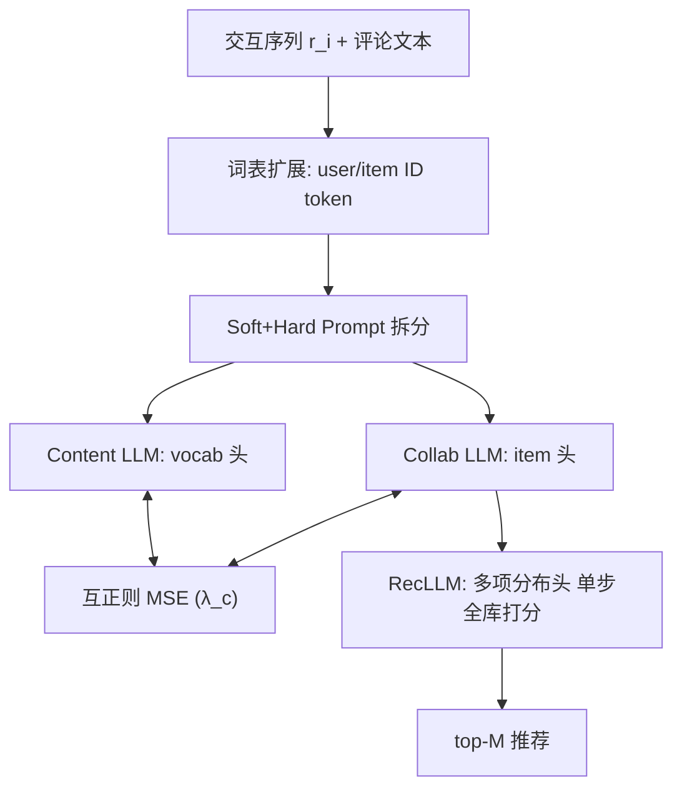
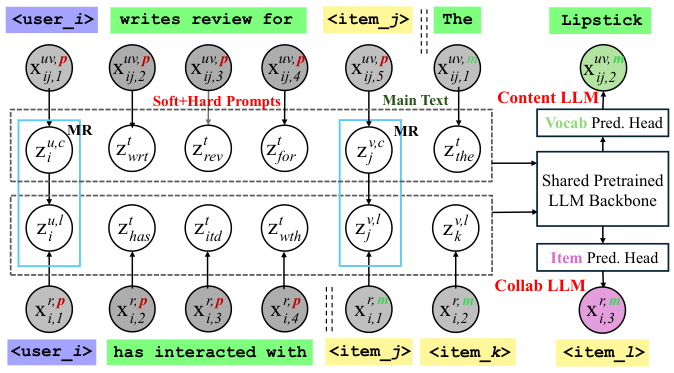

# Collaborative Large Language Model for Recommender Systems (协同大语言模型推荐系统)

- **会议/期刊**: WWW 2024
- **作者与机构**: Yaochen Zhu, Jundong Li (University of Virginia)；Liang Wu, Qi Guo, Liangjie Hong (LinkedIn)
- **推荐链路定位**: 端到端生成式（召回/直接推荐）
- **研究方向**: 大语言模型推荐 / 生成式推荐
- **论文原文**: [https://arxiv.org/abs/2311.01343v4](https://arxiv.org/abs/2311.01343v4)
- **开源代码**: [https://github.com/yaochenzhu/llm4rec](https://github.com/yaochenzhu/llm4rec)

## TL;DR (1分钟核心速览)

针对 LLM4Rec 中「自然语言 ↔ 用户/物品语义」的三重错配（伪 ID 被 tokenizer 拆碎引发伪相关、异构 token 语言建模不稳定、自回归逐条生成低效且易幻觉），CLLM4Rec 把 RS 的 ID 范式真正塞进 LLM：扩展词表注入 `<user_i>`/`<item_j>` 专属 token 并分别学习协同/内容两套嵌入，用软硬提示 + 互正则化预训练对齐二者，最后换成多项分布打分头做推荐微调。在 4 个公开数据集的 **Full-Ranking** 协议下，Recall@20 相对最强基线提升 7.0%–10.7%，NDCG@100 提升 3.1%–13.0%。

## Background & Motivation (背景与核心矛盾)

- **主流范式**: LLM4Rec 把交互与文本拼成自然语言 prompt 查询 LLM，再零样本或微调 T5/GPT 输出推荐，代表作为 P5、M6、TALLRec。
- **前人局限**: ① 伪 ID（`user_4332`）会被分词成 `["user","_","43","32"]`，让无关用户共享原子 token 产生伪相关；描述式索引又强行注入「内容相似即协同相似」的强归纳偏置。② 直接把数万随机初始化的 ID 嵌入混进 ~50k 词表做 LM，词表分布被稀释，训练不稳定；文本特征中大量与推荐无关的噪声也被 LLM 忠实拟合。③ 自回归逐条生成候选必须显式给出候选池，大候选池下延迟不可接受。
- **核心洞察 (Key Insight)**: 无论交互文档还是评论文档，都能拆成「异构 prompt（软 user/item token + 硬 vocab token）+ 同构正文（item token 序列或 vocab token 序列）」；只在同构正文上算 LM loss，就能让两个预测头各自专注协同/内容信号，稳定性与有效性同时提升。
- **本文切入点**: 用一组以协同嵌入为条件先验的内容嵌入把两个 LLM 用 MAP 互正则串起来，再用多项分布头替代自回归解码。

## Method (核心方法设计)

### 1. 整体框架 (Overall Architecture)

输入是用户交互序列 $\mathbf{r}_i$与用户/物品/评论文本；先扩充词表并初始化两套 token 嵌入；预训练阶段 Collaborative LLM 在物品序列上做 LM、Content LLM 在评论文本上做 LM，二者交替优化并互相施加 MSE 正则；微调阶段只保留协同主干，加一个与物品嵌入权重绑定的多项分布头，用 mask 后的交互 prompt 一次前向输出全库$J$个物品的概率；推理时取未交互物品的 top-$M$，无需候选池、无幻觉。

<figure class="paper-figure" markdown="span">
  <figcaption>图2：所提出的CLLM4Rec在相互正则化预训练阶段的概览。为简洁起见，省略了item_𝒌的相互正则化。</figcaption>
</figure>

### 2. 关键设计拆解 (Key Designs)

1. **ID token 词表扩展 + 条件先验双嵌入**：伪 ID 被拆碎、描述索引有偏，故为每个用户/物品插入不可拆分的 `<user_i>`（ID $N+i$）、`<item_j>`（ID$N+I+j$）。协同嵌入取无信息先验$\mathbf{z}^{l}\sim\mathcal{N}(\mathbf{0},\lambda_l^{-1}\mathbf{I}_K)$，内容嵌入取以其为均值的条件先验$\mathbf{z}^{c}\sim\mathcal{N}(\mathbf{z}^{l},\lambda_c^{-1}\mathbf{I}_K)$。该条件高斯在 MAP 下恰好退化为$\frac{\lambda_c}{2}\lVert\mathbf{z}^{c}-\mathbf{z}^{l}\rVert_2^2$的 MSE 项——「内容嵌入围绕协同嵌入波动」这一物理直觉，正是互正则的数学出处，同时可令$\lambda_l=0$ 丢掉先验。
2. **Soft+Hard Prompting + 交替 MAP 互正则**：协同侧只在 prompt `<user_i> has interacted with` 上算 KV、在 item token 正文上算 LM loss，物品头 $f_l(\mathbf{h})=\mathrm{softmax}(\mathbf{Z}^{l,v}\mathbf{h})$与物品嵌入绑定；内容侧对称，用 vocab 头与$\mathbf{Z}^{t}$绑定。L-step 目标为$\mathcal{L}^{\text{MAP}}_{l}=\sum_k-\ln p_{f_l}(\cdot)+\frac{\lambda_c}{2}\lVert\mathbf{z}^{l}_i-\hat{\mathbf{z}}^{c}_i\rVert_2^2+\frac{\lambda_c}{2}\sum_k\lVert\mathbf{z}^{l}_{i_k}-\hat{\mathbf{z}}^{c}_{i_k}\rVert_2^2$，C-step 对称固定协同侧。这样协同 LLM 借内容侧信息缓解交互稀疏过拟合，内容 LLM 被协同侧拉回「推荐相关」子空间滤除评论噪声。
3. **随机物品重排 + 面向推荐的微调**：交互顺序对直接推荐无意义，但位置编码会引入虚假时序相关，故在正文内随机置换 item token（prompt 固定）。微调时按 $100\times p_m\%$随机 mask 交互得$\mathbf{r}^{\text{masked}}_i$，构造 prompt `<user_i> has interacted with ... the user will interact with:`，目标为 multi-hot$\mathbf{r}^{\text{hold}}_i$，损失为多项 NLL：$\mathcal{L}_{\text{rec}}=-\sum_k r^{\text{hold}}_{ik}\ln\hat{r}^{\text{hold}}_{ik}+\text{MR}+\text{Prior}$，即只训练$I+J$个$K$ 维 token 嵌入与打分头，主干与词表嵌入全部冻结。

## Experimental Setup & Evaluation Protocol (实验设置与评估协议)

- **数据集与预处理**: 评分 >3 二值化为隐式反馈，二值化后保留 `5-core`；评论作 $\mathbf{x}^{uv}_{ij}$，LinkedIn 用用户 bio + 职位描述。

| 数据集 | #Users | #Items | #Interactions | 稀疏度 | 特征/场景说明 |
| :--- | :---: | :---: | :---: | :---: | :--- |
| AM-Beauty | 10,553 | 6,086 | 94,148 | 99.85% | 70,604 条评论 |
| AM-Toys | 11,268 | 7,309 | 95,420 | 99.88% | 70,784 条评论 |
| AM-Sports | 22,686 | 12,301 | 185,718 | 99.93% | 137,618 条评论 |
| Yelp | 28,330 | 18,775 | 292,017 | 99.94% | 224,825 条评论 |
| LinkedIn | 22,391 | 1,071 | 90,173 | 99.62% | 点击 + bio/职位描述 |

- **数据划分与防穿越 (Splitting Strategy)**: 用户内**比例划分** 80%/10%/10%（验证/测试各保证 ≥1 交互），非全局时间戳切分——存在轻微未来信息泄漏风险。
- **排名评测协议 (Ranking Protocol)**: 多项分布头在全部 $J$ 个物品上归一化，属无偏 `Full-Ranking (全库未交互排序)`；指标 Recall@20、Recall@40、NDCG@100（LinkedIn 为 Recall@10/20、NDCG@10）。未报告显著性检验。
- **对比基线与超参设置**: ID 类 Multi-VAE、MD-CVAE（+EASE、BPR 见附录）；LM 类 BERT4Rec、S3Rec；LLM 类 LLM-Scratch、LLM-CF、LLM-FtAll、LLM-FixOrd、LLM-PreRec；工业侧 Two-Tower、M6-Retrieval。GPT-2 主干 $K=768$、词表 50,257；$\lambda_c$ 网格搜索（峰值约 1）；预训练 100 epoch + 微调 150 epoch。

## Key Experimental Results (实验关键数据)

### 1. 主实验对比 (Main Results)

| 方法 | Beauty R@20 | Beauty N@100 | Toys R@20 | Toys N@100 | Sports R@20 | Sports N@100 | Yelp R@20 | Yelp N@100 |
| :--- | :---: | :---: | :---: | :---: | :---: | :---: | :---: | :---: |
| Multi-VAE | 0.1295 | 0.0835 | 0.1076 | 0.0781 | 0.0659 | 0.0446 | 0.0526 | 0.0424 |
| MD-CVAE | 0.1472 | 0.0976 | 0.1291 | 0.0844 | 0.0714 | 0.0514 | 0.0664 | 0.0497 |
| BERT4Rec | 0.1126 | 0.0781 | 0.0853 | 0.0532 | 0.0521 | 0.0305 | 0.0418 | 0.0361 |
| S3Rec | 0.1354 | 0.0867 | 0.1064 | 0.0665 | 0.0616 | 0.0438 | 0.0563 | 0.0485 |
| LLM-FtAll | 0.1335 | 0.0836 | 0.1162 | 0.0696 | 0.0794 | 0.0424 | 0.0653 | 0.0520 |
| LLM-PreRec | 0.1547 | 0.1051 | 0.1308 | 0.0874 | 0.0839 | 0.0561 | 0.0639 | 0.0498 |
| **CLLM4Rec** | **0.1656** | **0.1118** | **0.1436** | **0.0918** | **0.0926** | **0.0634** | **0.0735** | **0.0536** |
| Improv.% | +7.05% | +6.37% | +9.79% | +5.03% | +10.37% | +13.01% | +10.69% | +3.08% |

LinkedIn 线上口径离线评测：Two-Tower 0.1186 / M6-Retrieval 0.1279 / **CLLM4Rec-Emb（嵌入蒸馏回双塔）0.1302** / CLLM4Rec 0.1427（Recall@10），NDCG@10 依次 0.0979 / 0.1020 / 0.1034 / **0.1199**。

### 2. 消融实验 (Ablation Study)

| 变体 | Beauty R@20 | Beauty N@100 | Sports R@20 |
| :--- | :---: | :---: | :---: |
| w/o Content LLM & MR (LLM-CF) | 0.1319 | 0.0855 | 0.0642 |
| w/o 预训练主干 (LLM-Scratch) | 0.0840 | 0.0583 | 0.0362 |
| w/o 冻结主干 (LLM-FtAll) | 0.1335 | 0.0836 | 0.0794 |
| w/o 随机物品重排 (LLM-FixOrd) | 0.1524 | 0.1072 | 0.0901 |
| w/o 推荐微调 (LLM-PreRec) | 0.1547 | 0.1051 | 0.0839 |
| **CLLM4Rec (full)** | **0.1656** | **0.1118** | **0.0926** |

### 3. 关键实验发现 (Key Findings)

1. **互正则是真正的增益引擎**：剥掉 Content LLM 与 MR 后，LLM-CF 在 Toys/Sports 反而打不过纯 ID 的 Multi-VAE（0.1027 vs 0.1076、0.0642 vs 0.0659）；补回互正则后 Toys R@20 从 0.1027 跃至 0.1436（+39.8%），证明预训练语义必须被协同信号「校准」才能为推荐所用。
2. **冻结主干 > 全量微调，预训练知识是主红利**：全量微调 LLM-FtAll 在四个数据集全面落后（Beauty 0.1335 vs 0.1656），从头训练的 LLM-Scratch 最差（0.0840，仅约 full 的一半）——推荐语料规模不足以支撑整模型适配，只训 $I+J$ 个 token 嵌入是性价比最优解。
3. **两项「去伪」设计各贡献稳定一档**：移除随机重排后 Beauty NDCG@100 由 0.1118 跌至 0.1072（−4.1%）、Sports R@20 由 0.0926 跌至 0.0901；移除微调回退到 next-item 打分后 Beauty N@100 掉到 0.1051。此外 $\lambda_c$在 4 个数据集上一致于约 1 处取峰，$\lambda_c\to0$退化为 LLM-CF、$\lambda_c\gg1$ 时 MR 项压制 LM 学习。

## Highlights & Limitations (亮点、对比与审稿批判)

- **与代表作对比 (vs. Prior Work)**: P5/TALLRec 用伪 ID + 显式候选池，本文用真实不可拆 ID token 且全库打分；M6 用描述替代伪 ID 但仍受内容相似性偏置，本文用条件先验把内容嵌入锚定在协同嵌入上；MD-CVAE 用浅层词袋 VAE 融合文本，本文借冻结 LLM 的深层语义取得 6%–13% 的稳定领先。
- **可迁移亮点**: ① 「只在新 token 嵌入上算 loss + 冻结主干」是低成本 LLM4Rec 的通用范式；② 把「内容嵌入 = 协同嵌入 + 高斯噪声」写成条件先验，可复用到多模态/跨域对齐，用 MAP 直接导出 MSE 正则而无需调对比学习温度。
- **审稿级局限批判**: ① 用户内随机 80/10/10 划分而非时间切分，交互稀疏度 99.9% 下测试集物品可能出现在训练期，指标偏乐观且未做显著性检验；② 推理延迟仍高于双塔，论文自认「线上直接部署不可行」，只能靠 CLLM4Rec-Emb 蒸馏降级——而蒸馏版的 Recall@10 已从 0.1427 掉到 0.1302，生成式红利缩水过半；③ 附录显示 LLaMA-7B 在 Beauty/Sports 上反而弱于 GPT-2（0.1614 vs 0.1656），大主干在小数据上过拟合，方法对主干规模与训练稳定性（T5 因初始化方差大而训练不稳）较敏感。

## Rating (四维评分)

- **方法创新性 (Novelty)**: ⭐⭐⭐⭐ （首次把 ID token 与 LLM 词表真融合，条件先验导出互正则的推导干净且自洽）
- **评估协议与实验扎实度 (Protocol & Experiments)**: ⭐⭐⭐ （Full-Ranking 无偏、5 个数据集含工业数据，但随机划分无时序防穿越、未报告显著性检验）
- **写作与数学规范度 (Clarity & Rigor)**: ⭐⭐⭐⭐ （联合分布→交替 MAP→微调目标的推导链完整，$\lambda_l=0$ 等细节交代清楚）
- **工业落地与复现价值 (Industrial & Practical Value)**: ⭐⭐⭐⭐ （代码开源、LinkedIn 真实场景验证并给出可部署的嵌入蒸馏方案，但端到端在线延迟仍不达标）

