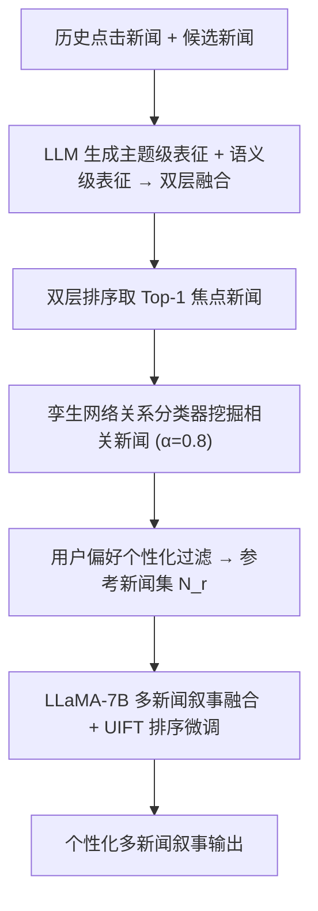

# Generative News Recommendation (生成式新闻推荐)

- **会议/期刊**: WWW 2024 (The Web Conference)
- **作者与机构**: Shen Gao、Jiabao Fang、Quan Tu、Zhitao Yao、Zhumin Chen、Pengjie Ren、Zhaochun Ren（山东大学、电子科技大学、中国人民大学、莱顿大学）
- **推荐链路定位**: 召回排序 + 端到端生成式重写（结果呈现层）
- **研究方向**: 大语言模型推荐 / 生成式推荐
- **论文原文**: [https://arxiv.org/abs/2403.03424v1](https://arxiv.org/abs/2403.03424v1)
- **开源代码**: [https://github.com/morganf33/GNR](https://github.com/morganf33/GNR)

## TL;DR (1分钟核心速览)

传统新闻推荐只在候选新闻与历史点击表征之间做语义匹配，既抓不住“梅西夺冠”这类需要常识推理的隐式主题关联，又只能把原文原样推给用户。GNR 用 LLM 生成主题级新闻/用户表征并与语义表征融合（双层表征），再经“排序→关系探索→个性化过滤”得到参考新闻集，最后由 LLaMA-7B 融合成个性化多新闻叙事，并用 UIFT 排序微调对齐用户兴趣。在 MIND 政治子集上，NDCG@5 相对提升 3.08%、MRR 提升 3.76%，UIFT 使叙事胜率达 74.54%。

## Background & Motivation (背景与核心矛盾)

- **主流范式**: NRMS、PLM4NR 等以预训练语言模型编码新闻标题/摘要，用户表征由历史点击新闻聚合得到，最终按内积分数对候选新闻排序并原样展示 Top-K 列表。
- **前人局限**: ① 仅建模显式语义相似度，无法识别“同一主题不同表述”的隐式关联（如“阿根廷夺冠”与“梅西封王”），此类关联依赖领域常识与多跳推理；② 推荐结果只能是语料库中既存文章的拷贝，用户须自行阅读多篇长文才能还原事件全貌，且不同兴趣用户拿到完全相同的内容。
- **核心洞察 (Key Insight)**: LLM 的内部常识与推理能力恰好可同时充当“主题级特征抽取器”与“多文档融合生成器”，把推荐对象从单篇新闻升级为“事件叙事”。
- **本文切入点**: 引入生成式新闻推荐范式：先检索一个“既个性化又相互关联”的参考新闻集，再生成围绕焦点新闻的连贯叙事。

## Method (核心方法设计)

### 1. 整体框架 (Overall Architecture)

输入为用户历史点击列表与候选新闻集：模块一用 ChatGPT 生成主题级新闻/用户表征，经多视图注意力与语义级表征融合为双层表征；模块二先以双层表征排序取 Top-1 作为焦点新闻，再用孪生网络关系分类器在全库中挖掘与之相关的新闻，随后以用户偏好对相关集做个性化过滤，得到参考新闻集 $N_r$；模块三用 LLaMA-7B 将$N_r$ 融合为以焦点新闻为主线的叙事，并通过 UIFT 排序微调使生成的叙事与用户兴趣对齐（推理时先检索后生成，两阶段串行）。

### 2. 关键设计拆解 (Key Designs)

1. **双层表征与多视图注意力融合**：语义级表征无法表达“主题相同而字面不同”的隐式关联，本文用 Prompt 让 LLM 输出不超过 5 词的主题标签（新闻侧）与“类别+主题”的用户画像描述（用户侧），再以类似 NAML 的注意力加权拼接两层嵌入：$e_d=\alpha'_s e_s+\alpha'_t e_t$。注意力权重让模型按样本自适应决定“字面语义”与“高层主题”谁主导，从而在不改主干网络的前提下注入 LLM 常识。
2. **关系探索 + 个性化过滤的两段式参考集构造**：Top-K 列表内部往往互不连贯，无法直接生成叙事。本文先取排序 Top-1 作为焦点新闻，用 SBERT 孪生网络以三元组损失 $L_{classify}=\max(\|e_i-e_j\|-\|e_i-e_k\|+\epsilon,0)$训练关系判别器，按阈值$\alpha=0.8$召回相关新闻；由于“相关≠感兴趣”，再用双层表征的内积$\hat{y}_i=e_{user_i}\cdot e_{rel_i}$筛出得分最高的$T-1$篇，与焦点新闻组成$N_r$。这样既保证叙事的事实连贯，又避免无关噪声稀释个性化。
3. **UIFT 用户兴趣对齐微调与训练/推理开销**：黑盒 LLM 的 in-context 能力不足以捕捉用户偏好。本文先以 ChatGPT 生成叙事做 SFT 蒸馏，再用序列平均对数似然 $p_i=\sum_t \log P_\pi(s_{i,t}|n,s_{i,<t})/\|s_i\|$衡量候选叙事（ChatGPT 版、GNR 版、焦点新闻原文）的生成概率，并以推荐模型打分给出偏好序$r_{GNR}<r_{ChatGPT}<r_{f}$，用成对排序损失$L_{rank}=\sum_{r_i<r_j}\max(0,p_i-p_j)$微调。核心直觉是：不需要额外人工标注，用现成推荐器作为“兴趣代理”提供弱监督信号，把生成模型的概率排序拉向用户偏好。排序阶段沿用负采样（随机取$K_{neg}$条未点击新闻）与对数似然损失训练；叙事生成仅对参考集（$2<T\le4$）做一次前向，主要开销来自 7B 模型解码。

## Experimental Setup & Evaluation Protocol (实验设置与评估协议)

- **数据集与预处理**: 从 MIND-Large 中筛出 politics 类目 5145 篇新闻构建语料；行为侧要求历史与候选新闻均属该子集，并额外约束 $5\le|H|\le15$；关系分类器训练数据由 CNN 站点的“相关新闻”链接爬取构造。

| 数据集 | #Users(行为数) | #Items | #Interactions | 稀疏度/密度 | 特征/场景说明 |
| :--- | :---: | :---: | :---: | :---: | :--- |
| MIND-Politics (推荐器) | 43,232 / 4,800 / 6,713 (train/valid/test) | 5,145 | 54,745 条行为 | 极稀疏（单类目小语料） | 标题+摘要+类目，$5\le\|H\|\le15$ |
| MIND-Politics (生成器) | 8,926 / 183 / 1,956 | 5,145 | 11,065 条样本 | 同上 | 焦点新闻 + ChatGPT 叙事对 |

- **数据划分与防穿越 (Splitting Strategy)**: 沿用 MIND 官方按时间戳切分的 train/valid/test 行为划分，再在子集上按上述条件过滤；用户历史严格取点击时刻之前的记录，生成器数据与推荐器数据分开构建，避免测试叙事泄漏。
- **排名评测协议 (Ranking Protocol)**: `Sampled Ranking`——按 MIND 原始候选列表（每样本约 5 条候选，1 正例 + 若干负例）打分，训练时另随机采样 $K_{neg}$ 条未点击新闻作负样本；指标为 AUC、MRR、NDCG@5。叙事质量用两项新指标：Win Rate（叙事得分超过焦点新闻的比例）与 Consistency Rate（由 gpt-3.5-turbo 判定叙事与参考集是否事实一致）。
- **对比基线与超参设置**: 基线为 NRMS、PLM4NR(title)、PLM4NR(title+abstract)；语义编码器用 DistilBERT 取 `[CLS]`，AdamW 优化器，推荐模型 lr=$1\times10^{-4}$，LLaMA-7B 的 SFT lr=$5\times10^{-5}$、UIFT lr=$1\times10^{-5}$，关系阈值$\alpha=0.8$；无显著性检验报告。

## Key Experimental Results (实验关键数据)

### 1. 主实验对比 (Main Results)

| 输入 (News/User) | NRMS (NDCG@5/AUC/MRR) | PLM4NR-title (NDCG@5/AUC/MRR) | PLM4NR-title+abs (NDCG@5/AUC/MRR) |
| :--- | :---: | :---: | :---: |
| Sem / Sem | 58.57 / 56.47 / 50.44 | 62.38 / 69.44 / 54.73 | 61.11 / 68.36 / 53.70 |
| Sem / Dual | 59.39 / 56.54 / 51.36 | 62.98 / 70.38 / 55.21 | 61.78 / 68.77 / 54.35 |
| Dual / Sem | 58.99 / 56.35 / 51.46 | 63.02 / 69.95 / 55.61 | 62.76 / 69.26 / 55.52 |
| Dual / Dual | **59.81 / 57.54 / 51.80** | **63.46 / 70.31 / 56.03** | **62.99 / 69.42 / 55.72** |
| Improv.% (PLM4NR-t+a) | — | +1.73 / +1.25 / +2.38 | +3.08 / +1.55 / +3.76 |

叙事融合（生成器对比）:

| 生成器 | Win Rate (%) | Consistency Rate (%) |
| :--- | :---: | :---: |
| ChatGPT (gpt-3.5-turbo) | 72.80 | **96.63** |
| GNR (仅 SFT) | 65.13 | 96.52 |
| GNR (UIFT) | **74.54** | 96.57 |

### 2. 消融实验 (Ablation Study)

以 NDCG@5 为核心指标（AUC 括号内）：

| 配置 | NRMS | PLM4NR-title | PLM4NR-t+a |
| :--- | :---: | :---: | :---: |
| w/o 主题级表征 (Sem/Sem) | 58.57 | 62.38 | 61.11 |
| w/o 主题级用户表征 (Dual/Sem) | 58.99 (56.35) | 63.02 (69.95) | 62.76 (69.26) |
| w/o 主题级新闻表征 (Sem/Dual) | 59.39 (56.54) | 62.98 (70.38) | 61.78 (68.77) |
| Full (Dual/Dual) | **59.81** (57.54) | **63.46** (70.31) | **62.99** (69.42) |
| w/o UIFT（叙事胜率） | — | 65.13（$-9.41$） | — |

其余超参敏感性：关系阈值 $\alpha\in\{0.6,0.7,0.8\}$时叙事一致性分别为 66/85/98；参考新闻最大条数$T_{max}=4$ 时胜率最优，过小信息不足、过大引入噪声。

### 3. 关键实验发现 (Key Findings)

- 双层表征的增益是“双向”的：新闻侧和用户侧各自注入主题信息都有效，但两侧同时注入才取得最优（PLM4NR-t+a 的 NDCG@5 从 61.11 升至 62.99，超过单侧最优的 62.76），说明隐式主题关联必须同时建模在“物品语义”与“用户画像”两端才能对齐。
- UIFT 是叙事能否真正个性化的分水岭：仅 SFT 蒸馏时 Win Rate 只有 65.13%，甚至低于直接调用 ChatGPT 的 72.80%；加入排序损失后升至 74.54%，同时一致性几乎不变（96.52→96.57），证明“对齐概率排序”不以牺牲事实性为代价。
- 参考新闻集的质量受关系阈值强支配：$\alpha$从 0.8 降到 0.6 时一致性从 98% 崩至 66%，作者归因为低相关参考集会诱发幻觉；而$T_{max}$ 存在明显倒 U 形最优（4 篇），说明生成式推荐的有效信息窗口很窄。

## Highlights & Limitations (亮点、对比与审稿批判)

- **与代表作对比 (vs. Prior Work)**: 相比 NRMS/PLM4NR 这类纯语义匹配模型，GNR 不改主干却通过 LLM 主题表征引入常识推理；相比 Wang & Lim 式的“LLM 直接 prompting 做推荐”，它把 LLM 用作特征增强器与生成器而非排序器，规避了 LLM 缺少推荐任务训练的性能缺口；相比 Chat-REC 把 LLM 当系统控制器，GNR 把 LLM 当内容生产者，推荐结果发生了“形态升级”。
- **可迁移亮点**: ① “LLM 主题标签 + 注意力加权的双层表征”可零成本插入任意双塔召回，只需一次离线 Prompt 调用；② UIFT 用现成推荐器打分构造偏好序、再做成对排序微调的思路，可迁移到任意生成式推荐/解释生成任务，免人工标注。
- **审稿级局限批判**: ① 评测自洽性存疑——Win Rate 由被改进的基线 PLM4NR 打分，Consistency Rate 由 ChatGPT 判定而生成器之一也是 ChatGPT，存在循环评估与自我偏好风险，且无人工一致性校验的规模说明；② 场景极窄且系统开销大：仅在 5145 篇 politics 新闻上验证，参考集依赖爬取的“相关新闻”才可构造，7B 模型逐样本解码 + 两阶段检索难以支撑线上毫秒级响应，论文亦未报告延迟与 A/B 数据。

## Rating (四维评分)

- **方法创新性 (Novelty)**: ⭐⭐⭐⭐ （首次把新闻推荐目标从“选文章”改写为“生成事件叙事”，双层表征与 UIFT 排序微调的组合有新意，但各组件本身多为已有技术的重新拼装）
- **评估协议与实验扎实度 (Protocol & Experiments)**: ⭐⭐⭐ （消融、阈值与 $T_{max}$ 敏感性做得完整，但只在单一类目小语料上做采样排序评估，缺显著性检验、缺全库排序与线上验证）
- **写作与数学规范度 (Clarity & Rigor)**: ⭐⭐⭐⭐ （三模块流程与公式定义清晰，UIFT 的概率-偏好序映射交代到位；关系分类器与参考集构造的细节充分，但对负采样规模等超参披露不足）
- **工业落地与复现价值 (Industrial & Practical Value)**: ⭐⭐⭐ （代码已开源、双层表征可低成本落地，但 7B 生成器、两阶段串行推理与关系分类器冷启动成本限制了真实业务部署）

