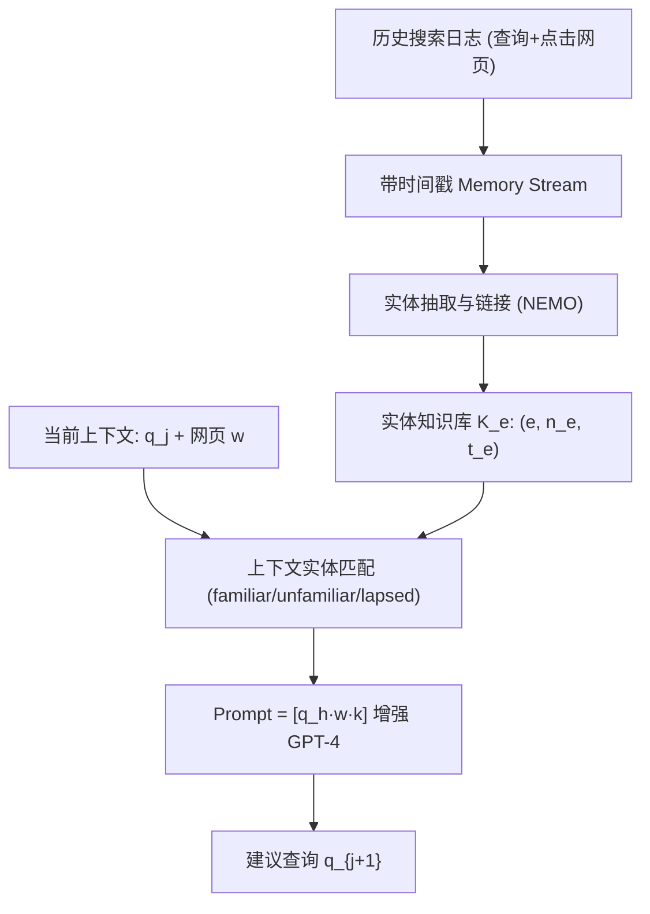
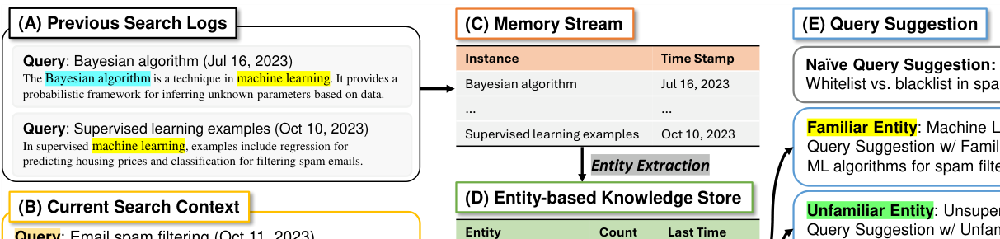

# Knowledge-Augmented Large Language Models for Personalized Contextual Query Suggestion (知识增强大语言模型的个性化上下文查询建议)

- **会议/期刊**: WWW 2024 (The Web Conference)
- **作者与机构**: Jinheon Baek (KAIST, 实习期间于 Microsoft Research)、Nirupama Chandrasekaran、Silviu Cucerzan、Allen Herring、Sujay Kumar Jauhar (Microsoft Research)
- **推荐链路定位**: 召回侧查询建议 / LLM 提示增强式端到端生成
- **研究方向**: 大语言模型推荐 (LLM4Rec) / 序列与会话推荐
- **论文原文**: [论文原文链接](https://arxiv.org/abs/2311.06318v2)
- **开源代码**: 暂未开源

## TL;DR (1分钟核心速览)

LLM 无法针对单个用户重训/微调，而历史交互线性拼接进 Prompt 又冗长且噪声大；本文提出 K-LaMP，用现成实体链接器把用户搜索日志中的实体抽取并聚合为**轻量实体中心个人知识库**，再按 familiar、unfamiliar、lapsed 三种视图检索实体注入 Prompt，完成新任务「上下文查询建议」(给定当前查询 q_j 与正在浏览的网页 w 预测下一查询 q_{j+1})。在 Bing 三个月真实日志（1000 用户 × 平均 493 条查询）上以 12 名标注员、5236 条人工打分为评估协议，K-LaMP 相对最强 LLM 基线在 Relatedness/Usefulness 上分别提升 16.9%/16.9%，Ranking 位次由 2.415 降至 2.160。

## Background & Motivation (背景与核心矛盾)

- **主流范式**: LLM 个性化主流是 in-context learning——把用户历史交互序列线性塞入 Prompt，或从完整交互记忆中检索相似记录、做摘要/关键词抽取。
- **前人局限**: ①线性记忆随历史增长会撑爆 Prompt 窗口，且并非所有历史都与当前意图相关；②纯交互序列只建模"兴趣"，不建模"用户知道什么/熟悉到什么程度"，无法区分专家与新手面对同一网页时该问什么。
- **另一条路的问题**: 深描用户画像 (deep user profile) 虽能建模知识，但需在线建模、侵犯隐私且与现有日志基础设施不兼容。
- **核心洞察 (Key Insight)**: 实体是"兴趣 + 知识"的天然原子：出现频次刻画熟悉度、时间戳刻画记忆衰减、公开知识图谱上的投影可在既有日志上低成本聚合，且 Prompt 增量远短于原文网页。
- **本文切入点**: 不做画像、不改 LLM 参数，只把搜索日志投影成以实体为原子的个人知识库，并设计上下文相关的实体检索策略来增强 Prompt。

## Method (核心方法设计)

### 1. 整体框架 (Overall Architecture)

输入为用户当前查询 $q_j$、正在浏览的网页正文$w$与历史查询序列$\boldsymbol{q}_h$；系统先将过去所有查询与点击网页按时间戳写入 memory stream，经 NEMO 实体链接器抽取并规范化实体，聚合为带频次与最近出现时间的实体中心知识库$\mathcal{K}_e$；推理时以$[q_j \oplus w]$中出现的实体为查询键，按三种匹配视图从$\mathcal{K}_e$采样 5 个实体，线性化为文本$\boldsymbol{k}$ 拼入 Prompt，交由冻结的 GPT-4 自回归生成建议查询。整个链路只依赖既有日志与一个实体链接器，无需微调。

<figure class="paper-figure" markdown="span">
  <figcaption>图2：K-LaMP概览。系统输入为(A) 先前的搜索日志和(B) 用户的当前搜索上下文，后者由查询和关联网页组成。(C) 每条搜索记录连同时间戳存储在记忆流中。(D) 基于实体的知识库通过聚合从记忆流中提取的实体构建。(E) K-LaMP利用从基于实体的个人知识库中检索到的实体进行增强，生成与用户知识和兴趣相符的查询建议。</figcaption>
</figure>

### 2. 关键设计拆解 (Key Designs)

1. **实体中心个人知识库 $\mathcal{K}_e$（把日志投影成可聚合的知识原子）**：线性记忆无法在线聚合，长网页还会引入多主题噪声并抬高 token 成本。本文用实体三元组$\mathcal{K}_e=\{(e,n_e,t_e)\}$表示，$n_e$为实体在用户全历史中出现的累计次数、$t_e$ 为最近出现时间；由于实体被投影到 Wikipedia 子图，天然支持 k-匿名与"按需删除实体即完成遗忘"。直觉：频次即熟悉度、时间即记忆强度，两个标量就把"知识画像"压缩成可 O(1) 更新的稀疏表。

2. **三视图实体检索策略（决定"喂哪些知识"）**：向量相似度检索 (Contriever) 在 $\mathcal{K}_s$上相关性仅 0.299，因为模糊匹配会引入语义相近但用户并不关心的噪声。本文改为对上下文实体集合$\mathcal{E}_{[q_j\oplus w]}$ 精确匹配后按不同打分采样：
$$s_{\text{fam}}(e)=n_e,\qquad s_{\text{unf}}(e)=-n_e,\qquad s_{\text{lap}}(e)=n_e\ \ \text{s.t.}\ \ t_e<T_{\text{now}}-14\text{d}$$
分别对应"巩固已知""引导探索""唤回遗忘"三种推荐意图；精确匹配使检索相关性升至 0.810–0.936，且注入的 $\boldsymbol{k}$ 只有实体串，Prompt 增量极小。

3. **训练目标、负采样与推理开销**：本文**完全无训练**——LLM 参数冻结、无负采样、无 BPR/InfoNCE 类损失，全部"学习"发生在推理时的检索构造上：
$$\hat{q}_{j+1}=\text{LLM}_\theta\big(\,\text{Prompt}(q_j,\ w,\ \boldsymbol{k})\,\big),\quad \boldsymbol{k}=\text{Retrieve}(\mathcal{K}_e,\ q_j\oplus w)$$
在线开销为一次实体链接（数千 token/秒）+ 一次稀疏表匹配 + 一次 GPT-4 调用（temperature 0.7, top_p 0.95），无梯度回传；代价是每会话都要付 LLM 推理费用。

## Experimental Setup & Evaluation Protocol (实验设置与评估协议)

- **数据集与预处理**: Bing 真实日志（2023.05.01–07.31）。过滤规则：仅保留有点击的会话；仅保留 Wikipedia 与 500 个高流量新闻站（以契合 Wikipedia 链接器）；剔除三个月内页面访问 <100 的轻度用户；企业级隐私过滤（查询至少被 50 人发出）。最终随机采样 1000 用户构成基准。

| 数据集 | #Users | 平均查询/用户 | 平均会话/用户 | 平均点击网页/用户 | 平均实体/用户 |
| :--- | :---: | :---: | :---: | :---: | :---: |
| Bing Search Logs (采样) | 1,000 | 493 | 109 | 177 | 3,053 |

- **数据划分与防穿越 (Splitting Strategy)**: 采用**全局时间戳切分**的变体——每个用户最近的 10 个 session 作为测试目标，其余更早 session 全部用于构建 $\mathcal{K}_s$与$\mathcal{K}_e$，严格避免未来交互泄漏进知识库。
- **排名评测协议 (Ranking Protocol)**: 非 Full-Ranking、非采样排序，而是**人工评分 + 人工排序**：3 点 Likert（0/1/2）打 Validness、Relatedness、Usefulness，另给 4 个系统输出做点击倾向排序 (Ranking，越小越好)。12 名标注员（第三方 vendor，$11.98/小时）标注 1,309 组上下文、共 5,236 条单查询判断；27% 数据双标，Cohen's kappa 0.606/0.652/0.622，Ranking 的 Spearman 0.654。
- **对比基线与超参设置**: 全部基线共用同一 GPT-4（2023-06-13 版）以保证公平——Query Suggestion（仅同会话历史查询）、Contextual Query Suggestion（+网页 w）、Contextual QS w/ $\mathcal{K}_s$（+线性历史检索）、K-LaMP（+实体知识库）。未纳入 RNN/BART 类传统方法，理由是它们无法处理网页长上下文且需任务训练数据。

## Key Experimental Results (实验关键数据)

### 1. 主实验对比 (Main Results)

| 模型类型 | Validness↑ | Relatedness↑ | Usefulness↑ | Ranking↓ |
| :--- | :---: | :---: | :---: | :---: |
| Query Suggestion | 1.769 | 0.962 | 0.948 | 2.736 |
| Contextual Query Suggestion | **1.966** | 1.267 | 1.245 | 2.415 |
| Contextual QS w/ $\mathcal{K}_s$ | 1.822 | 1.192 | 1.166 | 2.654 |
| **K-LaMP (Ours)** | **1.966** | **1.482** | **1.455** | **2.160** |
| Improv. vs 最强基线 | 0.0% | **+16.9%** | **+16.9%** | **−10.6%** |

**检索质量对照（Table 3，人工判定是否与当前上下文相关）**: $\mathcal{K}_s$的 Contriever 检索仅 0.299；$\mathcal{K}_e$ 的 familiar/unfamiliar/lapsed 实体匹配分别为 0.936/0.810/0.849——精确实体匹配比稠密向量检索高出 2.7–3.1 倍。

### 2. 消融实验 (Ablation Study)

| 配置 | Validness↑ | Relatedness↑ | Usefulness↑ |
| :--- | :---: | :---: | :---: |
| Contextual QS（无检索） | 1.966 | 1.267 | 1.245 |
| K-LaMP w/ Familiar only | ≈1.97 | 略低于全量 | 略低于全量 |
| K-LaMP w/ Unfamiliar only | ≈1.97 | **最高** | **最高** |
| K-LaMP w/ Lapsed only | ≈1.97 | 居中 | 居中 |
| K-LaMP w/ All Entities | 1.966 | 1.482 | 1.455 |

（消融在 313 个上下文上做人工评测，Validness 对知识注入方式几乎不敏感。）

### 3. 关键实验发现 (Key Findings)

1. **线性历史增强反而有害**：$\mathcal{K}_s$ 变体把 Relatedness 从 1.267 拉到 1.192、Ranking 从 2.415 退化到 2.654，与其检索相关性仅 0.299 相印证——噪声上下文会"污染"LLM，说明实体聚合带来的收益主要来自**检索精度**而非"更多信息"。
2. **知识库随时间复利增长**：把记忆规模从 1×150 扩到 5×150 条历史查询，只有 K-LaMP 在 Relatedness/Usefulness 上单调上升，其余基线持平或抖动；这直接归因于实体知识库的频次聚合机制，线性拼接则无此累积效应。
3. **轻量表示可替代大模型能力**：GPT-3.5-Turbo + K-LaMP 的 Usefulness 达 1.303，几乎追平 GPT-4 + Contextual QS 的 1.313，说明"喂对实体"比"换更强底座"更划算；同时 unfamiliar-only 变体超过全量实体，提示当前标注偏好"探索型"建议，但也暴露了评估目标与真实用户意图（研究/复习/探索）可能不一致。

## Highlights & Limitations (亮点、对比与审稿批判)

- **与代表作对比 (vs. Prior Work)**: 相比线性注入交互序列的 LLM 个性化工作（如 P5/序列化推荐类），本文从"序列"转向"实体集合"，把上下文长度从网页级降到实体串级；相比 deep profile 路线，避免在线用户建模；相比传统 context-aware query suggestion（只用 query–page title 表层关联），本文首次把**网页正文 + 用户知识水平**同时纳入条件，并提出全新任务定义。
- **可迁移亮点**: ①"实体频次 + 最近时间戳"两标量即可构造可遗忘、可 k-匿名的轻量画像，可直接迁移到电商类目偏好或短视频兴趣建模；②精确实体匹配替代向量检索的思路，可缓解 LLM4Rec 中 RAG 注入噪声的问题。
- **审稿级局限批判**: ①**评估完全依赖人工**，无线上 A/B、无公开数据与代码，1,309 组样本由第三方标注员（非真实用户本人）打分，个性化判断存在系统性偏差；②自动指标尝试失败（Usefulness 与人工 Spearman 仅 −0.016，Validity/Relatedness 仅 0.445/0.397），可扩展性存疑；③数据强依赖 NEMO + Wikipedia 与"仅维基/新闻站"过滤，跨域（电商、视频）泛化未验证；④线上成本为每次建议一次 GPT-4 调用，冷启动用户（无历史实体）退化为普通上下文建议。

## Rating (四维评分)

- **方法创新性 (Novelty)**: ⭐⭐⭐⭐ （把"用户知识"操作化为实体频次/时间的稀疏表，三视图检索思路清晰且具推荐语义，但整体是检索增强 LLM 的工程组合，缺乏理论分析）
- **评估协议与实验扎实度 (Protocol & Experiments)**: ⭐⭐⭐ （时间戳切分严谨、kappa 与 Spearman 报告完整、消融与规模分析齐全，但纯人工评测、无 A/B、自动指标几乎失效，复现门槛高）
- **写作与数学规范度 (Clarity & Rigor)**: ⭐⭐⭐⭐ （任务定义与检索策略公式化清楚，实体采样细节（Top-5、两周窗口）可落地；但形式化较浅，缺少检索召回率/延迟的定量分析）
- **工业落地与复现价值 (Industrial & Practical Value)**: ⭐⭐⭐ （复用既有日志与现成链接器、无需训练、支持实体级删除，工程友好；但未开源、依赖私有 Bing 日志与 GPT-4 成本，线上部署需额外延迟预算）

