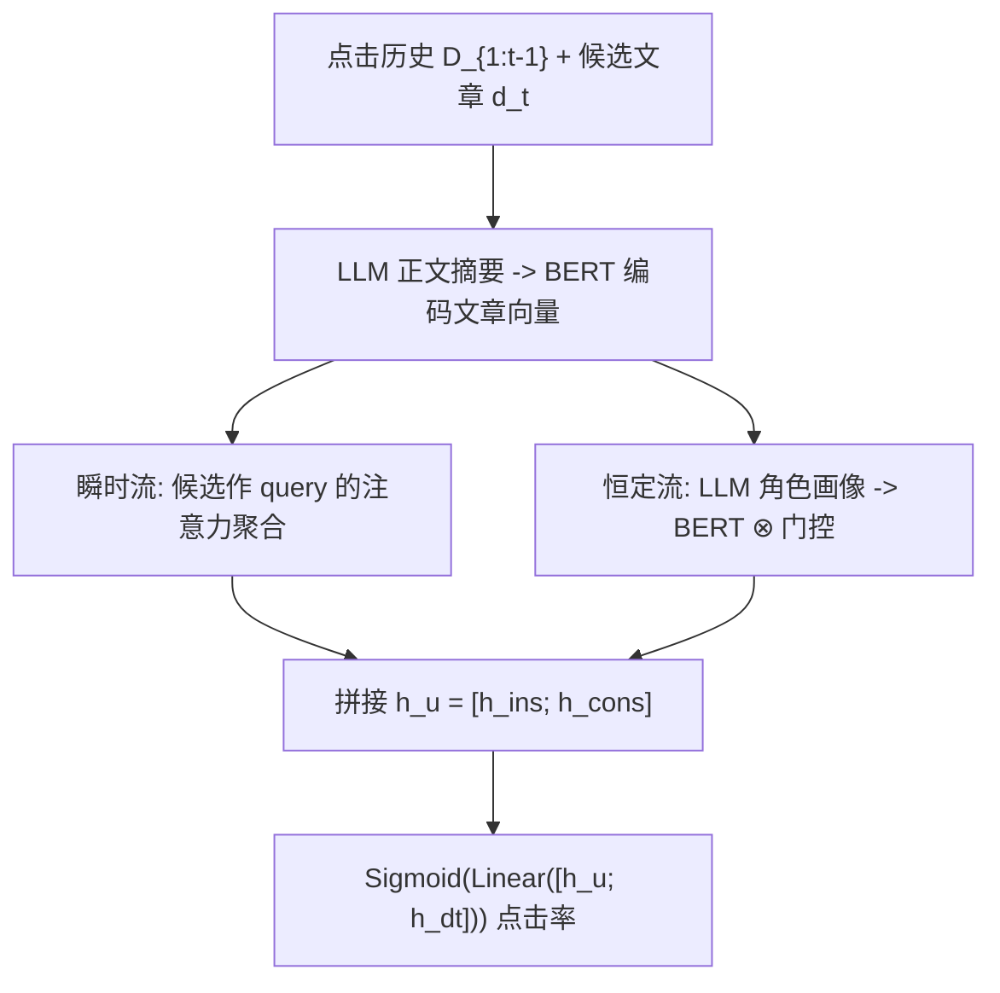
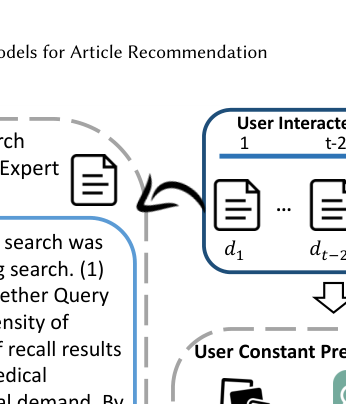

# Modeling User Viewing Flow Using Large Language Models for Article Recommendation (用大语言模型建模用户观看流做文章推荐)

- **会议/期刊**: WWW 2024 (WebConf)
- **作者与机构**: Zhenghao Liu, Yu Gu, Ge Yu (东北大学) ; Zulong Chen, Moufeng Zhang, Shaoyang Duan, Liangyue Li, Nan Li (阿里巴巴)
- **推荐链路定位**: 精排 / 候选重排（线上以 RRSS 重排服务形式落地）
- **研究方向**: 大语言模型推荐 (LLM4Rec) / 序列与会话推荐
- **论文原文**: [https://arxiv.org/abs/2311.07619v2](https://arxiv.org/abs/2311.07619v2)
- **开源代码**: 暂未开源（文中给出的 https://github.com/THUDM/ChatGLM-6B 仅为所用 LLM 底座）

## TL;DR (1分钟核心速览)

长文推荐的两难是：文章正文动辄数千字，BERT 截断只能吃标题，语义被截肢；而用户兴趣既有稳定的岗位/技能画像，又有随时漂移的即时兴趣，单一注意力把两者揉在一起。SINGLE 用 LLM 做两件事——把正文摘要成短段落、把点击历史归纳成"用户角色"文本画像，再用候选文章作 query 对历史做注意力"瞬时读"。在 ATA 与 MIND 上以 AUC/MRR/nDCG 全面超越 6 个基线（MIND nDCG@10 相对 NRMS +3.7%），ATA 线上 A/B 的 UVCTR 相对 DCN 提升 2.4%。

## Background & Motivation (背景与核心矛盾)

- **主流范式**: 新闻/文章推荐主流把任务视作序列推荐，用 CNN/自注意力编码标题得到文章向量，再用用户 ID 个性化注意力聚合点击历史（NPA/NAML/NRMS），工业侧常用 DCN/DIN 类特征交叉模型。
- **前人局限**: ① 预训练语言模型的长度上限迫使模型**丢弃正文只用标题**，而技术文章的正文才承载关键语义，一旦点击序列含噪就无从纠正；② 用户兴趣被压缩成**单一向量**，无法同时表达"长期岗位画像"与"当期话题漂移"，导致推荐要么千篇一律要么追热点失焦。
- **核心洞察 (Key Insight)**: 作者在 ATA 上抽样发现用户点击主题呈"双峰"结构——大量点击集中在与其岗位/技能（前端架构、服务端、运维高可用）一致的主题（恒定兴趣），同时掺入少量异质主题（即时兴趣）；图 3 与图 4 进一步显示恒定表示与历史文章的相似度曲线平稳，而即时表示只与少数近期文章高度相似。
- **本文切入点**: 把这两种观看行为显式拆成两条支路：恒定流交给 LLM 生成自然语言画像，瞬时流交给候选感知的注意力，再以门控融合。

## Method (核心方法设计)

### 1. 整体框架 (Overall Architecture)

离线阶段先用 LLM 对每篇文章正文生成约 200 词摘要（ATA 平均 3902 字 → 260 字），把「标题 + 摘要 + 作者属性」三段拼接后经**冻结的 BERT** 与随机初始化属性嵌入编码成文章向量；在线/训练时，给定用户点击流 $D_{1:t-1}$与候选文章$d_t$，恒定支路让 LLM 依据用户的岗位、技能提示把历史摘要成一段画像文本并编码，瞬时支路以候选文章为 query 对历史文章做 softmax 注意力加权求和，两路拼接后与候选文章向量一起送入线性层 + Sigmoid 输出点击概率，交叉熵端到端训练 BERT 之上的可训练层。

<figure class="paper-figure" markdown="span">
  <figcaption>图2：我们的用户观看流建模（SINGLE）方法的框架。</figcaption>
</figure>

### 2. 关键设计拆解 (Key Designs)

1. **LLM 长文摘要替代截断（解决正文语义丢失）**: 痛点是用 BERT 只能喂标题，正文信息被丢弃。本文用指令 $d_i^{b*}=\mathrm{LLM}(\text{instruct}_s, d_i^{t}, d_i^{b})$把正文压成短摘要，文章表示为三段拼接$h_{d_i}=[h^{a}_{d_i};h^{t}_{d_i};h^{b*}_{d_i}]$，其中$h^{t}_{d_i}=\mathrm{Linear}(\mathrm{BERT}(d^t_i))$ 且 BERT 冻结。直觉：摘要保留主题与关键词而非逐字文本，使同一编码器能在长度预算内"看见"正文，同时把 LLM 调用全部推到离线，线上零额外开销。

2. **恒定观看流：用 LLM 当"用户角色"归纳静态画像**: 若直接从历史池化，噪声主题会被平均进用户向量。本文用角色化提示 $u^{cons}_t=\mathrm{LLM}(\text{instruct}_u, D_{1:t-1})$（模板里显式注入岗位与技能）生成画像文本，并以**门控**而非拼接注入候选：$h^{cons}_{u_t}=\mathrm{BERT}(u^{cons}_t)\otimes h_{d_t}$。物理直觉是 LLM 的自然语言先验天然过滤掉与岗位无关的离群点击，而逐元素乘让画像只调制候选向量中与其一致的语义维度。

3. **瞬时观看流与训练目标**: 即时兴趣用候选感知注意力建模，$\alpha_i=\mathrm{softmax}_i\!\left(h_{d_t}W h_{d_i}^{\top}\right)$，$h^{ins}_{u_t}=\sum_{i=1}^{t-1}\alpha_i h_{d_i}$；用户表示为$h_{u_t}=[h^{ins}_{u_t};h^{cons}_{u_t}]$。最终$P(y=1)=\sigma(\mathrm{Linear}([h_{u_t};h_{d_t}]))$，损失为标准交叉熵$\mathcal{L}=\mathrm{CE}(y^*,P)$。训练采用 batch 512、Adam、lr 1e-5、dropout 0.1，约 60 万步早停；负采样策略未在文中披露（仅二分类点击监督），推理时 LLM 摘要与画像均可离线缓存，在线仅做向量内积与浅层 MLP。

## Experimental Setup & Evaluation Protocol (实验设置与评估协议)

- **数据集与预处理**: 使用 ATA（阿里技术协会内部技术文章平台，中文技术博客，含作者岗位/技能属性）与 MIND（微软新闻，英文，官方小样本版本）。

| 数据集 | #Users | #Items | #Interactions(Train) | Test | 特征/场景说明 |
| :--- | :---: | :---: | :---: | :---: | :--- |
| ATA | 44,758 | 146,219 | 9,196,714 | 52,583 | 技术文章，含岗位/技能/部门属性；平均正文 3,902 字→摘要 260 字 |
| MIND | 2,000 | 6,444 | 24,140 | 2,800 | 英文新闻，仅用标题+摘要+类别 |

- **数据划分与防穿越 (Splitting Strategy)**: 沿用新闻推荐的**按用户点击日志的时间顺序切分**（历史为输入、下一篇文章为目标，训练/测试按样本切分，非随机打乱），符合 next-article 预测设定；但论文未给出显式的全局时间戳边界说明。
- **排名评测协议 (Ranking Protocol)**: 报告 AUC（点击率区分度）与 MRR、nDCG@5、nDCG@10（列表排序质量）；**负采样比例与候选集构造未披露**，属本文评估协议的最大不透明点；线上另用 UVCTR $=\frac{\#\text{点击用户}}{\#\text{访问 ATA 首页用户}}$ 作业务指标。
- **对比基线与超参设置**: 基线覆盖特征交叉类（DCN、DIN）与个性化新闻推荐类（NPA、NAML、NRMS）以及隐私联邦类（FedRec）；BERT 采用中文 tiny 句向量 checkpoint 并冻结，MIND 用 gpt-3.5-turbo、ATA 用 ChatGLM-6B（合规考虑）。

## Key Experimental Results (实验关键数据)

### 1. 主实验对比 (Main Results)

| Model | ATA AUC | ATA MRR | ATA nDCG@5 | ATA nDCG@10 | MIND AUC | MIND MRR | MIND nDCG@5 | MIND nDCG@10 |
| :--- | :---: | :---: | :---: | :---: | :---: | :---: | :---: | :---: |
| DCN | 67.69 | 40.81 | 50.48 | 61.01 | 63.43 | 40.40 | 47.56 | 57.67 |
| DIN | 67.19 | 39.90 | 49.30 | 60.30 | 63.01 | 40.94 | 47.56 | 58.44 |
| NPA | 67.05 | 39.55 | 49.04 | 59.96 | 61.22 | 38.69 | 43.27 | 55.72 |
| NAML | 66.85 | 39.22 | 48.60 | 59.61 | 64.30 | 41.12 | 48.06 | 58.12 |
| NRMS | 67.28 | 40.11 | 49.45 | 60.47 | 64.75 | 41.69 | 48.16 | 58.80 |
| FedRec | 66.95 | 39.58 | 48.83 | 59.89 | 63.02 | 41.66 | 47.80 | 58.65 |
| **SINGLE** | **68.06** | **41.01** | **50.40** | **61.28** | **66.50** | **44.22** | **52.26** | **60.97** |
| Improv. (vs best base) | +0.55% | +0.49% | — | +0.44% | +2.70% | +6.07% | +8.51% | +3.69% |

> 注：ATA 上 nDCG@5 最优基线为 DCN 的 50.48，SINGLE 因四舍五入后同值略低，属持平；线上 A/B（7 天，各模型约 1/2 流量）UVCTR 相对 DCN **平均 +2.4%**。

### 2. 消融实验 (Ablation Study)

| 变体 | AUC | MRR | nDCG@5 | nDCG@10 | ΔAUC |
| :--- | :---: | :---: | :---: | :---: | :---: |
| SINGLE (full) | **68.06** | **41.01** | **50.40** | **61.28** | — |
| w/o Summarized Bodies | 66.92 | 39.39 | 48.52 | 59.56 | -1.14 |
| w/o Instant Flow | 67.19 | 40.11 | 49.01 | 60.45 | -0.87 |
| w/o Constant Flow | 67.12 | 39.86 | 48.83 | 60.20 | -0.94 |
| w/o Flow Gate | 67.07 | 39.84 | 48.78 | 60.13 | -0.99 |
| w/o $\text{Instruct}_u$ | 67.18 | 39.86 | 49.04 | 60.18 | -0.88 |

### 3. 关键实验发现 (Key Findings)

1. **正文摘要贡献最大**：去掉 LLM 摘要后 AUC 掉 1.14、nDCG@10 掉 1.72，是五个消融中最大跌幅，说明在技术文章场景"能用正文"比任何注意力结构改良都更值钱——这直接反驳了新闻推荐"标题即足够"的默认假设。
2. **两路观看流互补而非冗余**：单独去掉恒定流或瞬时流分别掉 0.94 / 0.87 AUC；案件分析显示瞬时注意力能把权重集中到"BERT 相关性模型"(20.2)与"Prompt 工程"(29.9)等少数近期文章，从而在话题漂移时仍排对目标文章，而恒定流保证推荐结果不丢失与岗位一致的扩散模型类文章。
3. **LLM 画像的作用主要来自角色提示而非编码器**：去掉 $\text{Instruct}_u$ 与去掉整条恒定流的损失几乎相同（67.18 vs 67.12），说明收益几乎全部来自"岗位/技能模板"这一先验注入；同时恒定性来自门控融合（去掉门控掉 0.99，甚至略大于去掉恒定流），表明"如何注入"比"是否注入"更敏感。

## Highlights & Limitations (亮点、对比与审稿批判)

- **与代表作对比 (vs. Prior Work)**: 相比 NPA/NRMS 把用户压成单向量、只用标题，SINGLE 用 LLM 解决长文并显式解耦两种兴趣；相比 DIN 的局部激活单元，其注意力被"候选感知"复用但同时保留了一条不随候选漂移的画像支路；相比 TALLRec 等把 LLM 直接当推荐器，本文仅把 LLM 当**离线特征/画像生成器**，工程上更易落地。
- **可迁移亮点**: ① "LLM 离线摘要 + 冻结小模型在线编码"是长文本推荐极低成本的通路，可直接迁移到长文电商详情、技术文档、法律条文推荐；② 用角色模板（岗位/技能/会员等级）约束 LLM 画像，再以逐元素门控注入候选向量，是可复用的画像融合算子。
- **审稿级局限批判**: ① 评估协议不透明——负采样比例、候选集规模、显著性检验均未报告，AUC/MRR 与 nDCG 混报且 nDCG 提升幅度小于 AUC，存在候选集构造影响结论的风险；② LLM 依赖性强：摘要质量、提示模板、底座模型（ChatGLM-6B vs gpt-3.5-turbo）在不同数据集上不一致，缺少对摘要长度（200/150 词）与提示变体的敏感性分析；③ 线上仅与 DCN 单基线对比 7 天，2.4% UVCTR 提升未给置信区间，且 ATA 用户规模与内容域较窄，外推性存疑。

## Rating (四维评分)

- **方法创新性 (Novelty)**: ⭐⭐⭐ （"恒定流/瞬时流"解耦本身在新闻推荐中已有影子，真正的新意是把 LLM 摘要与角色画像嵌入传统排序器，属工程化增量创新而非理论突破）
- **评估协议与实验扎实度 (Protocol & Experiments)**: ⭐⭐⭐ （双数据集 + 线上 A/B + 消融 + 案例分析齐全，但负采样与候选集协议缺失、无显著性检验，nDCG 增益偏薄）
- **写作与数学规范度 (Clarity & Rigor)**: ⭐⭐⭐⭐ （公式简洁、注意力与门控定义清楚，图示直观；但符号在同一文中复用较多，超参搜索与复杂度分析缺失）
- **工业落地与复现价值 (Industrial & Practical Value)**: ⭐⭐⭐⭐ （LLM 全部离线、线上只做浅层打分，已在阿里 ATA 真实流量验证 2.4% UVCTR；未开源代码，复现需自建提示模板与摘要流水线）

