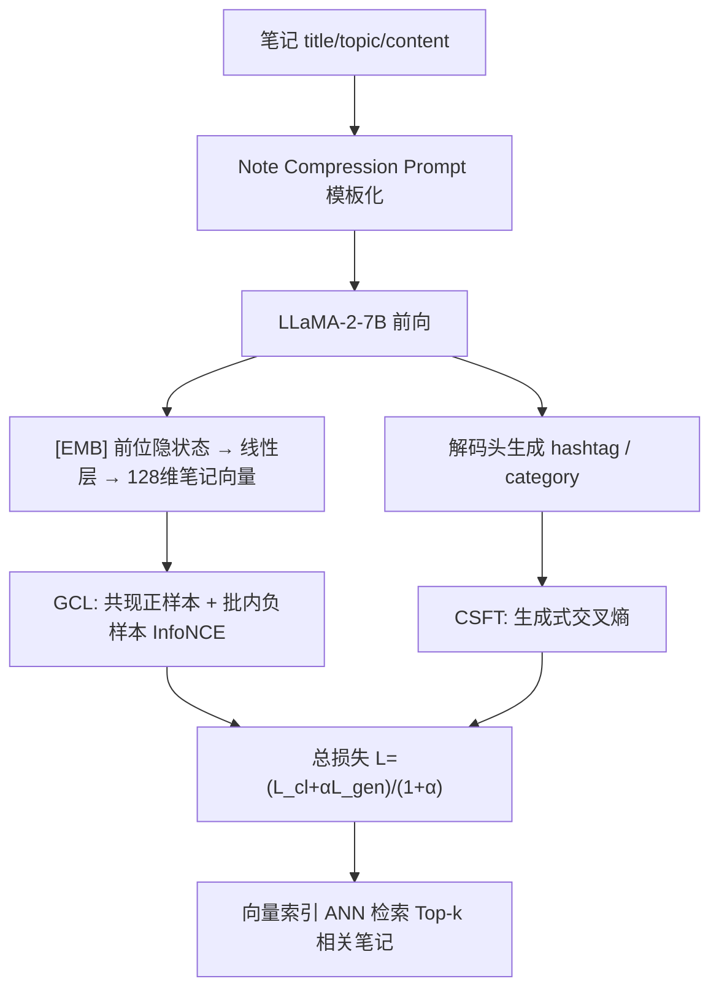

# NoteLLM: A Retrievable Large Language Model for Note Recommendation (面向笔记推荐的可检索大语言模型)

- **会议/期刊**: WWW 2024 (Companion, full paper)
- **作者与机构**: Chao Zhang, Shiwei Wu, Tong Xu, Enhong Chen 等（中国科学技术大学 MINE Lab / 认知智能国家重点实验室）；Haoxin Zhang, Yan Gao, Yao Hu, Di Wu（小红书）
- **推荐链路定位**: 召回（Item-to-Item 笔记召回）
- **研究方向**: 大语言模型推荐（LLM4Rec） / 协同过滤与双塔召回
- **论文原文**: [https://arxiv.org/abs/2403.01744v2](https://arxiv.org/abs/2403.01744v2)
- **开源代码**: 暂未开源

## TL;DR (1分钟核心速览)

针对小红书类 UGC 平台的 I2I 笔记召回：现有线上方案把整篇笔记塞进 BERT 得到句向量，既未利用话题标签/类目这类"核心概念"信号，也丢掉了 LLM 的生成能力。NoteLLM 用一个统一 Note Compression Prompt 把笔记压成单个特殊 token `[EMB]` 的隐状态作为笔记向量，用共现构造的正样本做生成式对比学习（GCL）注入协同信号，同时以指令微调（CSFT）让同一模型生成话题标签/类目，把"摘要式生成能力"迁移到向量压缩上。在 25.8 万笔记池的无偏全库排序（Full-Ranking）下 Avg Recall@100~100k 达 94.66%，线上 A/B 的 CTR 提升 16.20%。

## Background & Motivation (背景与核心矛盾)

- **主流范式**: 工业界 I2I 召回主流是双塔式文本检索——把笔记的标题+正文+标签拼接后送入 BERT（SentenceBERT）编码成向量，用内积/ANN 在百万级笔记池中取 Top-k 相似笔记。近年 LLM4Rec 多把 LLM 当作更强的"句子编码器"（RepLLaMA、PromptEOL+CSE）。
- **前人局限**: ①话题标签（`#Singapore`）与类目是笔记的核心概念，但现有方法只把它们当作输入内容的一部分，未显式监督模型"学会提炼概念"；②把 LLM 当纯编码器使用，浪费其自回归生成能力，而恰恰"生成标签"与"压缩出笔记向量"在目标上高度同构——都是把长文本压缩为极短信息。
- **核心洞察 (Key Insight)**: 若一个 LLM 能准确生成笔记的话题标签/类目，说明它已把笔记的关键语义压缩进隐状态；因此把标签生成作为辅助任务，应当能反向提升 `[EMB]` 向量对"相关性"的判别力，且标签/类目是冷启动新笔记唯一可靠的监督信号。
- **本文切入点**: 用一条提示模板同时承载"I2I 召回"和"标签/类目生成"两个任务，靠共享的 `[EMB]` 压缩位实现任务间的表征互惠。

## Method (核心方法设计)

### 1. 整体框架 (Overall Architecture)

输入侧对每条笔记构造统一的 Note Compression Prompt：`[BOS]<Instruction><Input Note> The compression word is: "[EMB]". <Output Guidance><Output>[EOS]`，其中 `<Input Note>` 是 JSON 化的 title/topic/content，`<Output>` 在召回任务下为空、在生成任务下为类目 $c_i$或随机抽取的$j$个话题标签。提示经 LLaMA-2-7B 前向，取 `[EMB]` **前一个 token** 的最后一层隐状态（自回归因果掩码决定其只能看到左侧笔记内容），经线性层投到$d=128$ 的笔记向量空间；该向量既用于批内对比学习（GCL），其上下文隐状态又用于解码标签/类目（CSFT）。训练完成后，线上仅需一次前向得到 `[EMB]` 向量，灌入向量索引即可做百万级 I2I 检索；生成分支则保留为标签补全、类目补全能力。

### 2. 关键设计拆解 (Key Designs)

1. **共现加权正样本构造（Collaborative Pair Construction）**：纯语义相似会召回"话题相同但意图不同"的笔记，因此用一周内用户行为构造 $n_A\to n_B$ 正样本，并对活跃用户做倒数加权以抑制无差别点击：
$s_{n_A\to n_B}=\sum_{i=1}^{U}\frac{1}{N_i}$，其中$N_i$为第$i$个用户点击过的笔记数。随后剔除高于$u=30$、低于$l=0.01$的异常分数，取 Top-$t=10$ 作为相关笔记。直觉上这是把"共读即相关"的协同先验以软权重方式注入 LLM，而非依赖 LLM 自身缺失的协同知识。
2. **生成式对比学习 GCL（Generative-Contrastive Learning）**：把 `[EMB]` 向量当作双塔的 item 塔输出，用批内负样本做 InfoNCE，使 LLM 在"整体关系视角"下学习笔记邻近性（相对逐 token 的 SFT，更能刻画排序结构）：
$\mathcal{L}_{cl}=-\frac{1}{2B}\sum_{i=1}^{2B}\log\frac{e^{sim(\boldsymbol{n}_i,\boldsymbol{n}_i^+)/\tau}}{\sum_{j\in[2B]\setminus\{i\}}e^{sim(\boldsymbol{n}_i,\boldsymbol{n}_j)/\tau}}$，$sim(\boldsymbol{a},\boldsymbol{b})=\boldsymbol{a}^\top\boldsymbol{b}/(\|\boldsymbol{a}\|\|\boldsymbol{b}\|)$，温度$\tau$ 可学习（初始 3），批大小 128 条笔记（64 对），负样本即批内其余 127 条，**无需显式难负采样**。
3. **协同监督微调 CSFT 与任务混比**：对每个 batch 随机划出 $r=40\%$的笔记做话题标签生成、其余做类目生成，避免单一任务导致的灾难遗忘与"跷跷板效应"；生成损失为$\mathcal{L}_{gen}=-\frac{1}{T}\sum_{i=1}^{T}\log p(o_i\mid o_{<i},x)$，总目标$\mathcal{L}=\frac{\mathcal{L}_{cl}+\alpha\mathcal{L}_{gen}}{1+\alpha}$（$\alpha=0.01$）。生成分支强迫隐状态保留可解码的关键概念，从而反向正则化压缩向量；$\alpha$ 过大则会牺牲召回（见实验）。

## Experimental Setup & Evaluation Protocol (实验设置与评估协议)

- **数据集与预处理**: 小红书真实产品数据，按"每个类目组合抽固定数量笔记对"平衡采样，含 500+ 类目；测试池取自后续一个月的新笔记并**剔除训练集中已出现的笔记**。

| 数据集 | #Notes | #Note Pairs | 平均标题词数 | 平均标签数 | 特征/场景说明 |
| :--- | :---: | :---: | :---: | :---: | :--- |
| Training | 458,221 | 312,564 | 11.54 | 3.02 | 一周行为构造共现正样本 |
| Testing | 257,937 | 27,999 | 13.70 | 5.49 | 次月笔记，与训练集不重叠 |

- **数据划分与防穿越 (Splitting Strategy)**: **时间切分**（一周训练 → 次月测试池），并显式排除训练期已见笔记，属于弱冷启动设定；标题截断 20 token、正文截断 80 token。
- **排名评测协议 (Ranking Protocol)**: **无偏 Full-Ranking**——对每个 query 笔记在 257,937 条候选池（剔除自身）上全库排序，报告 Recall@100/1k/10k/100k；生成任务用 Acc./Ill.（生成类目不在候选集的比例）、BLEU4/ROUGE1/2/L。
- **对比基线与超参**: LLaMA-2-7B（zero-shot、PromptEOL zero-shot、PromptEOL+CSE）、线上 SentenceBERT（110M）、RepLLaMA；嵌入维度 $d=128$，8×A100 80G、单卡 batch 8、总 batch 64 对，DDP 训练。

## Key Experimental Results (实验关键数据)

### 1. 主实验对比 (Main Results)

| Model | Size | R@100 | R@1k | R@10k | R@100k | Avg. |
| :--- | :---: | :---: | :---: | :---: | :---: | :---: |
| LLaMA 2 zero-shot | 7B | 11.94 | 19.44 | 32.53 | 68.81 | 33.18 |
| PromptEOL zero-shot | 7B | 55.27 | 74.47 | 88.71 | 98.04 | 79.12 |
| SentenceBERT (Online) | 110M | 70.72 | 87.88 | 96.29 | 99.62 | 88.63 |
| PromptEOL+CSE | 7B | 83.28 | 95.26 | 99.20 | 99.96 | 94.43 |
| RepLLaMA | 7B | 83.63 | 95.10 | 99.27 | 99.94 | 94.49 |
| **NoteLLM** | 7B | **84.02** | **95.23** | 99.23 | **99.96** | **94.66** |
| Improv. | — | +0.47% | +0.14% | −0.04% | +0.02% | +0.18% |

分曝光度（表 3）：低曝光（<1500 次，占测试集 30%、总曝光 0.5%）R@100 达 87.85（RepLLaMA 86.54，+1.51%）；高曝光（>75000 次，10% 笔记占 75% 曝光）R@100 为 73.46（RepLLaMA 72.64）。

### 2. 消融实验 (Ablation Study)

| 变体 | R@100 | R@1k | Avg. | 类目 Acc. | 标签 ROUGE-L |
| :--- | :---: | :---: | :---: | :---: | :---: |
| **NoteLLM (full)** | **84.02** | **95.23** | **94.66** | 66.17 | 21.03 |
| w/o CSFT（仅 GCL） | 83.28 | 95.26 | 94.43 | 0.00 | 0.00 |
| w/o GCL ($r$=40%，仅生成) | 75.38 | 90.33 | 90.43 | **75.12** | 23.27 |
| w/o GCL ($r$=0%，仅类目) | 60.38 | 83.22 | 84.64 | 80.64 | 1.54 |
| w/o GCL ($r$=100%，仅标签) | 71.98 | 87.86 | 88.49 | 0.18 | **24.11** |

### 3. 关键实验发现 (Key Findings)

1. **生成任务确实反哺召回**：完全去掉 GCL、只用 CSFT 类目生成时 Avg Recall 仍有 84.64，高于 PromptEOL zero-shot（79.12）；而 `w/o CSFT` 虽保留协同对比学习，Avg 仅 94.43（−0.23），且生成能力归零——说明 GCL 提供主要排序增益、CSFT 提供"零成本"的增量语义正则。
2. **任务混比存在最优区间**：纯类目（$r=0$）召回最差（84.64）但类目 Acc 最高（80.64），纯标签（$r=100\%$）类目 Acc 崩至 0.18、召回 88.49，呈现明显跷跷板；$r=40\%$同时取得最高 Avg 94.66，验证指令多样性是缓解任务冲突的关键。$\alpha$亦呈同样权衡：$\alpha=0.01$召回最优，$\alpha\ge 1$ 生成指标升高但 Avg 回落至 94.03。
3. **增益集中在低曝光/冷启动侧（最有工业价值的发现）**：低曝光组 R@100 相对线上 SentenceBERT 提升 12.85 个点，且线上新笔记单日评论数提升 3.58%；主表 LLM 基线对高曝光笔记普遍掉点（72% 左右），说明纯 LLM 编码忽视流行度偏置，而 CSFT 让模型更依赖内容本身，更适合冷启召回。

## Highlights & Limitations (亮点、对比与审稿批判)

- **与代表作对比 (vs. Prior Work)**: 与 RepLLaMA / PromptEOL+CSE 这类"LLM 即编码器"范式相比，NoteLLM 首次在**召回阶段**同时使用 LLM 的编码与生成能力，把标签/类目生成当作向量压缩的自监督信号，离线 Avg 提升 +0.17/+0.23；与线上 SentenceBERT 相比则是 7B 模型对 110M 模型的全面替换，换来 16.20% 的线上 CTR 增益。
- **可迁移亮点**: ①"辅助生成任务监督压缩向量"的多任务配方可平移到短视频封面/商品标题的 I2I 召回，尤其适合标签稀疏类目；②共现分数的倒数用户加权 $\sum 1/N_i$ 是极低成本、可直接复用的正样本去噪技巧。
- **审稿级局限批判**: ①离线相对 RepLLaMA 的增益仅 0.17 个点，且 R@10k 反而微降，统计显著性未给出，说服力主要依赖线上 A/B；②7B 模型编码 45 万笔记的推理成本与在线延迟未量化，正文仅截断到 20/80 token，长文笔记信息被截断；③生成侧存在幻觉（类目 Acc 仅 66.17、Ill. 0.5），标签评测用 BLEU/ROUGE 与推荐收益的相关性也未建立。

## Rating (四维评分)

- **方法创新性 (Novelty)**: ⭐⭐⭐⭐ （"压缩 token + 生成式多任务"思路清晰且首次把 LLM 引入 I2I 召回，但 GCL 本身仍是标准 InfoNCE，增量偏工程组合）
- **评估协议与实验扎实度 (Protocol & Experiments)**: ⭐⭐⭐⭐ （25.8 万笔记 Full-Ranking + 分曝光度分析 + 线上 A/B 齐全，但缺显著性检验与多平台验证）
- **写作与数学规范度 (Clarity & Rigor)**: ⭐⭐⭐⭐ （提示模板与公式交代清楚、超参与混比分析充分，但公式 (2) 排版有误、复杂度与延迟分析缺失）
- **工业落地与复现价值 (Industrial & Practical Value)**: ⭐⭐⭐⭐ （已在小红书全量部署并报告 CTR/评论/WAP 三指标，工程价值高；但未开源、7B 推理开销对中小团队门槛较高）

