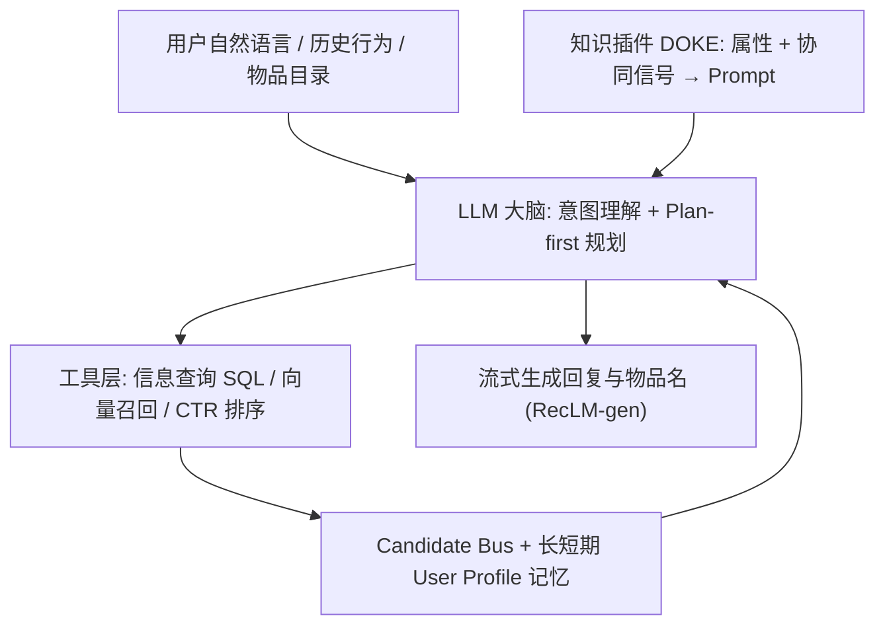

# RecAI: Leveraging Large Language Models for Next-Generation Recommender Systems (面向下一代推荐系统的大模型工具箱 RecAI)

- **会议/期刊**: WWW 2024 Companion（Demo Track，4 页）
- **作者与机构**: Jianxun Lian, Jing Yao, Xing Xie（微软亚洲研究院）；Yuxuan Lei, Xu Huang（中国科学技术大学）；Wei Xu（中国人民大学）
- **推荐链路定位**: 端到端生成式 / 对话式召回与重排（Agent 编排传统模型为工具）
- **研究方向**: 大语言模型推荐 (LLM4Rec) / 对话推荐与智能体仿真
- **论文原文**: [https://arxiv.org/abs/2403.06465v1](https://arxiv.org/abs/2403.06465v1)
- **开源代码**: [https://github.com/microsoft/RecAI](https://github.com/microsoft/RecAI)

## TL;DR (1分钟核心速览)

本文是一篇**系统/Demo 论文**而非单点模型论文：它针对"LLM 世界知识封闭于训练截止点、无法覆盖私有物品目录与快速漂移的用户偏好"这一核心矛盾，提出开源工具包 RecAI，用五大支柱（Recommender AI Agent、RecLM-emb/gen、Knowledge Plugin、RecExplainer、Evaluator）在**不改参、可改参、不可改参**三种算力约束下分别给出 LLM×RS 的融合路径。系统自带独立评测器（含 GPT-4 用户模拟器与 LLM-as-Judge）。核心收益以定性/相对结论呈现：fine-tuned Llama-7B（RecLlama）在工具规划上明显超过 GPT-3.5-turbo 与 Text-davinci-003，fine-tuned 7B Llama-2-chat 在物品排序上超过 GPT-4；具体数值表格被显式托管于参考文献 [3][4][5][6][7]。

## Background & Motivation (背景与核心矛盾)

- **主流范式**: 工业 RS 依赖 ID 序列与结构化特征训练专用模型（召回双塔 + 精排 CTR），近年 LLM4Rec 主流是"直接把 LLM 当推荐器"（prompt 排序或生成物品名）。
- **前人局限 ①**: 直接套用 LLM 不可行——LLM 的**知识边界**止于最后一次训练更新，私有 item catalog 与物品属性根本没被编码。
- **前人局限 ②**: 用户偏好是 **domain-specific 且快速漂移**的，通用世界知识无法替代在线数据驱动的重训/微调；同时纯 Agent 多轮工具调用带来 10–20 s 级延迟。
- **核心洞察 (Key Insight)**: 不该让 LLM 替代推荐模型，而应让**传统推荐模型降级为"工具"、LLM 升级为"大脑"**；训练/工具/提示三种注入知识的成本阶梯，恰好覆盖 API-only、有 GPU、可微调三类真实工程约束。
- **本文切入点**: 以统一工具包形态，把"Agent 编排 + 领域微调 + Prompt 注入 + 黑箱解释 + 自动评测"打包成可复现的五个独立落地场景。

## Method (核心方法设计)

### 1. 整体框架 (Overall Architecture)

RecAI 按"知识注入手段的成本"分层：**可微调**走 RecLM-emb（对比学习训文本-物品对齐的检索塔）与 RecLM-gen（自回归生成物品名的排序/对话塔）；**可改架构但要多轮推理**走 InteRecAgent（LLM 作为规划器，SQL 查询/向量召回/CTR 排序作为三类工具，Candidate Bus 与长短期 User Profile 作为外置记忆）；**只能调 API**走 Knowledge Plugin 的 DOKE 范式（抽取→按样本筛选→自然语言化后塞进 prompt）；**只能黑箱观测**走 RecExplainer（用 LLM 做替代模型反推 embedding 语义）；最后由 Evaluator 统一五维打分。训练与推理解码完全解耦：生成式支路直接流式吐物品名，避免 Agent 的多轮往返。

<figure class="paper-figure" markdown="span">
  <figcaption>图1：InteRecAgent 概览。用户以自然语言与 LLM 交互。LLM 理解用户意图，并制定工具执行计划，以从特定领域获取正确的物品或信息。根据工具结果，LLM 为用户生成响应。</figcaption>
</figure>

### 2. 关键设计拆解 (Key Designs)

1. **RecLM-emb 与 RecLM-gen 的双塔/生成分工（把通用文本编码器改造成物品检索器）**：痛点起因是通用对比预训练 embedding 在 zero-shot item retrieval 上失效——其表示过于泛化，捕捉不到"结构化 query 里提到的物品细节"。作者构造**十类匹配任务**覆盖物品表示的不同侧面，用对比损失微调：
$\mathcal{L}_{emb}=-\log\frac{\exp(\langle\mathbf{h}_q,\mathbf{h}_{i^+}\rangle/\tau)}{\exp(\langle\mathbf{h}_q,\mathbf{h}_{i^+}\rangle/\tau)+\sum_{j\in\mathcal{N}}\exp(\langle\mathbf{h}_q,\mathbf{h}_{i^-_j}\rangle/\tau)}$直觉：多facet 的正样本把"query 措辞差异"与"物品同一性"解耦，使同一 item 在不同说法下都能被召回；副产品是可统一搜索与推荐两个流量入口。RecLM-gen 则把物品名当 token 序列直接解码，$\mathcal{L}_{gen}=-\sum_{k}\log p_\theta(y_k\mid y_{<k},x)$，端到端完成对话与推荐，省掉召回+工具调用两跳。

2. **InteRecAgent 的 Plan-first 规划 + Candidate Bus 外置记忆（降延迟、抗长上下文）**：传统 ReAct 式 step-by-step 每步都要一次 LLM 调用，延迟叠加到 10–20 s。本文改为一次性产出完整工具执行计划 $\pi=\mathrm{LLM}(u,\mathcal{M},\{\text{desc}(T_j)\},\mathcal{D}_{\text{kNN}}(u))$，随后**严格照单执行**，其中$\mathcal{D}_{\text{kNN}}(u)$ 是按当前意图检索出的动态高质量 demo（in-context demonstration），仅在需要时触发 reflection 重规划。物品候选流不写进 prompt，而由 Candidate Bus 承载；用户画像切成长期/短期两段记忆。直觉：把"上下文推理开销"换成"一次规划 + 结构化内存"，既压 API 次数又避免候选列表撑爆窗口。

3. **RecExplainer 的混合对齐与 Evaluator 的五维协议**：行为对齐（LLM 学"用户画像→预测物品"以复刻目标模型输出）只能模仿结果、不触及内部逻辑；意图对齐让 LLM 直接消费推荐模型的 user/item embedding（类比视觉语言模型处理视觉 token），从而解释"为什么是这个分数"：$\mathcal{L}_{exp}=\mathcal{L}_{beh}+\lambda\,\mathcal{L}_{intent}$，后者以$\mathbf{h}=\mathrm{MLP}(\mathbf{e}_u)$ 作为软 prompt 前缀注入。评测侧：生成式用**模糊匹配**校验物品名（容忍标点误差），对话用 GPT-4 用户模拟器测目标物品命中率（NDCG/Recall），解释与闲聊用 LLM-as-Judge 成对比较统计 Win/Tie/Loss。

4. **训练目标、负采样与推理效率**: 统一损失为 $\mathcal{L}=\mathcal{L}_{emb}+\mathcal{L}_{gen}+\mathcal{L}_{exp}$（各支路独立训练，不联合优化）。负采样未在本文披露（Demo 篇幅限制，十类匹配任务的负例构造细节需查 [5]）；推理开销差异是全文关键 trade-off：Agent 框架每次对话多轮 LLM 调用约 10–20 s，而 RecLM-gen 流式生成可做实时交互。

## Experimental Setup & Evaluation Protocol (实验设置与评估协议)

- **数据集与预处理**: 本文为 4 页 Demo，**未给出任何数据集统计表**（#Users/#Items/#Interactions 均缺失），仅说明知识插件在"不同推荐 benchmark"上验证，具体过滤（如 5-core）与稀疏度交由 [3]–[7] 各自论文。下表为可确证的协议与结论层信息：

| 评测维度 | 评测方式 | 本文给出的结论形态 |
| :--- | :--- | :--- |
| 生成式推荐 | 物品名模糊匹配 + NDCG/Recall | 定性 |
| 嵌入式推荐 | RecLM-emb / OpenAI text-embedding 后走常规流程 | 定性 |
| 对话能力 | GPT-4 用户模拟器发起请求，测目标物品命中 | 定性 |
| 解释质量 | 独立 LLM（GPT-4）作裁判，informativeness/persuasiveness/helpfulness | 成对比较 Win/Tie/Loss |
| 闲聊鲁棒性 | GPT-4 评 helpfulness/relevance/thoroughness | 成对比较 |

- **数据划分与防穿越 (Splitting Strategy)**: 本文未声明；**未使用** Leave-One-Out / 全局时间戳切分的任何描述，也无冷启动划分。这是本 Demo 最明显的协议缺口。
- **排名评测协议 (Ranking Protocol)**: 未声明 Full-Ranking 亦未声明 Sampled Ranking；对话场景采用"模拟器目标物品命中"这一弱化替代，本质上不是全库排序。
- **对比基线与超参设置**: 对比对象为通用 LLM（GPT-4、GPT-3.5-turbo、Text-davinci-003）与零样本通用 embedding；工具学习侧以 GPT-4 生成 [instruction, tool plan] 数据蒸馏到 Llama-7B（RecLlama）；排序侧微调 Llama-2-chat-7B。Embedding 维度、显著性检验（如 $p<0.05$）均未报告。

## Key Experimental Results (实验关键数据)

### 1. 主实验对比 (Main Results)

原文**没有主实验表格**，仅有作者陈述的相对结论。为避免臆造数值，此处如实转录可核查的比较关系：

| 对比场景 | 参与方 | 本文陈述的结论 | 数值 |
| :--- | :--- | :--- | :---: |
| Agent 工具规划（"大脑"） | RecLlama (Llama-7B 微调) vs **GPT-3.5-turbo** vs **Text-davinci-003** | RecLlama **显著优于**两者 | 未给出 |
| 物品排序 (item ranking) | fine-tuned **Llama-2-chat-7B** vs **GPT-4** | 微调 7B **超过** GPT-4 | 未给出 |
| 零样本检索 | RecLM-emb vs 通用对比预训练 embedding | 微调后 item retrieval "notable enhancement" | 未给出 |
| 知识注入 | DOKE-prompted LLM vs 原始 LLM | 多个 benchmark 上 "markedly enhances" | 未给出 |
| 交互延迟 | InteRecAgent 多轮调用 vs RecLM-gen 流式生成 | Agent 约 **10–20 s**/轮；流式生成可实时 | 10–20 s |

### 2. 消融实验 (Ablation Study)

原文未设消融表格；唯一具备"消融语义"的对照是三档对齐策略的比较：

| 配置 | 机制 | 原文结论 |
| :--- | :--- | :--- |
| Behavior-only alignment | 仅学"画像→预测物品" | 可给洞察，但**不触及模型内部逻辑** |
| Intention-only alignment | LLM 消费 rec-model embedding | 可解释推理链，但单独使用易出现解释偏差 |
| **Hybrid alignment (采用)** | 文本 + embedding 联合 | 更有效修正 "interpretation inaccuracies"，可解释性最强 |

另外"蒸馏 vs 直接用大模型"构成隐性消融：7B 微调 > 更大通用模型，说明**领域数据比参数规模更关键**。

### 3. 关键实验发现 (Key Findings)

1. **规模不是瓶颈、领域对齐才是**：7B 级微调模型在工具规划上压过 GPT-3.5-turbo/Text-davinci-003，在物品排序上压过 GPT-4——说明 item name 与协同模式的域内分布是通用大模型的知识盲区，微调恰好补的是这块而非语言能力。
2. **延迟瓶颈来自"多轮工具往返"而非模型本身**：Agent 形态每轮 10–20 s 的观测值直接支撑了 RecLM-gen 的流式端到端路线——把规划-执行-生成三跳压缩成一跳解码，是对话推荐能否上线的分水岭。
3. **可解释性上"意图对齐"不可省**：仅行为对齐只能复述输出、无法解释打分，混合对齐在两个方向上互补；这提示 black-box 推荐模型的解释不应只做输出蒸馏，必须让 LLM 读到中间表征。

## Highlights & Limitations (亮点、对比与审稿批判)

- **与代表作对比 (vs. Prior Work)**: 相比 Chat-Rec [1] 这类"LLM 直接当推荐器"的方案，本文把传统推荐模型保留为可复用资产（工具化），工业改造成本最低；相比 TALLRec 类纯指令微调排序工作，本文额外覆盖了不可微调（DOKE）、不可解释（RecExplainer）与不可评测（Evaluator）三块工程空白；相比 ReAct 式 step-by-step Agent，Plan-first + Candidate Bus 是对延迟与上下文长度的针对性工程修正。
- **可迁移亮点**: ① **Candidate Bus + 长短期画像分段记忆**可无痛移植到任何 LLM 对话推荐/客服 Agent，避免候选集污染 prompt；② **十类 facet 匹配任务**的构造思路可直接迁移到电商 query-item 对齐、跨域召回的数据合成；③ GPT-4 生成 [instruction, tool plan] 蒸馏到 7B 的范式，适合把昂贵 Agent 降本为私有化部署。
- **审稿级局限批判**: ① **评测协议严重缺失**——无数据集统计、无划分方式、无 Full/Sampled Ranking 声明、无显著性检验，全部关键数值外包给五篇参考文献，本文自身不可验证，作为 WWW Demo 可接受但作为研究结论不成立；② **组件间无联合优化与相互增益分析**，五支柱更像并列 SDK 而非一个系统，且 Agent 10–20 s 延迟在真实 CVR 场景仍不可接受；③ 生成式推荐的模糊匹配指标存在**宽松化风险**（容忍标点即可能虚高命中率），且未报告 RecLM-gen 的幻觉率/无效物品率。

## Rating (四维评分)

- **方法创新性 (Novelty)**: ⭐⭐⭐ （单点算法创新有限，价值在"LLM 为脑、RS 为工具"的系统性分层与三档知识注入成本阶梯的抽象）
- **评估协议与实验扎实度 (Protocol & Experiments)**: ⭐⭐ （4 页 Demo 无数据集统计、无划分与排序协议声明、无显著性检验，核心数值全部外置到参考文献，不可独立复核）
- **写作与数学规范度 (Clarity & Rigor)**: ⭐⭐⭐ （五支柱结构清晰、trade-off 叙述有工程直觉，但公式近乎为零、复杂度与负采样细节缺失）
- **工业落地与复现价值 (Industrial & Practical Value)**: ⭐⭐⭐⭐⭐ （开源完整工具链，覆盖 API-only 到全参微调全谱系，Candidate Bus 与 RecLlama 蒸馏可直接进生产）

