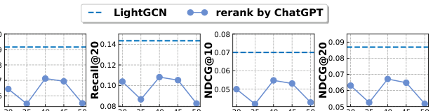
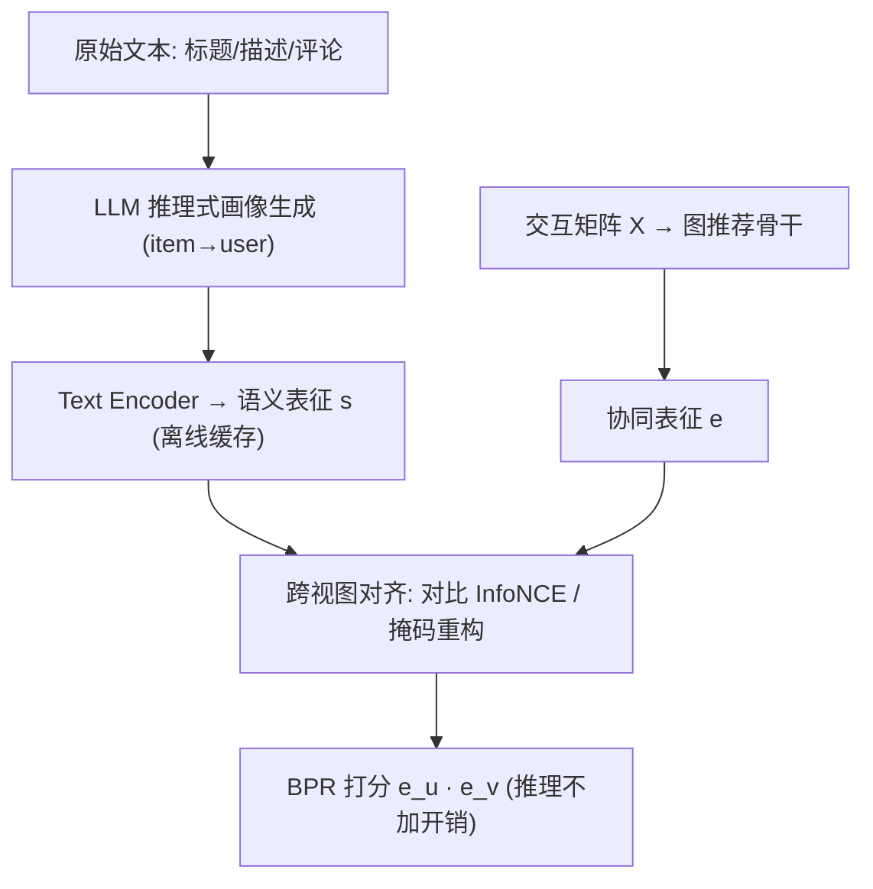
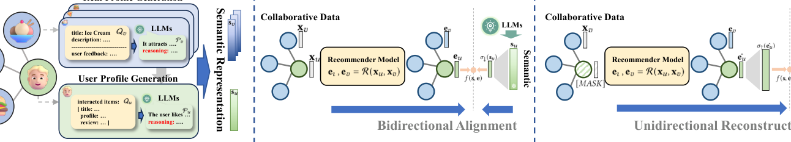

# Representation Learning with Large Language Models for Recommendation (面向推荐的大语言模型表征学习)

- **会议/期刊**: WWW 2024 (Full Paper)
- **作者与机构**: Xubin Ren, Wei Wei, Lianghao Xia, Chao Huang (香港大学) ; Lixin Su, Suqi Cheng, Junfeng Wang, Dawei Yin (百度)
- **推荐链路定位**: 召回 / 表征学习（模型无关插件，训练期增强）
- **研究方向**: 大语言模型推荐 (LLM4Rec) / 自监督对齐与去噪
- **论文原文**: [https://arxiv.org/abs/2310.15950v5](https://arxiv.org/abs/2310.15950v5)
- **开源代码**: [https://github.com/HKUDS/RLMRec](https://github.com/HKUDS/RLMRec)

## TL;DR (1分钟核心速览)

针对 ID-based 图推荐器「只吃二值交互、忽略文本语义」且「隐式反馈噪声污染表征」的痛点，本文提出模型无关框架 RLMRec：用 LLM + 推理链生成用户/物品画像并编码为语义视图，再以互信息最大化（对比对齐 / 掩码生成对齐）把语义空间与协同空间对齐，理论上证明引入文本信号等价于最大化 $I(e;s)$。在 Amazon-book/Yelp/Steam 的 `all-rank` 全库排序下，插入 6 个 CF 骨干后 Recall@20 稳定提升 1.5%–7.6%，且推理阶段零额外开销。

## Background & Motivation (背景与核心矛盾)

- **主流范式**: LightGCN/SGL/SimGCL/AutoCF 等在 user-item 二部图上传播 ID embedding，仅以 0/1 交互矩阵为监督信号。
- **前人局限 1**: 纯 ID 表征丢弃了物品标题、描述、评论等丰富文本，长尾物品表征极其贫瘠；且隐式反馈本身含误点击（假阳性）与流行度偏置，GNN 会把噪声沿高阶路径放大。
- **前人局限 2**: 直接用 LLM 做推荐（P5、InstructRec、TALLRec）存在三重硬伤——① 可扩展性差（LLaMA2-13B 单用户约 3.6s）；② 仅靠文本易幻觉、且 2048 token 装不下全局协同信号；③ 推理昂贵。
- **核心洞察 (Key Insight)**: 作者用 LightGCN 召回 Top-50 再让 ChatGPT 重排，Recall@10/NDCG@10 **反而低于原始 LightGCN**（图1）——说明 LLM 不应"替代"推荐器做打分，而应作为**语义信号源**去增强表征。
- **本文切入点**: 以"表征学习"为桥梁：LLM 离线产出语义表征，只在训练期通过互信息对齐约束协同表征 $e$，推理时仍只用原推荐器。

<figure class="paper-figure" markdown="span">
  <figcaption>图1：LLM在处理不同规模候选物品时的推荐重排性能。</figcaption>
</figure>

## Method (核心方法设计)

### 1. 整体框架 (Overall Architecture)

三阶段闭环：(a) **画像生成**——用礼帽式 system prompt $\mathcal{S}_{u/v}$强制 LLM 输出"理由(reasoning)+画像"，物品侧先做（title/description/属性/采样评论），用户侧后做（采样交互物品的画像 + 该用户评论），形成 item→user 的级联归纳；(b) **语义编码**——冻结的 text-embedding-ada-002 将画像编码为$s_u,s_v\in\mathbb{R}^{d_s}$，离线一次、可缓存；(c) **跨视图对齐**——以 InfoNCE（RLMRec-Con）或掩码重构（RLMRec-Gen）最大化$I(e;s)$，梯度只回流到协同侧$e$，故在线服务与原始骨干完全一致。

<figure class="paper-figure" markdown="span">
  <figcaption>图3：我们提出的LLM增强表示学习框架RLMRec的整体架构。</figcaption>
</figure>

### 2. 关键设计拆解 (Key Designs)

1. **理论落地：从后验最大化到互信息下界**：把隐先验 $z$（真正有益于推荐的因素）显式引入有向图$z\to e,\ z\to s$，目标是$\arg\max_e \mathbb{E}_{p(e,s)}[p(z,s|e)]$。作者证明该式正比于$I(e;s)=\mathbb{E}\log\frac{p(e|s)}{p(e)}$，即"语义视图是纯净先验的观测"，对齐它等价于给协同表征去噪。再用 density ratio$f(s,e)\propto p(s|e)/p(s)$ 得可优化下界：
$$\mathcal{L}_{info}=-\mathbb{E}\log\frac{f(s_i,e_i)}{\sum_{s_j\in\mathcal{S}}f(s_j,e_i)}$$
物理直觉：以语义为"锚"的 InfoNCE 会把含噪的 $e_i$ 拉向多条语义一致的邻居方向，噪声方向因缺乏语义支撑而被抑制。

2. **两种 density ratio 建模（Con / Gen）**：对比式取 $f(s_i,e_i)=\exp(\mathrm{sim}(\sigma_\downarrow(s_i),e_i))$，双向拉近正对、batch 内其余为负；生成式取$f(s_i,e_i)=\exp(\mathrm{sim}(s_i,\sigma_\uparrow(\hat{e}_i)))$，其中$\hat{e}_i=\mathcal{R}(\{x\}\backslash x_i)$ 是被 `[MASK]` 替换初始 embedding 后由骨干重算的单向重构，只用 CF 侧去重建语义侧，天然抑制信息泄漏。

3. **训练目标与开销**：$\mathcal{L}=\mathcal{L}_{R}+\lambda\mathcal{L}_{info}$，$\mathcal{L}_R$为原骨干的 BPR 损失，负采样沿用原骨干（batch 内负 + 采样负），Con 额外$O(N^2d)$、Gen 额外$O(Md+MNd)$（$M$ 为掩码节点数）；在 SGL/SimGCL/DCCF/AutoCF 等重骨干上每 epoch 只增加约 10%–20% 时间，轻骨干 GCCF/LightGCN 因原耗时极短（1s 级）相对开销接近 2×。

## Experimental Setup & Evaluation Protocol (实验设置与评估协议)

- **数据集与预处理**: Amazon-book/Yelp 过滤评分 <3 的交互，Steam 无评分故不过滤；随后 k-core 过滤，统计见原文附录表 5（下表为量级）：

| 数据集 | #Users | #Items | #Interactions | 稀疏度 | 特征/场景说明 |
| :--- | :---: | :---: | :---: | :---: | :--- |
| Amazon-book | ≈59.2K | ≈91.4K | ≈3.01M | ≈99.94% | 书籍，标题+描述+用户评论，长文本 |
| Yelp | ≈42.7K | ≈30.5K | ≈1.05M | ≈99.92% | 商户，含类别/位置属性与评论文本 |
| Steam | ≈7.4K | ≈11.4K | ≈162K | ≈99.81% | 游戏，评论含大量符号噪声 |

- **数据划分与防穿越**: 比例划分 `3:1:1`（train/valid/test），验证集早停；预训练实验额外用 Yelp 2012–2017 预训练、2018–2019 下游训练，严格时间上不重叠。
- **排名评测协议**: 无偏 `Full-Ranking`（all-rank，对全物品库未交互项排序），指标 Recall@{5,10,20} 与 NDCG@{5,10,20}，5 次随机初始化取均值，显著性 $p<0.05$（表中 `*`）。
- **对比基线与超参**: 骨干 GCCF/LightGCN/SGL/SimGCL/DCCF/AutoCF（基于 SSLRec 复现）；LLM 侧 gpt-3.5-turbo 生成画像、text-embedding-ada-002 编码；$d=32$，batch 4096，学习率 1e-3，Adam。

## Key Experimental Results (实验关键数据)

### 1. 主实验对比 (Main Results)

| 骨干 | 变体 | Ama R@20 | Ama N@20 | Yelp R@20 | Yelp N@20 |
| :--- | :--- | :---: | :---: | :---: | :---: |
| — | 仅语义嵌入 (无协同) | 0.0199 | 0.0112 | 0.0047 | 0.0026 |
| LightGCN | Base | 0.1411 | 0.0856 | 0.1157 | 0.0733 |
| LightGCN | **RLMRec-Con** | **0.1483** | **0.0903** | **0.1230** | **0.0776** |
| GCCF | Base → Con | 0.1343 → 0.1395 | 0.0807 → 0.0842 | 0.1084 → 0.1144 | 0.0680 → 0.0719 |
| SGL | Base → Gen | 0.1473 → 0.1537 | 0.0913 → 0.0947 | 0.1197 → **0.1263** | 0.0753 → **0.0798** |
| SimGCL | Base → Con | 0.1512 → 0.1552 | 0.0919 → 0.0942 | 0.1254 → 0.1292 | 0.0801 → 0.0814 |
| DCCF | Base → Con | 0.1517 → 0.1563 | 0.0943 → 0.0968 | 0.1249 → **0.1321** | 0.0800 → **0.0836** |
| AutoCF | Base → Gen | 0.1536 → 0.1581 | 0.0984 → 0.0996 | 0.1280 → **0.1330** | 0.0813 → **0.0848** |
| **最优提升** | — | **↑6.67%** (LG R@5) | ↑5.76% | **↑8.10%** (SGL R@5) | ↑7.19% |

对比 LLM 增强基线 KAR（同语义表征输入）：Amazon-book 上 LightGCN+KAR 仅 +0.3% R@20，SGL+KAR 甚至 **−2.5%**；同设置下 RLMRec-Con 分别 +5.1% / +3.7%。

### 2. 消融实验 (Ablation Study)

| 消融项 | 设置 | Ama R@20 / N@20 | 结论 |
| :--- | :--- | :---: | :--- |
| 语义对齐方式 | Shuffle（打乱 $s_i$与$e_i$ 对应） | 明显低于 Con/Gen | 关键在于**配对对齐**而非"多一路特征" |
| 文本编码器 | ada-002 / Contriever / Instructor | 三者均优于 Base，Instructor 最佳 | 编码器越强增益越大，框架与编码器解耦 |
| 噪声注入 | 5%/10%/15%/20%/25% | Con > Gen > Base 全程成立 | 对比式抗噪强于生成式（掩码自带噪声） |
| 预训练用途 | None → Base → Con → Gen | 0.0820 → 0.0971 → 0.1034 → **0.1068** | 语义预训练参数可作为下游初始化 |
| 每 epoch 耗时 | LightGCN 1.01s→1.94s；DCCF 2.26s→2.49s | — | 重骨干仅 +10%~20%，轻骨干近 2× |

### 3. 关键实验发现 (Key Findings)

1. **纯语义信号几乎不可用**：仅用 LLM 语义嵌入做打分，Amazon-book R@20 只有 0.0199（LightGCN 的 1/7），证实"对齐"才是价值所在，直接喂特征（KAR 式）甚至会拖累 SGL。
2. **对齐必须"配对"**：打乱语义表征后性能回落（图4），说明增益来自 $e_i\leftrightarrow s_i$ 的互信息约束，而非文本特征提供的额外维度。
3. **抗噪与跨跳语义传播**：25% 噪声下 Con 仍稳定优于 Base（图5）；案例研究中 $u_{1998}$与$u_{227}$ 在图上游走距离 >3 跳，对齐后相似度得分 0.40→0.52、排名 1245→500，说明 LLM 语义可补足 ID 图难以触达的全局用户依赖。

## Highlights & Limitations (亮点、对比与审稿批判)

- **与代表作对比**: vs. **KAR**（把 LLM 描述当输入特征）——本文把语义当"锚"做互信息对齐，故不被文本噪声直接污染；vs. **TALLRec/InstructRec**（LLM 直接生成推荐）——本文不进入在线推理链路，3.6s/用户 的延迟问题被彻底规避；vs. **SGL/SimGCL**（ID 空间内数据增广对比）——本文的对比视图来自**跨模态外部知识**，增广语义远比 dropout/扰动丰富。
- **可迁移亮点**: ① "LLM 离线产画像 → 冻结编码 → 只训练期对齐"的三段式，可无痛挂到任何召回/精排骨干上，且推理零延迟；② 用 density ratio 的统一视角把"对比对齐"和"掩码生成对齐"解释成同一目标的两个实例，便于按骨干特性（如 AutoCF 本身是 MAE 式）选择变体。
- **审稿级局限批判**: ① 语义表征完全依赖 gpt-3.5-turbo + ada-002 的**一次性离线产物**，画像质量不可微、不可端到端优化，且规模上亿物品时 API 成本与隐私合规存疑；② 理论推导假设存在共享隐先验 $z$且$p(s)$在训练中恒定，属于合理解释而非严格保证；③ 仅在 3 个公开数据集、$d=32$ 的小规模设定下验证，缺少工业级 A/B 与千万级物品的可扩展性证据。

## Rating (四维评分)

- **方法创新性 (Novelty)**: ⭐⭐⭐⭐ （把"LLM 增强推荐"从 prompt 工程重构成跨视图互信息对齐，并有 SCM 式有向图推导支撑，思路干净）
- **评估协议与实验扎实度 (Protocol & Experiments)**: ⭐⭐⭐⭐ （6 个 SOTA 骨干 × 3 数据集 × Full-Ranking + 显著性检验，抗噪/预训练/效率多维剖析，唯缺工业数据）
- **写作与数学规范度 (Clarity & Rigor)**: ⭐⭐⭐⭐ （定理 1/2 推导链条清晰、Con 与 Gen 统一在同一 density ratio 框架下，附录补齐 prompt 细节）
- **工业落地与复现价值 (Industrial & Practical Value)**: ⭐⭐⭐⭐ （代码开源、模型无关、推理零开销；扣分在画像生成依赖闭源 LLM API 与离线缓存成本）

