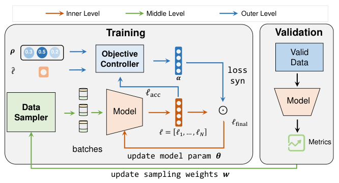
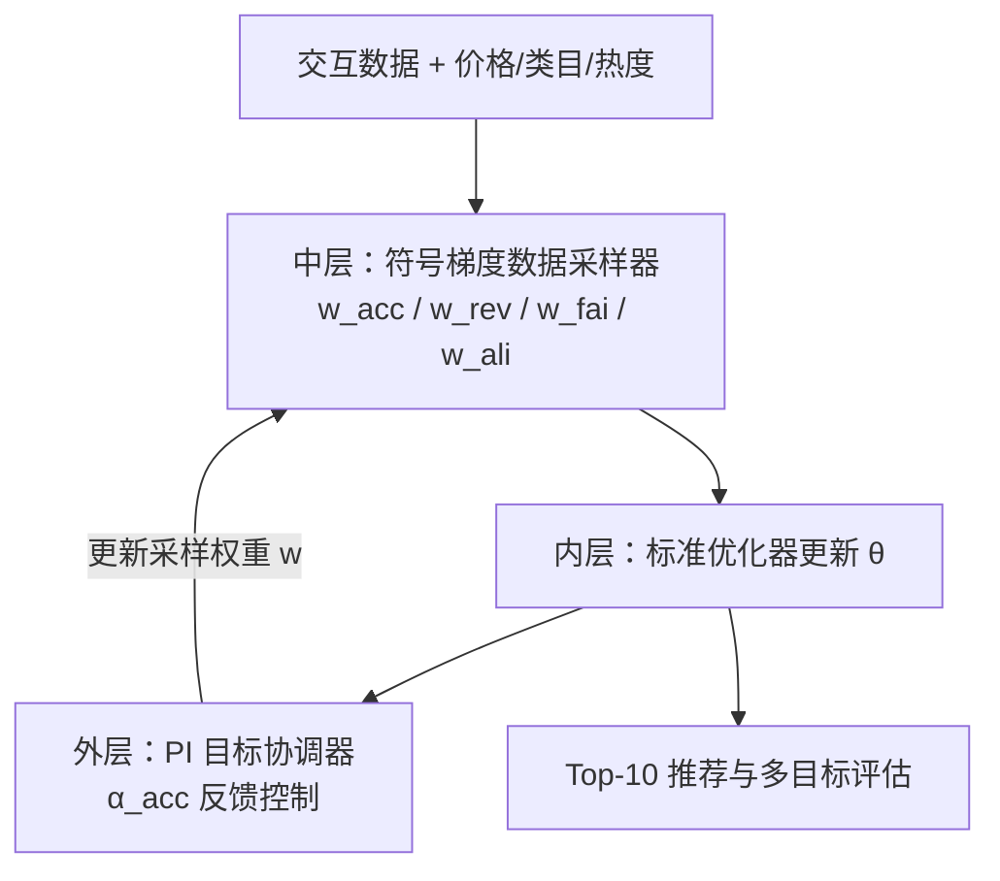
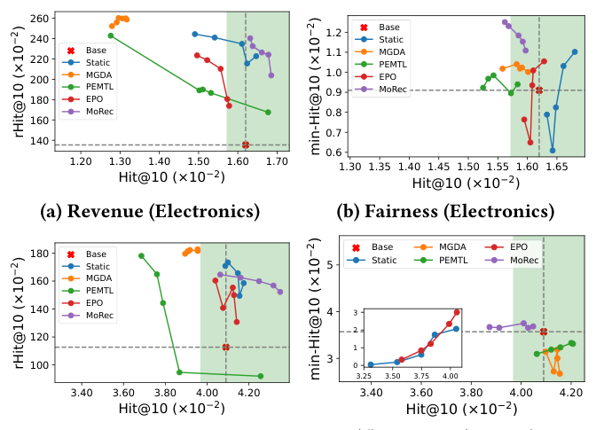

# A Data-Centric Multi-Objective Learning Framework for Responsible Recommendation Systems (面向负责任推荐系统的数据中心多目标学习框架)

- **会议/期刊**: WWW 2024
- **作者与机构**: Xu Huang, Defu Lian (USTC)；Jianxun Lian, Xing Xie (MSRA)；Hao Wang (ZJU)
- **推荐链路定位**: 精排/训练框架（模型无关）
- **研究方向**: 多任务学习与列表级重排 / 去偏公平、可信隐私与工业架构
- **论文原文**: [https://arxiv.org/abs/2310.13260v1](https://arxiv.org/abs/2310.13260v1)
- **开源代码**: [https://aka.ms/unirec](https://aka.ms/unirec)（检测到基线 MGDA 仓库：https://github.com/isl-org/MultiObjectiveOptimization）

## TL;DR (1分钟核心速览)

工业推荐需同时优化准确率、收入、公平与对齐，但现有静态加权或 MGDA/PEMTL/EPO 等 Pareto 方法难统一异构目标，且无法控制主目标精度下降。MoRec 以数据为中心：外层 PI 控制器锁定准确率损失，中层用符号梯度把各目标转成采样权重，内层仍用标准优化器。Amazon 两套 5-core 与 Xbox 工业数据、Leave-One-Out、Top-10 评测下，MF-BPR/SASRec 双主干均有效，最大相对精度损失 2.76%，平均 Imp 最高达 83.79%/51.38%。

## Background & Motivation (背景与核心矛盾)

- **主流范式**: 多目标推荐常用静态加权或 MGDA/PEMTL/EPO 等多梯度下降求 Pareto 解，主要覆盖准确率与收入。
- **前人局限**: 公平、对齐等目标难写成样本级可微损失；Pareto 解虽有效但不唯一、不可控，可能为提升收入过度牺牲精度。FairBatch 仅处理公平+准确率双目标，且缺少目标优先级控制。
- **核心洞察 (Key Insight)**: FairBatch 的 sign-gradient 数据重加权可推广为统一多目标优化；PID 反馈能把主目标损失稳定在预设值附近。
- **本文切入点**: 不改模型结构与损失函数，只改 dataloader，用三层框架统一四类目标并控制精度退化。

## Method (核心方法设计)

### 1. 整体框架 (Overall Architecture)

MoRec 将训练拆成三层闭环：外层 Objective Coordinator 根据验证集误差动态调节准确率权重 $\alpha_{acc}$；中层 Adaptive Data Sampler 按各目标对应的样本权重$w$抽取 mini-batch；内层用 SGD/Adam 正常更新$\theta$。每轮先用当前$w$训练，再在验证集上按符号梯度更新$w$，同时 PI 控制器依据$\hat{\ell}-\ell(t)$修正$\alpha_{acc}$。四类目标被统一为准确率、收入、公平（least misery）与热度对齐，推理阶段与原主干完全一致，无额外线上开销。

图1：MoRec 三层数据中心框架。
<figure class="paper-figure" markdown="span">
  <figcaption>图1：MoRec框架。</figcaption>
</figure>

### 2. 关键设计拆解 (Key Designs)

1. **四目标统一为采样权重（数据为中心）**：痛点是非可微/异构目标无法直接进损失。收入设 $w_i\propto r(e_i)$；公平对最差组提权，$w_{i^*}^{t+1}=w_{i^*}^{t}+\alpha$；对齐按模型分布$P$与目标分布$Q$的偏差调整，$w_i^{t+1}=w_i^t-\alpha\,\mathrm{sign}(P(x_i,\boldsymbol{\theta})-Q(x_i))$。直觉是“谁欠拟合/偏离期望，就多采谁”，无需改模型即可优化异构目标。

2. **PI 控制器控制主目标精度**：痛点是用多目标优化时准确率可能不可控地下滑。论文去掉 PID 的 D 项，令
$\alpha_{acc}(t)=\frac{K_p}{1+\exp(err(t))}-K_i\sum_{j=1}^{t}err(j)+\alpha_{\min}$，其中$err(t)=\hat{\ell}-\ell(t)$。当前损失高于预设$\hat{\ell}$ 时增大准确率权重，累计误差项防止整体漂移，从而把精度锁在业务可接受区间。

3. **训练目标、负采样与推理效率**：最终损失为 $\mathcal{L}_{final}=\alpha_{acc}\ell_{acc}+\sum_{obj\neq acc}\alpha_{obj}\ell_{obj}$；数据采样器按$w$抽 batch，验证集上更新$w$。MF-BPR 用 10 个、SASRec 用 3 个按热度采样的负例；推理仍为原模型前向，不增加 serving 成本，训练端多一次验证集评估与重加权。

## Experimental Setup & Evaluation Protocol (实验设置与评估协议)

- **数据集与预处理**: 三数据集均 5-core；Amazon 仅保留评分≥3。

| 数据集 | #Users | #Items | #Interactions | 密度 | 特征/场景说明 |
| :--- | :---: | :---: | :---: | :---: | :--- |
| Electronics | 124,917 | 44,848 | 1,072,840 | 0.019% | Amazon 电子品；类目/价格 |
| Movies | 89,922 | 38,563 | 1,146,563 | 0.033% | Amazon 电影；类目/价格 |
| Xbox | 154,210 | 5,161 | 6,058,454 | 0.761% | 工业游戏购买记录 |

- **数据划分与防穿越 (Splitting Strategy)**: `Leave-One-Out`：每用户最近 1 条测试、次近 1 条验证，其余训练；先 5-core 过滤。
- **排名评测协议 (Ranking Protocol)**: `Top-10` 排序，报告 Hit、rHit、Pop-KL、min-Hit；原文未明确全库候选或采样候选比例，仅说明训练负采样按热度分布，协议透明度一般。
- **对比基线与超参设置**: Static、MGDA、PEMTL、EPO；MF-BPR 与 SASRec 双主干，$d=64$，Adam$lr=1e^{-3}$，batch 512/1024，weight decay$0/10^{-6}/10^{-5}$；未报告显著性检验。MoRec 超参$\alpha=0.1,\lambda=0.2,K_p=0.01,K_i=0.001$。

## Key Experimental Results (实验关键数据)

### 1. 主实验对比 (Main Results)

表中每格为 `Hit / rHit / Pop-KL / min-Hit / Imp`；↓表示相对 Base 精度掉超 3% 的无效解，粗体为 MoRec 的有效最优/近最优值。

| MF-BPR | Electronics | Movies | Xbox |
| :--- | :--- | :--- | :--- |
| Base | 1.62/135.42/142.54/0.91/0.00 | 4.09/112.68/83.11/3.57/0.00 | 20.27/532.53/51.94/3.28/0.00 |
| Static | 1.62/197.56/37.09/1.00/32.41 | 4.06/136.92/27.74/2.16/11.99 | 18.22↓/681.73/4.93/3.68/Invalid |
| MGDA | 1.32↓/262.84/20.37/0.32/Invalid | 3.90↓/179.71/9.32/3.23/Invalid | 14.38↓/418.16/11.33/9.05/Invalid |
| PEMTL | 1.68/167.53/99.08/1.03/17.60 | 4.08/161.25/9.09/3.10/29.70 | 17.54↓/679.04/6.34/3.37/Invalid |
| EPO | 1.51↓/162.99/35.75/0.98/Invalid | 3.97/160.46/9.14/2.44/24.22 | 16.89↓/645.64/3.89/4.90/Invalid |
| **MoRec** | **1.63/225.19/16.81/1.05/42.60** | 3.98/**164.44**/9.73/**3.68/33.69** | **19.71/575.66/18.52/11.98/83.79** |

| SASRec-BCE | Electronics | Movies | Xbox |
| :--- | :--- | :--- | :--- |
| Base | 1.81/174.53/26.38/0.75/0.00 | 5.93/175.17/10.78/4.13/0.00 | 25.99/809.74/17.16/7.84/0.00 |
| Static | 1.84/259.75/20.49/0.40/6.51 | 5.21↓/163.30/8.63/3.24/Invalid | 13.73↓/700.68/32.45/0.67/Invalid |
| MGDA | 1.70↓/175.00/42.23/0.37/Invalid | 5.50↓/167.22/14.34/4.57/Invalid | 25.66/932.78/20.88/8.46/4.00 |
| PEMTL | 2.46/220.91/45.40/1.28/15.10 | 5.81/153.64/14.69/4.08/-12.94 | 25.41/812.74/32.84/9.63/-17.58 |
| EPO | 1.69↓/228.42/43.57/0.03/Invalid | 5.15↓/157.85/18.05/3.24/Invalid | 21.12↓/995.70/47.42/2.03/Invalid |
| **MoRec** | 2.32/**239.54/14.87/1.47/51.38** | **6.25/189.26/1.64/5.17/30.84** | **25.96**/899.47/**7.64/14.12/36.65** |

图3：准确率-收入/公平 Pareto 前沿；绿色为精度下降<3%。
<figure class="paper-figure" markdown="span">
  <figcaption>图3：两个目标上的帕累托效率研究。绿色部分表示与base相比准确率下降小于3%。</figcaption>
</figure>

### 2. 消融实验 (Ablation Study)

原文以 Pareto 前沿图呈现，未给单点数值表；下表按图4定性汇总。

| 变体 | 收益前沿 | 公平前沿 | 精度落在绿色区 | 结论 |
| :--- | :--- | :--- | :--- | :--- |
| w/o DS | 接近完整 MoRec | 明显变差 | 是 | 异构公平目标难由加权损失替代 |
| OC=Static | 弱于 MoRec | 弱于 MoRec | 多数否 | 固定权重不可控 |
| OC=MGDA | 弱 | 弱 | 多数否 | 梯度法不保证优先级 |
| OC=PEMTL | 弱 | 弱 | 多数否 | 偏好向量仍难锁精度 |
| OC=EPO | 弱 | 弱 | 多数否 | 同上 |
| **MoRec** | **最佳** | **最佳** | **是** | DS 与 PI 协同不可或缺 |

### 3. 关键实验发现 (Key Findings)

1. **精度可控性**：MF-BPR 上 MoRec 三数据集 Imp 为 42.60/33.69/83.79，显著高于 Static 的 32.41/11.99/Invalid；且最大相对精度降仅 2.76%，验证 PI 控制器对主目标的有效约束。
2. **强主干仍稳健**：SASRec 下 Static/MGDA/EPO 在 Movies、Xbox 多出现 >3% 掉点或负 Imp，MoRec 三数据集均保持有效，Imp 达 51.38/30.84/36.65，说明数据采样框架不依赖弱主干。
3. **偏好可调**：预设 $\hat{\ell}$从 0.18 到 0.26 时验证损失可跟踪，收入随宽容度上升；$\rho=[0.8,0.1,0.1]$使 min-Hit 最高，$\rho=[0.3,0.3,0.4]$ 给出更均衡解，验证目标偏好控制有效。

## Highlights & Limitations (亮点、对比与审稿批判)

- **与代表作对比 (vs. Prior Work)**: Static 靠固定权重，无法保证 Pareto 与精度；MGDA/PEMTL/EPO 在梯度层求 Pareto，但难处理公平/对齐异构损失且不可控；FairBatch 只覆盖公平+准确率。MoRec 的本质增量是把多目标转为数据采样权重，并用 PI 反馈控制主目标。
- **可迁移亮点**: sign-gradient 重采样可把非可微业务约束转成 dataloader 权重；PI 控制器适合线上持续训练时“锁精度、调副目标”的安全升级。
- **审稿级局限批判**: 评测仅报 Top-10，未明确全库/采样候选与显著性检验，公平性也仅按物品类目分组；PI 的 $K_p,K_i,\alpha_{\min},\hat{\ell}$ 依赖数据集调参，验证集反馈带来额外训练开销与采样方差，缺少线上 A/B。

## Rating (四维评分)

- **方法创新性 (Novelty)**: ⭐⭐⭐⭐ （数据中心多目标 + PI 控制有巧思，但核心 sign-gradient 源自 FairBatch，理论分析偏工程化）
- **评估协议与实验扎实度 (Protocol & Experiments)**: ⭐⭐⭐⭐ （三数据集含工业集、双主干、四目标与 Pareto/控制实验较完整；缺全库排序协议和显著性检验）
- **写作与数学规范度 (Clarity & Rigor)**: ⭐⭐⭐⭐ （四类目标与三层框架清晰，公式可复现；部分评测协议与符号细节披露不足）
- **工业落地与复现价值 (Industrial & Practical Value)**: ⭐⭐⭐⭐ （只改 dataloader、模型无关、推理零额外开销，适合精排训练管线；超参与验证反馈需工程调优）

