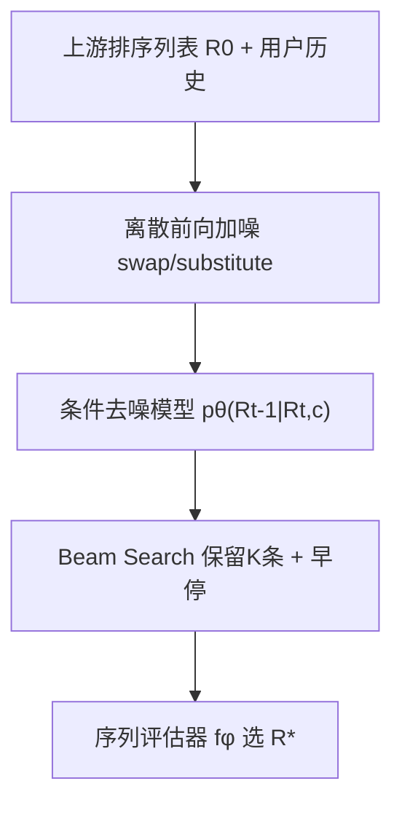
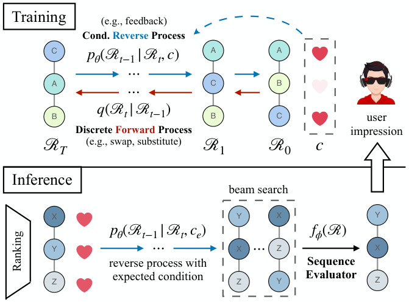

# Discrete Conditional Diffusion for Reranking in Recommendation (离散条件扩散推荐重排)

- **会议/期刊**: WWW 2024
- **作者与机构**: Xiao Lin, Xiaokai Chen, Chenyang Wang, Hantao Shu, Linfeng Song, Biao Li, Peng Jiang；快手
- **推荐链路定位**: 重排
- **研究方向**: 多任务学习与列表级重排 / 生成式推荐与离散语义 ID
- **论文原文**: [论文原文链接](https://arxiv.org/abs/2308.06982v1)
- **开源代码**: 暂未开源

## TL;DR (1分钟核心速览)

针对重排的组合搜索空间与列表上下文建模，本文将扩散生成引入重排：用交换/替换的离散前向加噪、以用户反馈为条件逆向去噪生成序列，并用 beam search 与评估器选序列。Avito 上 AUC 0.9172、NDCG@3 0.3901，较最强基线提升 1.56%/3.59%；VideoRerank 亦提升，线上 300M DAU A/B 正向指标显著。

## Background & Motivation (背景与核心矛盾)

- **主流范式**: 重排采用 evaluator-generator 范式，生成器产生可行排列，评估器按列表级效用选序列；传统生成器多为 GAN/VAE 或连续扩散。
- **前人局限**: 一是 item 排列本质离散，而主流扩散在连续空间加高斯噪声；二是推荐需以用户反馈为目标，生成器不能只重建曝光列表。
- **核心洞察 (Key Insight)**: 若把“交换/替换”设计成可处理离散马尔可夫链，就能保留扩散的逐步去噪优势，同时直接建模排列。
- **本文切入点**: 用离散前向过程 + 反馈条件逆向过程，将扩散变成可控序列生成器，并补齐 beam、评估器、早停等工业推理技巧。

## Method (核心方法设计)

### 1. 整体框架 (Overall Architecture)

DCDR 将上游排序列表 $\mathcal{R}_0$作为输入。训练时按离散前向过程逐步加噪得到$\mathcal{R}_t$，再以用户真实反馈$\mathbf{c}$为条件训练去噪模型$p_\theta(\mathcal{R}_{t-1}|\mathcal{R}_t,\mathbf{c})$恢复上一步序列；损失为可处理后验与模型分布间的 KL。推理时从初始排序列表而非纯噪声出发，将期望反馈设为全正向，逐步反向生成；每步保留$K$条候选，最终由序列评估器$f_\phi(\mathcal{R})$ 选最优序列，并在似然增益边际化时早停。

<figure class="paper-figure" markdown="span">
  <figcaption>图 2：DCDR 框架示意图，主要由：1）离散前向过程，和 2）条件逆向过程组成。在前向过程中，引入了两种具有可处理后验的离散操作；而在逆向过程中，引入用户反馈作为条件以控制生成。</figcaption>
</figure>

### 2. 关键设计拆解 (Key Designs)

1. **离散前向过程与可处理后验**：解决连续扩散不匹配排列空间的问题。排列级操作以 $1-\beta_t$保持原序列、以$\beta_t/C_{l_o}^2$随机交换一对 item；token 级操作以$1-\beta_t$保留同位、以$\beta_t/(l_s-1)$替换为输入序列中其他 item。二者转移矩阵双随机且遍历，平稳分布均匀，故$q(\mathcal{R}_{t-1}|\mathcal{R}_t,\mathcal{R}_0)$ 可由 Bayes 定理闭式算出，KL 可直接训练。

2. **反馈条件逆向去噪**：解决“生成序列应满足用户兴趣”而非仅重建曝光列表。去噪模型用 self-attention 编码当前噪声序列，再用历史 attention 聚合用户历史；反馈 $\mathbf{c}$映射为条件嵌入作为 query，聚合序列表示，按位置余弦相似度给出$p_\theta(\mathcal{R}_{t-1}|\mathcal{R}_t,\mathbf{c})$。训练用真实反馈，推理用期望正向反馈，实现可控生成。

3. **训练目标、负采样与推理效率**：总损失为扩散 KL，$\mathcal{L}_t=\mathbb{E}_{q(\mathcal{R}_t|\mathcal{R}_0)}[\mathrm{KL}(q(\mathcal{R}_{t-1}|\mathcal{R}_t,\mathcal{R}_0)\|p_\theta(\mathcal{R}_{t-1}|\mathcal{R}_t,\mathbf{c}))]$，无显式负采样；评估器用二元交叉熵与 rank-weighted sum 估计列表效用。转移矩阵可预计算，$l_o<10$ 时开销可控；线上平均延迟仅 +0.610%、最大 +0.696%。

## Experimental Setup & Evaluation Protocol (实验设置与评估协议)

- **数据集与预处理**: 未采用 `5-core` 过滤，样本为真实曝光列表；Avito 按前 21 天训练、后 7 天测试，VideoRerank 正文未交代时间切分。

| 数据集 | #Users | #Items | #Interactions | 稀疏度/密度 | 特征/场景说明 |
| :--- | :---: | :---: | :---: | :---: | :--- |
| Avito | 1.3M | 36M ads | 53M lists | 未报告 | 搜索广告曝光列表，列表长 5 |
| VideoRerank | 100,102 | 1,243,877 | 871,834 lists | 未报告 | 快手短视频真实曝光列表，列表长 6 |

- **数据划分与防穿越 (Splitting Strategy)**: Avito 为全局时间切分；VideoRerank 以完整 session 的真实展示列表为样本，避免人工构造列表造成穿越。
- **排名评测协议 (Ranking Protocol)**: 列表级重排评估，非全库 `Full-Ranking`；上游 Lambdamart 排序列表作为初始序列，重排后计算 AUC 与 NDCG@3。
- **对比基线与超参设置**: 对比 PRM、DLCM、SetRank、EGRerank、DiffusionLM-R；正文未报告 embedding 维度 $d$；beam 最优$K=6$，反向步数$T$取 1–5，噪声$\beta$在 0.1–0.5 调参；显著性$p<0.05$。

## Key Experimental Results (实验关键数据)

### 1. 主实验对比 (Main Results)

| 方法 | Avito AUC | Avito NDCG@3 | VideoRerank AUC | VideoRerank NDCG@3 |
| :--- | ---: | ---: | ---: | ---: |
| PRM | 0.8651 | 0.3559 | 0.6174 | 0.6317 |
| EGRerank | 0.8724 | 0.3570 | 0.6171 | 0.6325 |
| SetRank | 0.8663 | 0.3564 | 0.6037 | 0.6235 |
| DLCM | 0.8982 | 0.3578 | 0.6054 | 0.6251 |
| DiffusionLM-R | 0.9031 | 0.3766 | 0.6302 | 0.6422 |
| DCDR-T | 0.9120 | 0.3818 | 0.6340 | 0.6522 |
| **DCDR-P** | **0.9172** | **0.3901** | **0.6361** | **0.6576** |
| **Improv. vs 最强基线** | **+1.56%** | **+3.59%** | **+0.94%** | **+2.40%** |

DCDR-T/P 相对基线均标注 $p<0.05$ 显著。线上 A/B 相对 PRM：Views +0.341%、Likes +0.884%、Follows +1.100%、Collects +1.299%、Downloads +1.358%。

### 2. 消融实验 (Ablation Study)

原文未给独立 `w/o` 消融，以下用变体/替代对比：

| 变体 | Avito AUC | Avito NDCG@3 | Video AUC | Video NDCG@3 |
| :--- | ---: | ---: | ---: | ---: |
| DCDR-P 完整 | **0.9172** | **0.3901** | **0.6361** | **0.6576** |
| DCDR-T：token 级替换 | 0.9120 | 0.3818 | 0.6340 | 0.6522 |
| DiffusionLM-R：连续扩散替代 | 0.9031 | 0.3766 | 0.6302 | 0.6422 |

### 3. 关键实验发现 (Key Findings)

1. **排列级操作优于 token 级替换**：DCDR-P 比 DCDR-T 在 Avito 上 AUC +0.57%、NDCG@3 +2.17%，说明固定候选集内直接交换排列更能保留 item 集合与列表级效用。
2. **离散扩散显著优于连续扩散迁移**：DCDR-P 比 DiffusionLM-R 的 Avito NDCG@3 +3.59%、VideoRerank NDCG@3 +2.40%，验证离散转移矩阵与可处理后验更契合 item 排列。
3. **解码规模存在收益拐点**：Fig. 5 显示 beam $K=6$最佳，反向步数从 1 增至 5 先升后边际化，支持早停；$\beta$ 过大反而增加学习难度，需适中噪声。

## Highlights & Limitations (亮点、对比与审稿批判)

- **与代表作对比 (vs. Prior Work)**: PRM 用列表上下文打分后贪心排序；EGRerank 用 RL 生成器+评估器但训练不稳；DiffusionLM-R 将连续扩散套到离散 item。DCDR 的本质区别是离散前向 + 可处理后验 + 反馈条件控制。
- **可迁移亮点**: 从上游排序列表起始去噪，既保留偏好又减少步数；beam+评估器+早停可迁移到其他生成式重排/列表生成解码。
- **审稿级局限批判**: 排列空间为 $l_o!$，长列表扩展性受限；线上仅报告 DCDR-P vs PRM，缺少更充分的全库排序、冷启/稀疏分桶与独立组件消融，且代码未开源。

## Rating (四维评分)

- **方法创新性 (Novelty)**: ⭐⭐⭐⭐ （首个将离散条件扩散用于推荐重排，交换/替换前向与可处理后验设计新颖）
- **评估协议与实验扎实度 (Protocol & Experiments)**: ⭐⭐⭐⭐ （两离线数据集+300M DAU 线上 A/B，$p<0.05$，但缺独立消融与全库排序）
- **写作与数学规范度 (Clarity & Rigor)**: ⭐⭐⭐⭐ （后验推导与平稳分布证明完整，部分架构与超参细节略简）
- **工业落地与复现价值 (Industrial & Practical Value)**: ⭐⭐⭐⭐ （真实系统上线且延迟仅 +0.61%，但未开源、长列表成本需关注）

