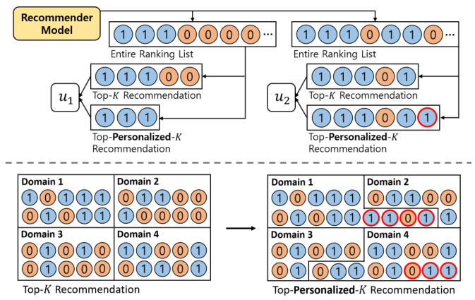
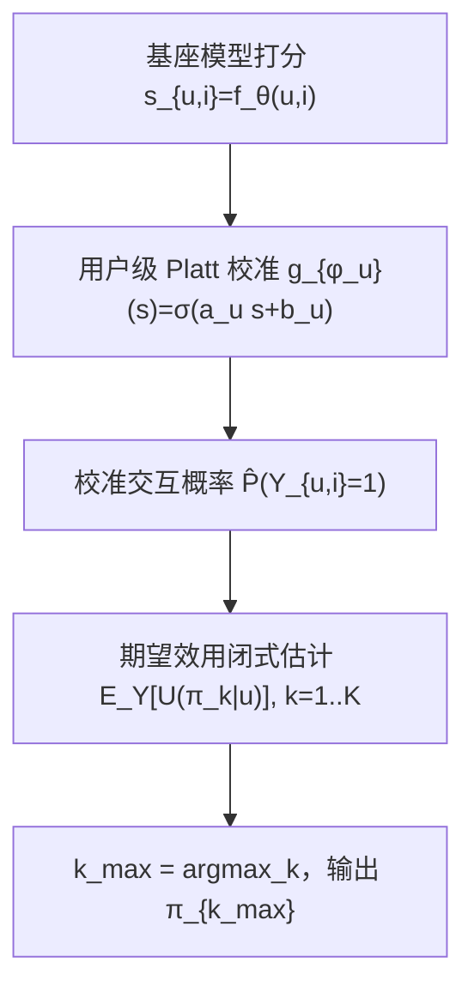

# Top-Personalized-K Recommendation (Top-个性化-K 推荐)

- **会议/期刊**: WWW 2024 (The ACM Web Conference)
- **作者与机构**: Wonbin Kweon、Sanghwan Jang、Hwanjo Yu (POSTECH)，SeongKu Kang (UIUC)
- **推荐链路定位**: 重排 / 列表级输出（列表长度决策）
- **研究方向**: 多任务学习与列表级重排 / CTR 预估与概率校准
- **论文原文**: [https://arxiv.org/abs/2402.16304v1](https://arxiv.org/abs/2402.16304v1)
- **开源代码**: [https://github.com/WonbinKweon/PerK_WWW2024](https://github.com/WonbinKweon/PerK_WWW2024)

## TL;DR (1分钟核心速览)

固定 $K$的 top-$K$推荐对所有用户“一刀切”：相关物品不足时被迫在尾部塞入无关项（引发广告盲视/用户流失），相关物品富余时又被人为截断（损失曝光与营收）。本文提出 **Top-Personalized-K Recommendation** 新任务，并给出模型无关框架 **PerK**：先用用户级 Platt 校准把任意推荐模型的排序分映射为校准交互概率，再以伯努利假设推导 NDCG/PDCG/F1/TP 的**期望效用闭式解**，取期望效用最大的$k\in[K]$。在 4 个真实数据集 × 3 个基座模型的全库排序评估下，F1 相对最强基线 MtCut 提升 3.72%–8.98%，TP 最高提升 16.43%，推理耗时仅增约 10%。

## Background & Motivation (背景与核心矛盾)

- **主流范式**: 推荐系统普遍输出全局固定长度 $K$的 top-$K$列表；概率排序原则仅在$K$ 固定时保证效用最优，故长度选择本身从未被优化。
- **前人局限**: ①文档检索的列表截断方法（AttnCut、MtCut）依赖稠密相关标签与高维文本特征做分类；推荐场景极度稀疏、且未观测项中混有 hidden-relevant 正例，标签噪声大，深层分类器极易过拟合到“全局表现最好的 k”（实验显示其长度分布尖锐堆叠于 10–20）。
- **前人局限**: ②朴素方案（验证集选最优 k / 随机 k）在稀疏噪声交互下过拟合验证集，甚至不如最优固定 $K$。
- **核心洞察 (Key Insight)**: 用户真实效用不可直接计算，但若把未观测项的交互标签视为伯努利变量，效用的**期望**可仅由交互概率解析算出——瓶颈于是从“预测长度”退化为“拿到准确概率”。
- **本文切入点**: 用“校准概率 + 期望效用闭式估计”替代“端到端长度分类器”，把长度决策变成一个免训练的推理期最优搜索。<figure class="paper-figure" markdown="span">
  <figcaption>图 1：top-personalized-𝐾推荐的一个示例。1 和 0 分别表示相关与不相关物品。注意，这些标签在推理阶段不可用。新增物品以红色轮廓标出。</figcaption>
</figure>

## Method (核心方法设计)

### 1. 整体框架 (Overall Architecture)

给定已训练且冻结的推荐模型 $f_\theta$，PerK 分三步闭环：(1) 在验证集构造的用户级校准集上拟合$g_{\phi_u}$，把无界排序分$s_{u,i}$映射为校准交互概率$\hat{P}(Y_{u,i}=1)$；(2) 对$k=1,\dots,K$，用校准概率代入期望效用闭式公式，并行估计$\mathbb{E}_Y[U(\pi_k|u)]$；(3) 取$\arg\max_k$输出前缀$\pi_{k_{\max}}$。整个过程不重训基座模型，只增加每用户 2 个参数。

### 2. 关键设计拆解 (Key Designs)

1. **双层优化与期望效用 (Expected User Utility)**：外层要选 $k$，但内层列表$\pi_k$已知是 top-$k$排序，故只需解外层$\max_k U(\pi_k|u)$；真值不可得则改用期望。以 PDCG 为例，因惩罚项线性可加，期望有极简闭式$\mathbb{E}_Y[U_{\text{PDCG}}(\pi_k|u)]=\sum_{r=1}^{k}\frac{2P(Y_{u,r}=1)-1}{\log_2(1+r)}$——**相关性概率超过 0.5 的尾部位置即贡献正效用**，这正是“允许延长列表”的理论依据。NDCG/F1/TP 因分母含$S_u^Y=\sum_{i\in\mathcal{I}^-_u}Y_{u,i}$（总相关数），需按全期望定理对$S_u^Y$分层：$\mathbb{E}[U_{\text{NDCG}}]\approx\sum_{m=1}^{M}\frac{\sum_{r=1}^{k}P(Y_{u,r}=1)P(S_u^Y=m-1)/\log_2(1+r)}{\sum_{r=1}^{\min(m,k)}1/\log_2(1+r)}$，其中$S_u^Y$服从 Poisson-Binomial 分布，可由各$P(Y_{u,i}=1)$ 的卷积得到。
2. **用户级 Platt 校准 (User-wise Calibration)**：推荐模型输出常是无界分数或系统性高估的概率，直接当 $P(Y=1)$会让期望效用整体偏移。PerK 为**每个用户**单独实例化$g_{\phi_u}(s)=\sigma(a_us+b_u)$，以 BCE 在$\mathcal{D}^{\text{cal}}_u=\{(u,i,1)\mid i\in\mathcal{I}^{\text{val}}_u\}\cup\{(u,i,0)\mid i\in\mathcal{I}^-_u\setminus\mathcal{I}^{\text{val}}_u\}$ 上训练。按用户分组的关键直觉：不同用户的打分离散度差异极大，全局单一温度会把高分用户的概率压扁、低分用户抬高，而长度决策恰恰对概率绝对值的敏感性极高。
3. **训练目标、负采样与推理效率**：基座模型冻结，仅优化 $\mathcal{L}_{\text{cal}}=\sum_{(u,i,Y)}-[Y\log g_{\phi_u}(s)+(1-Y)\log(1-g_{\phi_u}(s))]$（等价逻辑回归，凸问题秒解）。推理侧两项加速：$M\le 2000$截断（用户实际相关项极少，$m>M$的尾概率可忽略）与$P(S_u^Y-r=m-1)\approx P(S_u^Y=m-1)$近似；所有$k$ 与所有用户并行向量化，实测每用户生成列表耗时仅从 2.871 ms 升至 3.022 ms（+5%~10%）。

## Experimental Setup & Evaluation Protocol (实验设置与评估协议)

- **数据集与预处理**: 4 个公开数据集，统一采用 **20-core** 过滤（用户与物品均至少 20 次交互）；具体用户/物品/交互规模见原文附录 A.3（此处不臆造）。

| 数据集 | 领域 | 过滤 | 划分 | 候选集 | 评估效用 |
| :--- | :--- | :---: | :---: | :---: | :--- |
| MovieLens 10M | 电影 | 20-core | 每用户随机 60/20/20 | 全库未交互 $\mathcal{I}^-_u$ | NDCG / PDCG / F1 / TP |
| MovieLens 25M | 电影 | 20-core | 每用户随机 60/20/20 | 同上 | 同上 |
| CiteULike | 学术文献 | 20-core | 每用户随机 60/20/20 | 同上 | 同上 |
| Amazon Books | 图书电商 | 20-core | 每用户随机 60/20/20 | 同上 | 同上 |

- **数据划分与防穿越 (Splitting Strategy)**: 每用户按 6:2:2 随机切分训练/验证/测试；验证集复用为校准集，测试集仅用于最终评测，**长度决策阶段不看任何测试标签**（Oracle 例外，仅作上界）。
- **排名评测协议 (Ranking Protocol)**: 无偏 **Full-Ranking**——在用户全部未交互物品 $\mathcal{I}^-_u$上排序；测试集正例记为相关，其余未交互项记为不相关（含 hidden-relevant 噪声，符合真实分布）。最大候选长度$K=50$。
- **对比基线与超参设置**: Oracle（真值上界）、Top-$k$($k\in\{1,5,10,20,50\}$)、Rand（下界）、Val-$k$（验证集选长）、AttnCut、MtCut(MMoECut)；基座模型 BPR / NCF / LightGCN 三种架构与损失；结果取 3 次独立运行均值，paired t-test，显著性水平$p<0.05$（表中所有 Improv. 均显著）。

## Key Experimental Results (实验关键数据)

### 1. 主实验对比 (Main Results)

下表为 BPR 基座下的 NDCG / F1（完整 4 指标 × 3 基座见原文表 1）：

| Method | ML-10M NDCG | ML-10M F1 | CiteULike NDCG | CiteULike F1 | ML-25M NDCG | ML-25M F1 | ABooks NDCG | ABooks F1 |
| :--- | :---: | :---: | :---: | :---: | :---: | :---: | :---: | :---: |
| Oracle (上界) | 0.6190 | 0.3152 | 0.3020 | 0.1806 | 0.5961 | 0.2883 | 0.1895 | 0.1133 |
| Top-10 | 0.3725 | 0.1984 | 0.1495 | 0.1024 | 0.3496 | 0.1757 | 0.0828 | 0.0582 |
| Top-20 | 0.3734 | 0.2228 | 0.1668 | 0.1108 | 0.3460 | 0.2013 | 0.0955 | 0.0584 |
| Top-50 | 0.4057 | 0.2117 | 0.2021 | 0.0930 | 0.3740 | 0.1983 | 0.1203 | 0.0496 |
| Rand | 0.3872 | 0.2046 | 0.1738 | 0.1003 | 0.3611 | 0.1865 | 0.0998 | 0.0535 |
| Val-$k$ | 0.4562 | 0.2270 | 0.1922 | 0.1061 | 0.4368 | 0.2052 | 0.1093 | 0.0563 |
| AttnCut | 0.4604 | 0.2371 | 0.2024 | 0.1063 | 0.4392 | 0.2087 | 0.1203 | 0.0566 |
| MtCut | 0.4621 | 0.2383 | 0.2034 | 0.1071 | 0.4413 | 0.2140 | 0.1212 | 0.0568 |
| **PerK** | **0.4901** | **0.2538** | **0.2159** | **0.1117** | **0.4687** | **0.2300** | **0.1261** | **0.0619** |
| Improv. vs MtCut | +6.06% | +6.50% | +6.15% | +4.30% | +6.21% | +7.48% | +4.04% | +8.98% |

LightGCN 基座下 TP 提升最猛（ML-10M **+15.22%**、ML-25M **+6.80%**），NCF 基座 F1 提升 6.50%–7.77%，说明 PerK 对基座架构与损失函数完全解耦。

### 2. 消融实验 (Ablation Study)

校准模块消融（基座 NCF；ECE 越低越好，效用越高越好）：

| 数据集 | 校准方式 | ECE ↓ | NDCG | F1 | TP |
| :--- | :--- | :---: | :---: | :---: | :---: |
| ML-10M | uncalibrated | 0.1284 | 0.4083 | 0.1966 | 0.4481 |
| ML-10M | global (全局 Platt) | 0.0046 | 0.4255 | 0.2175 | 0.4925 |
| ML-10M | **user-wise (本文)** | **0.0011** | **0.4482** | **0.2293** | **0.5335** |
| ML-25M | uncalibrated | 0.1572 | 0.3612 | 0.1669 | 0.3812 |
| ML-25M | global | 0.0422 | 0.3761 | 0.1757 | 0.4007 |
| ML-25M | **user-wise (本文)** | **0.0098** | **0.4056** | **0.1960** | **0.4742** |
| ABooks | uncalibrated | 0.3371 | 0.0812 | 0.0427 | 0.1391 |
| ABooks | global | 0.0581 | 0.0946 | 0.0449 | 0.1477 |
| ABooks | **user-wise (本文)** | **0.0171** | **0.0982** | **0.0468** | **0.1553** |

开销消融（BPR，ML-10M / ABooks）：参数量 5.041M→5.181M、34.542M→34.857M（每用户仅 +2 参数）；时延 2.871→3.022 ms、2.636→2.973 ms。

### 3. 关键实验发现 (Key Findings)

1. **个性化长度确实存在巨大收益空间，且 PerK 吃到了三分之一**：Oracle 与最优固定 $K$之间的 F1 差距在 ML-10M 上为$0.3152-0.2228=0.0924$，PerK 取得 0.2538，弥合约 **33.5%** 的效用鸿沟；而在 ABooks 上 Top-50 的 F1（0.0496）竟低于 Top-10（0.0582），证明“固定长度”本身即是性能瓶颈而非模型能力问题。
2. **固定 $K$的尾部惩罚是单调恶化，PerK 把 PDCG 由负转正**：BPR/ML-10M 的 PDCG 随$K$增大从 Top-1 的$-0.0902$一路崩到 Top-50 的$-7.1636$（尾部全是负贡献项），而 PerK 达到 **+0.2087**，是唯一在 PDCG 上取正值的非 Oracle 方法——直接验证了“概率 > 0.5 才延长列表”的闭式判据有效。
3. **截断式分类器严重过拟合到全局最优 k，而校准式回归更稳健**：MtCut 的推荐长度分布尖锐堆叠在 $[10,20]$（正是表中 F1 的全局最优区间），与 Oracle 的分散分布严重不符；PerK 的分布平滑且贴近 Oracle。对应到消融，用户级校准把 ML-25M 的 ECE 从 0.0422 压到 0.0098，F1 随之从 0.1757 升至 0.1960（+11.6%）——**校准精度直接兑换为效用**。

## Highlights & Limitations (亮点、对比与审稿批判)

- **与代表作对比 (vs. Prior Work)**: 与 AttnCut/MtCut 等文档截断方法相比，PerK 不做长度分类、不需高维内容特征，仅用标量分数 + 校准概率即可工作，天然免疫推荐场景的标签稀疏与 hidden-positive 噪声；与 Val-$k$相比，它用解析期望替代单点验证效用，避免过拟合 20% 的小验证集；与固定 top-$K$ 相比，它把“长度”从超参变成逐用户决策变量。
- **可迁移亮点**: ①“先校准概率、再算期望效用、最后做离散决策”这一三步范式可直接迁移到**多目标融合的列表长度/广告位分配/多域混排预算分配**；②用户级 Platt scaling（每人 2 个参数）是极低成本、即插即用的后处理校准件，可加在任何输出无界分数的双塔/图模型之后。
- **审稿级局限批判**: ①期望效用的推导建立在**用户-物品交互条件独立**的伯努利假设上，Poisson-Binomial 忽略了物品间相关性（如同一系列电影），在强共现场景下 $S_u^Y$的方差会被低估；②$M\le 2000$截断与$P(S_u^Y-r)\approx P(S_u^Y)$ 两个近似缺乏误差上界证明，对长尾重度用户（相关项可能远超 2000）可能系统性偏短；③评估仍为离线全库排序，缺少在线 A/B 对留存/营收的验证，而“缩短列表减少无关曝光”的真实用户反馈（广告盲视缓解）无法在离线指标中体现；④基座模型完全冻结，未考虑长度决策与排序分数的联合优化，理论上存在次优。

## Rating (四维评分)

- **方法创新性 (Novelty)**: ⭐⭐⭐⭐ （首次形式化“个性化推荐长度”任务并给出双层优化建模，期望效用的闭式推导（尤其 PDCG 的线性化简）优雅且具解释性，但核心组件 Platt scaling 与 Poisson-Binomial 均为成熟工具的组合）
- **评估协议与实验扎实度 (Protocol & Experiments)**: ⭐⭐⭐⭐ （4 数据集 × 3 基座 × 4 效用指标的全库排序评估 + Oracle 上界 + 显著性检验相当完整，长度分布与案例研究有说服力；扣分在于仅离线评估、缺少在线验证与近似误差分析）
- **写作与数学规范度 (Clarity & Rigor)**: ⭐⭐⭐⭐ （双层优化与四类效用的期望推导链条清晰、符号统一，PDCG 闭式与 F1/TP 的全期望分层交代到位；NDCG 近似的合理性主要靠经验而非误差界支撑）
- **工业落地与复现价值 (Industrial & Practical Value)**: ⭐⭐⭐⭐⭐ （模型无关、无需重训、每用户仅增 2 参数、时延 +10%，代码已开源，可直接套在现网排序模型后作为“列表长度决策层”，对多域混排与广告位分配场景尤具吸引力）

