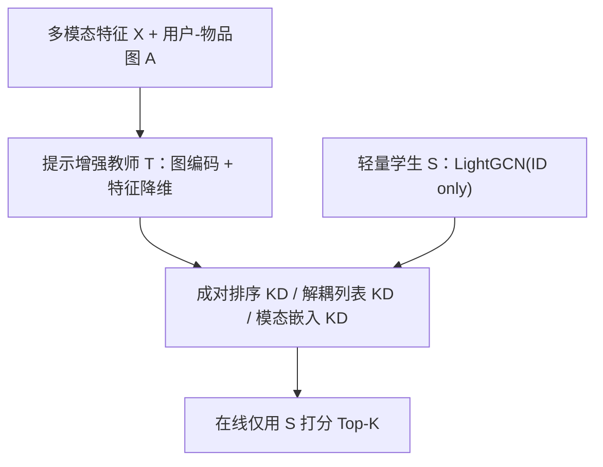
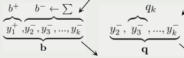

# PromptMM: Multi-Modal Knowledge Distillation for Recommendation with Prompt-Tuning (PromptMM：面向推荐的提示微调多模态知识蒸馏)

- **会议/期刊**: WWW 2024
- **作者与机构**: Wei Wei, Jiabin Tang, Yangqin Jiang, Lianghao Xia, Chao Huang（香港大学）
- **推荐链路定位**: 召回 / 端到端轻量推理
- **研究方向**: 多模态推荐 / 去噪与鲁棒表征
- **论文原文**: [论文原文链接](https://arxiv.org/abs/2402.17188v3)
- **开源代码**: [开源代码仓库链接](https://github.com/HKUDS/PromptMM)

## TL;DR (1分钟核心速览)

针对多模态推荐中高维视觉/文本特征导致参数膨胀与过拟合、以及模态噪声扭曲用户偏好两大痛点，PromptMM 用两阶段离线蒸馏把笨重教师压缩为仅 LightGCN 的轻量学生：软提示桥接语义、成对排序/解耦列表/嵌入三层 KD 迁移知识。三数据集 Full-Ranking 下 R@20/N@20 相对最优基线提升 3.5%–14.8%，学生参数仅为教师的 2.70%–7.83%。

## Background & Motivation (背景与核心矛盾)

- **主流范式**: GNN 多模态推荐将 ViT/BERT 等高维特征经降维层并入图传播，代表工作有 MMGCN、LATTICE、SLMRec。
- **前人局限**: 模态特征维度 $d_m\gg d$，额外降维参数在稀疏交互上加重过拟合；副信息本身含冗余与噪声，且与协同信号存在语义鸿沟，直接融合会误导用户偏好建模。
- **核心洞察 (Key Insight)**: 在线推理未必需要携带模态编码器，模态知识可离线蒸馏；但教师若被噪声污染，直接 KD 会把偏差传给学生，因此教师也需被“任务适配”增强。
- **本文切入点**: 用软提示将学生任务梯度注入冻结教师，并对 list-wise 软标签解耦重加权，实现去噪蒸馏。

## Method (核心方法设计)

### 1. 整体框架 (Overall Architecture)

PromptMM 采用两阶段离线蒸馏。第一阶段训练多模态图教师 $T(\cdot)$与提示模块$P(\cdot)$；第二阶段冻结教师参数，仅训练轻量学生$S(\cdot)$（LightGCN，仅用 ID 嵌入）并继续更新提示模块。教师输出两类知识：协同边关系与模态感知节点内容；学生通过成对排序 KD、解耦列表 KD、模态嵌入 KD 接收监督。在线部署只保留学生，彻底移除高维特征降维层。

<figure class="paper-figure" markdown="span">
  <figcaption>图1：PromptMM 旨在学习一个在线消耗极小的轻量级推荐器，包含三类知识蒸馏：i) 排序知识蒸馏；ii) 去噪的模态感知排序知识蒸馏；iii) 模态感知嵌入知识蒸馏。此外，提示微调用于自适应的任务相关知识蒸馏；引入解耦与重加权来调节模态中噪声的影响。</figcaption>
</figure>
图 1：PromptMM 整体框架：提示增强教师与三类知识蒸馏，在线仅部署轻量学生。

### 2. 关键设计拆解 (Key Designs)

1. **软提示语义桥 (Soft Prompt as Semantic Bridge)**：模态内容与协同信号分布不一致，教师降维层易过拟合任务无关冗余。本文构造语义初始化的提示 $\mathbf{p}=P(\eta(\frac{1}{|\mathcal{M}|}\sum_m \mathbf{x}^m))$，再注入教师降维层：$\mathbf{f}^m=\rho((\mathbf{x}^m+\lambda_1\mathbf{p}^m)\mathbf{W}_R^m+\mathbf{b}_R^m)$。直觉是用学生任务相关梯度塑造提示，让冻结教师输出更贴近推荐任务的模态表征。

2. **解耦列表蒸馏与重加权 (Disentangled List-wise KD)**：普通 list-wise KL 会把不确定的未交互项也强行迁移。本文将排序 logits 拆成总体二元偏好 $\mathbf{b}=[b^+,b^-]$ 与未观测集合内部细粒度分布 $\mathbf{q}$，并重写为 $\mathcal{L}_{ListKD}=-\sum_m[\mathrm{KL}(\mathbf{b}^T\|\mathbf{b}^S)+(b_T^+-1)\mathrm{KL}(\mathbf{q}^T\|\mathbf{q}^S)]$。$b_T^+$ 控制细粒度知识迁移强度，低置信关系被降权，从而抑制模态噪声。

3. **训练目标、负采样与推理效率**：总损失为 $\mathcal{L}=\mathcal{L}_{BPR}+\lambda_2\mathcal{L}_{PairKD}+\lambda_3\mathcal{L}_{ListKD}+\lambda_4\mathcal{L}_{EmbKD}$，其中 $\mathcal{L}_{PairKD}=-\sum y_{pair}^T(\log y_{pair}^T-\log y_{pair}^S)$，$y_{pair}=\log\mathrm{sigmoid}(\mathbf{e}_u\cdot\mathbf{e}_{i^+}-\mathbf{e}_u\cdot\mathbf{e}_{i^-})$；嵌入 KD 用 SCE：$\mathcal{L}_{EmbKD}=\sum_m\frac{1}{|\mathcal{I}|}\sum_i(1-\cos(\mathbf{e}_i^S,\mathbf{f}_i^m))^\gamma$。训练采用 BPR 三元组负采样（$A[u,i^-]=0$），推理无负采样，仅学生对全库内积排序，复杂度$O(L|\mathcal{E}|d)$。

## Experimental Setup & Evaluation Protocol (实验设置与评估协议)

- **数据集与预处理**: 原文未显式披露 k-core 过滤；交互二值化为隐式图，统计如下。

| 数据集 | #Users | #Items | #Interactions | 稀疏度 | 特征/场景说明 |
| :--- | :---: | :---: | :---: | :---: | :--- |
| Netflix | 43,739 | 17,239 | 609,341 | 99.919% | 海报 CLIP-ViT 512 + BERT 768 |
| Tiktok | 14,343 | 8,690 | 276,637 | 99.778% | 视觉/音频各 128 + SBERT 768 |
| Electronics | 41,691 | 21,479 | 359,165 | 99.960% | CNN 视觉 4,096 + SBERT 1024 |

- **数据划分与防穿越 (Splitting Strategy)**: 论文正文未明确给出 Leave-One-Out 或比例切分，需以代码/附录核对；评测严格采用全库未交互排序。
- **排名评测协议 (Ranking Protocol)**: 无偏 **Full-Ranking**，报告 Recall@20/50 与 NDCG@20/50，并以 $p$-value 做显著性检验。
- **对比基线与超参设置**: 对比 BPR-MF、NGCF、LightGCN、VBPR、MMGCN、GRCN、CLCRec、SLMRec、LATTICE；教师学习率 $[3.5e^{-4},9.8e^{-3}]$，学生$[2.5e^{-4},8.5e^{-4}]$，$L_2$正则$\{2.5e^{-3},7.4e^{-3},2.1e^{-2}\}$，表示维度在$\{16,32,64,128\}$ 搜索，约 64 饱和且师生同维更优。

## Key Experimental Results (实验关键数据)

### 1. 主实验对比 (Main Results)

| 方法 | Netflix R@20 | N@20 | Tiktok R@20 | N@20 | Electronics R@20 | N@20 |
| :--- | :---: | :---: | :---: | :---: | :---: | :---: |
| LightGCN | 0.1605 | 0.0609 | 0.0612 | 0.0211 | 0.0259 | 0.0101 |
| VBPR | 0.1661 | 0.0621 | 0.0525 | 0.0186 | 0.0234 | 0.0095 |
| MMGCN | 0.1685 | 0.0620 | 0.0629 | 0.0208 | 0.0273 | 0.0114 |
| GRCN | 0.1762 | 0.0661 | 0.0642 | 0.0211 | 0.0281 | 0.0117 |
| CLCRec | 0.1801 | 0.0719 | 0.0657 | 0.0214 | 0.0300 | 0.0118 |
| SLMRec | 0.1743 | 0.0682 | 0.0669 | 0.0221 | 0.0331 | 0.0132 |
| LATTICE | 0.1654 | 0.0623 | 0.0675 | 0.0232 | 0.0340 | 0.0135 |
| **PromptMM** | **0.1864** (+3.5%) | **0.0743** (+3.3%) | **0.0737** (+9.2%) | **0.0258** (+11.2%) | **0.0369** (+8.5%) | **0.0155** (+14.8%) |

### 2. 消融实验 (Ablation Study)

| 变体 | Netflix R@20 | N@20 | Tiktok R@20 | N@20 | Electronics R@20 | N@20 |
| :--- | :---: | :---: | :---: | :---: | :---: | :---: |
| w/o-Prompt | 0.1665 | 0.0662 | 0.0681 | 0.0240 | 0.0280 | 0.0117 |
| w/o-PairKD | 0.1774 | 0.0689 | 0.0692 | 0.0242 | 0.0277 | 0.0112 |
| w/o-ListKD | 0.1690 | 0.0487 | 0.0673 | 0.0234 | 0.0331 | 0.0136 |
| w/o-disentangle | 0.1712 | 0.0693 | 0.0706 | 0.0249 | 0.0353 | 0.0141 |
| **PromptMM** | **0.1864** | **0.0743** | **0.0737** | **0.0258** | **0.0369** | **0.0155** |

### 3. 关键实验发现 (Key Findings)

1. **提示桥接是最大增益来源之一**：去掉 Prompt 后 Netflix R@20 从 0.1864 降至 0.1665（-10.7%），Electronics 从 0.0369 降至 0.0280（-24.1%）；高维特征数据集受益更明显，说明语义提示确实缓解了教师降维层的任务失配与过拟合。
2. **解耦 list-wise KD 的降噪作用在 NDCG 上最敏感**：Netflix 上 w/o-ListKD 的 N@20 仅 0.0487，相对完整模型下降 34.5%；而 w/o-disentangle 在 Tiktok/Electronics 上也分别降至 0.0706/0.0353，证明“拆分总体偏好与细粒度排序再重加权”比普通 KL 更能过滤不可靠模态监督。
3. **精度与压缩效率同时成立**：学生参数 1.95M/2.67M，仅为教师的 7.83%/2.70%；每 epoch 时间 23.3s/13.9s，优于教师 42.6s/30.8s 与 LATTICE 61.0s/45.1s，同时主指标更高。说明离线蒸馏把模态编码成本移出在线，且未牺牲排序质量。

## Highlights & Limitations (亮点、对比与审稿批判)

- **与代表作对比 (vs. Prior Work)**: MMGCN/LATTICE/SLMRec 在线仍需模态降维或同质图学习；PromptMM 将模态编码完全移到教师侧，在线仅 LightGCN。相比普通 KD，本文让提示模块随学生任务更新，并将 list-wise KL 解耦重加权；相比 CLCRec 的对比对齐，本文直接蒸馏排序知识而非重建模态一致性。
- **可迁移亮点**: ①用学生任务梯度更新 soft prompt，作为冻结大模型的“任务适配器”，可迁移到多教师/跨域蒸馏；②将 list-wise KL 拆成总体二元偏好与内部细粒度分布，并按置信度重加权，适用于任何含噪软标签蒸馏。
- **审稿级局限批判**: ①两阶段离线蒸馏训练成本不低，且师生维度需一致才更优，压缩自由度受限；②解耦重加权依赖教师 soft label 的校准质量，教师偏差大时 $b_T^+$ 可能失效；③评估仅三数据集且未披露切分细节，缺少冷启动/长尾分桶与线上 A/B，工业结论仍需补强。

## Rating (四维评分)

- **方法创新性 (Novelty)**: ⭐⭐⭐⭐ （将 soft prompt 与多模态 KD 结合，并以解耦 list-wise 蒸馏处理噪声，组合新颖但理论保证有限）
- **评估协议与实验扎实度 (Protocol & Experiments)**: ⭐⭐⭐⭐ （三数据集 Full-Ranking、$p$-value、消融与效率分析完整，但切分协议未明示且缺少长尾分桶）
- **写作与数学规范度 (Clarity & Rigor)**: ⭐⭐⭐⭐ （公式与复杂度分析清晰，Eq.8–10 推导较密，提示符号与概率记号略易混淆）
- **工业落地与复现价值 (Industrial & Practical Value)**: ⭐⭐⭐⭐⭐ （开源完整，参数压至 2.70%–7.83%，在线推理显著加速，部署价值明确）

