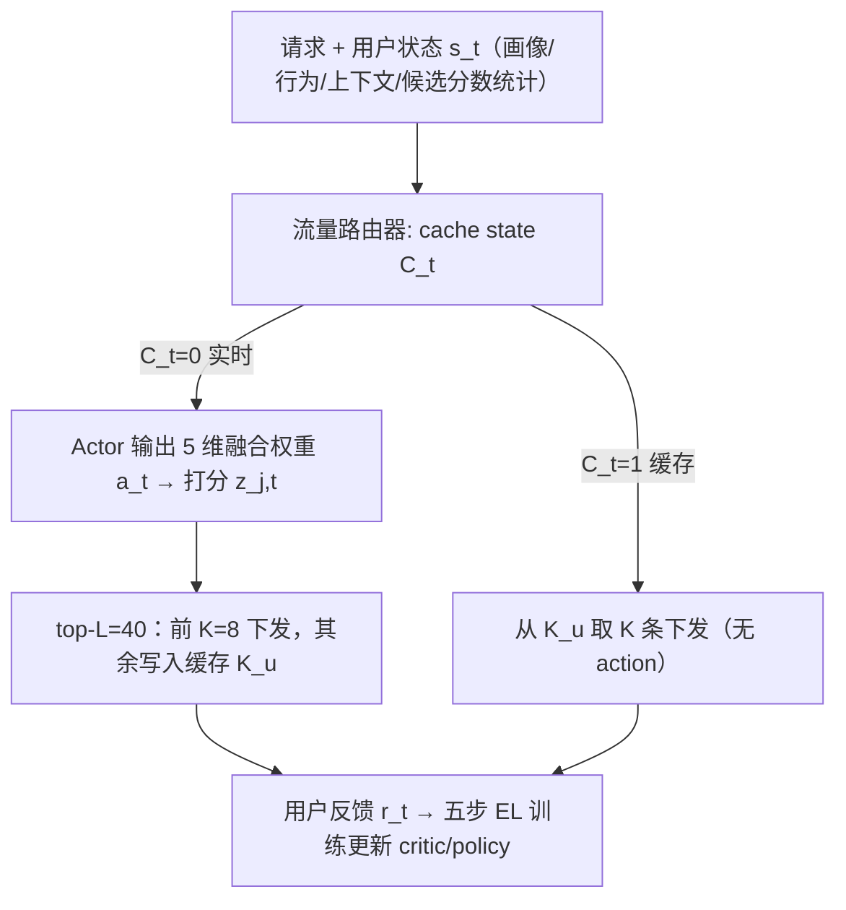
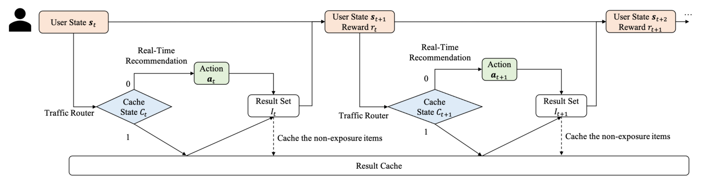

# Cache-Aware Reinforcement Learning in Large-Scale Recommender Systems (大规模推荐系统中的缓存感知强化学习)

- **会议/期刊**: WWW 2024 (Companion)
- **作者与机构**: Xiaoshuang Chen, Gengrui Zhang, Yao Wang, Yulin Wu, Shuo Su, Kaiqiao Zhan, Ben Wang（快手科技 Kuaishou Technology）
- **推荐链路定位**: 精排/重排阶段的分数融合 + 结果缓存调度（端到端在线服务）
- **研究方向**: 强化学习与动态探索推荐 / 多任务学习与列表级重排
- **论文原文**: [论文原文链接](https://arxiv.org/abs/2404.14961v1)
- **开源代码**: 暂未开源

## TL;DR (1分钟核心速览)

大规模推荐的峰谷 QPS 差数倍，峰值期约 40% 请求走"用户级结果缓存"（缓存结果观看时长仅为实时推荐的 0.85×、点赞 0.68×），而传统 RL 假设每步都有 action、且忽略缓存差异。本文把"走实时计算还是走缓存"抽象为与用户状态无关的 cache state 加入 MDP，并提出特征函数学习 (EL) 解耦互相耦合的 $Q_0/Q_1$ 双 critic。Kwai 线上 A/B（1 亿+ 用户）session 观看时长相对 CEM +0.545%、日观看时长 +0.586%，critic loss 由 0.30→0.25。

## Background & Motivation (背景与核心矛盾)

- **主流范式**: RL4Rec 把用户当环境、推荐系统当 agent，通过实时反馈序列优化长期留存/时长；工业界则用"实时计算 + 结果缓存"削峰填谷，buffer 中的 $L-K$ 条候选留作下次直接下发。
- **前人局限**: 其一，缓存命中时不存在 action，破坏了 RL"每步可交互"的假设；其二，是否命中缓存由全局流量队列决定，与用户状态 $\boldsymbol{s}_t$ 完全无关，学习者无法预测；其三，缓存结果与实时结果奖励分布异质（表 1 显示三类指标分别衰减至 0.85/0.68/0.54），单一 critic 会系统性高估。
- **核心洞察 (Key Insight)**: 缓存状态 $C_t$只依赖系统负载$D_c(t)=P(C_t=c)$，与$\boldsymbol{s}_t,\boldsymbol{a}_t$独立；因此$Q_0$与$Q_1$ 的耦合是"可解析解耦"的线性结构，而非必须用黑盒网络硬拟合。
- **本文切入点**: 把 $C_t$ 作为 MDP 的显式状态条件，用特征函数（eigenfunction）把耦合的 TD 迭代变换为两条互不依赖的迭代式。

## Method (核心方法设计)

### 1. 整体框架 (Overall Architecture)

每次请求由流量路由器给出 $C_t\in\{0,1\}$：$C_t=0$时 actor 依$\boldsymbol{s}_t$输出 5 维连续动作$\boldsymbol{a}_t\in[0,3]^5$，作为 5 个反馈预测（watchtime/shortview/longview/finish/forward）的融合权重，得到$z_{j,t}=f(\boldsymbol{x}_{j,t};\boldsymbol{a}_t)$，取 top-$L=40$，前$K=8$下发、其余$L-K$条写入用户缓存$\mathcal{K}_u$；$C_t=1$时直接从$\mathcal{K}_u$取$K$条下发并删去，无 action。训练侧用 15 分钟不活跃规则切 session，相邻两请求构成一条 RL 样本入 replay buffer，在线五步循环（学即时奖励→算特征即时奖励→学$\Lambda_b$→恢复$Q_0,Q_1$→策略梯度）更新 actor。

<figure class="paper-figure" markdown="span">
  <figcaption>图3：CARL 模型。</figcaption>
</figure>

### 2. 关键设计拆解 (Key Designs)

1. **缓存条件双 critic 与 Critic Dependency 诊断**：把长期回报按 $C_t$条件化，$Q_0(\boldsymbol{s}_t,\boldsymbol{a}_t)\triangleq\mathbb{E}[R_t|C_t=0]$、$Q_1(\boldsymbol{s}_t)\triangleq\mathbb{E}[R_t|C_t=1]$。直接学习 (DL) 的 TD 目标$l_{DL}(\phi)=[Q_{C_t}(\boldsymbol{s}_t,\boldsymbol{a}_t;\phi)-(r_t+\gamma Q_{C_{t+1}}(\boldsymbol{s}_{t+1},\mu(\boldsymbol{s}_{t+1};\theta^-);\phi^-))]^2$会因$C_{t+1}$随机而在$Q_0,Q_1$间产生 4 种交叉依赖（表 2）；由反向归纳得$Q_0=V_0+\gamma D_0(t{+}1)\mathbb{E}Q_0+\gamma D_1(t{+}1)\mathbb{E}Q_1$、$Q_1=V_1+\gamma D_0(t{+}1)\mathbb{E}Q_0+\gamma D_1(t{+}1)\mathbb{E}Q_1$，二者互为对方输入，方差被缓存比例的抖动放大。
2. **特征函数学习 (EL) 解耦两条 TD 链**：定义特征即时/长期奖励 $\Gamma_a=V_0-V_1,\ \Gamma_b=D_0V_0+D_1V_1$；$\Lambda_a=Q_0-Q_1,\ \Lambda_b=D_0Q_0+D_1Q_1$。关键命题是$\Lambda_a(\boldsymbol{s}_t,\boldsymbol{a}_t)=\Gamma_a(\boldsymbol{s}_t,\boldsymbol{a}_t)$、$\Lambda_b(\boldsymbol{s}_t,\boldsymbol{a}_t)=\Gamma_b(\boldsymbol{s}_t,\boldsymbol{a}_t)+\gamma\Lambda_b(\boldsymbol{s}_{t+1},\boldsymbol{a}_{t+1})$。物理直觉：未来缓存状态与当前缓存状态独立，故"实时 vs 缓存"的**差值**不必再打折传播，退化为单步即时差；只有加权和$\Lambda_b$需要类标准 TD 递推且完全不含$\Lambda_a$。再由$Q_0=D_1\Lambda_a+\Lambda_b$、$Q_1=-D_0\Lambda_a+\Lambda_b$ 无损还原，用于 actor 提升。
3. **训练目标、负采样与推理开销**：三步损失依次为 $l(\psi)=\mathbb{I}[C_t{=}0](r_t-V_0)^2+\mathbb{I}[C_t{=}1](r_t-V_1)^2$、$l(\rho)=[\Lambda_b(\boldsymbol{s}_t,\boldsymbol{a}_t;\rho)-(\Gamma_b+\gamma\Lambda_b(\boldsymbol{s}_{t+1},\mu(\boldsymbol{s}_{t+1};\theta^-);\rho^-))]^2$，以及策略梯度$\nabla_\theta J=\nabla_\theta\mu(\boldsymbol{s}_t;\theta)\nabla_{\boldsymbol{a}}Q_0(\boldsymbol{s}_t,\mu(\boldsymbol{s}_t;\theta))$；无负采样（非对比范式）。推理只增加一个 5 维 actor 前向，缓存命中路径反而省掉全部深度模型计算，故线上时间成本与 CEM 差异 <0.1%。

## Experimental Setup & Evaluation Protocol (实验设置与评估协议)

- **数据集与预处理**: 论文明确说明"暂无考虑缓存影响的离线实验环境"，因此**完全采用 Kwai App 线上 A/B 实验**（服务 1 亿+ 用户，峰值约 40% 请求走缓存）；样本以请求为单位，按 15 分钟不活跃切 session。无公开数据集的 #Users/#Items 统计，故下表仅列线上场景画像：

| 场景 | 用户规模 | 候选规模 | 缓存比例 | 特征/场景说明 |
| :--- | :---: | :---: | :---: | :--- |
| Kwai 短视频 | >1e8 | 每次请求 $L=40$ 入池 | 峰值 ~40% | 画像 + 行为历史 + 时间/地点 + 候选预测分数分位数 (10/30/50/70/90) |
| 下发/缓存切分 | — | $K=8$下发 |$L-K=32$ 入缓存 | 缓存命中时无 action |

- **数据划分与防穿越 (Splitting Strategy)**: 线上流式 A/B 分流，实验组与对照组同流量同时段并行，非离线切分；无显式时间穿越风险，但也因此无法做交叉验证。
- **排名评测协议 (Ranking Protocol)**: 非传统 Full-Ranking / Sampled Ranking，而是**线上业务指标**——session 观看时长与日观看时长，均报告相对 CEM 的提升百分比（作者称 0.1% 即显著）。
- **对比基线与超参设置**: CEM（黑盒超参搜索拟合 $\boldsymbol{a}_t$）、TD3（双 critic 降偏但无缓存建模）、RLUR（上线前 SOTA、同样不区分实时/缓存）、CARL-DL（消融 EL）、CARL-EL（完整）；$\boldsymbol{a}_t$为 5 维$[0,3]$连续向量，$\gamma$为折扣因子，动作维度$d=5$。

## Key Experimental Results (实验关键数据)

### 1. 主实验对比 (Main Results)

| 方法 | Session 观看时长 (vs CEM) | 日观看时长 (vs CEM) | 是否显式建模缓存 |
| :--- | :---: | :---: | :---: |
| CEM | +0.000% | +0.000% | ✗ |
| TD3 | +0.176% | +0.184% | ✗ |
| RLUR | +0.206% | +0.192% | ✗ |
| CARL-DL | +0.390% | +0.342% | ✓ |
| **CARL-EL** | **+0.545%** | **+0.586%** | ✓ |

（`Improv.`：CARL-EL 相对最强基线 RLUR 在 session 时长上 +0.339pp，相对 CARL-DL +0.155pp；相对 CEM 提升约 2.6× 于 RLUR。）

### 2. 消融实验 (Ablation Study)

| 变体 | 缓存状态建模 | EL 解耦 | Critic Loss ↓ | Session 时长 ↑ | 日时长 ↑ |
| :--- | :---: | :---: | :---: | :---: | :---: |
| TD3 | ✗ | ✗ | 0.33 | +0.176% | +0.184% |
| RLUR (w/o cache state) | ✗ | ✗ | 0.30 | +0.206% | +0.192% |
| CARL-DL (w/o EL) | ✓ | ✗ | 0.28 | +0.390% | +0.342% |
| **CARL-EL (full)** | ✓ | ✓ | **0.25** | **+0.545%** | **+0.586%** |

### 3. 关键实验发现 (Key Findings)

1. **缓存建模贡献大于 RL 算法本身**：从 RLUR (+0.206%) 到 CARL-DL (+0.390%) 只改动了"显式区分 $C_t$"，session 时长近乎翻倍（+0.184pp），说明异质奖励若不区分会持续高估缓存路径；此后 EL 再贡献 +0.155pp，两项增益可比但不重叠。
2. **EL 的收益直接体现在 critic 收敛质量**：critic loss 0.30→0.28→0.25 的单调下降与线上指标排序完全一致，验证了"斩断 $Q_0/Q_1$ 交叉依赖降低方差"这一机制解释，而非单纯的容量增加。
3. **性价比优于"取消缓存"**：无缓存的 RLUR 变体日时长 +0.642%（相对 RLUR 口径）但总时间成本暴涨 67.6%；CARL-EL 在几乎零额外时间成本（各 RL 方法间 <0.1%，TD3 相对 CEM 也仅 +0.524%）下取得同等量级收益，且图 8 显示其对缓存路径的提升幅度大于实时路径，有效压缩了两者差距（$Q_0$始终高于$Q_1$，但$\Lambda_a=Q_0-Q_1=V_0-V_1$与$D_c(t)$ 无关，故两条曲线日内同峰同谷）。

## Highlights & Limitations (亮点、对比与审稿批判)

- **与代表作对比 (vs. Prior Work)**: RLUR 与 TD3 都把缓存命中视为"普通一步"，其 critic 在异质奖励上系统性偏移；CARL-DL 虽引入 $C_t$ 却留下耦合 TD；本文相对二者的本质增量是把"路由随机性"从噪声源转为可解析的线性变换对象，属结构性而非调参式改进。
- **可迁移亮点**: ①"与状态独立的外部随机变量"（如流量路由、AB 分桶、广告竞价水位）都可以用 $\Lambda_a=Q_0-Q_1$一步退化的技巧解耦多环境 critic；②把 top-$L$的尾部$L-K$ 条当作天然缓存池，对其他"预取/预计算"系统（如粗排候选池复用）有直接参考价值。
- **审稿级局限批判**: ①**零离线实验**是最大硬伤——只有线上 A/B、无重复实验与显著性检验（$p$值），且提升幅度千分位极易受同期流量波动干扰，缺乏可复现的公开 benchmark；②EL 假设缓存状态跨步独立、$D_c(t)$可由全天统计估计，若存在自相关（如热点事件导致持续拥堵）或$D_c$随策略变化而漂移，$\Lambda_a=\Gamma_a$ 的成立条件即被削弱；③actor 仅 5 维融合权重、baseline 数量少，方法在其他动作空间（如 item 级生成）上的可扩展性未验证。

## Rating (四维评分)

- **方法创新性 (Novelty)**: ⭐⭐⭐⭐ （把缓存路由随机性转成可解析特征函数解耦，$\Lambda_a=\Gamma_a$ 的"未来无关"推导干净且非拼装）
- **评估协议与实验扎实度 (Protocol & Experiments)**: ⭐⭐⭐ （仅有线上 A/B、无离线复现与显著性检验，1 亿用户规模真实但不可验证、不可重复）
- **写作与数学规范度 (Clarity & Rigor)**: ⭐⭐⭐⭐ （MDP 定义、四象限 TD 表与命题证明链条完整，$D_c(t)$独立性假设讲得清楚；部分符号如$\Gamma_b$中$D_0(t)$ 的时间下标略显随意）
- **工业落地与复现价值 (Industrial & Practical Value)**: ⭐⭐⭐⭐⭐ （已在 Kwai 全量上线服务 1e8+ 用户，训练只增一个 5 维 actor、推理零额外开销，缓存命中侧反而省算力，是罕见的"降本增效"型 RL 落地）

