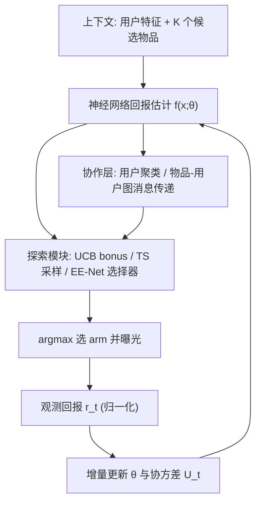

# Neural Contextual Bandits for Personalized Recommendation (面向个性化推荐的神经上下文 Bandit：WWW'24 教程)

- **会议/期刊**: WWW 2024 (The Web Conference, Singapore, Tutorial)
- **作者与机构**: Yikun Ban, Yunzhe Qi, Jingrui He (University of Illinois at Urbana-Champaign, DAIS Lab)
- **推荐链路定位**: 在线排序 / 曝光策略层（探索驱动的候选选择与重排）
- **研究方向**: 强化学习与动态探索推荐 / 冷启动与长尾推荐
- **论文原文**: [论文原文链接](https://arxiv.org/abs/2312.14037v1)
- **开源代码**: 暂未开源（正文承诺将 slides / data / code 发布于教程官网）

## TL;DR (1分钟核心速览)

这不是一篇提出新模型的论文，而是一份 3 小时的 WWW'24 教程综述。它指出静态监督式协同过滤把推荐当作一次性拟合，导致"富者愈富"的马太效应并丧失闭环自适应能力；教程主张把推荐形式化为上下文 Bandit 的序列决策问题，以**显式探索**换取长期累计收益，并沿"线性 UCB/TS $\to$神经 UCB/TS、EE-Net$\to$用户聚类与图 Bandit"三级递进，梳理各算法的探索算子与$\tilde{O}(\tilde{d}\sqrt{T})$ 级 Regret 保证，最后提出大模型时代下的可扩展性、可解释、公平与隐私四个开放问题。教程本身不含新实验。

## Background & Motivation (背景与核心矛盾)

- **主流范式**: 以 NCF/矩阵分解为代表的监督式协同过滤，在相对静态的数据集上做一次性拟合，线上按预测分数贪心排序（pure exploitation）。
- **前人局限**: 其一，训练数据由旧策略产生，闭环反馈不断把曝光集中到已热门物品，形成马太效应，长尾与新物品永无验证机会；其二，交互是**流式到达**的，静态模型无法在"推荐—反馈—更新"链条中自我修正，且线性/核 Bandit（LinUCB、KernelUCB）的特征映射固定，无法刻画非线性用户偏好。
- **核心洞察 (Key Insight)**: 推荐本质是 $T$轮序列决策——每轮呈现$K$个候选 arm，学习者选一个并观测带噪回报，目标是最大化累计回报$\sum_t r_t$即最小化累计 Regret$R(T)=\sum_{t}\big(r(\mathbf{x}_t,a_t^{\star})-r(\mathbf{x}_t,a_t)\big)$。不确定性本身就是资产：对"没把握"的物品的探索，正是打破流行度偏置、获取长期收益的唯一手段。
- **本文切入点**: 用神经网络替代线性假设以提升回报函数的表达力，同时用 NTK/神经切核把"探索奖励"重新理论化；再把单用户独立 Bandit 扩展为协作式 Bandit，同时建模用户异质性与用户相关性。

## Method (核心方法设计)

### 1. 整体框架 (Overall Architecture)

教程的组织本身即"方法框架"：给定第 $t$轮的上下文（用户画像 + 候选物品特征$\mathbf{x}_{t,a}$），模型用神经网络$\hat f(\mathbf{x};\boldsymbol\theta)$估计回报，并由探索模块输出一个**不确定性奖励项**（UCB 上界、TS 后验采样或学习式探索网络），二者相加后对$K$个 arm 取$\arg\max$完成推荐；观测到点击/转化回报后做归一化并增量更新参数，进入下一轮。第三阶段把单个$\boldsymbol\theta$替换为"用户簇共享参数"或"图上的消息传递参数"，使新用户/冷启动用户能借助邻居的样本来缩小自己的不确定性，从而在同等$T$ 下取得更紧的 Regret。

### 2. 关键设计拆解 (Key Designs)

1. **神经切核探索奖励 (NeuralUCB / NeuralTS)**：痛点在于线性 Bandit 的 $\mathbf{x}^\top\mathbf{A}^{-1}\mathbf{x}$置信区间无法覆盖非线性回报。做法是把网络最后一层梯度当作"自适应特征映射"$\mathbf{g}(\mathbf{x};\boldsymbol\theta)=\nabla_{\boldsymbol\theta}\hat f(\mathbf{x})$，构造$\tilde d$（参数量级$m^2$）维协方差$\mathbf{U}_t=\lambda\mathbf{I}+\sum_{s}\mathbf{g}_s\mathbf{g}_s^{\top}$，UCB 取$\hat f(\mathbf{x})+\gamma_t\sqrt{\mathbf{g}^{\top}\mathbf{U}_t^{-1}\mathbf{g}}$，TS 则改为采样$\hat f(\mathbf{x})+\beta_t\mathbf{g}^{\top}\mathbf{U}_t^{-1/2}\boldsymbol\epsilon$。直觉：梯度方向越"少见"、协方差越小，则该方向不确定度越大，探索奖励越高——等价于在 NTK 诱导的 RKHS 范数球内做乐观估计，故 Regret 可压到$\tilde{O}(\tilde{d}\sqrt{T})$。
2. **免不确定性估计的学习式探索 (EE-Net)**：痛点在于维护 $\mathbf{U}_t^{-1}$需$O(\tilde d^{3})$求逆，工业上不可行，且 UCB bonus 往往过度保守。EE-Net 改为并联"利用网络"$\hat f$与"探索网络"$g$，再用一个轻量选择器$\sigma(\cdot)$决定两者权重，即$a_t=\arg\max_a\big[\hat f(\mathbf{x}_{t,a})+\sigma(\mathbf{x}_{t,a})\cdot g(\mathbf{x}_{t,a})\big]$，探索能力完全由数据驱动学习而非解析 bonus，无需矩阵求逆。
3. **协作式 Bandit：用户聚类与图 Bandit**：单用户 Bandit 在冷启动用户上 Regret 线性增长。聚类 Bandit 让同簇用户共享 $\mathbf{U}$与参数，Regret 从"每用户独立$\tilde d$"降为"按簇数目摊薄"；Graph Neural Bandits 进一步把用户-物品交互建成带权图，用图卷积在邻居间传递回报信号并让探索奖励沿边权平滑，使**细粒度**的用户相关性（而非粗粒度簇）参与不确定性估计。直觉：邻居的反馈等价于"免费的额外样本"，能显著压低有效维度。
4. **训练目标、负采样与推理效率**：每轮最小化带正则的岭回归损失 $\mathcal{L}_t(\boldsymbol\theta)=\sum_{s=1}^{t-1}\big(\hat f(\mathbf{x}_{s,a_s};\boldsymbol\theta)-\bar r_s\big)^2+\frac{\lambda}{2}\|\boldsymbol\theta\|^2$，其中$\bar r_s$为归一化回报（消除量纲以适配$\gamma_t$）。Bandit 场景**不存在负采样**——未选中的 arm 无回报观测，这是与 BPR/InfoNCE 范式的根本差异。推理端仅需对$K$个候选各做一次前向，附加代价是$\mathbf{U}_t$ 的维护（实践中可用对角近似或周期性重算）。

## Experimental Setup & Evaluation Protocol (实验设置与评估协议)

- **本教程无原创实验**：作为 lecture-style tutorial，其"评估"体现为对所梳理算法**理论保证的横向对照**。为便于实践者复用，此处按其覆盖文献的通行协议归纳。

| 评估方式 | 数据来源 | 划分 / 防穿越 | 打分协议 | 典型局限 |
| :--- | :--- | :--- | :--- | :--- |
| Offline Replay | MovieLens-1M、Yahoo! News 等日志 | 全局时间戳切分，逐轮流式喂入 | 仅当新策略选中被记录 arm 时才计入回报 | 无偏但方差极大、样本利用率低 |
| Simulated Bandit | 静态数据集构造奖励函数 | 时间序切分为训练/模拟环境 | 全 $K$ 臂可查询回报，累计 Regret | 奖励函数人为设定，易高估探索收益 |
| Online A/B | 真实流量 | 真实曝光 | 累计 CTR / 长期留存 / 曝光熵 | 成本高，短期指标常与长期相悖 |

- **数据划分与防穿越**: 严禁 random split；一律按**全局时间戳切分**，$t$轮只能看到$t-1$ 以前的反馈，否则 Bandit 的探索假设被破坏。
- **排名评测协议**: 与推荐系统常用的 `Full-Ranking`（全库未交互排序）不同，Bandit 评测的核心指标是 **累计 Regret / 累计回报** 及曝光分布指标（基尼系数、长尾曝光占比），而非 NDCG@K。
- **对比基线与超参**: 覆盖 LinUCB、LinTS、KernelUCB、NeuralUCB、NeuralTS、EE-Net、NeuralIGW、Cluster-of-Bandits、Graph Neural Bandits；关键超参为网络宽度 $m$（决定$\tilde d$）、正则$\lambda$、探索系数$\gamma_t/\beta_t$ 与聚类数。

### 覆盖算法横向对比（替代主实验表，量级按各原论文定理归纳）

| 方法 | 探索机制 | 探索度量 | 理论 Regret 量级 | 典型适用 |
| :--- | :--- | :--- | :--- | :--- |
| LinUCB / LinTS | 置信上界 / 后验采样 | $\gamma_t\sqrt{\mathbf{x}^{\top}\mathbf{A}_t^{-1}\mathbf{x}}$|$\tilde{O}(d\sqrt{T})$ | 特征工程完备的轻量场景 |
| KernelUCB | 核岭回归乐观估计 | 核范数置信区间 | $\tilde{O}(\sqrt{T})\cdot$核复杂度 | 中小规模非线性 |
| **NeuralUCB / NeuralTS** | 神经切核 UCB / TS | $\gamma_t\sqrt{\mathbf{g}^{\top}\mathbf{U}_t^{-1}\mathbf{g}}$|$\tilde{O}(\tilde{d}\sqrt{T})$ | 非线性回报、特征难人工设计 |
| EE-Net | 学习式利用+探索双网络 | 选择器 $\sigma(\mathbf{x})\cdot g(\mathbf{x})$ | 同量级，无需逆矩阵 | 大规模候选、需低延迟 |
| NeuralIGW | 逆间隙加权采样 | $1/\hat p_a$型权重 | 有限臂下的$\sqrt{KT}$ 型 | 候选集较小 |
| Neural Cluster of Bandits | 用户簇共享统计量 | 簇内共享 $\mathbf{U}_t$|$\tilde{O}(\tilde{d}\sqrt{T})$+聚类误差 | 用户分群明显 |
| Graph Neural Bandits | 图消息传递 + 边权平滑 | 图上结构感知置信区间 | 依赖图有效维度 | 社交/物品关联丰富 |

### 教程内容配比（替代消融位，无消融实验）

| 模块 | 时长 | 核心内容 |
| :--- | :---: | :--- |
| Intro | 15 min | 序列决策形式化与 E&E 困境 |
| Part I 线性 Bandit | 30 min | LinUCB、LinTS、新闻推荐实例 |
| Part II 神经 Bandit | 40 min | NeuralUCB/TS、EE-Net、NeuralIGW |
| Part III 协作 Bandit | 60 min | 聚类 Bandit、图 Bandit、推荐落地 |
| Part IV 开放问题 | 35 min | 大搜索空间、可解释、公平、隐私 |

### 3. 关键实验发现 (Key Findings)

- **表达力换维度**：神经 Bandit 的 Regret 由有效维度 $\tilde{d}\approx O(m^2)$决定，虽比线性$d$更大，但当$T$足够大且回报函数强非线性时，$\tilde{d}\sqrt{T}$相对$d\sqrt{T}$ 的"常数劣势"会被拟合误差的降低所反超——这是教程反复强调的"神经优于线性"的严格条件。
- **协作即降维**：聚类与图结构不改变单轮算法，却把每个用户独立承担的 $\tilde{d}$ 摊薄到簇/邻居上，因此在冷启动用户比例高的场景收益最显著；图 Bandit 的增益随边权与真实相似度的一致性单调上升，噪声边会反噬。
- **探索是去偏手段而非精度手段**：教程将 exploration 明确定位为缓解马太效应的机制——短期 CTR 可能低于纯贪心策略，收益体现在曝光熵提升与长尾物品累计回报上，因此线上评估必须看长期指标而非单日 CTR。

## Highlights & Limitations (亮点、对比与审稿批判)

- **与代表作对比 (vs. Prior Work)**: 相较 WebConf'23 "Practical Bandits"（工业视角选型：contextual/non-contextual、on/off-policy）与 ICML'22 "Bridging Learning and Decision Making"（统一 Bandit 与监督学习的理论框架），本教程的差异化在于明确锁定**神经** Bandit 与**协作式**（聚类/图）Bandit，并始终以推荐系统的用户异质性与物品流行度偏置为落点。
- **可迁移亮点**: (1) 用最后一层梯度构造协方差 $\mathbf{U}_t$作为"不确定性度量"，可直接迁移到召回层的探索式曝光与冷启动物品扶持；(2) 用学习式选择器替代解析 UCB bonus，是规避$O(\tilde d^3)$ 求逆、落地低延迟系统的通用技巧。
- **审稿级局限批判**: 其一，作为 tutorial 无新实验、无基准复现与显著性检验，所有"优越性"论断均转引自原始论文，读者难以独立校验；其二，神经 Bandit 的 Regret 保证依赖过参数化（宽度 $m$ 多项式级大）、NTK 近似与精确岭回归求解等强假设，与工业中 SGD + 有限宽网络的实际情形存在明显 gap；其三，教程把大模型（LLM）场景仅列为开放问题，未给出可操作的算法路径或复杂度分析。

## Rating (四维评分)

- **方法创新性 (Novelty)**: ⭐⭐⭐ （作为教程不提出新算法，但"神经切核探索→协作式 Bandit"的组织脉络与去偏视角具有清晰的框架价值）
- **评估协议与实验扎实度 (Protocol & Experiments)**: ⭐⭐ （全程无原创实验、无数据集统计、无消融与显著性检验，仅有对既有 Regret 定理的定性归纳）
- **写作与数学规范度 (Clarity & Rigor)**: ⭐⭐⭐⭐ （序列决策形式化、E&E 困境与三级算法谱系的符号体系一致，理论引用到原始定理层面较为严谨）
- **工业落地与复现价值 (Industrial & Practical Value)**: ⭐⭐⭐ （EE-Net 免逆矩阵、协作式降维极具工程价值，但教程未附代码与可复现实验脚本，需回溯源论文）

