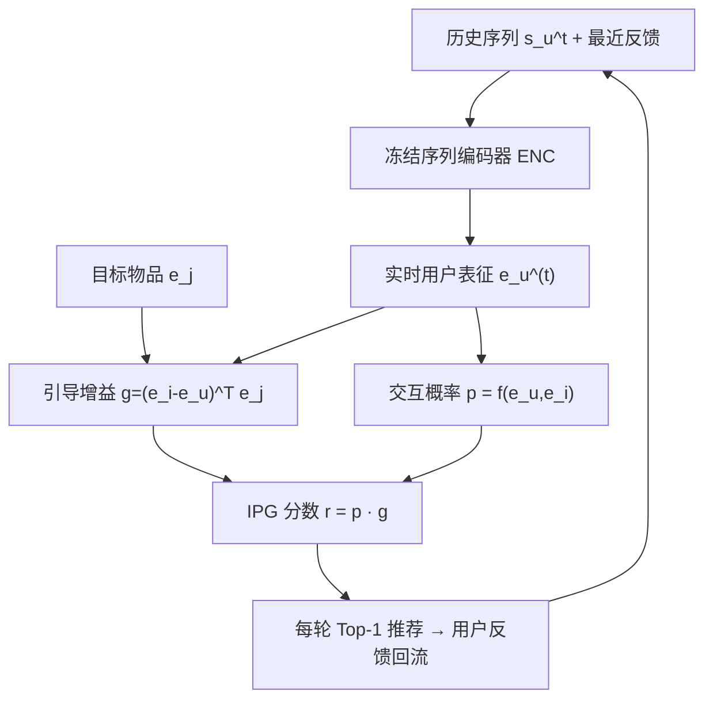

# Proactive Recommendation with Iterative Preference Guidance (基于迭代偏好引导的主动推荐)

- **会议/期刊**: WWW 2024 (Companion, Short Paper)
- **作者与机构**: Shuxian Bi, Hang Pan, Fuli Feng, Xiangnan He (中国科学技术大学)；Wenjie Wang (新加坡国立大学)
- **推荐链路定位**: 重排/后处理（挂在已训练序列推荐模型之上的打分修正层）
- **研究方向**: 强化学习与动态探索推荐 / 序列与会话推荐
- **论文原文**: [https://arxiv.org/abs/2403.07571v1](https://arxiv.org/abs/2403.07571v1)
- **开源代码**: [https://github.com/GabyUSTC/IPG-Rec](https://github.com/GabyUSTC/IPG-Rec)

## TL;DR (1分钟核心速览)

传统推荐被动迎合历史兴趣，在反馈闭环中自我强化，造成过滤气泡与观点极化。本文提出 IPG：不改动任何已训练序列推荐模型的结构与损失，仅在每轮用“交互概率 $\times$引导增益”的显式 IPG 分数重排候选项，并用线性表征演化假设把引导增益的$|\mathcal{I}|$ 次前向压缩为一次向量内积。在自建的交互仿真器（6034 用户 / 3533 物品，20 轮引导、50 个目标物品）上，IoI@20 由最强基线 SASRec-Heuristic 的 0.2084 提升至 0.2649（+27.1%），HR@20 仅从 0.5558 降至 0.4019。

## Background & Motivation (背景与核心矛盾)

- **主流范式**: 序列推荐（SASRec 等）从历史交互编码用户表征、按内积排序；主动推荐（IRS/IRN）则尝试在推荐序列中插入通向"目标物品"的桥梁，主动改变而非迎合用户兴趣。
- **前人局限**: ①IRS/IRN 假设用户无条件接受所有推荐物品，生成"不切实际的影响路径"，忽略引导过程中的真实反馈；②引导目标仅靠对目标物品加一个 attention mask 隐式表达，训练与推理均无显式引导信号；③额外的 mask 模块难以嵌入现有工业推荐系统。
- **核心洞察 (Key Insight)**: 引导价值不应等于"物品与目标有多像"，而应等于"用户点完之后，其表征朝目标前进了多少"——即偏好的一阶增量 $g_{uij}^t$。
- **本文切入点**: 用最近一次真实反馈迭代更新用户状态，把引导增益写成显式可算的增量项，再与交互概率相乘作为纯后处理打分。

## Method (核心方法设计)

### 1. 整体框架 (Overall Architecture)

给定目标物品 $j$与$l$步引导预算，IPG 每轮先由冻结的序列编码器 ENC 依据最新交互序列$\mathbf{s}_u^t$得到实时用户表征$\hat{\mathbf{e}}_u^{(t)}=\mathrm{ENC}(\mathbf{s}_u^t)$，再对全库候选并行计算 IPG 分数$r_{uij}^t$，取 argmax 推荐单个物品（默认每轮 1 条，契合微视频场景），用户反馈回流后序列延长、表征重算，进入下一轮。整个框架不引入新参数、不新增训练目标，只是对既有打分函数的一次可插拔改造。

### 2. 关键设计拆解 (Key Designs)

1. **IPG 乘法打分（引导与黏性的耦合器）**：若只按目标相似度排序，会推给用户大量"正确但没人点"的物品；若只按交互概率排序则退化为被动推荐。二者用乘法而非加法耦合：$r_{uij}^t=\hat{p}_{ui}^t\cdot g_{uij}^t$。乘法的物理直觉是"门控"——引导增益再大，只要交互概率低就被压低，从而避免加法权重$\alpha$ 带来的量纲敏感与失效候选被抬分的问题。

2. **引导增益的显式定义与线性加速（核心 Delta）**：直接按定义算 $g_{uij}^t=\hat{\mathbf{e}}_j^{\top}\hat{\mathbf{e}}_u^{(t+1)}-\hat{\mathbf{e}}_j^{\top}\hat{\mathbf{e}}_u^{(t)}$需要对每个候选做一次编码器前向，单用户$O(|\mathcal{I}|)$次推理不可接受。作者观察到$\hat{\mathbf{e}}_u^{(t+1)}$只是在序列尾部追加$\hat{\mathbf{e}}_i$，故假设表征按$\hat{\mathbf{e}}_u^{(t+1)}=\gamma\hat{\mathbf{e}}_u^{(t)}+(1-\gamma)\hat{\mathbf{e}}_i$ 线性移动，代入即得
$$g_{uij}^t=(1-\gamma)\left(\hat{\mathbf{e}}_i-\hat{\mathbf{e}}_u^{(t)}\right)^{\top}\hat{\mathbf{e}}_j .$$
由于 $(1-\gamma)$对所有$i$相同可省略，最终只需一次"物品向量减用户向量再与目标内积"的批量矩阵乘法。该式同时揭示了几何意义：高分物品必须同时满足"含用户当前兴趣成分"与"在目标方向上有正向投影"，式中的$-\hat{\mathbf{e}}_u^{(t)}$正是相较于 SASRec-Heuristic 的$\hat{\mathbf{e}}_j^{\top}\hat{\mathbf{e}}_i$ 的关键差别——它度量的是**增量**而非**绝对相似度**。

3. **训练目标、负采样与推理开销**：IPG 本身无损失函数，底座 SASRec 沿用原始 next-item 交叉熵（仿真日志中正样本即正向交互），IPG 不参与训练、不引入负采样设计。推理侧每轮开销为一次编码器前向 + 一次 $O(|\mathcal{I}|d)$的矩阵乘加，与一次普通全库打分同阶，天然适配 ANN 检索；$\gamma$ 为唯一引入的超参，沿用仿真器的 0.8。

## Experimental Setup & Evaluation Protocol (实验设置与评估协议)

- **数据集与预处理**: 主动推荐缺乏真实"偏好变化"标注，作者构建交互仿真器：20 维物品/用户嵌入 = 10 个 2 维类目嵌入拼接，类目倾向 $p_{i,c}\sim U(0,1)$归一化后缩放；点击模型$\sigma\left(w(\mathbf{e}_u^\top\mathbf{e}_i-b_{ui}-b)\right)$，$b=0.8$；正向交互后$\mathbf{e}_u\leftarrow\gamma\mathbf{e}_u+(1-\gamma)\mathbf{e}_i,\gamma=0.8$；并显式建模类目级与物品级厌倦效应（近 10 次点击中同主类目$\ge5$次则$\mathbf{e}_{u,c}\leftarrow0.8\mathbf{e}_{u,c}$；$b_{ui}=0.1n_{ui}$）。

| 数据集 | #Users | #Items | #Interactions | 稀疏度/密度 | 特征/场景说明 |
| :--- | :---: | :---: | :---: | :---: | :--- |
| Simulator-Log | 6,034 | 3,533 | ≈162.3k (人均 26.9 正交互) | ≈0.76% | 20 维合成嵌入、10 类目、含厌倦效应 |

- **数据划分与防穿越 (Splitting Strategy)**: 两阶段协议。**日志采集期**：100 轮，每轮 30% oracle + 70% 随机混合策略产生交互日志，仅用于离线训练各基线；**引导期**：独立 20 轮在线式交互，不再训练，考试与训练数据来源彻底隔离，防止穿越。
- **排名评测协议 (Ranking Protocol)**: `Full-Ranking`（每轮向全部用户对全库打分并召回 Top-1），K $\in\{5,10,15,20\}$轮累加。指标：$\mathrm{HR@}K=\frac{1}{K|\mathcal{U}|}\sum_k\sum_u c_{uk}$（正向交互比例）与$\mathrm{IoI@}K=\frac{1}{|\mathcal{U}|}\sum_u\hat{\mathbf{e}}_u^{(K)\top}\mathbf{e}_j-\hat{\mathbf{e}}_u^{(1)\top}\mathbf{e}_j$（对目标的兴趣增幅）。
- **对比基线与超参设置**: Random、SASRec（无引导）、IRN（目标注意力 mask，隐式引导）、SASRec-Heuristic（$s=\hat{\mathbf{e}}_u^\top\hat{\mathbf{e}}_i+\alpha\hat{\mathbf{e}}_j^\top\hat{\mathbf{e}}_i$），以及 SASRec-IPG。嵌入维度$d=20$，随机抽取 50 个目标物品取平均，未报告显著性检验。

## Key Experimental Results (实验关键数据)

### 1. 主实验对比 (Main Results)

| Model | HR@5 | IoI@5 | HR@10 | IoI@10 | HR@15 | IoI@15 | HR@20 | IoI@20 |
| :--- | :---: | :---: | :---: | :---: | :---: | :---: | :---: | :---: |
| Random | 0.1058 | 0.0019 | 0.1057 | 0.0042 | 0.1057 | 0.0065 | 0.1056 | 0.0086 |
| SASRec | **0.5558** | -0.0057 | **0.5552** | -0.0078 | **0.5541** | -0.0063 | **0.5558** | -0.0027 |
| IRN | 0.5007 | 0.0168 | 0.5011 | 0.0352 | 0.5019 | 0.0510 | 0.5027 | 0.0647 |
| SASRec-Heuristic | 0.3708 | 0.0521 | 0.3687 | 0.1164 | 0.3838 | 0.1683 | 0.3769 | 0.2084 |
| SASRec-IPG | 0.3992 | **0.0858** | 0.4020 | **0.1707** | 0.4004 | **0.2274** | 0.4019 | **0.2649** |
| Improv. (IoI vs 次优) | — | +64.7% | — | +46.6% | — | +35.1% | — | +27.1% |

### 2. 消融实验 (Ablation Study)

论文为短文，未做逐模块移除式消融，但四种基线的设计恰好构成对 IPG 两个核心要素的等价拆解：

| 变体（等价消融） | 引导目标 | 引导信号形式 | IoI@20 | HR@20 |
| :--- | :---: | :--- | :---: | :---: |
| SASRec | 无 | —（纯被动） | -0.0027 | **0.5558** |
| IRN | 有（隐式） | 目标 attention mask | 0.0647 | 0.5027 |
| SASRec-Heuristic | 有（显式） | 绝对相似度 $\hat{\mathbf{e}}_j^\top\hat{\mathbf{e}}_i$（缺$\hat{p}$ 门控与增量项） | 0.2084 | 0.3769 |
| SASRec-IPG (full) | 有（显式） | $\hat{p}_{ui}\cdot(\hat{\mathbf{e}}_i-\hat{\mathbf{e}}_u)^\top\hat{\mathbf{e}}_j$ | **0.2649** | 0.4019 |

### 3. 关键实验发现 (Key Findings)

1. **"增量"优于"绝对相似度"**：把目标相似度直接加到排序分上的 SASRec-Heuristic 已是强基线（IoI@20 = 0.2084），但 IPG 用偏好增量替换后进一步提升 27.1%，且 HR@20 反而从 0.3769 升到 0.4019——说明以增量取相似度不是精度换引导的零和交易，而是同时改善两者。
2. **显式引导目标不可替代**：隐式的 IRN 的 IoI@20 仅 0.0647，约为 IPG 的 1/4，同时 HR 已从 0.5558 掉到 0.5027，属于"引导没做成、精度也丢了"；而纯被动的 SASRec 的 IoI 全为负（-0.0027 ~ -0.0078），定量印证了过滤气泡式的兴趣自我收窄。
3. **引导效果随轮次近似线性累积**：IPG 的 IoI 从 0.0858(@5) 单调增长到 0.2649(@20)，而 HR 稳定在 0.40 附近不衰减，说明引导轨迹是可持续推进而非靠单轮"赌中"目标；图 3 的嵌入演化案例中，Heuristic 与 IRN 的用户嵌入基本静止，IPG 则被稳定拉向目标物品，并倾向于选出"兼具当前兴趣与目标特征"的过渡物品。

## Highlights & Limitations (亮点、对比与审稿批判)

- **与代表作对比 (vs. Prior Work)**: 与 IRS/IRN 相比，本文把"引导"从架构内的 attention mask 搬到架构外的后处理分数，无需重训即可插拔（IRN 需联合训练且假设用户全盘接受推荐）；与 SASRec-Heuristic 相比，仅多了一个 $-\hat{\mathbf{e}}_u^{(t)}$的增量项与$p$ 的乘法门控，却带来 27% 的引导增益，改动极小、收益明确。
- **可迁移亮点**: ①"目标向量 × (候选向量 − 当前用户向量)"这一增量打分式，可直接迁移到多样性/新颖性重排、探索-利用平衡的 item 加权；②用线性表征演化把 $O(|\mathcal{I}|)$ 次编码器前向降为一次矩阵乘，是任何"反事实重打分"后处理都可借鉴的加速范式。
- **审稿级局限批判**: ①**评估完全依赖自建仿真器**，20 维合成嵌入、固定 $\gamma=0.8$的偏好演化与人工设计的厌倦阈值共同决定了结论，真实用户是否同样被"引导"尚未验证，缺乏线上 A/B 与真人用户研究；②$\hat{\mathbf{e}}_u^{(t+1)}=\gamma\hat{\mathbf{e}}_u^{(t)}+(1-\gamma)\hat{\mathbf{e}}_i$的线性假设与仿真器的演化规则同构，存在"用模型假设去评估同一假设"的循环论证风险，且该方法对真实 Transformer 表征是否成立未做验证；③策略本质是每轮贪心最大化一步引导增益，无多步前瞻、无 bandit 式探索，容易陷入局部最优路径；④未报告显著性检验，也无$l$、$\gamma$、每轮推荐条数$>1$ 的敏感性分析。

## Rating (四维评分)

- **方法创新性 (Novelty)**: ⭐⭐⭐⭐ （把引导价值重定义为偏好一阶增量并乘积耦合交互概率，思路简洁有力；但贪心后处理与线性演化假设本身偏工程化，缺少理论保障）
- **评估协议与实验扎实度 (Protocol & Experiments)**: ⭐⭐⭐ （日志/引导两阶段隔离与 HR+IoI 双指标设计合理，但全部基于合成仿真器、无显著性检验、无超参与规模敏感性分析）
- **写作与数学规范度 (Clarity & Rigor)**: ⭐⭐⭐⭐ （5 页短文内公式推导紧凑、从定义式到简化式的加速链条清晰，几何直觉配图到位；可惜未给复杂度与 $\gamma$ 的理论讨论）
- **工业落地与复现价值 (Industrial & Practical Value)**: ⭐⭐⭐⭐⭐ （零新增参数、零重训、与现有序列模型/ANN 检索完全兼容，代码已开源，是少见的"一行打分改造即可上线"的引导方案）

