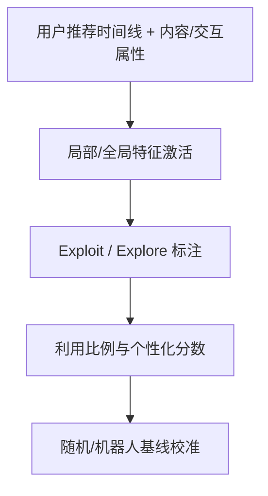
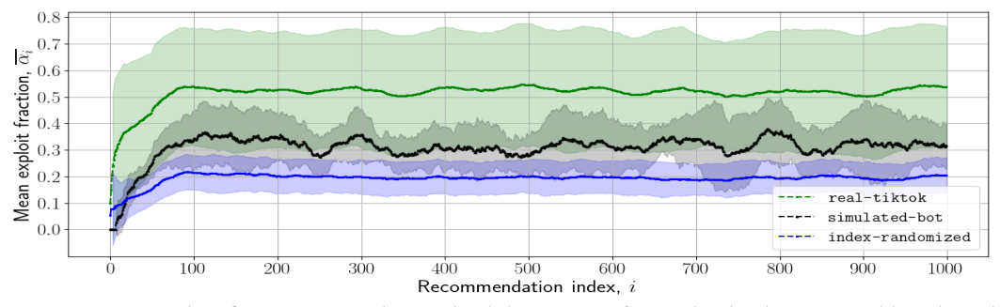

# TikTok and the Art of Personalization: Investigating Exploration and Exploitation on Social Media Feeds (TikTok个性化之术：社交媒体信息流中的探索与利用审计)

- **会议/期刊**: WWW 2024
- **作者与机构**: Karan Vombatkere 等；Boston University、MPI-SWS、TU Delft、University of Washington
- **推荐链路定位**: 端到端信息流推荐审计（非召回/精排模块）
- **研究方向**: 强化学习与动态探索推荐 / 去偏公平、可信隐私与工业架构
- **论文原文**: [论文原文链接](https://arxiv.org/abs/2403.12410v1)
- **开源代码**: [开源代码仓库链接](https://github.com/kvombatkere/TikTok-Personalization)

## TL;DR (1分钟核心速览)

针对TikTok式短视频信息流黑箱，本文把用户时间线建模为推荐序列，用内容/用户/交互特征将视频标注为利用(Exploit)或探索(Explore)，提出利用比例、个性化分数与信噪比特征选择框架。在220名真实用户、每人前1000条视频上，Full timeline审计显示真实利用比例≥50%，随机基线20%、机器人31%，扣除噪声后算法约30%–50%视频在利用用户兴趣；点赞与关注是主要驱动。

## Background & Motivation (背景与核心矛盾)

- **主流范式**: 平台用算法信息流持续推荐短视频；既有审计多依赖自动化机器人、问卷/访谈或用户自报，缺少对真实用户时间线的细粒度探索/利用标注。
- **前人局限**: 机器人行为随机、缺少真实兴趣多样性；自报数据存在偏差，且难以判断单条推荐是否由历史兴趣触发。
- **核心洞察 (Key Insight)**: 个性化可操作化为“当前视频是否与用户此前交互过的内容/创作者/标签相关”；随机置换时间线可估计特征激活的噪声底。
- **本文切入点**: 用可解释的局部/全局激活特征标注Exploit/Explore，并用随机基线与机器人基线校准真实个性化程度。

## Method (核心方法设计)

### 1. 整体框架 (Overall Architecture)

输入为按时间排序的推荐序列及各视频的内容、用户、交互属性；对每个用户-视频对$(r_i,u)$，计算局部窗口与全局历史特征，若任一特征激活则标为Exploit，否则标为Explore。随后聚合为用户利用比例$\alpha_i^u$、平均利用比例$\alpha_i$、个性化分数$\rho$，并通过index-randomized与simulated-bot两条基线做噪声校准和解释力验证。框架无训练参数，本质是可复现的规则化审计管线，适合对TikTok、Reels、Shorts等信息流做离线审计。

### 2. 关键设计拆解 (Key Designs)

1. **Exploit/Explore激活标注**：痛点在于黑箱推荐无法直接读取“为何推荐”。本文定义特征集$F$，若任一特征满足则$y_i^u=\mathbb{I}[\exists f_a\in F, f_a(r_i,u)=1]$。例如`likes_hashtag_local`要求窗口$W$内存在被点赞视频$r_j$且$H_j\cap H_i\ne\varnothing$。直觉是：与历史强交互内容共享标签/创作者，更可能是利用用户兴趣。
2. **个性化分数**：为区分“真实个性化”与“碰巧相关”，对$(r_i,u)$统计同一位置下其他$m$条时间线中同标签数量$k$，定义$\rho(r_i,u)=1-k/m$。若Exploit视频在其他用户时间线很少仍为Exploit，则$\rho$高；原文Exploit均值0.83、Explore均值0.08，验证了标签语义。
3. **信噪比特征选择与推理**：以$\alpha_i^u=N_i^u/W$、$\alpha_i=\frac1m\sum_u\alpha_i^u$度量利用比例；用$\mathrm{SNR}(f)=\bar{\alpha}^{real}_f/\bar{\alpha}^{rand}_f$选top-$d$特征，并剔除随机基线噪声过高的特征。最终$d=7$。无训练损失、无负采样；推理为规则扫描，复杂度约$O(mNdW)$，在$m=220,N=1000,d=7,W=50$下可离线重算。

## Experimental Setup & Evaluation Protocol (实验设置与评估协议)

- **数据集与预处理**:

| 数据集 | #Users | #Items | #Interactions | 稀疏度/密度 | 特征/场景说明 |
| :--- | :---: | :---: | :---: | :---: | :--- |
| Real TikTok traces | 347（审计用220） | 4.9M视频，4.1M有元数据 | 9.2M次观看 | 非评分矩阵 | 观看、点赞、关注、分享、收藏、标签 |
| Simulated bots | 5 | 5×1000视频 | 5000次观看 | N/A | 5种Watch/Skip/Like/Follow策略 |
| Index-randomized | 220 | 220×1000位置 | N/A | N/A | 每个推荐位置跨用户随机置换 |

- **数据划分与防穿越 (Splitting Strategy)**: 取每位用户最早/前1000条按时间排序推荐，无训练/测试划分；所有标注均为时间线内历史回溯，避免使用未来交互。
- **排名评测协议 (Ranking Protocol)**: 非Top-K排序任务，不使用Full-Ranking或Sampled Ranking；评估的是时间线级Exploit比例、个性化分数及组间因子差异，随机基线提供噪声底。
- **对比基线与超参设置**: 原文无传统推荐精度SOTA，因任务为算法审计；使用index-randomized与simulated-bot对照。超参$W=50$、兴趣半径$X=Y=25$、$d=7$、$N=1000$；组间因子用Student’s$t$-test，显著性阈值$p<0.05$。

## Key Experimental Results (实验关键数据)

### 1. 主实验对比 (Main Results)

原文仅3类审计对照，无传统Top-K基线，故完整列出而不虚增：

| 条件 | 类型 | 平均利用比例$\alpha_i$ | 相对真实用户 | 解释 |
| :--- | :--- | :---: | :---: | :--- |
| Real TikTok | 真实用户 | **≥50%**（$i>100$后稳定） | 100% | 算法持续利用用户兴趣 |
| Simulated-bot | 随机行为机器人 | 31% | 约60% | 随机行为仍有相关性噪声 |
| Index-randomized | 随机置换基线 | 20% | 约40% | 特征噪声底 |

图1：真实用户与两类基线的平均利用比例$\alpha_i$。

<figure class="paper-figure" markdown="span">
  <figcaption>图1：真实Tiktok用户与基线数据集的平均用户利用比例 𝛼𝑖 及其标准差。</figcaption>
</figure>

### 2. 消融实验 (Ablation Study)

原文未做逐特征消融；以下为等价验证与噪声消融：

| 设置/对照 | $\alpha_i$或分数 | 说明 |
| :--- | :---: | :--- |
| Real + 7特征 | ≥50% | 主框架结果 |
| Real − random噪声底 | 30%–50% | 净个性化估计 |
| Index-randomized | 20% | 无个性化噪声 |
| Simulated-bot | 31% | 随机行为对照 |
| Exploit个性化分数 | 0.83 | 高针对性 |
| Explore个性化分数 | 0.08 | 低针对性 |

### 3. 关键实验发现 (Key Findings)

- 真实TikTok时间线利用比例大多≥50%，随机基线20%、机器人31%；扣除20%噪声后，前1000条中约30%–50%视频在利用用户已知兴趣，说明算法并非全探索。
- Exploit视频个性化分数均值0.83，Explore仅0.08，表明规则标注与跨用户一致性高度吻合；且标签越少（内容越具体）的Exploit视频个性化分数越高。
- 因子对比中，关注比例TQ 0.30 vs BQ 0.02（$p=10^{-14}$）、点赞比例0.14 vs 0.03（$p=10^{-5}$）影响最高；观看完成率93% vs 84%（$p=0.03$）中等；早期跳过率不显著（$p=0.14$）。

## Highlights & Limitations (亮点、对比与审稿批判)

- **与代表作对比 (vs. Prior Work)**: 相比Boeker/Urman与WSJ的机器人审计，本文用真实用户轨迹并加入随机/机器人双基线；相比Klug等的混合方法，本文给出可复算的时间线级Exploit/Explore标注与个性化分数。
- **可迁移亮点**: “历史强交互+同标签/同创作者”的局部/全局激活规则可迁移到Reels、Shorts、新闻流审计；随机置换噪声底可用于任何规则化个性化度量校准。
- **审稿级局限批判**: 样本仅220名用户且非平台代表样本，特征集非穷尽，结果更接近个性化下界；规则激活是相关性证据而非因果识别，且未建模平台算法随时间的版本变化。

## Rating (四维评分)

- **方法创新性 (Novelty)**: ⭐⭐⭐⭐ （首次以真实TikTok时间线系统标注探索/利用，并提出可解释个性化分数）
- **评估协议与实验扎实度 (Protocol & Experiments)**: ⭐⭐⭐ （真实+随机+机器人三线验证较扎实，但无ground truth且样本有限）
- **写作与数学规范度 (Clarity & Rigor)**: ⭐⭐⭐⭐ （特征、指标与基线定义清晰，公式简洁可复现）
- **工业落地与复现价值 (Industrial & Practical Value)**: ⭐⭐⭐ （开源代码利于审计落地，但非线上推荐性能优化，因果解释有限）

