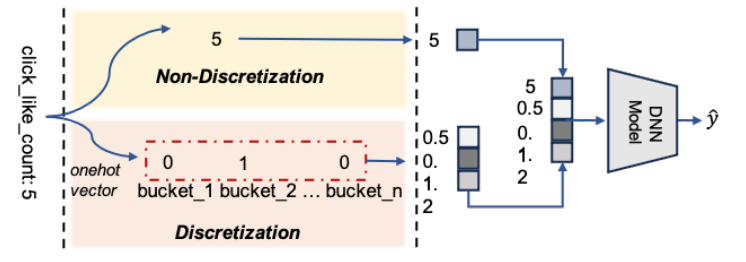
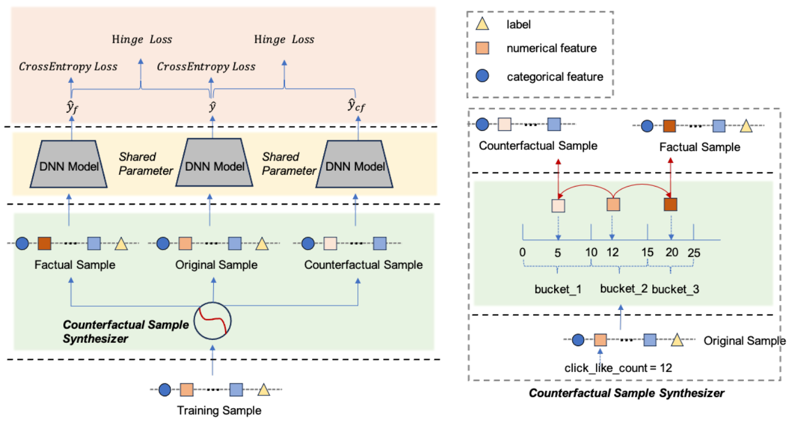
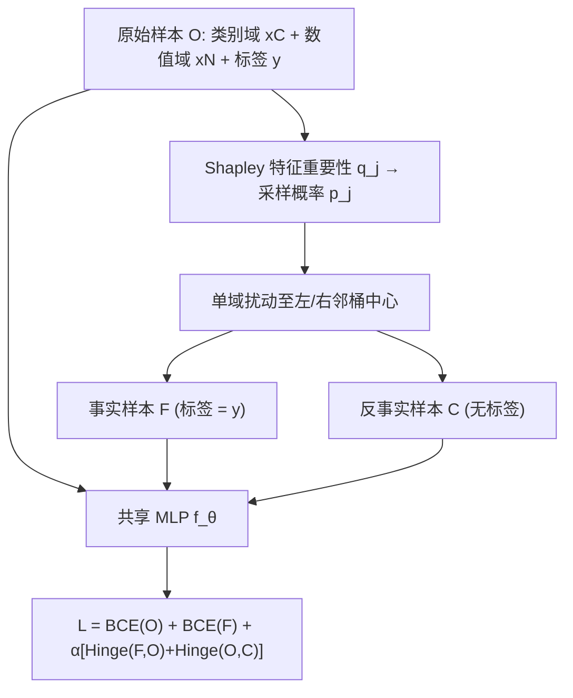

# Enhancing Interpretability and Effectiveness in Recommendation with Numerical Features via Learning to Contrast the Counterfactual samples (通过对比反事实样本提升数值特征推荐的可解释性与有效性)

- **会议/期刊**: WWW 2024 (Companion)
- **作者与机构**: Xiaoxiao Xu, Hao Wu, Wenhui Yu, Lantao Hu, Peng Jiang（快手科技）；Kun Gai（独立）
- **推荐链路定位**: 精排（CTR / 收藏率预估）
- **研究方向**: 自监督对比学习与交互去噪 / CTR 预估与特征交叉
- **论文原文**: [https://arxiv.org/abs/2509.03187v1](https://arxiv.org/abs/2509.03187v1)
- **开源代码**: [https://github.com/chongminggao/KuaiRand](https://github.com/chongminggao/KuaiRand)（该链接为论文所用公开数据集 KuaiRand 仓库，方法代码暂未单独开源）

## TL;DR (1分钟核心速览)

工业推荐中数值特征（用户活跃度、视频 CTR/完播率）既做稠密值又做分桶 Embedding，导致传统单调性建模方法（线性融合、单调网络）失效：模型输出与数值大小之间常出现"数值越大打分反而越低"的反直觉现象。本文提出与模型无关的 CCSS 框架：按 Shapley 特征重要性采样一个数值域，把它扰动到相邻桶中心合成**事实/反事实**样本，用"事实点式增广 + 三样本成对 Hinge 排序"端到端注入单调性先验。在 KuaiRand-Pure 与 12.9 亿样本工业集上，AUC 相对最高提升 31.2%，Mono_rate 平均从 ~54% 升至 ~82%，线上 A/B 收藏率 +3.93%。

## Background & Motivation (背景与核心矛盾)

- **主流范式**: 数值特征学习聚焦于离散化表征质量（缓解 SBD「值近而 Embedding 远」与 DBS「值远而 Embedding 近」），代表作为 AutoDis、DeepFM 等分桶+Embedding 方案。<figure class="paper-figure" markdown="span">
  <figcaption>图1：推荐系统深度模型中数值特征使用示意图：既通过非离散化方法作为稠密值使用，又通过离散化方法作为嵌入使用。</figcaption>
</figure>
- **前人局限**: ①传统单调性方法（如线性融合 $y=\text{DNN}(z)+w\cdot x$、 lattice/单调网络）**要求数值特征只走稠密通路**，一旦同时走分桶 Embedding 通路即不再适用（图 1 的工业标准范式）；②纯离散化方法学到的 Embedding 无任何序关系约束，输出与数值输入的相关方向完全由数据噪声决定。
- **核心洞察 (Key Insight)**: 单调性本质是**先验知识而非可观测监督信号**——"同一上下文下 $click\_like\_count$ 更高者应排更前"这句话本身能免费生成带标签的训练样本，等价于一种低成本数据增广，可同时提升可解释性与精度。
- **本文切入点**: 不改造网络结构，而在**样本层**用局部扰动合成反事实对，再用对比损失把这个先验"焊"进任意骨干。

## Method (核心方法设计)

### 1. 整体框架 (Overall Architecture)

输入一条曝光样本 $O=(\boldsymbol{x},y)$，数值域被离散化为$w$个桶并 Embedding，与稠密值拼接后送入 MLP$f_{\boldsymbol{\theta}}$。CCSS 在此之上挂载两个模块：**反事实合成器**按特征重要性采样单个数值域$j$，把其值推到左/右邻桶中心，得到**事实样本$F$**（继承$y$，因单调性先验而标签已知）与**反事实样本$C$**（标签未知）；**对比目标模块**在共享参数下同时打三份分，用"点式 BCE($O$)+BCE($F$)+成对 Hinge($F$,$O$)+Hinge($O$,$C$)"构成端到端损失。推理阶段合成器与对比项全部丢弃，在线开销与原始骨干完全一致。<figure class="paper-figure" markdown="span">
  <figcaption>图2：我们提出的 CCSS 示意图：左侧为含反事实样本合成的端到端学习框架，右侧为反事实样本合成器的细节示意图。</figcaption>
</figure>

### 2. 关键设计拆解 (Key Designs)

1. **重要性引导的单域反事实合成**：若同时扰动多个数值域，样本偏离真实流形过远、对比信号失效。故每样本**只扰动一个域**，并以 Shapley 值 $q_j$归一化为采样概率$p_j=q_j/\sum_{k=1}^{N}q_k$，优先扰动模型决策最敏感的域，使有限增广预算落在信息量最大的维度上。扰动幅度仅为"邻桶中心"，保证合成样本落在原分布支撑内（工业流式训练可实时生成）。
2. **方向性对比与边界处理**：以递增单调为例，正样本要求 $\hat{y}_F>\hat{y}_O>\hat{y}_C$，负样本则要求$\hat{y}_C>\hat{y}_O>\hat{y}_F$（对称翻转）。这条"符号感知"约束把对比学习从"相似性拉近"变成"序关系拉正"：
$$\mathcal{L}=l(O)+l(F)+\alpha\big[l_P(F,O)+l_P(O,C)\big],\quad l_P(A,B)=\max\!\big(0,\,m-(\hat{y}_A-\hat{y}_B)\big)$$
若样本已处于最右桶，则只合成反事实样本（无 $F$ 项）；负样本最左桶同理。
3. **训练目标、增广与推理开销**：事实样本因先验而标签已知，故额外以 BCE 作为**免费数据增广**参与训练——这一项贡献了最大增益（见消融）。$\alpha$统一取 1.0，无需负采样、无需额外对比队列；推理零开销，仅训练时每条样本前向 3 次（$O,F,C$ 共享参数）。

## Experimental Setup & Evaluation Protocol (实验设置与评估协议)

- **数据集与预处理**:

| 数据集 | #Users | #Items | #Interactions | 稀疏度/密度 | 特征/场景说明 |
| :--- | :---: | :---: | :---: | :---: | :--- |
| KuaiRand-Pure | ≈27.3K | ≈7.6K | ≈1.18M | 密度 ≈0.57% | 快手视频日志，全特征集，标签 $is\_click$ |
| Industrial | 43.98M | 23.80M | 1.29B 训练 / 0.26B 测试 | 极稀疏 | 8 天实时流，14 维数值特征（用户/视频 CTR、LTR、WTR、VTR、CMTR 等），标签 $is\_collect$ |

- **数据划分与防穿越**: **全局时间戳切分**。KuaiRand 用 05-01 前训练、05-01~05-08 测试；工业集前 7 天训练、第 8 天测试，严格避免未来曝光泄漏。
- **排名评测协议**: 非 Top-K 检索任务，故**不做负采样**，直接在全体曝光样本上计算点式 AUC 与用户内加权 **GAUC**（$GAUC=\sum_i \#imp_i\cdot AUC_i/\sum_i \#imp_i$），并辅以标准化指标$RelaImpr=(AUC_m-0.5)/(AUC_b-0.5)-1$消除基数差异；可解释性由 **Mono_rate**$=\#Monotone\_pairs/\#Comparable\_pairs$度量（覆盖全部$(F,O)$与$(C,O)$ 期望单调对）。
- **对比基线与超参设置**: 5 个可插拔骨干 DNN / Wide&Deep / PNN / DCN / DeepFM；统一 $d=32$、4 层 FC$[512,255,127,127]$、Adam ($lr=0.05$,$decay=0.9$)、batch 1024、$\alpha=1.0$；5 次重复取均值，无配对$t$检验$p<0.05$ 显著（std ≈0.1%）。

## Key Experimental Results (实验关键数据)

### 1. 主实验对比 (Main Results)

| 骨干 | 工业 AUC（基线→+CCSS） | 工业 GAUC | KuaiRand AUC | KuaiRand GAUC |
| :--- | :---: | :---: | :---: | :---: |
| DNN | 0.7200 → **0.7860** | 0.6560 → **0.7320** | 0.6847 → **0.7324** | 0.6419 → **0.6768** |
| Wide & Deep | 0.7311 → 0.7763 | 0.6672 → 0.7110 | 0.7113 → 0.7527 | 0.6626 → 0.6959 |
| PNN | 0.7253 → 0.7663 | 0.6662 → 0.6934 | 0.7222 → 0.7491 | 0.6702 → 0.7039 |
| DCN | 0.7356 → 0.7865 | 0.6702 → 0.7242 | 0.7086 → **0.7737** | 0.6605 → 0.6873 |
| DeepFM | 0.7168 → 0.7298 | 0.6545 → 0.6615 | 0.6912 → 0.7357 | 0.6476 → 0.6846 |
| **RelaImpr (AUC)** | **+30.0% / +19.6% / +18.2% / +21.6% / +6.0%** | +48.7% / +26.2% / +16.4% / +31.7% / +4.5% | +25.8% / +19.6% / +12.1% / **+31.2%** / +23.3% | +24.5% / +20.5% / +19.8% / +16.7% / +25.1% |

### 2. 消融实验 (Ablation Study)

工业集、DNN 骨干、5 次均值：

| 变体 | AUC | GAUC | ΔAUC |
| :--- | :---: | :---: | :---: |
| DNN + CCSS (完整) | **0.786** | **0.732** | — |
| w/o 事实点式增广（仅留三样本对比） | 0.734 | 0.669 | −5.2 pt |
| w/o 反事实对比项（仅 $(F,O)$ 对） | 0.772 | 0.715 | −1.4 pt |
| w/o 事实对比项（仅 $(C,O)$ 对） | 0.768 | 0.720 | −1.8 pt |
| 等概率随机扰动（替换 Shapley 重要性） | 0.766 | 0.711 | −2.0 pt |

### 3. 关键实验发现 (Key Findings)

1. **增广 > 对比**：移除事实样本的 BCE 增广后 AUC 反而跌至 0.734，低于仅保留任一单边对比项的 0.768/0.772，说明"单调性先验=免费标签"是主要增益来源，对比损失是把增广信号"焊正方向"的保险丝，二者缺一不可。
2. **结构越弱、增益越大**：DNN（工业 GAUC RelaImpr +48.7%）与 DCN（+31.7%）获益最大；DeepFM 因二阶内积已隐式编码部分序关系，AUC 仅 +6.0%。CCSS 可视为对弱骨干的"先验补齐"。
3. **可解释性提升远大于精度提升**：工业集 DNN 的 top-1 数值特征 Mono_rate 由 51.3% 跃升至 83.6%，top-7 均值由 ~54% 升至 ~82%；KuaiRand 上 DNN top-5 由 54.5% 升至 80.5%。线上 A/B 中，已在特征工程上重度优化的 DCN 仍获 +3.93% collect_rate，验证了离线 Mono_rate 与线上收益的正相关。

## Highlights & Limitations (亮点、对比与审稿批判)

- **与代表作对比 (vs. Prior Work)**: 与 AutoDis/Flexible-CM 等"改进数值 Embedding 表征"的路线正交——本文不碰 Embedding 结构，而在样本层注入序先验，可与前者叠加；与 lattice / 单调网络（Sill 等）相比，突破"数值只能走稠密通路"的硬约束，可直接插到含分桶 Embedding 的工业标准结构上；与 VQA/NLP 中整图/整句掩码式反事实增广相比，本文的扰动是**单域、邻桶、方向敏感**的最小编辑，保真度更高。
- **可迁移亮点**: ①"邻桶中心扰动 + 继承标签"这一招可直接迁移到任何存在单调先验的场景（时长/价格/热度/距离），且天然兼容流式训练；②Shapley 值做扰动采样权重，是一种低成本的"按信息量分配增广预算"通用策略。
- **审稿级局限批判**: ①**训练开销 3 倍前向**且 Shapley 值需额外近似计算，论文未给出训练吞吐与收敛步数对比，工业流式场景下成本不可忽视；②Mono_rate 由模型自身在 $F/O/C$上的打分计算，与训练目标同源，存在"自证"风险，缺乏对真实因果单调性的独立外部验证；③仅在两个快手数据集（短视频）与单一$is\_collect$任务上验证，$\alpha$ 敏感性仅给曲线未给最优区间，跨域泛化性证据不足。

## Rating (四维评分)

- **方法创新性 (Novelty)**: ⭐⭐⭐⭐ （把"单调性先验"重述为可免费标注的增广源，单域邻桶合成 + 方向敏感排序损失组合简洁且此前未见）
- **评估协议与实验扎实度 (Protocol & Experiments)**: ⭐⭐⭐⭐ （时间戳切分防穿越、5 骨干插件式验证、RelaImpr 归一化与线上 A/B 齐备；Mono_rate 自评闭环与训练开销缺失扣一星）
- **写作与数学规范度 (Clarity & Rigor)**: ⭐⭐⭐⭐ （损失分正负样本对称给出、边界条件与方向表 Table 2 交代清楚；但缺复杂度分析与 Shapley 近似实现细节）
- **工业落地与复现价值 (Industrial & Practical Value)**: ⭐⭐⭐⭐⭐ （推理零开销、12.9 亿样本 + 数亿用户线上验证 +3.93%，是罕见的高落地度插件式方案；仅方法代码未独立开源）

