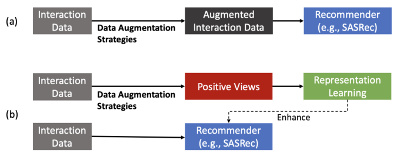
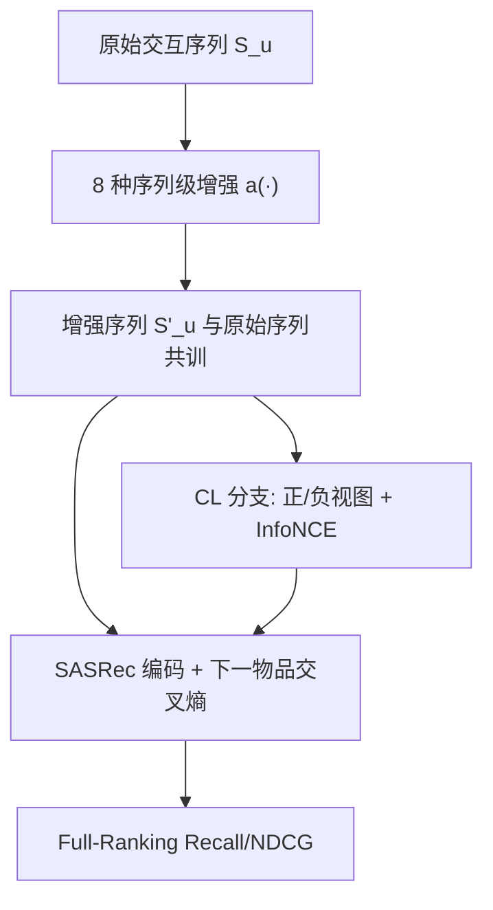

# Is Contrastive Learning Necessary? A Study of Data Augmentation vs Contrastive Learning in Sequential Recommendation（对比学习真的必要吗？序列推荐中数据增强与对比学习的实证研究）

- **会议/期刊**: WWW 2024
- **作者与机构**: Peilin Zhou, You-Liang Huang, Yueqi Xie, Jingqi Gao, Shoujin Wang, Jae Boum Kim, Sunghun Kim；HKUST(GZ)/HKUST、Upstage、University of Technology Sydney
- **推荐链路定位**: 召回/排序（Next-Item 预测）
- **研究方向**: 自监督对比学习与交互去噪 / 序列与会话推荐
- **论文原文**: [https://arxiv.org/abs/2403.11136v1](https://arxiv.org/abs/2403.11136v1)
- **开源代码**: [https://github.com/AIM-SE/DA4Rec](https://github.com/AIM-SE/DA4Rec)

## TL;DR (1分钟核心速览)

本文质疑序列推荐中“数据增强必须服务于对比学习”的默认范式，将8种序列级增强直接用于SASRec训练，并与CL4SRec、CoSeRec、ICLRec在4个数据集、Full-Ranking与冷启动设置下系统对比。结果显示：slide-window在Beauty上Recall@20达11.56%，显著高于SASRec的6.47%与CL4SRec的7.87%，且训练显存与耗时更低；CL并非缓解稀疏性的唯一必要手段。

## Background & Motivation (背景与核心矛盾)

- **主流范式**: CL4SRec、CoSeRec、ICLRec等先对序列做crop/mask/reorder等增强，再用InfoNCE拉近正视图、推远负视图，增强仅作为辅助任务。
- **前人局限**: 其一，增强策略很少被直接作为主任务训练样本，无法判断性能增益来自“增强”还是“对比损失”；其二，已有综述仅比较4种增强且未与CL方法系统对比，也缺少冷启动与效率分析。
- **核心洞察 (Key Insight)**: 若增强能直接扩充“下一物品”监督信号，则简单DA可能以更低开销达到CL效果；尤其slide-window会改变预测目标，等价于增加训练标签密度。
- **本文切入点**: 解耦“增强”和“对比学习”，统一骨干、数据划分与全库排序协议，做控制变量式基准评测。

<figure class="paper-figure" markdown="span">
  <figcaption>图1：(a) 用于序列推荐的直接数据增强；(b) 用于序列推荐的对比学习。</figcaption>
</figure>

## Method (核心方法设计)

### 1. 整体框架 (Overall Architecture)

论文不提出新网络，而构建统一评测框架：原始序列$S_u$经8种算子$a(\cdot)$生成增强序列$S'_u$，原始与增强序列共同输入SASRec，以下一物品交叉熵训练；CL基线则在同骨干上增加正/负视图与InfoNCE辅助损失。所有方法在相同Leave-One-Out划分与Full-Ranking下评测，并额外做冷启动采样、物品流行度分桶、增强规模与GPU效率分析。

### 2. 关键设计拆解 (Key Designs)

1. **直接数据增强训练（DA as Main Task）**：此前增强只进入辅助分支，本文令$S'_u=a(S_u)$直接参与主任务，目标为
$\mathcal{L}_{rec}=-\sum_t \log p(v_{u,t+1}\mid S'_{u,t})$。
这样增强直接改变输入分布与标签频次，避免CL辅助目标与主任务目标不一致。
2. **Slide-window 的标签移位增强**：固定窗口$L$在序列上滑动，得到$S'_{u,t}=[v_{u,t},\ldots,v_{u,t+L-1}]$，标签同步变为$v_{u,t+L}$。它不只扰动输入，还成倍增加“目标物品出现次数”，因此对短序列与稀疏数据尤其有效；crop只截取子序列但保留原标签，增益较弱。
3. **CL基线目标与效率对照**：CL方法在$\mathcal{L}_{rec}$外加入
$\mathcal{L}_{CL}=-\log\frac{\exp(\mathrm{sim}(z_i,z_i^+)/\tau)}{\sum_j\exp(\mathrm{sim}(z_i,z_j)/\tau)}$，
总损失$\mathcal{L}=\mathcal{L}_{rec}+\lambda\mathcal{L}_{CL}$。DA方法无额外负采样与辅助前向，推理阶段不增加开销；CL需构造视图与batch内负样本，训练时间和显存显著更高。

## Experimental Setup & Evaluation Protocol (实验设置与评估协议)

- **数据集与预处理**: 统一采用`5-core`过滤；Beauty/Sports/Yelp序列较短，ML-1m序列较长。

| 数据集 | #Users | #Items | #Interactions | 稀疏度/密度 | 特征/场景说明 |
| :--- | :---: | :---: | :---: | :---: | :--- |
| Beauty | 22,363 | 12,101 | 198,502 | 99.93% | Amazon美妆评论 |
| Sports | 35,598 | 18,357 | 296,337 | 99.95% | Amazon运动户外 |
| Yelp | 30,499 | 20,068 | 317,182 | 99.95% | 本地商户评论 |
| ML-1m | 6,041 | 3,407 | 999,611 | 95.15% | 电影评分，长序列 |

- **数据划分与防穿越 (Splitting Strategy)**: `Leave-One-Out`，每个用户最后两个物品分别作为验证集与测试集，其余训练；未使用全局时间戳切分。
- **排名评测协议 (Ranking Protocol)**: 无偏`Full-Ranking`，在完整物品库上排序，报告Recall@10/20与NDCG@10/20；训练采用下一物品交叉熵，CL使用batch内负样本。
- **对比基线与超参设置**: 骨干为SASRec，对比8种DA与CL4SRec、CoSeRec、ICLRec；嵌入/隐藏维度在{64,128,256}搜索，序列长度50（ML-1m为200），batch 1024，学习率0.001，5个随机种子取均值±标准差。为隔离默认slide-window，关闭RecBole默认SW并以`*`标识。

## Key Experimental Results (实验关键数据)

### 1. 主实验对比 (Main Results)

下表保留主实验中最具代表性的7个方法，数值为Recall@20 / NDCG@20（%），加粗为各数据集最优。

| 方法 | Beauty | Sports | Yelp | ML-1m |
| :--- | :---: | :---: | :---: | :---: |
| SASRec* | 6.47 / 2.73 | 3.41 / 1.46 | 4.68 / 2.61 | 8.45 / 3.50 |
| + subset-split | 6.98 / 2.95 | 3.89 / 1.65 | 5.17 / 2.78 | 11.09 / 4.57 |
| + crop | 7.72 / 3.22 | 4.28 / 1.77 | 5.79 / 3.10 | 13.51 / 5.35 |
| + slide-window | **11.56 / 4.83** | **7.70 / 3.03** | **8.62 / 4.46** | **31.88 / 14.83** |
| CL4SRec* | 7.87 / 3.32 | 5.10 / 2.11 | 6.42 / 3.33 | 8.51 / 3.45 |
| CoSeRec* | 7.01 / 2.89 | 4.12 / 1.68 | 5.53 / 3.03 | 8.47 / 3.49 |
| ICLRec* | 7.14 / 3.01 | 4.00 / 1.64 | 5.10 / 2.88 | 8.74 / 3.50 |

相对SASRec，slide-window在Beauty/Sports/Yelp/ML-1m的Recall@20分别提升约78.7%、125.8%、84.2%、277.3%。

### 2. 消融/组合实验 (Ablation & Combination Study)

| 组合方法（Recall@20） | Beauty | Sports | Yelp | ML-1m |
| :--- | :---: | :---: | :---: | :---: |
| SW alone | 11.56 | 7.70 | 8.62 | 31.88 |
| SW + subset-split | 12.04 | 8.32 | 9.05 | 31.78 |
| SW + delete | 12.02 | 7.84 | 8.83 | 32.12 |
| SW + insert | 12.05 | 8.10 | 9.16 | 31.84 |
| CL4SRec* + SW | 11.40 | 7.98 | 9.56 | 31.98 |
| CoSeRec* + SW | **12.07** | 8.26 | **10.08** | 31.48 |
| ICLRec* + SW | 12.00 | **8.34** | 9.92 | **32.78** |

### 3. 关键实验发现 (Key Findings)

1. **直接增强可超越CL且更便宜**：Beauty上SW的Recall@20为11.56%，高于CL4SRec的7.87%；训练时间692s，对比CL4SRec的3321s、CoSeRec的4651s，显存0.36GB也低于0.78–2.35GB，推理均为0.20s左右。
2. **越稀疏，DA越有价值**：冷启动采样10%/20%时，crop已可超过所有CL方法，SW在5个采样比例下均领先；说明低资源场景应先试低成本DA，而非默认上CL。
3. **增益来自目标物品频次与低流行物品覆盖**：SW+subset-split在Beauty/Sports上较SW再提升约4.2%/8.1%；性能随目标物品训练频次近似线性上升后边际递减，低流行组（0–50、50–100）增益最明显，但增强规模过大时组合方法反而引入噪声。

## Highlights & Limitations (亮点、对比与审稿批判)

- **与代表作对比 (vs. Prior Work)**: CL4SRec/CoSeRec/ICLRec把增强用于构造正视图并通过InfoNCE学习；本文把增强直接作为主任务样本，证明“增强本身”是重要增益源。相较仅比较4种增强的早期研究，本文覆盖8种DA、3种CL、冷启动与效率。
- **可迁移亮点**: slide-window可作为无额外负采样、零推理开销的序列扩增；冷启动/少样本场景可先做DA基线，再决定是否引入CL；评测应同时报告Recall/NDCG与训练时间、显存。
- **审稿级局限批判**: 其一，本文是实证基准而非新算法，缺少理论解释与更多CL变体（如DuoRec、feature-level增强）；其二，结论受SASRec骨干、窗口长度与增强次数$n$影响较大，且未提供线上A/B或工业级延迟验证。

## Rating (四维评分)

- **方法创新性 (Novelty)**: ⭐⭐⭐ （问题意识强、结论有冲击力，但本质是系统性实证评测而非新模型）
- **评估协议与实验扎实度 (Protocol & Experiments)**: ⭐⭐⭐⭐ （4数据集、Full-Ranking、冷启动与5种子重复较扎实；CL基线数量仍有限）
- **写作与数学规范度 (Clarity & Rigor)**: ⭐⭐⭐⭐ （算子定义清楚、对比公平；理论推导与复杂度分析较少）
- **工业落地与复现价值 (Industrial & Practical Value)**: ⭐⭐⭐⭐ （代码开源，DA零推理开销、显存友好，适合作为冷启动低成本基线）

