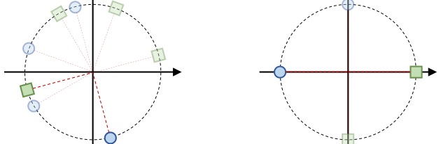
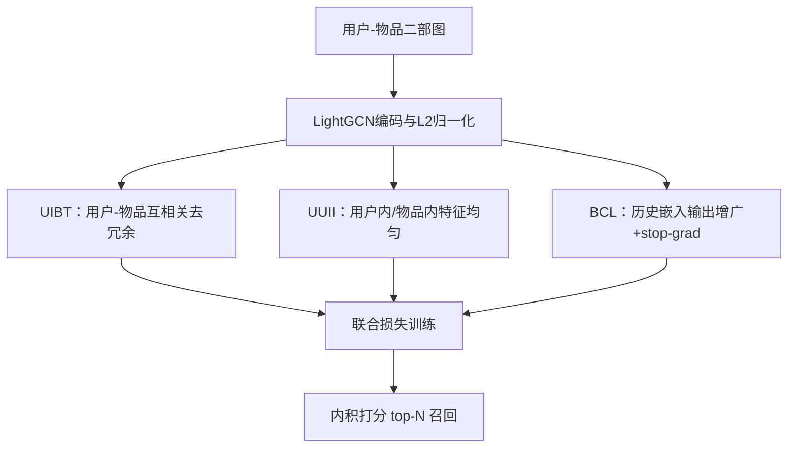
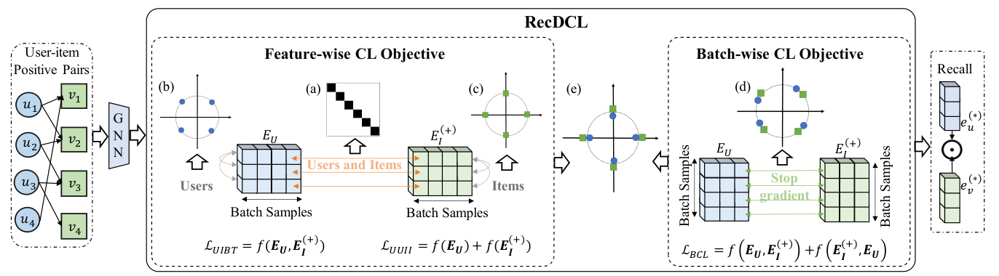

# RecDCL: Dual Contrastive Learning for Recommendation (双对比学习推荐)

- **会议/期刊**: WWW 2024
- **作者与机构**: Dan Zhang, Yangliao Geng, Wenwen Gong, Zhongang Qi, Zhiyu Chen, Xing Tang, Ying Shan, Yuxiao Dong, Jie Tang；清华大学、腾讯等
- **推荐链路定位**: 召回
- **研究方向**: 自监督对比学习与交互去噪 / 图神经网络推荐
- **论文原文**: [https://arxiv.org/abs/2401.15635v2](https://arxiv.org/abs/2401.15635v2)
- **开源代码**: [https://github.com/THUDM/RecDCL](https://github.com/THUDM/RecDCL)

## TL;DR (1分钟核心速览)

针对现有对比推荐只在批维对比、忽略特征维正则，导致表征冗余与负采样假阴性问题，RecDCL将批维CL与特征维CL统一：UIBT对齐用户-物品互相关矩阵、UUII用多项式核促使用户/物品特征正交、BCL用历史嵌入做输出增广。在Beauty/Food/Game/Yelp全库排序及支付工业集上，Recall@20最高相对提升5.65%。

## Background & Motivation (背景与核心矛盾)

- **主流范式**: 基于LightGCN的CF常以BPR负采样训练；SSL推荐则以SGL/SimGCL的图增广InfoNCE、BUIR/DirectAU的正样本批维对比为主。
- **前人局限**: BCL只在批维推开负样本，难以约束特征维冗余；FCL如Barlow Twins虽能做特征去相关，却忽略用户-物品正对交互，单独使用易产生大量冗余解。
- **核心洞察 (Key Insight)**: BCL推动样本在嵌入空间均匀分布，FCL推动特征正交；二者结合可消除冗余解但不遗漏最优解，且嵌入维度越高越受益。
- **本文切入点**: 将FCL的UIBT/UUII与输出增广BCL联合优化，形成面向推荐的“双对比”正则。

<figure class="paper-figure" markdown="span">
  <figcaption>图 1：展示 BCL、FCL 和 BCL+FCL 中负对效果的启发性示例，其中浅阴影符号表示可能解。在该例中，BCL（右上）倾向于将负对对齐在一条直线上，即在圆内均匀分布；FCL（左下）主要促使两个表示正交；BCL+FCL（右下）驱动两个样本在 𝑥 轴上任一位置饱和。</figcaption>
</figure>

## Method (核心方法设计)

### 1. 整体框架 (Overall Architecture)

输入用户-物品二部图，经LightGCN编码并归一化用户/物品嵌入；三路损失并行：UIBT约束用户-物品互相关矩阵趋近单位阵，UUII在用户内与物品内做特征维均匀化，BCL用历史嵌入构造输出增广并以stop-gradient对比。联合训练后，以用户-物品内积做top-N召回，无需负采样。

<figure class="paper-figure" markdown="span">
  <figcaption>图 2：RecDCL 的整体框架。在该框架中，(a) 表示 FCL 中用户与物品之间互相关矩阵趋近单位矩阵；(b) 和 (c) 表示 FCL 中用户内和物品内的分布均匀性；(d) 表示 BCL 中用户-物品正对上的随机分布；(e) 展示了双 CL 在用户和物品上产生的最终分布。</figcaption>
</figure>

### 2. 关键设计拆解 (Key Designs)

1. **UIBT：用户-物品互相关去冗余**：将Barlow Twins搬到推荐正对，令用户嵌入与物品嵌入的互相关矩阵$\mathbf{C}$接近单位阵；对角项保不变性，非对角项降维间冗余，公式为$\mathcal{L}_{UI}=\frac{1}{F}\sum_m(1-\mathbf{C}_{mm})^2+\frac{\gamma}{F}\sum_m\sum_{n\ne m}\mathbf{C}_{mn}^2$。它把“正对对齐”和“特征去相关”同时写入目标。
2. **UUII：多项式核特征均匀化**：仅做互相关仍可能让用户/物品内部特征塌缩，故分别在用户侧与物品侧用多项式核拉开不同特征维：$\mathcal{L}_{UUII}=\frac12\log\sum_{m\ne n}(a(\mathbf{E}_{:,m}^U)^\top\mathbf{E}_{:,n}^U+c)^e+\frac12\log\sum_{m\ne n}(a(\mathbf{E}_{:,m}^I)^\top\mathbf{E}_{:,n}^I+c)^e$。默认$a=1,c=10^{-7},e=4$，促使特征正交且分布更锐利。
3. **BCL与训练目标**：对输出嵌入做历史混合增广$\hat{\mathbf{E}}_U=\tau\mathbf{E}_U^{(h)}+(1-\tau)\mathbf{E}_U$，并以$\mathcal{L}_{BCL}=\frac12S(h(\mathbf{E}_U),sg(\hat{\mathbf{E}}_I))+\frac12S(sg(\hat{\mathbf{E}}_U),h(\mathbf{E}_I))$增强鲁棒性；总损失$\mathcal{L}=\mathcal{L}_{UI}+\alpha\mathcal{L}_{UUII}+\beta\mathcal{L}_{BCL}$。训练免负采样，推理仅内积检索。

## Experimental Setup & Evaluation Protocol (实验设置与评估协议)

- **数据集与预处理**: 四个公开集沿用DirectAU设置；支付工业集取2022年12月支付日志，核心用户为支付次数>3者。

| 数据集 | #Users | #Items | #Interactions | 密度 | 特征/场景说明 |
| :--- | :---: | :---: | :---: | :---: | :--- |
| Beauty | 22,364 | 12,102 | 198,502 | 0.0733% | Amazon美妆评论 |
| Food | 127,279 | 40,995 | 1,141,946 | 0.0219% | Amazon食品 |
| Game | 37,419 | 14,079 | 343,481 | 0.0652% | Amazon游戏 |
| Yelp | 31,669 | 38,049 | 1,561,406 | 0.1296% | Yelp2018商户 |
| Payment | 83,810 | 23,318 | 797,828 | 0.0408% | 工业支付-商户 |

- **数据划分与防穿越 (Splitting Strategy)**: 公开集按用户交互做`80%/10%/10%`训练/验证/测试比例划分；工业集同比例。
- **排名评测协议 (Ranking Protocol)**: 采用无偏`Full-Ranking`，对每个用户除训练物品外的全库物品排序，报告Recall@20与NDCG@20。
- **对比基线与超参设置**: 对比Pop、BPR-MF、NeuMF、Mult-VAE、RecVAE、NGCF、LightGCN、BUIR、CLRec、DirectAU；嵌入维度32–2048调优，默认64；重复5次随机种子并做$t$检验，$p<0.05$为显著。RecDCL免负采样，BPR类基线使用负采样。

## Key Experimental Results (实验关键数据)

### 1. 主实验对比 (Main Results)

| 模型 | Beauty R@20 | Beauty N@20 | Food R@20 | Food N@20 | Game R@20 | Game N@20 | Yelp R@20 | Yelp N@20 |
| :--- | :---: | :---: | :---: | :---: | :---: | :---: | :---: | :---: |
| BPR-MF | 14.12 | 6.62 | 27.02 | 21.04 | 18.16 | 8.33 | 6.92 | 4.29 |
| NeuMF | 7.66 | 3.46 | 15.28 | 8.79 | 10.36 | 4.28 | 6.01 | 3.63 |
| Mult-VAE | 11.37 | 5.46 | 24.89 | 20.77 | 15.50 | 7.18 | 9.51 | 5.84 |
| RecVAE | 12.76 | 6.37 | 26.69 | 22.29 | 17.65 | 8.38 | 10.70 | 6.69 |
| NGCF | 13.27 | 6.28 | 26.84 | 20.96 | 18.04 | 8.31 | 7.29 | 4.45 |
| LightGCN | 13.48 | 6.25 | 24.56 | 16.77 | 19.20 | 8.91 | 8.43 | 5.23 |
| CLRec | 15.17 | 7.56 | 27.64 | 20.65 | 20.12 | 9.60 | 10.95 | 6.89 |
| DirectAU | 15.43 | 7.49 | 28.57 | 22.41 | 20.14 | 9.55 | 10.97 | 6.92 |
| **RecDCL** | **15.78** | **7.89** | **28.95** | **23.27** | **20.44** | **9.87** | **11.59** | **7.28** |
| **Improv.%** | +2.27% | +5.34% | +1.33% | +3.84% | +1.49% | +3.35% | +5.65% | +5.20% |

工业支付集：RecDCL Recall@20为**36.47**、NDCG@20为**17.86**，相对BPR-MF的35.27/16.61提升**3.40%/7.53%**。

### 2. 消融实验 (Ablation Study)

| 方法 | Beauty R@20 | Beauty N@20 | Yelp R@20 | Yelp N@20 |
| :--- | :---: | :---: | :---: | :---: |
| LightGCN | 13.48 | 6.25 | 8.43 | 5.28 |
| w/ UIBT | 14.78 | 7.47 | 9.92 | 6.18 |
| w/ UUII | 1.01 | 0.50 | 0.06 | 0.03 |
| w/ BCL | 14.90 | 7.51 | 10.08 | 6.36 |
| w/ UIBT & UUII | 14.88 | 7.43 | 11.00 | 6.85 |
| w/ UIBT & BCL | 15.64 | 7.63 | 10.73 | 6.78 |
| w/ UUII & BCL | 15.16 | 7.59 | 7.65 | 4.66 |
| **RecDCL** | **15.78** | **7.89** | **11.59** | **7.28** |

### 3. 关键实验发现 (Key Findings)

1. RecDCL相对最强SSL基线DirectAU在Beauty/Yelp的R@20提升2.27%/5.65%，相对LightGCN分别提升17.06%/37.49%，说明FCL补足了批维CL缺失的特征正则；Game R@20仅+1.49%且$p=0.265$，需谨慎解读。
2. UUII单独使用几近崩溃（Beauty R@20=1.01、Yelp=0.06），但UIBT+UUII恢复至14.88/11.00，UIBT+BCL达15.64/10.73，三者齐全才达15.78/11.59，表明“正对对齐+特征均匀+输出增广”缺一不可。
3. 工业支付集上NDCG@20提升7.53%，且BCL+FCL的平均熵低于单独FCL/BCL，嵌入分布更锐利；UIBT+BCL在Yelp低于UIBT+UUII也说明用户/物品内部均匀性对稀疏数据更关键。

## Highlights & Limitations (亮点、对比与审稿批判)

- **与代表作对比 (vs. Prior Work)**: SGL/SimGCL依赖图/输入扰动，BUIR/DirectAU只做批维正样本对比，Barlow Twins只做CV特征去相关；RecDCL首次把“特征维去冗余”与“批维输出增广”统一到推荐目标，并给出BCL/FCL冗余解分析。
- **可迁移亮点**: 历史嵌入混合+stop-gradient的输出增广可直接迁移到图召回；用户侧/物品侧分离的多项式核均匀化适合稀疏双边平台。
- **审稿级局限批判**: 总训练轮数达253，明显多于LightGCN的57与DirectAU的43，虽单轮318s更快但总成本偏高；实验以LightGCN编码器和top-20离线全库排序为主，缺少线上A/B与更细粒度延迟/冷启动分桶验证。

## Rating (四维评分)

- **方法创新性 (Novelty)**: ⭐⭐⭐⭐ （将BCL/FCL的冗余解关系理论化，并落到UIBT+UUII+BCL三元目标，机制新颖）
- **评估协议与实验扎实度 (Protocol & Experiments)**: ⭐⭐⭐⭐ （四公开集+工业集、全库排序、5次种子t检验与充分消融，但Game R@20不显著且线上验证不足）
- **写作与数学规范度 (Clarity & Rigor)**: ⭐⭐⭐⭐ （公式、观测与附录推导较完整，UIBT/UUII/BCL符号统一；部分理论依赖标准化与近似假设）
- **工业落地与复现价值 (Industrial & Practical Value)**: ⭐⭐⭐⭐ （代码开源，免负采样、推理内积即可；但总训练epoch偏多，超参$\alpha,\beta,\tau$与高维嵌入需调优）

