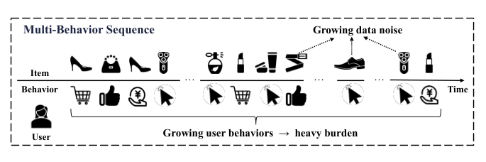
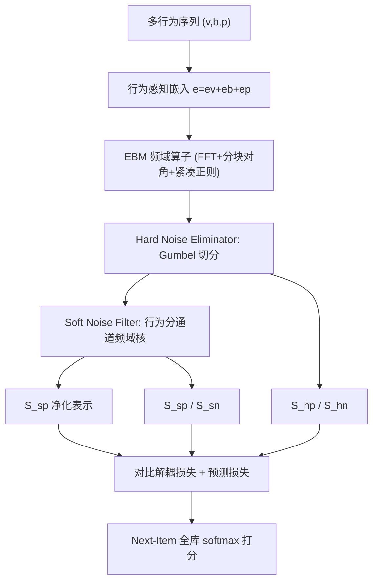
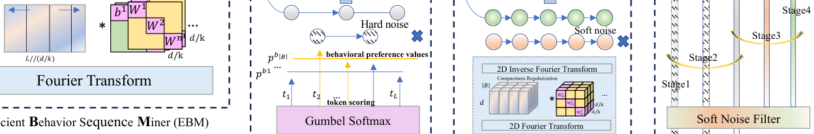

# END4Rec: Efficient Noise-Decoupling for Multi-Behavior Sequential Recommendation (多行为序列推荐的高效噪声解耦)

- **会议/期刊**: WWW 2024 (ACM Web Conference)
- **作者与机构**: Yongqiang Han, Hao Wang, Kefan Wang, Likang Wu, Zhi Li, Wei Guo, Yong Liu, Defu Lian, Enhong Chen（USTC / 清华深圳国际研究生院 / 华为新加坡研究所）
- **推荐链路定位**: 精排（Next-Item 序列打分）
- **研究方向**: 序列与会话推荐 / 自监督对比学习与交互去噪
- **论文原文**: [https://arxiv.org/abs/2403.17603v1](https://arxiv.org/abs/2403.17603v1)
- **开源代码**: 暂未开源

## TL;DR (1分钟核心速览)

多行为序列（点击/收藏/加购/购买）既让序列急剧变长、又混入两类噪声（误点击的 token 级硬噪声、兴趣漂移的表示级软噪声）。END4Rec 以 FFT 频域算子 EBM（$O(L\log L)$、参数与序列长度无关）替代时域自注意力，再加硬噪声消除器（Poisson 行为偏好值 + Gumbel-Softmax 可微切分）、按行为分通道的软噪声滤波器，以及"净化>$原始>$噪声"的三元解耦对比损失与四阶段引导训练。在 CIKM/Taobao/IJCAI 上按 Leave-One-Out + 99 负采样评测，HR@10 相对最强基线 DPT 提升 8.02%/5.75%/6.38%。

## Background & Motivation (背景与核心矛盾)

- **主流范式**: 多行为序列推荐把点击、收藏、加购、购买按时间戳拼成一条长序列，用 Transformer（MATN/KHGT）或 GCN（MB-GCN）分别编码各行为，再借对比学习（CML/KMCLR）或去噪范式（CLEA/ADT/FMLP-Rec/DPT）增强目标行为（购买）的预测。
- **前人局限**: 其一，多行为拼接使序列长度爆炸，自注意力 $O(L^2d)$ 的时域建模在长序列上不可承受，FMLP-Rec 虽用 FFT 降复杂度却只做逐元素点积、无法跨频带融合；其二，现有去噪方法（CLEA 的篮子子集划分、ADT 的高 loss 剪枝、RAP 的 MDP 策略）把噪声视为单一同质现象，既未区分"离散误点击"与"连续过期兴趣"，也未利用噪声与行为类型（点击天然比购买更随机）的关联。
- **核心洞察 (Key Insight)**: 噪声在频域上表现为能量聚集于少数频带导致局部过拟合；而不同行为的噪声比例天然不同（点击高、购买低），因此去噪必须"整体感知序列 + 行为感知"。
- **本文切入点**: 用低复杂度频域算子提供"整段序列的全局感知"底座，在其上把去噪拆成 token 级硬切分与通道级软滤波两条支路，并用对比损失把噪声信号显式推开。

<figure class="paper-figure" markdown="span">
  <figcaption>图1：我们的动机示意图：用户交互增加及由此产生的大量数据噪声。</figcaption>
</figure>

## Method (核心方法设计)

### 1. 整体框架 (Overall Architecture)

输入用户行为三元组序列 $S_u=[(v_1,b_1,p_1),\dots]$，嵌入层做$\boldsymbol{e}=\boldsymbol{e}_v+\boldsymbol{e}_b+\boldsymbol{e}_p$相加；主干 EBM 在频域完成跨频带融合并输出序列表示。在 EBM 之上并联两条去噪支路：Hard Noise Eliminator 用"整体 token 评分$t_i$− 行为偏好值$p_{b_i}$"打分，经 Gumbel-Softmax 可微地切出净化序列$S_{hp}$与硬噪声序列$S_{hn}$；Soft Noise Filter 在 EBM 的频域权重上按行为分通道（EBM+），得到软过滤表示$S_{sp}$与软噪声$S_{sn}$。最后用"净化 > 原始 > 噪声"的三元对比损失 + 四阶段引导训练（预训练 EBM → 训硬去噪 → 训软去噪 → 冻结去噪层收敛）完成解耦，推理时仅走$S_{sp}$ 打分。

<figure class="paper-figure" markdown="span">
  <figcaption>图2：我们的END4Rec模型，具有𝑂(𝑁𝑙𝑜𝑔𝑁)复杂度和自适应输入长度的用户多行为序列高效挖掘过程。该框架由若干关键组件构成：用于高效挖掘行为模式的高效行为序列挖掘器（EBM）（4.3）、包含硬噪声消除器和软噪声过滤器的行为感知去噪（4.4）用于噪声检测，以及用于充分解耦噪声的噪声解耦对比学习（4.5）。</figcaption>
</figure>

### 2. 关键设计拆解 (Key Designs)

1. **EBM：频域融合 + 分块对角 + 紧凑正则**：痛点是用点积 $W\odot X$（$W\in\mathbb{C}^{L\times d}$）只能逐频点缩放、无法融合多时间尺度兴趣，而升为$W\in\mathbb{C}^{L\times d\times d}$又使参数随序列长度增长。EBM 把$W$分解为$k$个共享小块$\mathrm{MLP}_n$：$\tilde{x}_i^n=\mathrm{MLP}_n(x_i^n),\ n=1..k$，复杂度降为$O(Ld^2/k+Ld\log L)$、参数量$(1+4/k)d^2+4d$（$k=8$时约$1.5d^2$，低于自注意力的$3d^2$），且与$L$无关，可自适应变长输入。再加紧凑正则$R(X,\epsilon)=\frac{1}{2}\log\det\left(I+\frac{d}{L\epsilon^2}XX^{\top}\right)$，压低频域 token 编码率、稀疏化频谱以防过拟合局部频带（图 5 可视化印证）。
2. **硬噪声消除（行为感知 + 可微切分）**：token 噪声源于误点击，但"哪些行为更易误点"应由行为频率刻画。作者用 Poisson 峰值构造行为偏好值 $p_b=P\{X=\lambda_b\}+1=\frac{e^{-\lambda_b}\lambda_b^{\lambda_b}}{\lambda_b!}+1$（$\lambda_b$为可搜超参），与残差+线性+sigmoid 得到的整体感知评分$t_i$相减，以$p_{b_i}-t_i<0.5$判为噪声；由于硬切分不可导，用 Gumbel-Softmax$\mathcal{J}(v_i)$作可微替身，$\tau$ 控制平滑度。直觉是"购买这类强意图行为的阈值应更高"，从而避免把高价值信号当噪声删掉。
3. **软噪声滤波 + 解耦对比学习 + 训练目标**：把 EBM 的 $W_b^n$按行为$b$分通道（EBM+），$\tilde{x}_{i,b}^n=W_b^n x_{i,b}^n$，用$\tilde{X}$与$X-\tilde{X}$分别得到软过滤/软噪声表示（可学习频域核天然承担"过期兴趣"滤波）。对比损失先定义序列对目标物品的匹配度$Q(S)=\frac{\exp(S\cdot e_{v_t})}{\sum_{v\in V}\exp(S\cdot e_v)}$，再约束排序$Q(S_p)>Q(S)>Q(S_n)$：$\mathcal{L}_{CL}=-\sum\log\sigma\left(Q(S_p)-Q(S)\right)-\sum\log\sigma\left(Q(S)-Q(S_n)\right)$。总损失为各阶段$\mathcal{L}=\mathcal{L}_{pred}(S_{sp})+\mathcal{L}_{CL}+\mathcal{L}_{compactness}$，其中$\mathcal{L}_{pred}=-\sum_{u}Q(S_u)$ 为全物品 softmax（无显式负采样，靠分母归一化隐式对比）。

## Experimental Setup & Evaluation Protocol (实验设置与评估协议)

- **数据集与预处理**（过滤掉交互 < 20 的用户/物品，并要求购买行为至少出现 5 次，即 `20-core + buy≥5`）：

| 数据集 | #Users | #Items | #Interactions | 稀疏度/密度 | 特征/场景说明 |
| :--- | :---: | :---: | :---: | :---: | :--- |
| CIKM | 254,356 | 521,900 | 18,824,670 | 1.42e-4 | 阿里电商，click/favorite/cart/buy 四行为 |
| Taobao | 279,052 | 731,517 | 32,758,555 | 1.60e-4 | 淘宝多行为日志，序列长度分布长尾 |
| IJCAI | 324,859 | 331,064 | 46,694,666 | 4.34e-4 | IJCAI-15 重复购买者预测 |

- **数据划分与防穿越**: `Leave-One-Out`——每个用户时间序最后一次购买为 test、倒数第二次为 valid，其余为训练，严格避免未来交互泄漏。
- **排名评测协议**: `Sampled Ranking`——每个正样本配 99 个随机未交互负样本（正负比 1:99），指标 HR@10/20、NDCG@10/20；非 Full-Ranking，绝对数值偏高但基线间可比。
- **对比基线与超参**: 通用序列（SASRec/BERT4Rec/CL4SRec/FEARec）、多行为（MB-GCN/KHGT/CML/KMCLR）、去噪（CLEA/ADT/FMLP-Rec/DPT）三类；embedding $d=128$、batch 512、最多 1000 epoch、验证 NDCG 20 轮不升即早停；报告$p<0.05$ 显著性。

## Key Experimental Results (实验关键数据)

### 1. 主实验对比 (Main Results)

| Dataset | Method | H@10 | N@10 | H@20 | N@20 |
| :--- | :--- | :---: | :---: | :---: | :---: |
| CIKM | SASRec | 0.3055 | 0.1861 | 0.3981 | 0.2285 |
| CIKM | BERT4Rec | 0.3350 | 0.2147 | 0.4235 | 0.2337 |
| CIKM | FEARec | 0.3392 | 0.2093 | 0.4386 | 0.2493 |
| CIKM | MB-GCN | 0.3889 | 0.2136 | 0.4951 | 0.2894 |
| CIKM | KHGT | 0.4014 | 0.2305 | 0.5160 | 0.2993 |
| CIKM | CML | 0.4234 | 0.2466 | 0.5400 | 0.3060 |
| CIKM | KMCLR | 0.4344 | 0.2494 | 0.5584 | 0.3239 |
| CIKM | DPT | 0.4431 | 0.2545 | 0.5697 | 0.3304 |
| CIKM | **END4Rec** | **0.4787** | **0.2754** | **0.6120** | **0.3536** |
| CIKM | Improv. | +8.02% | +8.23% | +7.44% | +7.00% |
| Taobao | SASRec | 0.2995 | 0.1766 | 0.3834 | 0.2129 |
| Taobao | FEARec | 0.3213 | 0.1891 | 0.4120 | 0.2274 |
| Taobao | MB-GCN | 0.3628 | 0.2016 | 0.4510 | 0.2498 |
| Taobao | KHGT | 0.3824 | 0.2181 | 0.4815 | 0.2670 |
| Taobao | CML | 0.4212 | 0.2420 | 0.5311 | 0.2942 |
| Taobao | KMCLR | 0.3587 | 0.2070 | 0.4563 | 0.2503 |
| Taobao | DPT | 0.4221 | 0.2408 | 0.5315 | 0.2947 |
| Taobao | **END4Rec** | **0.4464** | **0.2533** | **0.5614** | **0.3102** |
| Taobao | Improv. | +5.75% | +4.71% | +5.63% | +5.27% |
| IJCAI | BERT4Rec | 0.3748 | 0.2060 | 0.4890 | 0.2658 |
| IJCAI | FEARec | 0.3866 | 0.2085 | 0.5027 | 0.2626 |
| IJCAI | KHGT | 0.4104 | 0.2214 | 0.5337 | 0.2791 |
| IJCAI | CML | 0.4344 | 0.2366 | 0.5658 | 0.3018 |
| IJCAI | KMCLR | 0.4441 | 0.2397 | 0.5769 | 0.3051 |
| IJCAI | CLEA | 0.3989 | 0.2166 | 0.5194 | 0.2752 |
| IJCAI | FMLP-Rec | 0.4265 | 0.2315 | 0.5552 | 0.2940 |
| IJCAI | DPT | 0.4531 | 0.2445 | 0.5709 | 0.3082 |
| IJCAI | **END4Rec** | **0.4821** | **0.2613** | **0.6166** | **0.3314** |
| IJCAI | Improv. | +6.38% | +6.88% | +6.88% | +7.53% |

### 2. 消融实验 (Ablation Study)

| Variant | CIKM H@10 / N@10 | Taobao H@10 / N@10 | IJCAI H@10 / N@10 |
| :--- | :---: | :---: | :---: |
| w/o hard (去硬去噪) | 0.3614 / 0.2260 | 0.3308 / 0.1943 | 0.4094 / 0.2222 |
| w/o soft (去软滤波) | 0.4107 / 0.2255 | 0.3831 / 0.2129 | 0.3830 / 0.2079 |
| w/o cl (去解耦对比) | 0.4254 / 0.2443 | 0.4052 / 0.2311 | 0.4350 / 0.2347 |
| w/o comp (去紧凑正则) | 0.4387 / 0.2519 | 0.3623 / 0.2090 | 0.4486 / 0.2421 |
| w/o opti (端到端替代引导) | 0.4576 / 0.2590 | 0.4263 / 0.2432 | 0.4577 / 0.2470 |
| **END4Rec** | **0.4787 / 0.2754** | **0.4464 / 0.2533** | **0.4821 / 0.2613** |

### 3. 关键实验发现 (Key Findings)

- **硬去噪是主贡献，且数据集间噪声分布差异显著**：去掉 HNE 使 CIKM/Taobao/IJCAI 的 H@10 分别下降 24.5%/25.9%/15.1%，远大于去软滤波的 14.2%/14.2%/20.5%（IJCAI 反超），说明 token 级误点击在阿里系数据中最重，而 IJCAI 的过期兴趣噪声更突出——单一路径去噪必然次优。
- **解耦对比损失与引导训练是"稳定增益项"**：去掉 $\mathcal{L}_{CL}$ 三数据集 H@10 掉 11.1%/9.2%/9.8%；用端到端替换四阶段引导训练掉 6.5%/4.5%/5.1%，证明在稀疏监督下"逐步冻结 + 阶段性对比"比一次性联合优化更易把噪声子空间推开。
- **紧凑正则的价值高度依赖频谱结构**：Taobao 上去掉后 H@10 从 0.4464 跌至 0.3623（-18.8%，甚至劣于 w/o cl），而 CIKM/IJCAI 仅掉 8.4%/7.0%，对应图 5 中该数据集频域能量更集中于少数频带、更易局部过拟合。
- **噪声比例与行为语义一致**（图 4）：点击的硬噪声移除比例最高、购买最低；软滤波核在"加购/购买"上呈现相似模式，说明模型自动学到了行为间偏好关联，这与 $\lambda_b$ 排序（click < cart < buy < favorite）的设定互为验证。

## Highlights & Limitations (亮点、对比与审稿批判)

- **与代表作对比 (vs. Prior Work)**: 相比 FMLP-Rec（仅频域点积、无跨频带融合、无去噪语义），EBM 用分块对角矩阵乘法在同等 $O(L\log L)$下实现 full fusion 且参数不随$L$ 增长；相比 CLEA/ADT（假设噪声可由高 loss 或篮子子集识别，单一噪声类型），END4Rec 显式区分 token 级硬噪声与表示级软噪声并绑定行为类型；相比 DPT（三阶段但纯数据驱动、无频域效率优势），本文额外给出四阶段引导与三元对比排序约束。
- **可迁移亮点**: (1) "行为频率 → Poisson 峰值 → 偏好阈值"的构造可低成本迁移到任意多行为/多事件类型场景，用作门控先验；(2) 用 $Q(S_p)>Q(S)>Q(S_n)$ 的序关系代替正负二分类对比，可在无干净标签时把"中间态"原始序列当作锚点，缓解净化样本过少的问题。
- **审稿级局限批判**: 其一，评测采用 1:99 采样排序而非 Full-Ranking，且训练侧 $\mathcal{L}_{pred}$为全库 softmax，采样评测可能放大头部效应、掩盖长尾排序退化，缺少 Full-Ranking 与长尾分桶结果；其二，四阶段引导训练需反复冻结/解冻并多次前向，$k$、$\alpha$、四组$\lambda_b$均为人工搜索超参（$\lambda_b$ 敏感性虽称不高），实际线上增量训练与推理延迟未做端到端 profiling，工程可得性证据不足。

## Rating (四维评分)

- **方法创新性 (Novelty)**: ⭐⭐⭐⭐ （把频域高效算子与"硬/软双粒度 + 行为感知"去噪耦合，并用序关系对比显式解耦，机制组合新颖且有频谱可视化支撑）
- **评估协议与实验扎实度 (Protocol & Experiments)**: ⭐⭐⭐ （三数据集 + 12 类基线 + 5 组消融较完整，但仅 1:99 采样排序、缺 Full-Ranking 与显著性置信区间细节）
- **写作与数学规范度 (Clarity & Rigor)**: ⭐⭐⭐⭐ （EBM 复杂度/参数量对比表清晰，Poisson 与 Gumbel 推导到位；$\mathcal{L}_{CL}$与$Q$ 的关系及阶段损失权重略欠显式交代）
- **工业落地与复现价值 (Industrial & Practical Value)**: ⭐⭐⭐⭐ （$O(L\log L)$、参数与序列长度解耦，天然适配长多行为序列；但代码未开源、四阶段训练流程增加落地调参成本）

