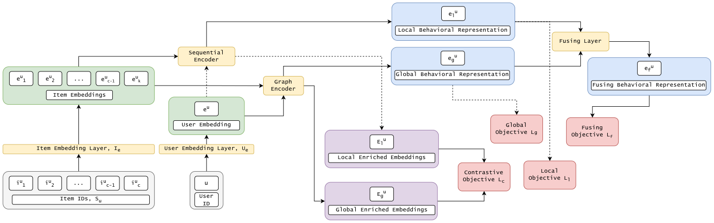
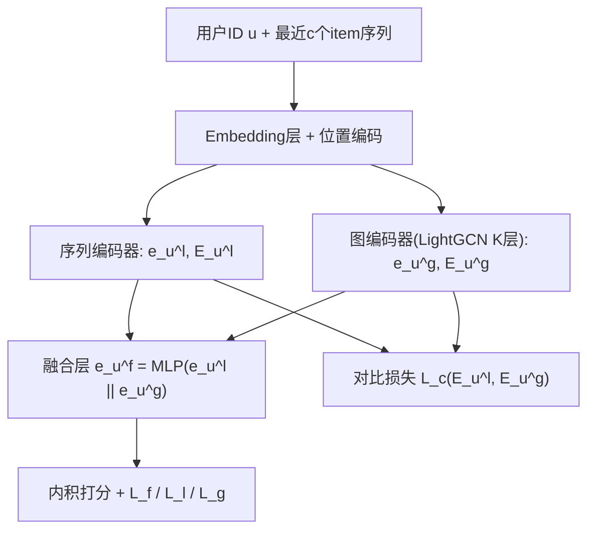

# End-to-End Graph-Sequential Representation Learning for Accurate Recommendations (图-序列端到端表征学习用于精准推荐)

- **会议/期刊**: WWW 2024 (Companion, short paper, 4 pages)
- **作者与机构**: Vladimir Baikalov (Skoltech)、Evgeny Frolov (AIRI / Skoltech)
- **推荐链路定位**: 召回 / 粗排（Next-Item 全库打分）
- **研究方向**: 序列与会话推荐 / 图神经网络推荐
- **论文原文**: [https://arxiv.org/abs/2403.00895v3](https://arxiv.org/abs/2403.00895v3)
- **开源代码**: 暂未开源

## TL;DR (1分钟核心速览)

序列模型只用用户自身有序交互、对全局共现不敏感；GCN 能挖间接依赖、却难精细刻画个体近期意图。本文提出 MRGSRec：把可插拔的序列编码器（SASRec+）与图编码器（LightGCN）并联，在训练与推理**全程**保留两路表征，经 MLP 融合层 $e_u^{f}$ 打分，并额外用局部-全局 item 表征间的 InfoNCE 对比损失互蒸馏。在 5-core、Leave-One-Out、**全库未采样 Full-Ranking** 协议下，四个基准上 HR@5/NDCG@5 全面超越 SASRec+、LightGCN 与 MCLSR，ML-1M NDCG@5 相对提升 8.94%。

## Background & Motivation (背景与核心矛盾)

- **主流范式**: 序列侧以 Transformer（SASRec/BERT4Rec）建模有序交互，图侧以 LightGCN 在 user-item 二分图上传播高阶协同信号。
- **前人局限**: ①序列模型只看直接依赖，缺乏跨用户/跨物品的全局上下文；②GCN 抓到的是聚合后的粗粒度偏好，对"用户最近 $c$ 个 item 的精确意图"建模能力弱，且难以直接适配序列化设定。
- **核心洞察**: 两者捕捉的是**互补而非冗余**的信号——同一 item 的"局部富化表征"与"全局富化表征"应当被显式对齐，从而让序列分支吸收图分支的高阶协同，反之亦然。
- **本文切入点**: 唯一的多表征工作 MCLSR 仅在训练期把图信息灌入 item 表征、推理时只用序列分支；本文把融合推到**训练+推理全链路**，且对两侧编码器只施加签名约束，架构完全可插拔。

## Method (核心方法设计)

### 1. 整体框架 (Overall Architecture)

输入用户 ID $u$与截断到最近$c$个 item 的序列$S_u$，经 User/Item Embedding 层加位置编码得$\boldsymbol{e}_u\in\mathbb{R}^d$、$\boldsymbol{E}_u\in\mathbb{R}^{c\times d}$。序列编码器吃$[\boldsymbol{e}_u\|\boldsymbol{E}_u]$产出局部行为表征$\boldsymbol{e}_u^{l}$与局部富化表征$\boldsymbol{E}_u^{l}$；图编码器在二分图上传播$K$层，按 ID 抽取全局行为表征$\boldsymbol{e}_u^{g}$与全局富化表征$\boldsymbol{E}_u^{g}$。融合层拼接两路行为表征得$\boldsymbol{e}_u^{f}$ 用于最终打分，四个目标（局部、全局、融合、对比）联合优化。

<figure class="paper-figure" markdown="span">
  <figcaption>图 1</figcaption>
</figure>

### 2. 关键设计拆解 (Key Designs)

1. **会话内用户上下文注入 (User-Conditioned Sequential Encoding)**：SASRec 类编码器对同一序列在不同用户下输出相同表征，丢失个性化。本文把用户嵌入前置拼进序列矩阵再送入 Transformer，即 $[\boldsymbol{e}_u^{l}\|\boldsymbol{E}_u^{l}]=\mathrm{SeqEnc}([\boldsymbol{e}_u\|\boldsymbol{E}_u])$，输入维度$(c+1)\times d$、输出同形，使每个位置的表征都携带用户先验。
2. **训练+推理双路融合层 (Full-Path Fusion)**：痛点在于 MCLSR 推理时丢弃图分支，导致图信号只在训练期做正则。融合算子为
$\boldsymbol{e}_u^{f}=W_2\,\mathrm{ReLU}\big(W_1[\boldsymbol{e}_u^{l}\|\boldsymbol{e}_u^{g}]\big),\ W_1\in\mathbb{R}^{4d\times 2d},W_2\in\mathbb{R}^{d\times 4d}$推理时直接用$\boldsymbol{e}_u^{f}$ 与 Item Embedding 内积打分，保证线上打分同时享有两种依赖信号。
3. **跨表征对比互蒸馏与总目标**：为避免两分支各自坍缩到无关子空间，对序列中第 $i$ 个 item 的局部/全局富化表征做 InfoNCE（同一 item 的两个视图为正对，序列内其他位置为负对）：
$\mathcal{L}_{c}=-\sum_{u}\sum_{i=1}^{c}\log\frac{\exp\big((\boldsymbol{E}_{u,i}^{l})^{\top}\boldsymbol{E}_{u,i}^{g}\big)}{\sum_{j=1}^{c}\exp\big((\boldsymbol{E}_{u,i}^{l})^{\top}\boldsymbol{E}_{u,j}^{g}\big)}$**训练目标与负采样**：$\mathcal{L}=\alpha\mathcal{L}_{l}+\beta\mathcal{L}_{g}+\gamma\mathcal{L}_{f}+\delta\mathcal{L}_{c}$，其中$\mathcal{L}_{l}$沿用 SASRec+ 交叉熵、$\mathcal{L}_{g}$沿用 LightGCN 的 BPR+正则、$\mathcal{L}_{f}$ 为融合表征上的 softmax 下一项损失（每用户仅采 1 个序列外均匀负样本）：
$\mathcal{L}_{f}=-\sum_{u\in\mathcal{U}}\log\frac{\exp\big((\boldsymbol{e}_u^{f})^{\top}\boldsymbol{e}_{i_u^{+}}\big)}{\sum_{i\in\{i_u^{+}\}\cup \mathcal{N}(u)}\exp\big((\boldsymbol{e}_u^{f})^{\top}\boldsymbol{e}_{i}\big)}$推理开销为一次 Transformer 前向 + 一次$K$ 层稀疏图传播 + 一层 MLP，需要在线维护全图邻接，是其工程瓶颈。

## Experimental Setup & Evaluation Protocol (实验设置与评估协议)

| 数据集 | #Users | #Items | #Interactions | 平均序列长 | 特征/场景说明 |
| :--- | :---: | :---: | :---: | :---: | :--- |
| Amazon-Beauty | 22,363 | 12,101 | 198,502 | 8.876 | 稀疏美妆评论序列 |
| Amazon-Clothing | 39,387 | 23,033 | 278,677 | 7.075 | 最稀疏、最短序列 |
| Amazon-Sports | 35,598 | 18,357 | 296,337 | 8.325 | 户外运动品类 |
| MovieLens-1M | 6,040 | 3,706 | 1,000,209 | 165.598 | 高密度、长序列 |

- **数据集与预处理**: 四基准统一 `5-core` 过滤，全部交互视为正反馈，按时间戳升序排列用户序列。
- **数据划分与防穿越**: `Leave-One-Out`——最后 1 个 item 为测试目标、倒数第 2 个为验证目标（用于超参搜索），其余训练。
- **排名评测协议**: 无偏 `Full-Ranking`，**不做目标 item 负采样**，测试正样本与全量 item 目录共同排序，指标 HR@5/10、NDCG@5/10。
- **对比基线与超参**: 序列侧 SASRec、BERT4Rec、SASRec+；图侧 NGCF、LightGCN；多表征侧 MCLSR。MRGSRec 实例化采用 SASRec+ 序列头 + LightGCN 图头，$d$具体取值与$\alpha,\beta,\gamma,\delta$ 搜索区间原文未列；未报告显著性检验。

## Key Experimental Results (实验关键数据)

### 1. 主实验对比 (Main Results)

| 数据集 | 指标 | SASRec | BERT4Rec | SASRec+ | NGCF | LightGCN | MCLSR | **MRGSRec** | Improv.% |
| :--- | :--- | :---: | :---: | :---: | :---: | :---: | :---: | :---: | :---: |
| Beauty | HR@10 | 0.0611 | 0.0412 | 0.0663 | 0.0215 | 0.0253 | 0.0614 | **0.0681** | 2.71 |
| Beauty | NDCG@10 | 0.0273 | 0.0254 | 0.0343 | 0.0094 | 0.0098 | 0.0275 | **0.0349** | 1.75 |
| Clothing | HR@10 | 0.0271 | 0.0206 | 0.0339 | 0.0133 | 0.0156 | 0.0287 | **0.0352** | 3.83 |
| Clothing | NDCG@10 | 0.0116 | 0.0105 | 0.0155 | 0.0059 | 0.0071 | 0.0117 | **0.0162** | 4.52 |
| Sports | HR@10 | 0.0324 | 0.0322 | 0.0417 | 0.0155 | 0.0179 | 0.0318 | **0.0434** | 4.08 |
| Sports | NDCG@10 | 0.0167 | 0.0153 | 0.0218 | 0.0073 | 0.0080 | 0.0168 | **0.0227** | 4.12 |
| ML-1M | HR@10 | 0.1804 | 0.1333 | 0.2133 | 0.0864 | 0.0921 | 0.1813 | **0.2248** | 5.39 |
| ML-1M | NDCG@10 | 0.0918 | 0.0623 | 0.1065 | 0.0477 | 0.0549 | 0.0921 | **0.1134** | 6.48 |

Top-5 位置增益更猛：Clothing HR@5 0.0207→**0.0221**（+6.76%）、NDCG@5 0.0114→**0.0121**（+6.15%）；ML-1M NDCG@5 0.0761→**0.0829**（+8.94%）；Beauty NDCG@5 0.0289→**0.0301**（+4.15%）；Sports NDCG@5 0.0176→**0.0186**（+5.68%）。

### 2. 消融实验 (Ablation Study)

原文为 4 页短文，**未提供逐损失/逐模块消融**；下表用"单分支基线 + 训练期融合基线"构造成分对照（NDCG@5）：

| 配置（成分对照） | Beauty | Clothing | Sports | ML-1M |
| :--- | :---: | :---: | :---: | :---: |
| 仅图分支 (LightGCN) | 0.0079 | 0.0043 | 0.0072 | 0.0307 |
| 仅序列分支 (SASRec+) | 0.0289 | 0.0114 | 0.0176 | 0.0761 |
| 训练期融合 (MCLSR) | 0.0212 | 0.0093 | 0.0134 | 0.0634 |
| 全链路融合 + $\mathcal{L}_{c}$ (MRGSRec) | **0.0301** | **0.0121** | **0.0186** | **0.0829** |
| w/o $\mathcal{L}_{c}$, w/o$\mathcal{L}_{f}$ | 未报告 | 未报告 | 未报告 | 未报告 |

### 3. 关键实验发现 (Key Findings)

1. **密度决定图分支的价值**：ML-1M 平均序列长 165.6，MRGSRec 的 NDCG@5 相对 SASRec+ 提升 8.94%（0.0761→0.0829），远高于稀疏的 Beauty（4.15%）与 Clothing（6.15%），说明图传播在共现充分时才能贡献有效高阶信号；稀疏集上 LightGCN 单独仅 0.0043~0.0079，几乎无效。
2. **增益集中在列表顶部而非召回覆盖**：四个数据集上 HR@5 的相对提升普遍大于 HR@10（Clothing 6.76% vs 3.83%、Sports 5.09% vs 4.08%），NDCG 提升亦高于 HR，表明模型主要把已知正样本推到更前位置，对"其他模型都排不上"的长尾正样本召回能力提升有限。
3. **融合必须持续到推理**：MCLSR 在 Beauty 上 NDCG@5 仅 0.0212，甚至**低于**纯序列 SASRec+ 的 0.0289，印证"仅训练期融合、推理丢弃图分支"会带来负迁移；MRGSRec 同设定下 0.0301，相对 MCLSR 提升 42%，验证了全链路融合 + 对比对齐的必要性。

## Highlights & Limitations (亮点、对比与审稿批判)

- **与代表作对比**: 相较 SASRec+/LightGCN，本文不改任何单分支算子，只增加融合层与对比约束，属"结构外挂式"增益；相较 MCLSR，核心差异有二——融合贯穿推理、编码器仅受签名约束（可换任意序列/图骨干），通用性明显更强。
- **可迁移亮点**: ①"行为表征 + 富化 item 表征"双视图 InfoNCE 可作为任意双塔/多源召回的对齐正则；②以 $\mathcal{L}_{f}$ 在融合表征上单独施加下一项监督，能防止融合层被两侧损失"平均化"而退化。
- **审稿级局限批判**: ①无消融、无显著性检验、无 $\alpha/\beta/\gamma/\delta$与$d$敏感性分析，无法判断增益究竟来自融合结构还是对比项；②推理需在线维护全图并做$K$ 层传播，缺乏复杂度/时延与冷启动、长尾分桶评估，4 页短文亦未开源，复现与工业落地证据不足。

## Rating (四维评分)

- **方法创新性 (Novelty)**: ⭐⭐⭐ （融合思路直观、组件均为已有模块的组合，增量主要在"推理期保留双表征 + 跨表征对比"，理论支撑较弱）
- **评估协议与实验扎实度 (Protocol & Experiments)**: ⭐⭐⭐ （四数据集 + 全库未采样 Full-Ranking 与 LOO 划分较规范，但缺消融、缺显著性检验、缺分桶分析）
- **写作与数学规范度 (Clarity & Rigor)**: ⭐⭐⭐⭐ （公式与符号定义紧凑清晰、四目标构成交代明确，惟超参与复杂度细节缺失）
- **工业落地与复现价值 (Industrial & Practical Value)**: ⭐⭐⭐ （架构可插拔、易挂到现有序列召回上，但在线图传播开销大且无开源代码）

