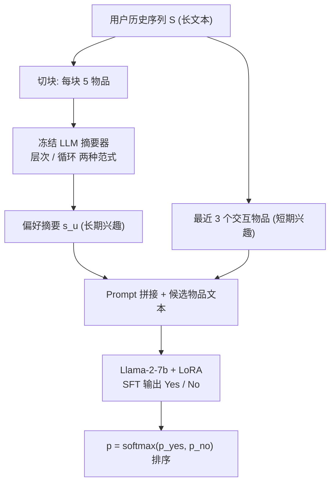
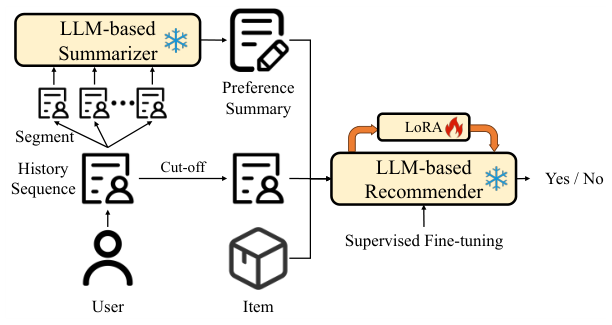

# Harnessing Large Language Models for Text-Rich Sequential Recommendation (利用大语言模型进行富文本序列推荐)

- **会议/期刊**: WWW 2024
- **作者与机构**: Zhi Zheng, Wenshuo Chao, Zhaopeng Qiu, Hengshu Zhu, Hui Xiong (USTC / BOSS 直聘 Career Science Lab / HKUST-GZ)
- **推荐链路定位**: 精排（候选物品 Yes/No 判别式打分）
- **研究方向**: 序列与会话推荐 / 大语言模型推荐
- **论文原文**: [论文原文链接](https://arxiv.org/abs/2403.13325v1)
- **开源代码**: [开源代码仓库链接](https://github.com/zhengzhi-1997/LLM-TRSR)

## TL;DR (1分钟核心速览)

富文本场景（电商商品长描述、新闻标题）下，直接用 LLM 建模用户历史序列会撞上上下文窗口、$O(n^2)$ 开销与偏好漂移三大瓶颈。本文把用户历史切块，用**冻结的 Llama-30b-instruct 当"摘要器"**，提出仿 CNN 的**层次摘要**与仿 RNN 的**循环摘要**两种压缩范式，将任意长历史压成一段偏好摘要，再与最近 3 个物品、候选物品拼成 prompt，用 LoRA-SFT 微调 Llama-2-7b 输出 Yes/No。在 Amazon-M2 与 MIND 上（1:20 采样排序协议），MIND 的 Recall@3 达 0.9160（TALLRec 0.8580，+6.8%），MRR@3 达 0.8505（+10.3%）。

## Background & Motivation (背景与核心矛盾)

- **主流范式**: 序列推荐用 GRU4Rec/BERT4Rec/SASRec 等 ID 序列模型，或 LSTUR/TempRec 加文本编码器；LLM4Rec 侧则以 TALLRec 为代表，把历史+候选拼成指令做二分类微调。
- **前人局限**: ① 富文本下单条物品平均 141 个 token（Amazon-M2），十几条历史就超出 GPT-2 的 1024 窗口；② Transformer 的 $O(n^2)$ 注意力使长 prompt 训练/推理成本爆炸，与推荐系统低延迟诉求冲突；③ 过长文本反而稀释了偏好漂移信号，性能不升反降。
- **核心洞察 (Key Insight)**: 用户历史的信息冗余度极高，**"压缩后的偏好摘要"比原始长文本更具判别力**——只要压缩过程保留长期兴趣、并与短期行为形成互补。
- **本文切入点**: 把"长序列建模"降级为"离线摘要 + 短 prompt 判别"，用冻结大模型承担压缩、用小模型承担打分，从架构上绕开长度限制。

## Method (核心方法设计)

### 1. 整体框架 (Overall Architecture)

输入用户行为序列 $S=[I_1,\dots,I_n]$，每物品含多类文本属性（Amazon-M2 有 10 类属性）。先将$S$序列化为一段长文本，按每块 5 个物品切成$B_1,\dots,B_N$；冻结的 Llama-30b-instruct（8-bit 量化）逐块摘要并聚合为最终偏好摘要$s_u$。随后构造五段式 prompt：推荐指令 + 偏好摘要$s_u$（长期兴趣）+ 最近 3 个交互物品（短期兴趣）+ 候选物品全部文本属性 + 答案位。用 LoRA-SFT 微调 Llama-2-7b，推理时去掉答案位，比较下一 token 为 "yes"/"no" 的概率得到打分。

<figure class="paper-figure" markdown="span">
  <figcaption>图1：我们方法的示意图。蓝色冰霜符号表示固定参数，红色火焰符号表示训练期间更新的参数。</figcaption>
</figure>

### 2. 关键设计拆解 (Key Designs)

1. **层次摘要 (Hierarchical Summarization，仿 CNN 感受野堆叠)**: 针对"单块摘要只见局部细节、缺乏全局抽象"的问题，先并行得到块级摘要 $s_i^{(1)}=\mathrm{Summ}(B_i)$，再把多个$s_i^{(1)}$拼接后二次送入摘要器得$s^{(2)}=\mathrm{Summ}(\oplus_i s_i^{(1)})$，可继续堆叠层数：$s^{(l+1)}=\mathrm{Summ}(\oplus_{j} s_j^{(l)})$。直觉与 CNN 逐层扩大感受野一致——层数越多，摘要越抽象、越能覆盖**理论上无限长**的历史，且各块可并行摘要。
2. **循环摘要 (Recurrent Summarization，仿 RNN 状态递推)**: 针对"用户偏好随时间漂移"的问题，把摘要当作隐状态递推：$s_t=\mathrm{Summ}(s_{t-1}, B_t)$，prompt 明确要求"判断偏好是否变化并输出更新后的完整摘要（而非新旧拼接）"。优点是对**兴趣转移**敏感且显存恒定；代价是块间串行、无法并行，长序列下摘要次数线性增长。
3. **训练目标、负采样与推理效率**: 仅对答案位做自回归损失 $\mathcal{L}_{sft}=-\sum_{i=1}^{L}\log \Pr(v_i\mid v_{<i})$，LoRA rank=8、lr=1e-4、梯度累积 64、8 epoch、ZeRO-2；训练正负比 1:1。推理去答案位后取$p=\frac{\exp(p_{yes})}{\exp(p_{yes})+\exp(p_{no})}$。关键工程价值在于**摘要可离线预计算并按用户缓存**，在线只需一次 7B 短 prompt 前向；摘要仅在用户产生新交互时增量更新（循环范式天然支持增量）。

## Experimental Setup & Evaluation Protocol (实验设置与评估协议)

- **数据集与预处理**: 仅保留交互数在 10–25 之间的用户序列；各数据集仅采样 10,000 训练 / 1,000 验证 / 1,000 测试正样本。

| 数据集 | #Users | #Items | #Interactions | 稀疏度/密度 | 特征/场景说明 |
| :--- | :---: | :---: | :---: | :---: | :--- |
| Amazon-M2 | 原文未披露 | 原文未披露 | 10k/1k/1k (train/val/test 正样本) | — | 电商，10 类属性，平均序列 13.16，平均物品 141.45 token |
| MIND | 原文未披露 | 原文未披露 | 10k/1k/1k | — | 新闻，4 类属性，平均序列 16.23，平均物品 40.83 token |

- **数据划分与防穿越 (Splitting Strategy)**: 按用户序列位置切分（历史 → 下一个物品作为标签），属 `Leave-Last-Out` 风格的下一物品预测；序列长度被硬性截断在 10–25，规避超长序列。
- **排名评测协议 (Ranking Protocol)**: `Sampled Ranking`——训练 1:1 负采样，验证/测试 **1:20 负采样**（1 正 + 20 负），**未使用 Full-Ranking 全库排序**，指标为 Recall@{3,5,10} 与 MRR@{3,5,10}。
- **对比基线与超参设置**: 非序列 NCF、DIN；序列 DIEN、GRU4Rec、NARM、SASRec、CORE（均用预训练 BERT 文本 embedding 替代纯 ID）；LLM 基线 TALLRec。摘要器 Llama-30b-instruct (8-bit)，推荐器 Llama-2-7b (BF16)，max token 2048，块内物品数 5，prompt 历史物品数 3。原文未报告显著性检验。

## Key Experimental Results (实验关键数据)

### 1. 主实验对比 (Main Results)

| 模型 | Amazon-M2 R@3 | R@10 | MRR@3 | MRR@10 | MIND R@3 | R@10 | MRR@3 | MRR@10 |
| :--- | :---: | :---: | :---: | :---: | :---: | :---: | :---: | :---: |
| NCF | 0.8300 | 0.9440 | 0.7328 | 0.7529 | 0.7010 | 0.9240 | 0.5523 | 0.5926 |
| DIN | 0.7380 | 0.9240 | 0.5838 | 0.6174 | 0.7900 | 0.9330 | 0.6352 | 0.6616 |
| GRU4Rec | 0.4420 | 0.7350 | 0.3355 | 0.3855 | 0.6650 | 0.9260 | 0.5305 | 0.5787 |
| NARM | 0.8410 | 0.9330 | 0.7475 | 0.7638 | 0.5820 | 0.8930 | 0.4142 | 0.4703 |
| SASRec | 0.6550 | 0.9040 | 0.4938 | 0.5374 | 0.8420 | 0.9410 | 0.7447 | 0.7636 |
| TALLRec | 0.8790 | 0.9460 | 0.8585 | 0.8697 | 0.8580 | 0.9590 | 0.7708 | 0.7885 |
| **LLM-TRSR-Hier** | **0.8910** | 0.9490 | 0.8597 | 0.8693 | **0.9160** | 0.9750 | **0.8505** | **0.8611** |
| **LLM-TRSR-Recur** | **0.8910** | **0.9570** | **0.8632** | **0.8737** | 0.9060 | **0.9840** | 0.8400 | 0.8534 |
| Improv. (最佳 vs TALLRec) | +1.4% | +1.2% | +0.5% | +0.5% | +6.8% | +2.6% | +10.3% | +9.2% |

### 2. 消融实验 (Ablation Study)

原文以图 9–11 呈现，未给精确数值，此处汇总趋势与最优设置：

| 消融维度 | 设置 | 观察结果 |
| :--- | :--- | :--- |
| Prompt 中历史物品数 $k$|$k\in\{0,1,2,3,5\}$| MIND 上$k=3$最优，$k=0$或$k=5$ 均下降（先升后降） |
| $k=0$（只用摘要） | 去掉短期行为 | 仍显著优于全部非 LLM 基线 → 摘要本身已含判别信息 |
| 推荐器规模 | Pythia-1.4b / 2.8b / Llama-2-7b | 规模越大越好，7B 最优（Amazon-M2） |
| 摘要器规模 | Llama-2-13b vs Llama-30b-instruct | 30B 显著更好；13B 生成的摘要格式混乱、几乎不可用 |
| 摘要范式 | 层次 vs 循环 | Amazon-M2 循环更优；MIND 层次更优 |

### 3. 关键实验发现 (Key Findings)

1. **收益高度依赖物品文本长度**：Amazon-M2（物品 141 token）上最佳模型相对 TALLRec 的 MRR@3 仅 +0.5%（0.8632 vs 0.8585），而 MIND（40.8 token）上 MRR@3 提升 +10.3%（0.8505 vs 0.7708）。说明摘要压缩的收益来自"原 prompt 被截断/稀释"的补偿，文本越长收益反而被摘要器自身的信息损失抵消。
2. **摘要已承载主要兴趣信号**：历史物品数 $k=0$时模型仍优于所有 IDF 序列基线，$k=3$达峰值，$k=5$ 回落，证明"长期摘要 + 少量短期行为"的最优配比约为 1 段摘要配 3 个近期物品，过多近期物品会重新引入长度噪声。
3. **摘要器质量是性能天花板**：把摘要器从 Llama-30b-instruct 换成 Llama-2-13b，摘要内容与格式双双崩坏；而推荐器从 Pythia-1.4b 升到 Llama-2-7b 只是平缓提升——说明瓶颈在"压缩阶段"而非"判别阶段"，小模型做摘要不可行。

## Highlights & Limitations (亮点、对比与审稿批判)

- **与代表作对比 (vs. Prior Work)**: 相比 TALLRec 直接把全历史拼进 prompt，本文用"冻结 30B 摘要器 + 7B 打分器"解耦压缩与判别，把输入长度从 $O(n\cdot L_{item})$ 降到常数级；相比 LSTUR/TempRec 这类"文本编码器 + 序列模型"，本文不训练专用文本编码器，而是复用 LLM 的零样本抽象能力，且天然支持无限长历史（层次范式）。
- **可迁移亮点**: ① "离线摘要 + 在线短 prompt"的两级架构可直接迁移到长行为序列的召回/粗排特征生产；② 循环摘要的增量更新机制适合流式场景，新交互只需一次摘要调用即可刷新用户画像。
- **审稿级局限批判**: ① **评估协议偏弱**：1:20 采样排序 + 每集仅 1,000 测试正样本，Recall@10 已达 0.95–0.98，指标严重饱和，缺少 Full-Ranking 与显著性检验，且 Amazon-M2 上的提升落在噪声区间；② **部署成本被低估**：摘要器是 30B 模型，虽可离线但每个用户每个块都要一次前向，冷启动用户或高频交互用户的摘要重算成本、以及摘要缓存的一致性维护均未讨论；③ 公式 (3) 对已归一化的 $p_{yes},p_{no}$ 再做一次 softmax，属符号/推导上的笔误；④ 数据集被硬性裁剪为 10–25 条交互，恰好回避了本文声称要解决的"超长序列"核心矛盾，说服力被削弱。

## Rating (四维评分)

- **方法创新性 (Novelty)**: ⭐⭐⭐ （"LLM 摘要长序列"思路直观有效，层次/循环两种范式类比 CNN/RNN 清晰，但本质是工程组合，缺少理论刻画与压缩信息损失的量化分析）
- **评估协议与实验扎实度 (Protocol & Experiments)**: ⭐⭐ （1:20 采样排序 + 仅 1,000 测试样本导致指标饱和，无 Full-Ranking、无显著性检验，序列被截断至 10–25 条，消融仅以曲线呈现无精确数值）
- **写作与数学规范度 (Clarity & Rigor)**: ⭐⭐⭐ （框架图与 prompt 示例详实、可复现性强，但公式 (3) 重复 softmax 存在推导瑕疵，问题定义与符号体系偏薄）
- **工业落地与复现价值 (Industrial & Practical Value)**: ⭐⭐⭐ （代码已开源，离线摘要 + LoRA 7B 在线判别的分层架构对工业部署有参考价值，但 30B 摘要器的算力门槛与摘要缓存更新策略限制了大规模实时应用）

