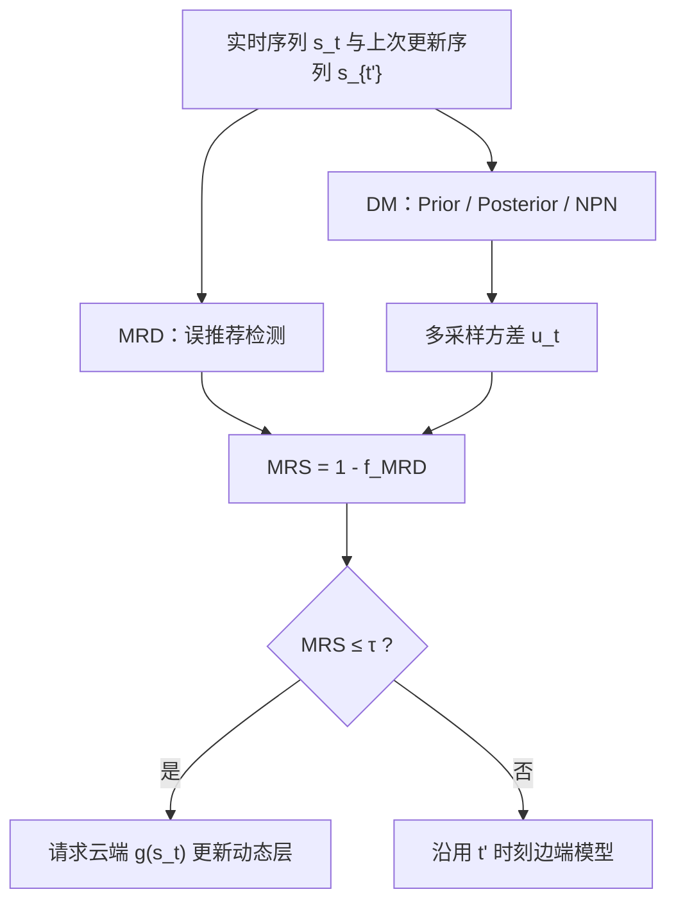
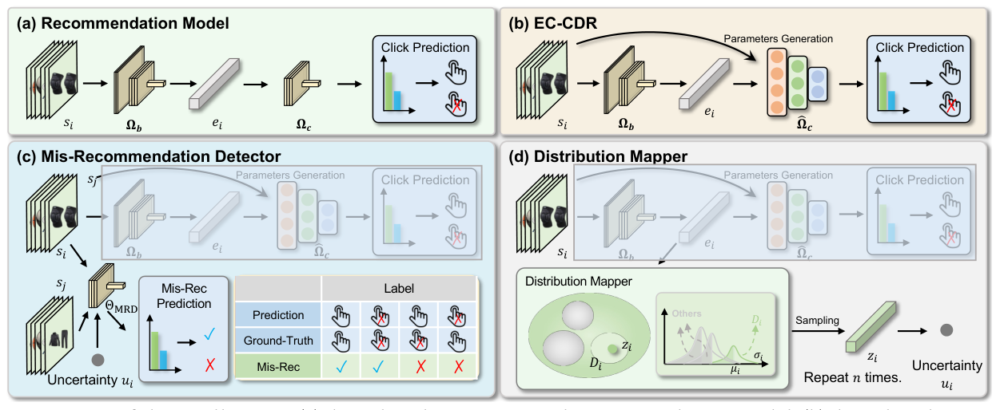
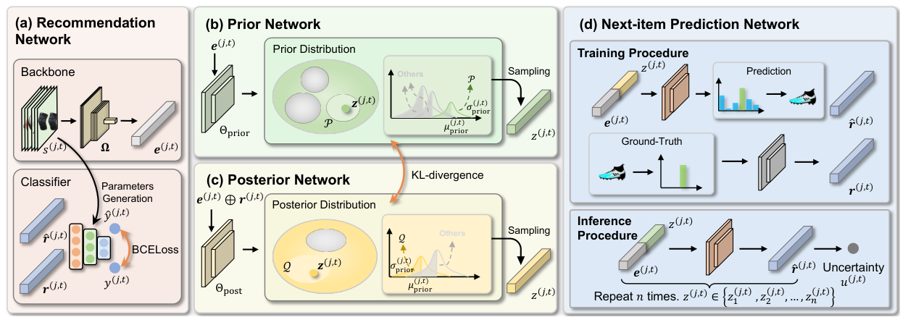

# Intelligent Model Update Strategy for Sequential Recommendation (面向序列推荐的智能模型更新策略)

- **会议/期刊**: WWW 2024 (Oral)
- **作者与机构**: Zheqi Lv, Wenqiao Zhang, Zhengyu Chen, Shengyu Zhang, Kun Kuang；浙江大学
- **推荐链路定位**: 端到端在线推理 / 边端模型更新
- **研究方向**: 序列与会话推荐
- **论文原文**: [论文原文链接](https://arxiv.org/abs/2302.07335v3)
- **开源代码**: 暂未开源

## TL;DR (1分钟核心速览)

针对 EC-CDR 每点击必向云端请求参数、通信频率高且收益低的问题，本文提出边缘端 IntellectReq：用误推荐检测器 MRD 判断“旧参数是否已失效”，再用分布映射器 DM 将实时序列映射为正态分布，以多采样方差量化不确定性，仅在 MRS 低于预算阈值时请求更新。在 Amazon CDs/Electronic、Douban Book 上以 AUC/UAUC/HR@20/NDCG 评估，10% 通信频率下 AUC 0.8562 逼近 100% 的 0.8581，3% 频率下 HR@20 0.6478 持平。

## Background & Motivation (背景与核心矛盾)

- **主流范式**: EC-CDR（DUET/APG）在云端训练静态层与参数生成器，边端用超网络按实时点击序列生成动态层参数，实现无需边端重训的个性化。
- **前人局限**: 其一，每来一次点击就请求云端参数，工业高并发下通信/网络压力大；其二，数据分布漂移时刻与模型更新时刻并不对齐，大量请求冗余、通信收益低。
- **核心洞察 (Key Insight)**: 图 2 将点击物品聚为 50 个域后发现，用户通常只活跃在 10–15 个域，行为高度重复；因此多数时刻沿用旧参数已足够，EC-CDR 缺少“何时该请求”的判别器。
- **本文切入点**: 把“是否请求云端参数”建模为边端可执行的 OOD/误推荐检测任务，用极低开销估计请求收益，并按云端预算设阈值。

## Method (核心方法设计)

### 1. 整体框架 (Overall Architecture)

边端推荐模型解耦为静态层 $\Omega(\cdot;\Theta_{bg})$与动态层$f_{\mathrm{rec}}(\cdot;\Theta_{cg})$；云端生成器$g$将实时序列$s_t$映射为动态参数。IntellectReq 部署在边端：MRD 输入当前序列$s_t$与上次更新序列$s_{t'}$，输出误推荐分数 MRS；DM 通过 Prior/Posterior/Next-item 三个网络估计模型对当前数据的不确定性$u_t$，增强 MRD。推理时边端计算 MRS，若低于预算阈值$\tau$才请求云端更新，否则沿用$t'$ 时刻模型。训练分云端联合训练与边端 MRD/DM 训练两段，推理无反向传播。

<figure class="paper-figure" markdown="span">
  <figcaption>图3：IntellectReq 概述。(a) 描述传统推荐模型。(b) 描述 EC-CDR。(c) 和 (d) 分别展示 IntellectReq 及其 Mis-Recommendation Detector 和 Distribution Mapper 模块。</figcaption>
</figure>

### 2. 关键设计拆解 (Key Designs)

1. **误推荐检测器 MRD（把“旧参数是否失效”变成可学习标签）**：痛点是用固定阈值或密度估计无法直接反映推荐收益。本文用 $t'$时刻旧参数预测$t$时刻样本，构造$c_{t,t'}=\mathbb{I}[\hat{y}_{t,t'}=y_t]$，再训练$f_{\mathrm{MRD}}$区分“会推荐错”与“不会推荐错”：$\mathcal{L}_{\mathrm{MRD}}=\sum_j\sum_{t'=1}^{T}\ell(y_j,f_{\mathrm{MRD}}(s_{j,t},s_{j,t'};\Theta_{\mathrm{MRD}}))$。直觉是：让模型直接学习“旧参数在当前分布下何时失败”，无需额外人工标注。
2. **分布映射器 DM（用概率分布与多采样方差刻画 OOD）**：点击序列噪声大，单点 embedding 易过拟合。DM 借鉴 Conditional-VAE：先验 $P(z|s)=\mathcal{N}(\mu_p,\sigma_p)$，后验$Q(z|s,r)=\mathcal{N}(\mu_q,\sigma_q)$，NPN 基于采样$z$预测下一项；训练损失$\mathcal{L}=\mathcal{L}_{\mathrm{rec}}+\beta D_{\mathrm{KL}}(Q(z|s,y)\|P(z|s))$。推理去掉后验，做$n$次采样并以$u_t=\mathrm{var}(\hat{r}_{i}=f_c(\Omega(s_t),z_i;\Theta_c))$ 作为不确定性。方差越大，说明模型对当前语义越不自信，越应请求更新。
3. **训练目标、负采样与推理效率**：云端联合优化静态层与生成器 $\mathcal{L}_{\mathrm{rec}}$；边端 MRD 用交叉熵，DM 用上述$\mathcal{L}$。最终请求规则为$\mathrm{MRS}=1-f_{\mathrm{MRD}}(s_t,s_{t'};\Theta_{\mathrm{MRD}})$，$\mathrm{Update}=\mathbb{I}(\mathrm{MRS}\le\tau)$，$\tau$ 按云端负载分位数设定。原文未报告负采样/候选集细节；推理仅额外 5.06k 参数，边端 7.9ms、云端预处理 11s，远低于 LOF/OC-SVM。

<figure class="paper-figure" markdown="span">
  <figcaption>图4：所提出的 Distribution Mapper 概述。训练过程：架构包括 Recommendation Network、Prior Network、Posterior network 和 Next-item Perdition Network。损失由分类损失和 KL-Divergence 损失组成。推理过程：架构包括 Recommendation Network、Prior Network 和 Next-item Perdition Network。不确定性由多采样输出计算得到。</figcaption>
</figure>

## Experimental Setup & Evaluation Protocol (实验设置与评估协议)

- **数据集与预处理**: 正文使用 Amazon CDs、Amazon Electronic、Douban Book 三套序列推荐基准；正文/抽取文本未给出精确规模与过滤规则（摘要称 four benchmarks 与正文三套不一致）。

| 数据集 | #Users | #Items | #Interactions | 稀疏度/密度 | 特征/场景说明 |
| :--- | :---: | :---: | :---: | :---: | :--- |
| Amazon CDs | — | — | — | — | 音乐 CD 序列；图 2 做 50 域分析 |
| Amazon Electronic | — | — | — | — | 电子产品序列 |
| Douban Book | — | — | — | — | 图书序列 |

- **数据划分与防穿越 (Splitting Strategy)**: 原文未在正文明确 `Leave-One-Out`/比例/时间戳切分，需查附录；实验按会话下一项预测组织，MRD 数据用 $t'\le t$的旧参数预测当前$t$，避免使用未来信息。
- **排名评测协议 (Ranking Protocol)**: 采用 AUC、UAUC、HR@20、NDCG；AUC/UAUC 为 CTR 式二分类指标，HR@20/NDCG 为 Top-20 排序指标。候选集规模与负采样比例未在正文给出，无法判定是 Full-Ranking 还是 Sampled Ranking。
- **对比基线与超参设置**: EC-CDR 基线 DUET、APG；序列基线 GRU4Rec、DIN、SASRec；请求控制基线 Random、LOF、OC-SVM。默认以 SASRec 为边端模型，可替换为 DIN/GRU4Rec；embedding 维度未明确。按 CTR 惯例，0.1% 绝对 AUC 提升视为显著。

## Key Experimental Results (实验关键数据)

### 1. 主实验对比 (Main Results)

原文主结果以图 5–7 曲线呈现，下表抽取图 1 可读数值与代表性策略；`—` 表示原文未给单点数值。

| 方法/策略 | 请求频率 | AUC | HR@20 | 相对收益/观察 |
| :--- | :---: | :---: | :---: | :--- |
| DUET (EC-CDR 上界) | 100% | **0.8581** | **0.6478** | 每步请求，通信上界 |
| APG (EC-CDR 上界) | 100% | — | — | 同为每步请求 |
| DUET + Random | 任意 | — | — | 性能随预算近似线性，不稳定 |
| DUET + LOF | 固定预算 | — | — | 可控性差；225s/11.3ms |
| DUET + OC-SVM | 固定预算 | — | — | 仅特定预算；160s/9.7ms |
| IntellectReq | 10% | 0.8562 | — | 通信省 90%，AUC 仅 -0.0019 |
| IntellectReq | 3% | — | **0.6478** | 通信省 97%，HR@20 持平 |

### 2. 消融实验 (Ablation Study)

| 变体 | 低请求频率 | 中请求频率 | 高请求频率 | 归因 |
| :--- | :---: | :---: | :---: | :--- |
| Full IntellectReq | 最优 | 最优 | 最优 | MRD + DM 协同 |
| w/o DM | 接近 Full | 差距扩大 | 差距收窄 | 低频仅 MRD 已够；中频不确定性关键 |
| w/o MRD | 较差 | 较差 | 较差 | 失去主请求判别器 |

### 3. 关键实验发现 (Key Findings)

1. **大多数请求确实冗余**：10% 频率下 AUC 0.8562 与 100% 的 0.8581 仅差 0.0019；3% 频率下 HR@20 与 100% 均为 0.6478，说明“每点击必更新”的通信收益极低。
2. **轻量+预算可控是核心工程收益**：LOF/OC-SVM 云端预处理需 225s/160s、边端 11.3/9.7ms，且只能适配固定预算；IntellectReq 为 11s/7.9ms、仅增 5.06k 参数，可在任意通信预算下设阈值。
3. **DM 的收益随请求频率呈“先小后大再小”**：低频时 MRD 已能过滤明显失效，DM 增益不显著；中频时分布漂移更隐蔽，多采样方差提供关键 OOD 信号；高频时请求本身已接近上界，DM 差异收窄。

## Highlights & Limitations (亮点、对比与审稿批判)

- **与代表作对比 (vs. Prior Work)**: DUET/APG 解决“如何生成边端动态参数”，但默认每步请求；本文补上“何时请求”的控制层。LOF/OC-SVM 用密度估计做 OOD，但云端预处理重、预算不可控；IntellectReq 把 OOD 检测压到边端轻量模型，并按预算分位数校准阈值。
- **可迁移亮点**: 用“旧参数预测当前样本”自动构造误推荐标签，可迁移到任何增量更新/缓存失效判断；多采样方差作为不确定性分数，可迁移到冷启动或分布漂移场景的置信度估计。
- **审稿级局限批判**: 其一，实验仅三套公开数据，主结果多为曲线而非完整表格，候选集/负采样/划分协议未交代，复现与公平比较受限；其二，阈值依赖云端负载分位标定，DM 需多采样，突发概念漂移或极短序列下方差可能失真，且缺少线上 A/B 与通信故障鲁棒性分析。

## Rating (四维评分)

- **方法创新性 (Novelty)**: ⭐⭐⭐⭐ （把 EC-CDR 的“每步请求”转为可学习的误推荐/OOD 控制，MRD 标签构造与 DM 不确定性映射有明确增量）
- **评估协议与实验扎实度 (Protocol & Experiments)**: ⭐⭐⭐ （覆盖三套基准与多类基线，但主结果以图为主、缺精确数据规模/负采样/划分说明，且摘要与正文数据集数量不一致）
- **写作与数学规范度 (Clarity & Rigor)**: ⭐⭐⭐⭐ （EC-CDR、MRD、DM 三层公式链路清晰，变量定义较完整；部分训练细节需查附录）
- **工业落地与复现价值 (Industrial & Practical Value)**: ⭐⭐⭐⭐ （边端仅 5.06k 参数、7.9ms，通信可省 90%–97%，对边云推荐部署有直接价值；但暂未开源，阈值标定依赖云端统计）

