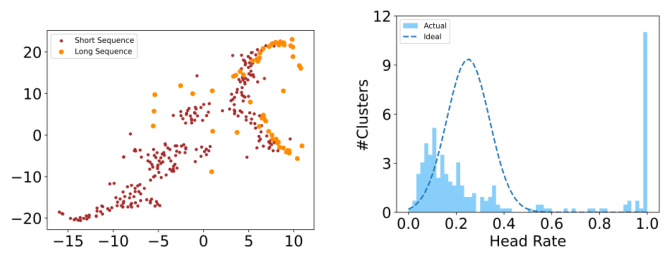
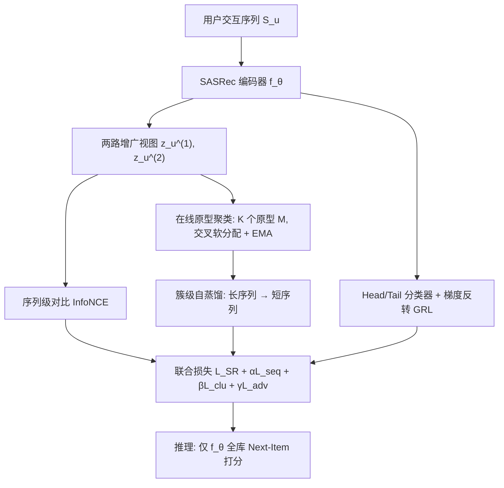

# Leave No One Behind: Online Self-Supervised Self-Distillation for Sequential Recommendation (基于在线自监督自蒸馏的序列推荐)

- **会议/期刊**: WWW 2024 (The ACM Web Conference)
- **作者与机构**: Shaowei Wei, Zhengwei Wu, Xin Li, Qintong Wu, Zhiqiang Zhang, Jun Zhou, Lihong Gu, Jinjie Gu（蚂蚁集团 Ant Group）
- **推荐链路定位**: 召回（Next-Item 序列召回）
- **研究方向**: 序列与会话推荐 / 自监督对比学习与表征去噪
- **论文原文**: [https://arxiv.org/abs/2404.07219v2](https://arxiv.org/abs/2404.07219v2)
- **开源代码**: 暂未开源

## TL;DR (1分钟核心速览)

本文针对序列推荐中"短行为序列用户"在对比学习（CL）范式下拿不到足够自监督信号、且表征被"行为长度"而非"潜在意图"主导的痛点，提出 $S^4$Rec：用**在线原型聚类**（SwAV 式交叉预测 + EMA 更新）替代 ICLRec 的全库 K-means，用**头尾对抗（梯度反转）**剥离长度因素，再用**簇感知双重自蒸馏**把长序列（teacher）的意图语义迁移给短序列（student）。在 Beauty/Sports/Toys/ML-1M 四数据集、Leave-One-Out 全库排序协议下，HR@5 相对最优基线最高提升 **9.3%**（Beauty）、NDCG@5 提升 **10.1%**（Beauty）。

## Background & Motivation (背景与核心矛盾)

- **主流范式**: SASRec/BERT4Rec 类 Transformer 序列编码器 + 仅用 next-item 交叉熵优化；近年 CL4SRec / CoSeRec / ICLRec 通过"同一序列两个增广视图互信息最大化"注入自监督信号，ICLRec 进一步用全库 K-means 的簇心作为潜在意图原型。
- **前人局限 (1)**: 离线全库 K-means 每个 epoch 要做一次全数据集 E-step（额外 $O(ab|\mathcal{U}|Kd)$），且**相邻 epoch 的簇编号无对应关系**，导致以簇为目标的预测层必须反复重置、训练剧烈震荡，既不可扩展也难以在线部署。
- **前人局限 (2)**: 长序列用户天然携带更多监督信息，短序列用户在对比学习中几乎"被落下"。图 1 的 t-SNE 可视化直接暴露了这一点：序列粒度下，长序列（head）自成一簇，与短序列（tail）明显分离——即表征被**行为长度**这类观测噪声主导，而非被 latent intent 主导。
- **核心洞察 (Key Insight)**: 理想表征应只由用户意图决定、与序列长度（稀疏度）解耦；一旦簇按意图而非长度划分，簇内即可形成"长序列教短序列"的自蒸馏通道。
- **本文切入点**: 把"簇分配"从离线批处理搬到 mini-batch 内在线完成，并用对抗手段显式抹掉簇中的长度信息，最后在簇内做知识迁移。

<figure class="paper-figure" markdown="span">
  <figcaption>图1：在 amazon 数据集上对序列粒度和簇粒度的聚类可视化。图1(a)的横轴和纵轴表示使用 t-SNE 降维技术得到的用户序列嵌入向量的二维空间坐标。</figcaption>
</figure>

## Method (核心方法设计)

### 1. 整体框架 (Overall Architecture)

$S^4$Rec 以 SASRec 为骨干：序列$\mathcal{S}_u$经$f_\theta$编码为$\mathbf{z}_u$，同时经 Mask/Crop/Reorder/Insert 增广出两个视图并送入**在线原型聚类**（$K$个原型 + 交叉预测 + EMA 更新），产生簇分配$\mathbf{p}_u$；簇分配一方面驱动**簇级自蒸馏**（同簇长短序列互为目标），另一方面与**序列级 InfoNCE** 共同构成 CSD 双路自监督；编码器表示同时接入**头尾分类器**，经梯度反转层做对抗训练以剥离长度可分性。四个任务联合优化；推理阶段聚类头与对抗头全部丢弃，仅保留$f_\theta$ 做全库打分，**serving 开销与 SASRec 完全一致**。

### 2. 关键设计拆解 (Key Designs)

1. **Online Clustering on the Fly（在线原型聚类）**：痛点源于离线 K-means 的全库遍历与簇身份漂移。本文改用一组可学习原型 $\mathbf{M}\in\mathbb{R}^{K\times d}$，对两个增广视图做**交换预测**：$\mathbf{p}_u^{(1)}=\mathrm{softmax}(\mathbf{z}_u^{(1)\top}\mathbf{M}/\tau)$，以另一视图的软分配为目标$\mathcal{L}_{clu}=-\sum_k \mathbf{q}_u^{(2),k}\log \mathbf{p}_u^{(1),k}$（对称相加），原型按簇内均值 EMA 更新。直觉：簇心是**全局可寻址的锚点**（编号恒定），无需全库 E-step 即可在 mini-batch 内持续校准，解决了簇目标"每 epoch 换身份"的优化断裂。

2. **Cluster-aware Two-fold Self-distillation (CSD，簇感知双重自蒸馏)**：序列级分支用 InfoNCE 拉开自身增广对与 batch 内其他序列；簇级分支则把同簇序列的聚合中心 $\mathbf{c}_{k}$当作教师，对齐$\mathcal{L}_{csd}=-\sum_u\log\frac{\exp(\mathbf{z}_u^\top\mathbf{c}_{k(u)}/\tau)}{\sum_{k'}\exp(\mathbf{z}_u^\top\mathbf{c}_{k'}/\tau)}$。由于簇内同时含长/短序列，短序列被强制向"意图语义中心"靠拢，等效于接收长序列的**软标签蒸馏**——这是"把头部知识传给尾部"的具体落点，而非额外引入外部大模型。

3. **Head-tail Adversarial Learning（头尾对抗）+ 训练/推理效率**：若簇按长度退化，簇级蒸馏只是"长的教短的看"，语义信息仍稀疏。因此接一个头/尾二分类器 $g_\phi$，损失$\mathcal{L}_{ht}=-\frac{1}{|\mathcal{B}|}\sum_u\big[y_u\log g(\mathbf{z}_u)+(1-y_u)\log(1-g(\mathbf{z}_u))\big]$，经 GRL 使编码器**最大化**该损失：$\mathcal{L}=\mathcal{L}_{SR}+\alpha\mathcal{L}_{seq}+\beta\mathcal{L}_{clu}-\gamma\mathcal{L}_{ht}$。分类器想分开、编码器想混淆，从而在保留主任务语义的前提下抹去长度可辨识性。负样本全部来自 **in-batch negatives**（免显式采样器）；复杂度$O(aL^2|\mathcal{U}|d+ab|\mathcal{U}|d^2)$，**不含** ICLRec 的$O(ab|\mathcal{U}|Kd)$ 聚类 E-step。

## Experimental Setup & Evaluation Protocol (实验设置与评估协议)

- **数据集与预处理**: 四个公开数据集，统一 `5-core` 过滤（用户/物品交互数 ≥ 5）；按序列长度排序，最长 20% 划为 head，其余为 tail（该划分仅用于对抗任务，不做独立测试集）。

| 数据集 | #Users | #Items | #Interactions | 稀疏度/密度 | 特征/场景说明 |
| :--- | :---: | :---: | :---: | :---: | :--- |
| Beauty | 22,363 | 12,101 | 0.20m | 99.95% | Amazon 美妆评论，平均长度 8.9 |
| Sports | 35,598 | 18,357 | 0.30m | 99.95% | Amazon 运动户外，平均长度 8.3 |
| Toys | 19,412 | 11,924 | 0.17m | 99.93% | Amazon 玩具，平均长度 8.6 |
| ML-1M | 6,041 | 3,417 | 0.99m | 95.15% | 电影评分，平均长度 165.5（长序列主导） |

- **数据划分与防穿越 (Splitting Strategy)**: `Leave-One-Out`——每个用户序列的最后两个交互分别作验证集与测试集，其余作训练；严格按时间序，不做随机打乱。
- **排名评测协议 (Ranking Protocol)**: 沿用 SASRec/BERT4Rec 系列的 `Full-Ranking`（对全库候选物品打分排序，正文与附录均未采用采样负例排序）；指标 HR@{5,20}、NDCG@{5,20}。
- **对比基线与超参设置**: 三类基线共 9 个——非序列 BPR-MF；标准序列 GRU4Rec/Caser/SASRec；自监督与意图类 BERT4Rec、S3-Rec、CL4SRec、DSSRec、ICLRec。骨干为 SASRec，$K$个原型、温度$\tau$、$\alpha/\beta/\gamma$网格搜索，显著性采用 paired$t$-test（$p<0.01$，表中 `*`）。

## Key Experimental Results (实验关键数据)

### 1. 主实验对比 (Main Results)

| Dataset | Metric | SASRec | DSSRec | BERT4Rec | S3-Rec | CL4SRec | ICLRec | **$S^4$Rec** | Improv. |
| :--- | :--- | :---: | :---: | :---: | :---: | :---: | :---: | :---: | :---: |
| Beauty | HR@5 | 0.0374 | 0.0410 | 0.0360 | 0.0189 | 0.0423 | 0.0475 | **0.0519** | +9.26% |
| Beauty | HR@20 | 0.0901 | 0.0914 | 0.0984 | 0.0487 | 0.0994 | 0.1050 | **0.1071** | +2.00% |
| Beauty | NDCG@5 | 0.0241 | 0.0261 | 0.0216 | 0.0115 | 0.0281 | 0.0316 | **0.0348** | +10.13% |
| Beauty | NDCG@20 | 0.0387 | 0.0403 | 0.0391 | 0.0198 | 0.0441 | 0.0478 | **0.0505** | +5.65% |
| Sports | HR@5 | 0.0206 | 0.0214 | 0.0217 | 0.0121 | 0.0217 | 0.0267 | **0.0284** | +6.37% |
| Sports | HR@20 | 0.0497 | 0.0495 | 0.0604 | 0.0344 | 0.0540 | 0.0644 | **0.0656** | +1.86% |
| Sports | NDCG@5 | 0.0135 | 0.0142 | 0.0143 | 0.0084 | 0.0137 | 0.0177 | **0.0181** | +2.26% |
| Sports | NDCG@20 | 0.0216 | 0.0220 | 0.0251 | 0.0146 | 0.0227 | 0.0283 | **0.0292** | +3.18% |
| Toys | HR@5 | 0.0463 | 0.0502 | 0.0274 | 0.0143 | 0.0526 | 0.0571 | **0.0586** | +2.63% |
| Toys | HR@20 | 0.0941 | 0.0975 | 0.0688 | 0.0235 | 0.1038 | 0.1110 | **0.1148** | +3.42% |
| Toys | NDCG@5 | 0.0306 | 0.0337 | 0.0174 | 0.0123 | 0.0362 | 0.0392 | **0.0407** | +3.83% |
| Toys | NDCG@20 | 0.0441 | 0.0471 | 0.0291 | 0.0162 | 0.0506 | 0.0545 | **0.0565** | +3.67% |
| ML-1M | HR@5 | 0.1444 | 0.1219 | 0.1142 | **0.1579** | 0.1520 | 0.1482 | 0.1557 | -1.39% |
| ML-1M | HR@20 | 0.3337 | 0.2855 | 0.2921 | 0.3435 | 0.3537 | 0.3431 | **0.3547** | +0.28% |
| ML-1M | NDCG@5 | 0.0939 | 0.0798 | 0.0713 | 0.0982 | 0.0969 | 0.0964 | **0.1012** | +3.05% |
| ML-1M | NDCG@20 | 0.1476 | 0.1257 | 0.1213 | 0.1510 | 0.1539 | 0.1513 | **0.1570** | +2.01% |

### 2. 消融实验 (Ablation Study)

在 Beauty 上逐模块剥离（SASRec 为骨干）：

| 变体 | HR@5 | HR@20 | NDCG@5 | NDCG@20 |
| :--- | :---: | :---: | :---: | :---: |
| SR only (= SASRec) | 0.0374 | 0.0901 | 0.0241 | 0.0387 |
| SR + CSD | 0.0499 | 0.1041 | 0.0332 | 0.0485 |
| SR + CSD + GR（完整） | **0.0517** | **0.1044** | **0.0349** | **0.0497** |
| $S^4$Rec w/o CSD | 0.0382 | 0.0922 | 0.0258 | 0.0397 |
| $S^4$Rec w/o GR | 0.0487 | 0.1035 | 0.0329 | 0.0480 |

### 3. 关键实验发现 (Key Findings)

1. **CSD 是收益主引擎，GR 是"放大器"**：Beauty 上 SR→SR+CSD 的 HR@5 提升 33.4%（0.0374→0.0499）、NDCG@5 提升 37.8%；而单独去掉 CSD 后模型几乎退化回 SASRec（HR@5 仅 0.0382，+2.1%），说明簇级蒸馏贡献了绝大部分增益，单纯对抗去长度化收益有限（NDCG@5 +7.1%）。
2. **GR 与 CSD 强互补**：完整模型去掉 GR 后 HR@5 从 0.0517 掉到 0.0487（-5.8%）、NDCG@20 掉 3.4%，证明"簇内长度可控"确实是簇级蒸馏生效的前提——若簇仍按长度聚集，短序列的簇中心本身信息量极稀，蒸馏近乎空转。
3. **提升幅度与序列长度分布强相关**：短序列主导的 Amazon 三子集上相对 ICLRec 的 HR@5 提升 2.6%–9.3%、NDCG@5 提升 2.3%–10.1%；而在平均长度 165.5 的 ML-1M 上，HR@5（0.1557）反而略低于 S3-Rec（0.1579，-1.4%），仅 NDCG@5/@20 领先 3.1%/2.0%——提示该方法的红利集中在"短序列用户占比高、稀疏度极高"的场景，对头部指标（HR@5）的绝对优势并非普适。

## Highlights & Limitations (亮点、对比与审稿批判)

- **与代表作对比 (vs. Prior Work)**: 与 **ICLRec** 的本质差别是把"离线全库 K-means 的簇心"换成"在线原型 + EMA 的恒定身份簇心"，并额外用对抗剥离长度混淆，二者叠加才使簇级蒸馏在尾部用户上真正生效；与 **CL4SRec/CoSeRec** 相比，本文的自监督信号不止于"序列—增广视图"互信息，还叠加了"序列—意图原型"的跨用户软标签；与 **S3-Rec** 的"预训练+微调"两阶段不同，本文是单阶段多任务端到端训练。
- **可迁移亮点**: (1) SwAV 式原型聚类 + EMA 可作为任意推荐模型（图召回、多场景召回）的可插拔"意图头"，推理零成本；(2) GRL 头尾对抗是一种通用的"剥离混杂因子"手段，可平移到曝光位置去偏、冷启动长度去偏等场景。
- **审稿级局限批判**: (1) **teacher/student 由长度阈值（最长 20%）人为定义**，未说明该超参敏感性，也未与"按信息量/置信度定义教师"的替代方案对比；(2) 对抗训练引入 GRL 与额外权重 $\gamma$，多任务博弈的收敛稳定性、$K$与$\tau$ 的敏感度均未给曲线；正文仅交代"线上 A/B 覆盖 2300 万+ 用户（2023-11-02 至 11-06）"却把数值全部塞进附录，缺乏可核验的延迟/收益数据，且 ML-1M 的 HR@5 未超越 S3-Rec，削弱了"Leave No One Behind"的普适性主张。

## Rating (四维评分)

- **方法创新性 (Novelty)**: ⭐⭐⭐⭐ （首次把在线原型聚类 + 簇感知自蒸馏 + 头尾对抗三者耦合成序列推荐学习范式，"簇身份稳定"与"长度解耦"两个动机均有 t-SNE 实证支撑，但各组件本身分别借鉴 SwAV/GRL，组合创新大于机理创新）
- **评估协议与实验扎实度 (Protocol & Experiments)**: ⭐⭐⭐⭐ （四数据集 + Leave-One-Out 全库排序 + paired $t$-test$p<0.01$，消融覆盖 CSD/GR 双向剥离；扣分在于未报告采样负例对照、$K$/$\tau$/$\gamma$ 敏感性缺失、A/B 仅有规模无指标）
- **写作与数学规范度 (Clarity & Rigor)**: ⭐⭐⭐⭐ （四任务复杂度对比 $O(aL^2|\mathcal{U}|d+ab|\mathcal{U}|d^2)$vs ICLRec 的额外$O(ab|\mathcal{U}|Kd)$ 交代清楚；但聚类与蒸馏的完整损失权重、原型更新公式被压缩在正文外，关键推导略欠）
- **工业落地与复现价值 (Industrial & Practical Value)**: ⭐⭐⭐⭐ （在线聚类天然适配流式训练、推理阶段零额外开销、已由蚂蚁集团在 2300 万用户量级验证，落地价值高；但代码未开源、超参未完全披露，复现门槛偏高）

