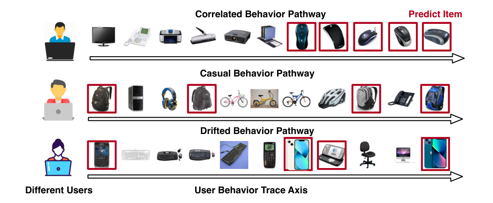
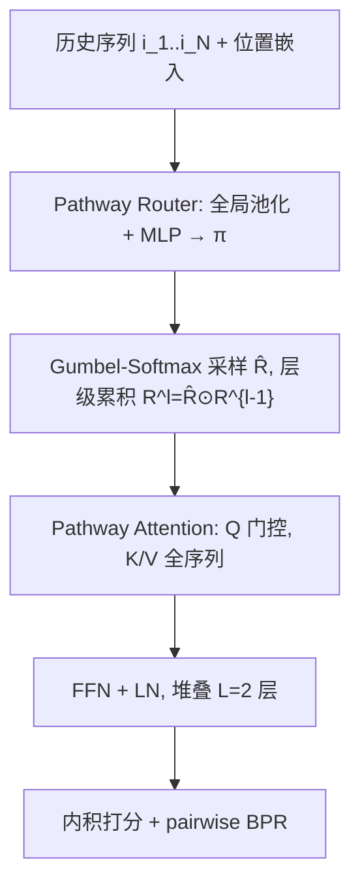
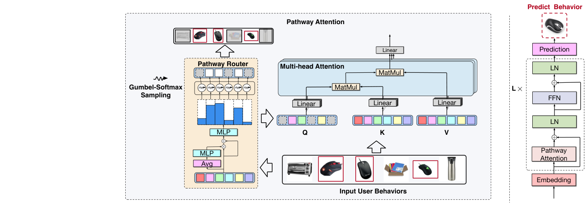

# Recommender Transformers with Behavior Pathways (带行为路径的推荐 Transformer)

- **会议/期刊**: WWW 2024
- **作者与机构**: Zhiyu Yao, Xinyang Chen, Sinan Wang, Qinyan Dai, Yumeng Li, Tanchao Zhu, Mingsheng Long（清华大学软件学院/BNRist、阿里巴巴集团、清华大学工业工程系）
- **推荐链路定位**: 召回（序列化下一物品预测）
- **研究方向**: 序列与会话推荐 / 自监督对比学习与交互去噪
- **论文原文**: [论文原文链接](https://arxiv.org/abs/2206.06804v1)
- **开源代码**: 暂未开源

## TL;DR (1分钟核心速览)

序列推荐把用户历史当作"多条线程交织的剧本"，但真正能演化为下一步行为的只有极少数"关键行为"，标准自注意力对全部历史做稠密建模，导致关键信号被琐碎行为淹没。RETR 提出 Pathway Attention：每个 block 用路由器为每个 token 生成二值 keep/drop 路径，多层之间以 Hadamard 累积实现层级稀疏化，并用 Gumbel-Softmax 打通离散采样梯度；Query 只走路径内 token，K/V 保留全序列以维持上下文。在 7 个真实数据集、Leave-One-Out 划分 + 100 负采样的 HR@10/NDCG@10/MRR 协议下全面 SOTA（Tmall HR@10 +10.2%、NDCG@10 +17.5%），而参数量与 GFLOPs 与 SASRec 几乎持平。

## Background & Motivation (背景与核心矛盾)

- **主流范式**: SASRec / BERT4Rec / SMRec 等 Transformer 序列模型用全历史自注意力捕捉长程依赖，把推荐当作时序预测问题，已长期占据各榜单 SOTA。
- **前人局限**: ①稠密注意力把"有效历史"与"噪声点击"一视同仁，最终预测被 trivial behaviors 稀释；②用户行为路径存在 **Correlated / Casual / Drifted** 三类形态（图 1），单一稠密权重无法针对不同用户动态切换关注点，尤其容易被近期"漂移兴趣"误导。
- **核心洞察 (Key Insight)**: 人类大脑只调用与当前情境相关的脑区——稀疏激活；类比到推荐，用户的未来行为只由一小部分 pivotal token 的路径决定，模型应当"按需激活"而非"全量联动"。
- **本文切入点**: 把 Pathways 稀疏激活思想下沉到注意力内部，用可学习的二值路由替代手工注意力权重，让 Query 只在行为路径上聚合。

<figure class="paper-figure" markdown="span">
  <figcaption>图1：不同用户行为路径的三个主要特征使序列推荐变得极其困难。行为路径由红框标出。</figcaption>
</figure>

## Method (核心方法设计)

### 1. 整体框架 (Overall Architecture)

输入沿用 sliding-window 将历史截断为定长 $N$序列，物品嵌入 + 可学习位置嵌入得$Z^0=X_s\in\mathbb{R}^{N\times d}$。模型堆叠$L$个 Pathway Attention 块与 FFN，每块接收上一 block 输出$Z^{l-1}$与前序路径$R^{l-1}$，路由器先根据全局池化信息生成 keep/drop 概率$\pi$，经 Gumbel-Softmax 采样并与前序路径逐元素相乘得到新路径$R^l$；注意力阶段用$R^l$ 只对 Query 做门控，K/V 仍取全序列以保留上下文，最后用带 look-ahead mask 的多头注意力和 FFN 更新表示。预测层以末位置隐状态与物品嵌入内积打分，pairwise BPR 损失端到端优化。推理解码只需前向一次，路由器为轻量 MLP，几乎不增加算力。

<figure class="paper-figure" markdown="span">
  <figcaption>图2：Recommender Transformer 架构（右）。Pathway Attention（左）通过路径路由器（橙色模块）探索行为路径，并通过多头注意力捕捉不断演化的序列特征。</figcaption>
</figure>

### 2. 关键设计拆解 (Key Designs)

1. **路径路由器 (Pathway Router)**：痛点是对全部 token 平权建模会淹没关键行为 $\to$先用前序路径$R^{l-1}$ 对被保留 token 做均值池化得到全局序列表示，再以残差方式注入每个 token，最后经 MLP 输出二分类分布：

$$\bar{Z}=\frac{\sum_{i=1}^{N}R^{l-1}_i Z^{l-1}_i}{\sum_{i=1}^{N}R^{l-1}_i},\quad Z^{l}_{\text{emb}}=Z^{l-1}+Z^{l-1}\odot \mathrm{MLP}(\bar{Z}),\quad \pi=\mathrm{Softmax}(\mathrm{MLP}(Z^{l}_{\text{emb}}))\in\mathbb{R}^{N\times 2}$$

   直觉：池化把"漂移兴趣"压成全局上下文，使路由决策基于整条路径而非单点局部噪声，从而对 Casual 路径保留、对 Drifted 路径截断。

2. **Gumbel-Softmax 可微采样 + 层级路径更新**：Bernoulli 采样不可导 $\to$用重参数化把 one-hot 松弛为$\boldsymbol{v}_t$：

$$\hat{R}^{l}_t=\arg\max_{j\in\{0,1\}}\big(\log\pi_t(j)+G_t(j)\big),\quad v_t(j)=\frac{\exp((\log\pi_t(j)+G_t(j))/\tau)}{\sum_{i\in\{0,1\}}\exp((\log\pi_t(i)+G_t(i))/\tau)},\quad R^{l}=\hat{R}^{l}\odot R^{l-1}$$

   层级乘积意味着 token 一旦在某层被丢弃，后续所有层永久失去路径资格，形成"逐层收紧"的稀疏演化路径，而非每层独立重抽的抖动路由。实验显示 $\tau=0.8$最优，$\tau>1$时分布趋于均匀（$p\to0.5$）导致过度不确定而掉点。

3. **Pathway Attention 与训练目标**：Query 被路径门控、K/V 保留全量，兼顾"聚焦关键"与"不丢上下文"：

$$Q_m=(Z^{l-1}\odot R^{l})W^{l}_{Q_m},\quad K_m=Z^{l-1}W^{l}_{K_m},\quad V_m=Z^{l-1}W^{l}_{V_m}$$

   总损失为逐时刻负采样 pairwise ranking：$\mathcal{L}=-\sum_{u}\sum_{t=1}^{n}\log\sigma\big(p(i_{t+1}|i_{1:t})-p(i^{-}_{t+1}|i_{1:t})\big)$，每个时间步均匀采样 1 个负例（非 in-batch、非 hard negative），无额外正则项；$L=2$、$h=4$、$d=256$，在线开销与 SASRec 同量级。

## Experimental Setup & Evaluation Protocol (实验设置与评估协议)

- **数据集与预处理**: 全部按 `5-core` 过滤（交互数 <5 的用户/物品剔除），按用户时间戳升序排列：

| 数据集 | #Users | #Items | #Interactions | 稀疏度/密度 | 特征/场景说明 |
| :--- | :---: | :---: | :---: | :---: | :--- |
| Beauty | 22,363 | 12,101 | 198,502 | 稀疏 | Amazon 美妆评论 |
| Sports | 25,598 | 18,357 | 296,337 | 稀疏 | Amazon 运动户外 |
| Toys | 19,412 | 11,924 | 167,597 | 稀疏 | Amazon 玩具 |
| Yelp | 30,431 | 20,033 | 316,354 | 中 | 本地商户（2019 年后交易） |
| MovieLens-1M | 6,040 | 3,416 | 1,000,000 | 稠密 | 电影评分 |
| Tmall | 66,909 | 37,367 | 427,797 | 中 | 电商购物日志 (IJCAI-15) |
| Steam | 334,730 | 13,047 | 3,700,000 | 稠密 | 游戏平台评论 |

- **数据划分与防穿越 (Splitting Strategy)**: 严格 `Leave-One-Out`——每用户最后 1 条为测试、倒数第 2 条为验证、其余训练；测试输入包含训练+验证行为，因果性由 look-ahead mask 保证。
- **排名评测协议 (Ranking Protocol)**: `Sampled Ranking`，每个 ground-truth 与 **100 个随机未交互负例** 共同排序（正负比 1:100），报告 HR@10 / NDCG@10 / MRR，三次重复取均值（沿用 SASRec 标准协议，未做 Full-Ranking）。
- **对比基线与超参设置**: 非序列 PopRec；CNN 类 Caser；RNN 类 GRU4Rec；Transformer 类 BERT4Rec、SASRec、SASRec+（时间嵌入）、SMRec（自调制注意力）。Adam，lr=0.001，batch=512，最大 200 epoch，早停 10 epoch，$d=256$，$N=100$（MovieLens 为 200），单卡 3090。

## Key Experimental Results (实验关键数据)

### 1. 主实验对比 (Main Results)

HR@10 / NDCG@10（加粗为最优，`Improv.` 为相对最强基线 SMRec 的提升）：

| Dataset | Caser | GRU4Rec | BERT4Rec | SASRec | SASRec+ | SMRec | **RETR** | Improv. (HR) |
| :--- | :---: | :---: | :---: | :---: | :---: | :---: | :---: | :---: |
| Beauty | .3942/.2512 | .4106/.2584 | .4739/.2975 | .4696/.3156 | .4798/.3261 | .4826/.3238 | **.5034/.3425** | +4.3% / +5.8% |
| Sports | .4014/.2390 | .4299/.2527 | .4722/.2775 | .4622/.2869 | .4776/.2987 | .4853/.3061 | **.5083/.3175** | +4.7% / +3.7% |
| Toys | .3540/.2183 | .3896/.2274 | .4493/.2698 | .4663/.3136 | .4729/.3183 | .4754/.3198 | **.5104/.3395** | +7.4% / +6.2% |
| Yelp | .6661/.4198 | .7265/.4375 | .7597/.4778 | .7373/.4642 | .7481/.4757 | .7548/.4789 | **.7730/.5136** | +2.4% / +7.2% |
| MovieLens-1M | .7886/.5538 | .5581/.3381 | .8269/.5965 | .8233/.5936 | .8291/.6057 | .8302/.6079 | **.8467/.6351** | +2.0% / +4.5% |
| Tmall | .5943/.4513 | .6432/.5169 | .6196/.5025 | .6275/.5049 | .6392/.5169 | .6476/.5192 | **.7138/.6103** | +10.2% / +17.5% |
| Steam | .7874/.5381 | .4190/.2691 | .8656/.6283 | .8729/.6306 | .8773/.6397 | .8792/.6408 | **.9001/.6795** | +2.4% / +6.0% |

### 2. 消融实验 (Ablation Study)

| 变体（Beauty / Yelp） | 设置 | MRR |
| :--- | :--- | :---: |
| RETR 完整模型 | L=2 | **0.3067** (Yelp 0.4354) |
| w/o Pathway Router（随机保留/丢弃 token） | L=2 | 0.2793 (−8.9%) |
| w/o 层级更新 $R^l=\hat R^l\odot R^{l-1}$ | L=2 | 0.2957 (−3.6%) |
| SASRec（路由恒为 1 的退化特例） | L=2 | 0.2852 (−7.0%) |
| RETR (L=1 / L=3 / L=4) | — | 0.2966 / 0.3058 / 0.3052 |
| 温度 $\tau$=0.4 / **0.8** / 1 / 2（Yelp） | — | 0.4312 / **0.4354** / 0.4292 / 0.4183 |
| 效率：RETR vs SASRec vs SMRec（Yelp） | Params (M) / GFLOPs | 5.021/9.558 vs 4.916/9.552 vs 5.173/9.864 |

### 3. 关键实验发现 (Key Findings)

1. **稀疏数据集收益最大，说明方法本质是抗噪**：Toys 的 HR@10 相对 SMRec 提升 7.4%、Tmall 提升 10.2%（NDCG@10 高达 +17.5%），而稠密的 MovieLens/Steam 提升约 2%——噪声比例越高（平均每用户交互少），路径路由器剔除 trivial token 的边际收益越大。
2. **路由器是必要而非装饰**：把路由器换成随机 keep/drop，MRR 从 0.3067 掉到 0.2793（甚至低于 SASRec 的 0.2852），证明"数据依赖的可学习路由"才是增益来源；层级累积更新单独贡献 +3.6%，说明 token 一旦离径即永久离径的"单调收紧"约束比每层独立重采样更稳定。
3. **层数为 2 即饱和，路径不宜过深**：L=1→2 带来 +3.4% MRR，L=3/4 反而回落（0.3058/0.3052）；同时 $\tau>1$ 时 Gumbel 分布趋于均匀使 MRR 跌至 0.4183，说明适度确定的软采样才既保梯度又保路径锐度。参数量/GFLOPs 与 SASRec 基本持平（5.02M vs 4.92M）却 MRR 从 0.3927 提到 0.4354，是"零成本换增益"。

## Highlights & Limitations (亮点、对比与审稿批判)

- **与代表作对比 (vs. Prior Work)**: 相对 SASRec/BERT4Rec 这类"全历史稠密注意力"模型，RETR 的核心差别是把注意力权重重构为 **hard 二值路径 + 软采样**，稀疏性发生在 Query 侧而非权重侧；相对 SMRec 的"时间权重调制"，RETR 的调制信号来自全局路径上下文而非手工时间衰减，故能同时抵抗 Casual 噪声与 Drifted 兴趣。与 Switch Transformer/MoE 的 expert routing 不同，这里路由的是"行为 token"而非 FFN 专家。
- **可迁移亮点**: ①"Q 门控、K/V 全量"的设计可直接套用到长序列去噪、会话内噪声点击过滤等任务，既稀疏又不丢上下文；②层级 Hadamard 累积的单调门控可迁移到多路特征选择/多任务共享单元，避免逐层抖动。
- **审稿级局限批判**: ①评估仅用 `100 负采样 Sampled Ranking`，未报告 Full-Ranking，负例数量对 HR/NDCG 绝对值影响大，跨论文可比性受限；②路由概率、$L$、$\tau$ 三个超参需在验证集网格搜索，且 Gumbel 采样引入训练随机性（论文只报三次均值、无显著性检验）；③可视化仅用 GradCAM 单用户示例，缺乏"路径长度/保留率 vs 性能"的定量分析。

## Rating (四维评分)

- **方法创新性 (Novelty)**: ⭐⭐⭐⭐ （把 Pathways 稀疏激活下沉至注意力 Query 侧，二值路径 + Gumbel 采样 + 层级累积的组合在序列推荐中属首次，动机清晰但理论分析偏直觉）
- **评估协议与实验扎实度 (Protocol & Experiments)**: ⭐⭐⭐⭐ （7 个跨规模跨场景数据集、6 类基线、消融/温度/层数/效率全覆盖，扣分在于仅 100 负采样且缺少显著性检验）
- **写作与数学规范度 (Clarity & Rigor)**: ⭐⭐⭐ （路由与注意力公式推导完整、变量定义清楚，但原文预印本存在大量重复段落与 AdaShare 内容串扰，图注与正文偶有不符）
- **工业落地与复现价值 (Industrial & Practical Value)**: ⭐⭐⭐⭐ （路由器仅 MLP，参数量与 GFLOPs 与 SASRec 持平，增量部署成本极低；可惜未开源代码，复现需自行调 $\tau$ 与路由正则）

