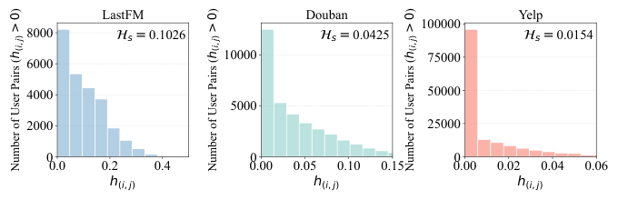
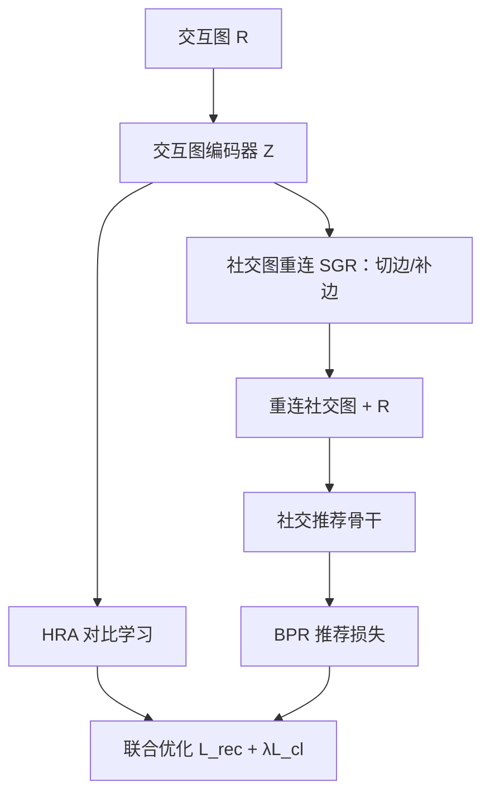
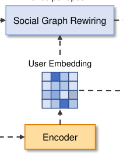

# Challenging Low Homophily in Social Recommendation（直面社交推荐中的低同质性）

- **会议/期刊**: WWW 2024
- **作者与机构**: Wei Jiang, Xinyi Gao, Guandong Xu, Tong Chen, Hongzhi Yin；The University of Queensland / University of Technology Sydney
- **推荐链路定位**: 召回与排序（Top-N 社交推荐）
- **研究方向**: 社交与群组推荐 / 图神经网络与知识图谱推荐
- **论文原文**: [论文原文链接](https://arxiv.org/abs/2401.14606v3)
- **开源代码**: [数据集资源仓库](https://github.com/Sherry-XLL/Social-Datasets)（论文代码未单独开源）

## TL;DR (1分钟核心速览)

本文指出真实社交图对用户偏好并不高度同质，直接聚合会引入冗余关系。作者提出数据驱动框架SHaRe：用交互图用户表征重连社交图，切低同质边、补高相似边，并以同质关系对比学习校准表征。在LastFM/Douban/Yelp全库排序下，SHaRe即插即用提升DiffNet、DiffNet++、LightGCN+social与MHCN，平均提升约3%–8%，LightGCN+social在Douban Recall@10提升14.15%。

## Background & Motivation (背景与核心矛盾)

- **主流范式**: 图社交推荐在用户-物品交互图之外引入社交图，假设社交同质性可缓解交互稀疏；GNN直接聚合社交邻居或构造社交超图。
- **前人局限**: 社交边不保证与用户偏好对齐，直接聚合会把异质/冗余关系注入表征；现有方法也缺少对边级可靠性的显式区分。
- **核心洞察 (Key Insight)**: 作者用Jaccard相似度定义偏好感知同质性 $h(i,j)=|V_{u_i}\cap V_{u_j}|/|V_{u_i}\cup V_{u_j}|$，并发现三个真实数据集的社交图同质性极低：LastFM$H_s=0.1026$、Douban$0.0425$、Yelp$0.0154$，边级分布近似幂律且大量接近0；合成实验进一步表明提高$H_s$ 可持续提升DiffNet/MHCN。
- **本文切入点**: 不修改骨干网络，而是“清洗数据”：重连社交图并辅以对比学习校准用户表征。

<figure class="paper-figure" markdown="span">
  <figcaption>图1：三个真实世界数据集上社交图的偏好感知同质性比例分布，其中 ℎ(𝑖,𝑗) 是用户-用户边 (𝑢𝑖,𝑢𝑗) 的边级同质性比例，H𝑠 是社交图的图级同质性比例（定义见第2.1节）。</figcaption>
</figure>

## Method (核心方法设计)

### 1. 整体框架 (Overall Architecture)

SHaRe由交互图编码器、社交图重连（SGR）与同质关系增强（HRA）组成。编码器仅从交互图学习用户表征 $Z$，用于计算用户相似度并重连社交图$\hat{\mathbf{S}}$；重连图与交互图共同输入任意图社交推荐骨干，输出用户/物品表征并计算BPR损失。HRA作为辅助任务，用原始社交图的边级同质性挑选正负样本，校准$Z$ 以反过来改善SGR。训练采用warm-up，第10个epoch起每个epoch仅执行一次SGR，兼顾效果与效率。

<figure class="paper-figure" markdown="span">
  <figcaption>图3：所提出的 SHaRe 框架概览。推荐编码器从交互图学习用户嵌入 𝑃。这些用户嵌入 𝑃 用于重连社交关系矩阵 𝑺。重连后的社交关系矩阵 b𝑺 和交互矩阵 𝑹 被输入到骨干社交推荐模型。其输出的用户和物品表示用于计算推荐损失 Lrec。</figcaption>
</figure>

### 2. 关键设计拆解 (Key Designs)

1. **社交图重连 SGR（切异质边、补高同质边）**：痛点在于原始社交边可靠性未知。先用交互图编码器得到 $z_u$，计算余弦相似度$c_{ij}=\cos(z_{u_i},z_{u_j})$；切掉$c_{ij}\le 0$的边，设切边数为$M$，再从全用户对中选Top-$M$相似对补边，重连边权为归一化相似度$\tilde{c}_{ij}$。直觉是：交互图相似度反映偏好同质性，切边去冗余、补边挖潜 latent homophily，且边数守恒控制开销。

2. **同质关系增强 HRA（用原始社交边构造对比正样本）**：重连可能引入噪声，故用原始社交图的边级同质性选取正样本：$\mathcal{P}_{u_i}^+=\{z_{u_k}\mid h(i,k)>\epsilon\}$，其中$\epsilon=h_{\min}+\zeta(h_{\max}-h_{\min})$。对比损失采用InfoNCE，最大化用户与高同质邻居表征一致性、拉远低同质用户。与随机图增广不同，HRA的正负样本由偏好感知同质性决定，能校准$Z$ 并提升下一轮SGR质量。

3. **训练目标、负采样与推理效率**：推荐主损失为BPR，训练时每用户随机采一个未交互物品为负样本；总损失 $\mathcal{L}=\mathcal{L}_{rec}+\lambda\mathcal{L}_{cl}$。SGR仅每epoch执行一次且从第10轮开始；推理阶段仍用原骨干，不增加在线打分模块。但SGR需计算全用户对相似度，复杂度约$O(|U|^2)$，是其主要扩展瓶颈。

## Experimental Setup & Evaluation Protocol (实验设置与评估协议)

- **数据集与预处理**:

| 数据集 | #Users | #Items | #Interactions | 社交边 | 密度 | 场景说明 |
| :--- | :---: | :---: | :---: | :---: | :---: | :--- |
| LastFM | 1,892 | 17,632 | 92,834 | 25,434 | 0.28% | 音乐社交，隐式反馈 |
| Douban | 2,848 | 39,586 | 894,887 | 35,770 | 0.79% | 豆瓣兴趣社交，评分<4过滤 |
| Yelp | 16,239 | 14,284 | 198,397 | 158,590 | 0.08% | 本地评论社交，评分<4过滤 |

- **数据划分与防穿越 (Splitting Strategy)**: 按 $8:1:1$ 随机划分为训练/验证/测试；非全局时间戳切分，存在随机划分常见的时序泄漏风险。
- **排名评测协议 (Ranking Protocol)**: 采用无偏 **Full-Ranking**，测试时对全库未交互物品排序，而非采样负例排序；报告Recall@10、Precision@10、NDCG@10，5次重复取均值与标准差。
- **对比基线与超参设置**: 骨干为DiffNet、DiffNet++、LightGCN+social、MHCN；嵌入维度 $d=64$，学习率0.001，batch size 2048，L2系数$1e-4$，Adam，验证集50轮不升则早停。训练负采样为每用户随机一个未交互物品。

## Key Experimental Results (实验关键数据)

### 1. 主实验对比 (Main Results)

| 方法 | LastFM R@10 | LastFM NDCG@10 | Douban R@10 | Douban NDCG@10 | Yelp R@10 | Yelp NDCG@10 |
| :--- | :---: | :---: | :---: | :---: | :---: | :---: |
| DiffNet | 0.1829 | 0.1586 | 0.0420 | 0.0845 | 0.0462 | 0.0296 |
| SHaRe-DiffNet | 0.1904 (↑4.10%) | 0.1646 (↑3.78%) | 0.0438 (↑4.29%) | 0.0873 (↑3.31%) | 0.0472 (↑2.17%) | 0.0303 (↑2.37%) |
| DiffNet++ | 0.1864 | 0.1584 | 0.0502 | 0.0974 | 0.0490 | 0.0308 |
| SHaRe-DiffNet++ | 0.1906 (↑2.25%) | 0.1613 (↑1.83%) | 0.0543 (↑8.17%) | 0.0980 (↑0.62%) | 0.0501 (↑2.25%) | 0.0319 (↑3.57%) |
| LightGCN+social | 0.2019 | 0.1756 | 0.0516 | 0.1017 | 0.0582 | 0.0375 |
| SHaRe-LightGCN+social | 0.2102 (↑4.11%) | 0.1816 (↑3.42%) | 0.0589 (↑14.15%) | 0.1107 (↑8.85%) | 0.0642 (↑10.31%) | 0.0422 (↑12.53%) |
| MHCN | 0.2154 | 0.1855 | 0.0606 | 0.1080 | 0.0620 | 0.0394 |
| SHaRe-MHCN | **0.2199** (↑2.09%) | **0.1894** (↑2.10%) | **0.0637** (↑5.12%) | **0.1110** (↑2.78%) | **0.0646** (↑4.19%) | **0.0410** (↑4.06%) |

### 2. 消融实验 (Ablation Study)

| SGR策略 | LastFM R@10 | LastFM NDCG@10 | LastFM 时间/epoch | Yelp R@10 | Yelp NDCG@10 | Yelp 时间/epoch |
| :--- | :---: | :---: | :---: | :---: | :---: | :---: |
| multi-SGR | 0.2193 | 0.1892 | 4.67s | 0.0635 | 0.0398 | 63.10s |
| w/o Warm-up | 0.2176 | 0.1882 | 2.22s | 0.0631 | 0.0397 | 11.79s |
| SHaRe-MHCN | **0.2199** | **0.1894** | **2.20s** | **0.0646** | **0.0410** | **11.69s** |

组件消融显示：去掉SGR、HRA或社交边权 $w/o\ SW$ 均会掉点；LastFM上HRA贡献最大，Douban上社交边权最敏感，Yelp上SGR最关键。操作消融显示Add-only与Cut-only均有效，Douban/Yelp上切边比补边更关键。

### 3. 关键实验发现 (Key Findings)

1. SHaRe对4个骨干均稳定增益：LastFM平均提升2.78%–3.14%，Douban 3.82%–7.93%，Yelp 4.23%–5.63%；其中LightGCN+social在Douban R@10提升14.15%、Yelp NDCG@10提升12.53%，说明数据重连对弱社交聚合骨干收益更大。
2. SGR策略并非越频繁越好：SHaRe-MHCN在Yelp R@10为0.0646，高于multi-SGR的0.0635与w/o Warm-up的0.0631，且每epoch仅11.69s，比multi-SGR的63.10s快约5.4倍。
3. 合成同质性实验表明 $H_s$越高，DiffNet/MHCN及其SHaRe版本均越好，且SHaRe在各$H_s$ 下持续高于vanilla；组件重要性随数据集变化，HRA、边权、SGR分别在不同数据上主导，提示单一去噪假设不足。

## Highlights & Limitations (亮点、对比与审稿批判)

- **与代表作对比 (vs. Prior Work)**: DiffNet/DiffNet++对各社交边近似均匀扩散，MHCN虽用超图刻画高阶社交关系但仍基于原始社交图；SHaRe不设计新骨干，而是在数据层重连社交图，并与任意图社交推荐模型即插即用。
- **可迁移亮点**: 用交互图独立编码器度量辅助图边可靠性，可迁移到社交、知识图谱或跨域辅助图清洗；用原始边级同质性构造对比正样本，比随机图增广更可控。
- **审稿级局限批判**: SGR每轮需全用户对余弦相似度，$O(|U|^2)$对百万级用户不友好；$\zeta$与$\lambda$最优值随数据集变化（如$\zeta$最优0.5/0.7/0.3，$\lambda$最优0.01/0.5/$1e-3$），调参成本较高。此外，实验采用随机8:1:1划分而非全局时间切分，线上时序泛化与A/B收益仍待验证。

## Rating (四维评分)

- **方法创新性 (Novelty)**: ⭐⭐⭐⭐ （从“低偏好同质性”实证切入，数据驱动重连+同质对比增强组合清晰，但图重连本身非全新范式）
- **评估协议与实验扎实度 (Protocol & Experiments)**: ⭐⭐⭐⭐ （三数据集、四骨干、Full-Ranking、5次重复与方差报告较扎实；随机划分与缺乏时序切分是短板）
- **写作与数学规范度 (Clarity & Rigor)**: ⭐⭐⭐⭐ （同质性定义、SGR与InfoNCE目标表达清楚；阈值公式与边权归一化细节可更严谨）
- **工业落地与复现价值 (Industrial & Practical Value)**: ⭐⭐⭐ （即插即用、推理不改骨干很实用；但全用户对重连的扩展性和未官方开源代码限制落地复现）

