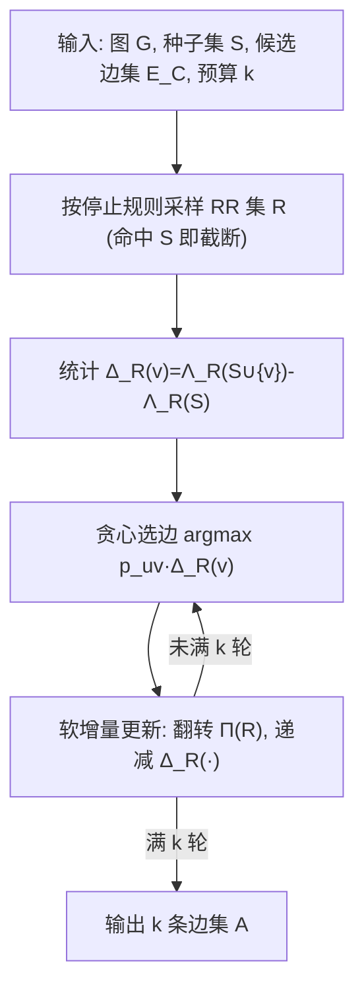
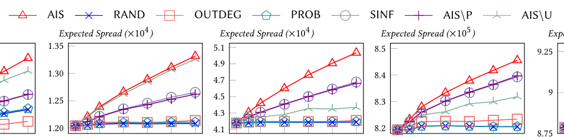

# Link Recommendation to Augment Influence Diffusion with Provable Guarantees (带可证明保证的影响力增广式链接推荐)

- **会议/期刊**: The Web Conference (WWW) 2024, Singapore
- **作者与机构**: Xiaolong Chen, Yifan Song, Jing Tang（香港科技大学(广州) / 香港科技大学）
- **推荐链路定位**: 召回（社交关系边 / "People You May Know" 类好友推荐）
- **研究方向**: 社交与群组推荐（社交影响力传播）/ 图推荐（图采样与子模优化）
- **论文原文**: [arXiv:2402.19189v1](https://arxiv.org/abs/2402.19189v1)
- **开源代码**: 暂未开源

## TL;DR (1分钟核心速览)

在线社交平台的"推荐关注"通常按共同好友数或画像相似度出边，与"让种子用户的影响力传得更远"这一业务目标脱节。本文研究 IMA 问题：给定图 $G$与种子集$S$，从候选边集$E_{\mathcal{C}}\subseteq(S\times V)\setminus E$中选$k$条边插入网络以最大化增广期望传播$\sigma(A,S)$。作者证明增广影响可拆解为$\sigma(A\cup\{e\},S)=p_{u,v}\sigma(A,S\cup\{v\})+(1-p_{u,v})\sigma(A,S)$，从而把 RR 集生成与候选边解耦，配合"命中种子即截断"与"软增量更新"，得到 AIS 算法：$(1-1/\mathrm{e}-\varepsilon)$近似、$1-\delta$置信、$O(k^2(m+n)\log(n/\delta)/\varepsilon^2+k|E_{\mathcal{C}}|)$时间。在 Twitter（41.7M 节点 / 1.5B 边）上，$k=50$ 时传播较最优启发式高约 1–4%，相对 MC-Greedy 加速 1–2 个数量级。

## Background & Motivation (背景与核心矛盾)

- **主流范式**: 影响力最大化（IM）在**固定拓扑**下用 RIS/反向可达集把 $\sigma(S)$ 估计转为最大覆盖问题（TIM/IMM/SUBSIM），工业侧好友推荐则用 FoF、画像重合度等启发式。
- **前人局限**: ① D'Angelo 等提出的 IMA 仅给出基于 Monte-Carlo 模拟的 MC-Greedy，需海量模拟才能压住估计误差，复杂度高达 $O(k^3mn|E_{\mathcal{C}}|\log(\cdot)/\varepsilon^2)$，百万级节点不可用；② FoF/out-degree/边概率等启发式会把大量边指向同一个热门节点，边际收益迅速饱和。
- **核心洞察 (Key Insight)**: IM 中 RR 集可在静态图上离线生成，但 IMA 的增广图 $G(A)$随选边变化，看似必须"每评估一条边重采样一次"；作者发现只需把"新边被激活"这一事件等价替换为"目标节点$v$变成种子"，就能让 RR 集在$G(A)$ 上一次采样、服务所有候选边。
- **本文切入点**: 用一条精确的分解恒等式把"变图"估计转成"变种子集"估计，再用截断采样与增量更新把常数与重复开销砍掉，同时保留端到端的近似比证明。

## Method (核心方法设计)

### 1. 整体框架 (Overall Architecture)

AIS 在 Greedy 框架内运行：先在当前增广图 $G(A)$上按停止规则采样一批随机 RR 集$\mathcal{R}$，统计每个节点$v$的"被覆盖但未被$S$覆盖"计数$\Delta_{\mathcal{R}}(v)$；每轮贪心从$E_{\mathcal{C}}\setminus A$中挑选使$p_{u,v}\Delta_{\mathcal{R}}(v)$最大的边$e=\langle u,v\rangle$加入$A$，随后对$\mathcal{R}$做**软更新**（不真正插入节点，只翻转覆盖标志并递减相关计数），进入下一轮。整个流程只需一次重采样预算，选边阶段仅做$O(k|E_{\mathcal{C}}|)$ 次查表比较，因而可在大图上落地。

### 2. 关键设计拆解 (Key Designs)

1. **增广影响的可分解估计器（Lemma 4.1）**：痛点在于 $\sigma(A\cup\{e\},S)$依赖$e$，为每条候选边单独采样不可行。作者在活边图（live-edge）视角下把$e$ 的"通/断"两种情形展开，得到
$\sigma(A\cup\{e\},S)=p_{u,v}\,\sigma(A,S\cup\{v\})+(1-p_{u,v})\,\sigma(A,S)$。
由于 $G(A)$与$e$无关，两项目标都可用同一批在$G(A)$上采的 RR 集估计；又因$\hat{\sigma}(A,S)$与$e$无关，选边准则化简为$\arg\max_{e=\langle u,v\rangle} p_{u,v}\big(\hat{\sigma}(A,S\cup\{v\})-\hat{\sigma}(A,S)\big)=\arg\max p_{u,v}\Delta_{\mathcal{R}}(v)$。物理直觉：新增边的价值 = "这条边被激活的概率 × 目标节点相对种子集带来的**新增**可达性"，天然抑制了对已被种子覆盖区域的重复推荐。

2. **截断采样与软增量更新（加速 $\mathcal{R}$的构建）**：痛点有二——采一条 RR 集要反向 BFS 整个连通块；且每轮选边后重采代价高。作者证明：一旦反向搜索命中$S$中任一节点，该 RR 集必被$S$覆盖，指示函数$\mathbb{I}_{\mathcal{R}}(v)\equiv 0$，可立即终止（截断）。选边后，仅当"$R$尚未被$S$覆盖 且$v\in R$且新边$e=\langle u,v\rangle$以概率$p_{u,v}$为活边"三条件同时成立时，把标志$\Pi(R)$置 1 并对$R$中所有节点执行$\Delta_{\mathcal{R}}(v)\!\leftarrow\!\Delta_{\mathcal{R}}(v)-1$。于是$k$ 轮选边共享同一批样本，更新代价被初始 RR 集总规模上界吸收（实验显示 AIS 与不做更新的 AIS\U 运行时间几乎一致）。

3. **训练目标、采样预算与推理开销**：本文为组合优化算法，无梯度损失，核心是**样本量控制**。取 $\lambda=\varepsilon/(k^2+\varepsilon k)$、$\delta\leftarrow\delta/(k|E_{\mathcal{C}}|)$（对$k|E_{\mathcal{C}}|$次估计做 union bound），采样直到$\Lambda_{\mathcal{R}}(S)\ge 2(1+\lambda)(1+\lambda/3)\log(2/\delta)/\lambda^2$，得$(1-1/\mathrm{e}-\varepsilon)$近似、失败概率$\le\delta$，时间
$O\!\big(k^2(m+n)\log(n/\delta)/\varepsilon^2+k|E_{\mathcal{C}}|\big)$（当$\sigma(\{v^{\circ}\})\le\sigma(S)$时）。相比 MC-Greedy 省去$k|E_{\mathcal{C}}|$次前向模拟因子，加速比约$k|S|n^2/\sigma(\{v^{\circ}\})$。免负采样、免模型推理，在线仅需一次采样 + 贪心查表。

## Experimental Setup & Evaluation Protocol (实验设置与评估协议)

- **数据集与预处理**（$K=10^3, M=10^6, B=10^9$，均为公开真实网络，无 5-core 过滤）：

| 数据集 | #Nodes | #Edges | 平均度 | 场景说明 |
| :--- | :---: | :---: | :---: | :--- |
| GRQC | 5.2K | 14.5K | 5.58 | 小规模合作/引用网，供 MC-Greedy 对比 |
| NetHEPT | 15.2K | 31.4K | 4.10 | 同上 |
| Epinions | 75.9K | 508.8K | 13.4 | 信任社交网 |
| DBLP | 317K | 1.05M | 6.10 | 合著网 |
| Orkut | 3.1M | 234.2M | 76.3 | 社交网，稠密 |
| Twitter | 41.7M | 1.5B | 70.5 | 大规模验证可扩展性 |

- **传播模型与划分**: 独立级联（IC）模型，$p_{u,v}$为$v$入度的倒数（领域标准设定）；候选边$e=\langle u,v\rangle$的概率启发式取$u$平均出度与$v$平均入度的均值。无训练/测试划分；$\varepsilon=0.5$、$\delta=0.001$、$|S|=50$、$k\in[0,50]$，每个方法跑 5 次取均值。
- **评估协议（关键区分）**: 小图实验固定 $|E_{\mathcal{C}}|=10^4$、Monte-Carlo 次数$r=10^4$（为 MC-Greedy 让步）；大图实验使用**全候选集**$E_{\mathcal{C}}=(S\times V)\setminus E$（$|E_{\mathcal{C}}|=O(|S|n)$），种子由 IMM 选出以贴合真实投放。目标值$\sigma(A,S)$本身由 RR 集给出$(\varepsilon,\delta)$-估计，而非前向全量模拟——这是本文"无偏全量评估"的等价替代。
- **对比基线与超参**: 7 个基线——RAND、OUTDEG、PROB、SINF（用同一 RR 集选 top-$k$节点但不更新）、AIS\P（去掉$p_{u,v}$）、AIS\U（去掉 RR 集更新）、MC-Greedy（+CELF 加速）。所有实现为 C++ O3，Intel Xeon 8377C / 512GB。

## Key Experimental Results (实验关键数据)

### 1. 主实验对比 (Main Results)

$k=50$、$\varepsilon=0.5$、IMM 种子、全候选集协议下的期望传播（数值由原文图 3 曲线读数近似，原文仅绘图未列表；AIS 列为最优）：

| 数据集 | RAND | OUTDEG | PROB | SINF | AIS\U | AIS | Improv.(vs SINF) |
| :--- | :---: | :---: | :---: | :---: | :---: | :---: | :---: |
| NetHEPT (×10⁰) | ≈985 | ≈990 | ≈1000 | ≈1145 | ≈1165 | **≈1195** | +4.4% |
| Epinions (×10⁴) | ≈1.21 | ≈1.21 | ≈1.22 | ≈1.305 | ≈1.32 | **≈1.345** | +3.1% |
| DBLP (×10⁴) | ≈4.20 | ≈4.25 | ≈4.30 | ≈4.88 | ≈4.80 | **≈5.05** | +3.5% |
| Orkut (×10⁵) | ≈8.26 | ≈8.25 | ≈8.30 | ≈8.43 | ≈8.40 | **≈8.48** | +0.6% |
| Twitter | ≈8.85 | ≈8.85 | ≈8.90 | ≈9.08 | ≈9.05 | **≈9.20** | +1.3% |

运行时间（秒，原文表 3 精确值，GRQC/NetHEPT，$\varepsilon=0.5$）：

| 方法 | GRQC (RAND 种子) | GRQC (IMM 种子) | NetHEPT (RAND 种子) | NetHEPT (IMM 种子) |
| :--- | :---: | :---: | :---: | :---: |
| MC-Greedy [$r$=1000] | 310.74 | 1131.53 | 304.41 | 1510.13 |
| MC-Greedy [$r$=5000] | 724.28 | 6196.58 | 640.81 | 7780.71 |
| **AIS** | **30.10** | **5.31** | **96.79** | **14.77** |

<figure class="paper-figure" markdown="span">
  <figcaption>图3：随𝑘变化的期望传播范围（𝜀= 0.5）。</figcaption>
</figure>

### 2. 消融实验 (Ablation Study)

| 变体 | 移除内容 | 机制后果 | 实测表现 |
| :--- | :--- | :--- | :--- |
| AIS\P | 去掉 $p_{u,v}$ 权重 | 退化为"纯边际覆盖"选边 | 与 SINF 基本持平，仍优于启发式，但低于 AIS |
| AIS\U | 去掉 RR 集增量更新 | 边际覆盖数组陈旧，反复指向同一节点 | NetHEPT/Epinions/Twitter 尚可；**DBLP、Orkut 明显退化** |
| SINF | 一次性取 top-$k$ 节点、不更新 | 忽视选边间的边际递减 | 与 AIS\P 几乎重合，受选边重叠拖累 |
| AIS | 完整 | — | 全部数据集最优 |

### 3. 关键实验发现 (Key Findings)

1. **"越高影响力种子越省时间"是 AIS 的结构性优势**：MC-Greedy 在 IMM 种子下从 310.7s 涨到 1131.5s（GRQC），AIS 反从 30.1s **降到 5.31s**；$r=5000$时相对 MC-Greedy 加速达 6196.58/5.31≈1167×，而 RAND 种子下仅约 24×。原因即停止规则中$\Lambda_{\mathcal{R}}(S)$的门槛与$\sigma(S)$ 成反比。
2. **增广边选择的瓶颈是"目标节点多样性"而非"边概率"**：OUTDEG/PROB 相比 RAND 几乎无增益（NetHEPT 上 985→990/1000），说明只按度数或概率出边会把 $k$ 条边堆在同一热门节点；AIS\U 在 DBLP（≈4.80 vs 5.05×10⁴）、Orkut 上退化，正是缺失增量更新导致的冗余推荐。
3. **理论 $\varepsilon$在实践中近乎免费**：$\varepsilon$ 从 0.1 增至 0.5，运行时间下降数个量级，而最终传播仅变化不足 1%（图 5a），意味着可以牺牲名义误差换取大规模可用性，采样预算的保守上界可显著放松。

## Highlights & Limitations (亮点、对比与审稿批判)

- **与代表作对比**: 相比 D'Angelo 等的 MC-Greedy（每轮前向模拟、复杂度随 $k^3|E_{\mathcal{C}}|$爆炸），AIS 用一条恒等式把"变图估计"降维为"变种子估计"，复杂度降为$O(k^2(m+n)\log/\varepsilon^2+k|E_{\mathcal{C}}|)$；相比 IMM/TIM 等 IM 方法只选种子不动拓扑，本文额外获得"可执行的边级推荐动作"；相比 FoF/SINF 类启发式，则首次带上$(1-1/\mathrm{e}-\varepsilon)$ 的端到端保证。
- **可迁移亮点**: ① "新边激活 ≡ 目标节点变种子"的等价替换，可迁移到任何"拓扑微调 + 传播收益"的场景（如信息流辟谣、欺诈链路阻断的反向问题）；② 截断采样 + 软增量更新共享样本池，是 RIS 类方法做多次相关查询时通用的省算力套路。
- **审稿级局限批判**: ① 近似保证只在 IC 模型、且以 $\sigma(\{v^{\circ}\})\le\sigma(S)$为前提；作者自承 Lemma 4.1 在 LT 模型下不成立，线性阈值场景仍空缺；② 大图实验的候选边概率来自"出度/入度均值"的启发式，真实平台中$p_{u,v}$需要学习与校准，噪声下的鲁棒性未评估；③ 只报告"每轮贪心 + 固定$r$"的离线结果，缺少与真实 OSN 上线 A/B（如接受率、点击后建边率）的闭环验证，且没有任何代码开源。

## Rating (四维评分)

- **方法创新性 (Novelty)**: ⭐⭐⭐⭐ （一条活边图分解恒等式把"变图"化为"变种子"，配合截断与软更新，是该问题上首个兼具理论保证与大图可用的方案）
- **评估协议与实验扎实度 (Protocol & Experiments)**: ⭐⭐⭐⭐ （6 个真实数据集含 1.5B 边、7 个基线、5 次重复、全候选集协议；扣分在于结果以曲线呈现、缺显著性检验）
- **写作与数学规范度 (Clarity & Rigor)**: ⭐⭐⭐⭐ （引理—停止规则—近似比—复杂度链条完整，常数与 union bound 交代清楚；部分结论依赖图中读数，表格化不足）
- **工业落地与复现价值 (Industrial & Practical Value)**: ⭐⭐⭐⭐ （在线仅需一次采样 + 查表选边，IMM 种子下秒级返回，直接对应"推荐关注"场景；但无开源、概率参数需线上校准）

