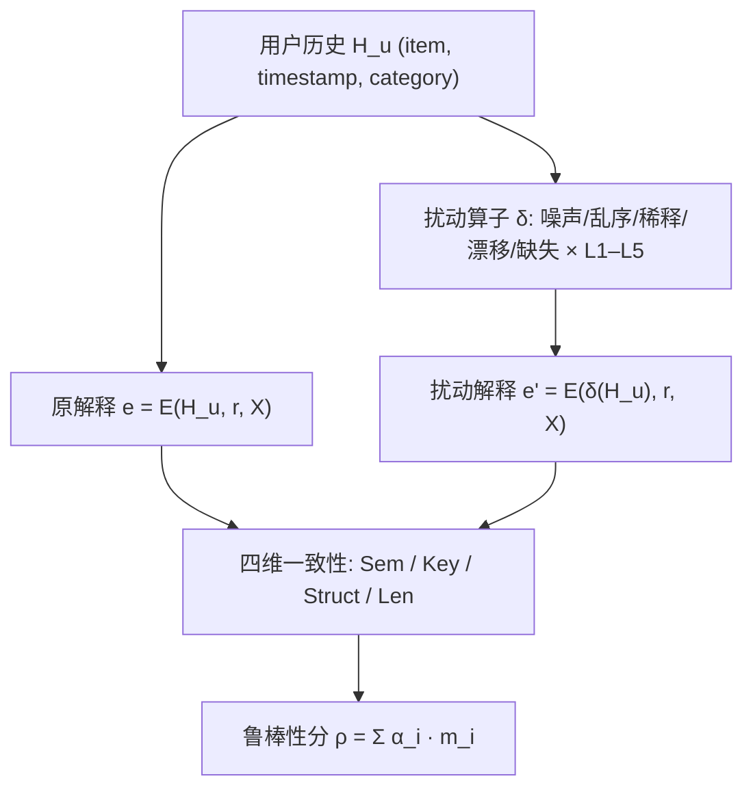
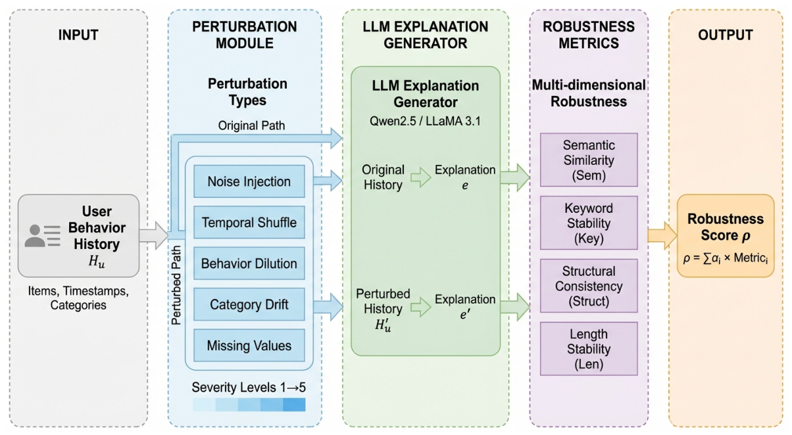
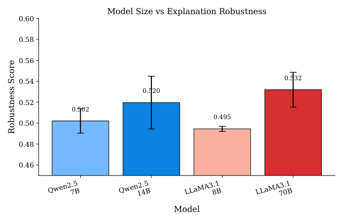

# RobustExplain: Evaluating Robustness of LLM-Based Explanation Agents for Recommendation (面向推荐的 LLM 解释智能体鲁棒性评测)

- **会议/期刊**: WWW Companion 2026 (8 页短文 / 4 图)
- **作者与机构**: Guilin Zhang, Kai Zhao, Jeffrey Friedman, Xu Chu（Workday, Pleasanton, USA）
- **推荐链路定位**: 端到端生成式（推荐解释生成侧，不改变排序结果）
- **研究方向**: 对话推荐与智能体仿真 / 大语言模型推荐 (LLM4Rec)
- **论文原文**: [https://arxiv.org/abs/2601.19120v3](https://arxiv.org/abs/2601.19120v3)
- **开源代码**: [https://github.com/GuilinDev/LLM-Robustness-Explain](https://github.com/GuilinDev/LLM-Robustness-Explain)

## TL;DR (1分钟核心速览)

现有 LLM 解释智能体的评测几乎都在"干净、静态"的用户历史上做流畅度/相关性打分，而真实平台的历史充满误点、乱序、共享账号与偏好漂移。本文提出 RobustExplain：用 5 类真实行为扰动 × 5 级严重度构造"原/扰动"解释配对，并以语义、关键词、结构、长度四维一致性加权成鲁棒性分。在 4 款 7B–70B 模型、每模型 500 对样本上，全体平均仅 0.509（满分 1），最大模型 70B 达 0.532，较小模型高约 8.1%，且严重度 L1→L5 仅下降 1.7%。

## Background & Motivation (背景与核心矛盾)

- **主流范式**: LLM 作为 explanation agent，读取用户交互历史 $H_u$、候选物品$r$与属性$X$，生成自然语言理由；评测集中在流畅性、相关性、用户满意度。
- **前人局限**: ① 可解释推荐工作默认历史可靠，忽略误点/共享账号/时间错乱等生产噪声；② 鲁棒性研究（NLP 扰动评测、序列推荐去噪）只看预测或排序精度，从不考察"面向用户的自然语言理由是否稳定"。
- **核心洞察 (Key Insight)**: 即便推荐物品完全不变，解释内容的抖动也会直接损害用户信任——"解释稳定性"应成为与准确率并列的一等评测维度，而非附属产物。
- **本文切入点**: 不做新模型，而是建立一个可控、可复现、任务级的扰动-度量评测框架，并给出首批基线。

## Method (核心方法设计)

### 1. 整体框架 (Overall Architecture)

RobustExplain 是**免训练**的配对评测协议：对同一用户历史先取原解释 $e=E(H_u,r,X)$，再经扰动算子得到$H_u'=\delta(H_u)$并取扰动解释$e'=E(H_u',r,X)$，把两个解释在四个维度上比对，最后加权为单一鲁棒性分；模型选择、提示模板、推荐物品在配对内严格固定，从而把差异完全归因于历史扰动。评测再沿扰动类型、严重度、模型规模三条轴切片，并附带指标相关性与统计显著性检验。

<figure class="paper-figure" markdown="span">
  <figcaption>图 1：RobustExplain 评估框架架构。原始用户历史通过五类扰动（噪声注入、时间乱序、行为稀释、类别漂移、缺失值）在不同严重程度等级下被系统扰动。原始与扰动后的历史均经 LLM 解释生成器处理，生成解释对，用于在语义、关键词、结构和长度维度上进行多维鲁棒性比较。</figcaption>
</figure>

### 2. 关键设计拆解 (Key Designs)

1. **五类行为扰动分类法（把"脏数据"翻译成可控算子）**：痛点是没有统一的噪声语言。定义为 ① 噪声注入 $H'=H_u\cup\{(i,t): i\sim \text{Uniform}(\mathcal{I})\}_{s}$（模拟误点/闲逛）；② 时序乱序$H'=\text{Shuffle}(H_u, s/5)$（延迟日志、时区错乱）；③ 行为稀释（注入用户最低互动类目的$s$条交互，模拟共享账号/代买）；④ 类目漂移（用替代类目替换最多 50% 交互，模拟季节/人生阶段变化）；⑤ 缺失值（抹除最多 50% 的评分/时间/类目）。$s\in\{1,\dots,5\}$ 控制严重度，Level 5 约注入/替换 50%。直觉：这五类恰好覆盖"假信号、信号错序、信号混杂、信号演化、信号残缺"五种失效模式。
2. **四维一致性度量 + 加权聚合（区分"含义变了"与"说法变了"）**：语义用词袋余弦 $\text{Sem}=\frac{\mathbf{v}_e\cdot \mathbf{v}_{e'}}{\|\mathbf{v}_e\|\|\mathbf{v}_{e'}\|}$；关键词用 POS 抽取名词/品类/属性后的 Jaccard$\text{Key}=\frac{|K_e\cap K_{e'}|}{|K_e\cup K_{e'}|}$；结构用 BLEU 捕捉组织与措辞模式的保持；长度用$\text{Len}=1-\frac{|\,|e|-|e'|\,|}{\max(|e|,|e'|)}$。最终
$\rho=\alpha_1\text{Sem}+\alpha_2\text{Key}+\alpha_3\text{Struct}+\alpha_4\text{Len},\ \sum_i\alpha_i=1$（语义权重最高，长度最低）。物理直觉：这四个维度分别对应"用户读到的意思、记住的锚点、看到的行文、感知的详略"，只有都稳，解释才可信。
3. **训练目标与推理开销**：本文无训练损失、无负采样，唯一"超参"是扰动强度与 $\alpha$ 权重。推理开销为每样本 2 次 LLM 调用（原 + 扰动），单模型 500 对、四模型合计 2000 次解释生成，全部本地 Ollama 部署以避免 API 漂移。

## Experimental Setup & Evaluation Protocol (实验设置与评估协议)

- **数据集与预处理**: 受控合成电商数据，保留真实类目分布与时间动态，便于隔离扰动的因果效应。

| 数据集 | #Users | #Items | #Interactions | 稀疏度/密度 | 特征/场景说明 |
| :--- | :---: | :---: | :---: | :---: | :--- |
| Synthetic E-commerce | 100（仅 20 人参与评测） | 200 | 每人 10–50 条（总计约 $3\times10^3$） | 极稀疏（$<0.02\%$） | 7 大类目：Electronics / Fashion / Home / Beauty / Sports / Books / Toys；含 item、timestamp、category、模拟评分 |

- **数据划分与防穿越 (Splitting Strategy)**: 不设训练/测试划分；采用**配对留原协议**——同一用户历史的原始版与扰动版构成样本对，物品与提示词固定，杜绝推荐结果变化污染解释归因。
- **排名评测协议 (Ranking Protocol)**: 非 Full-Ranking，而是 **Paired Consistency Scoring（配对一致性打分）**，取值 $[0,1]$，越高越稳；不涉及候选池采样与负采样。
- **对比基线与超参设置**: 4 款模型覆盖 7B–70B——Qwen2.5-7B、LLaMA 3.1-8B、Qwen2.5-14B、LLaMA 3.1-70B；统一结构化 prompt（history + item + features + "focus on connecting preferences to characteristics"）；显著性用 paired t-test 与 one-way ANOVA + Tukey HSD。

## Key Experimental Results (实验关键数据)

### 1. 主实验对比 (Main Results)

| Model | Noise | Shuffle | Dilute | Drift | Missing | **Overall** | Improv. vs 7B |
| :--- | :---: | :---: | :---: | :---: | :---: | :---: | :---: |
| LLaMA 3.1-70B | **0.534** | **0.528** | **0.531** | **0.538** | **0.535** | **0.532** | **+8.1%** |
| Qwen2.5-14B | 0.521 | 0.509 | 0.518 | 0.526 | 0.522 | 0.519 | +5.5% |
| LLaMA 3.1-8B | 0.498 | 0.487 | 0.494 | 0.489 | 0.493 | 0.492 | 0.0% |
| Qwen2.5-7B | 0.484 | 0.500 | 0.491 | 0.493 | 0.492 | 0.492 | — |
| Average | 0.509 | 0.506 | 0.509 | **0.512** | 0.511 | 0.509 | — |

### 2. 消融与维度分解 (Ablation / Metric Decomposition)

本文为评测型论文，无模块级 `w/o` 消融，改用**度量维度分解 + 严重度切片 + 度量相关性**作为替代分析。

| Model | Sem | Key | Struct | Len | L1 | L3 | L5 |
| :--- | :---: | :---: | :---: | :---: | :---: | :---: | :---: |
| LLaMA 3.1-70B | **0.638** | **0.512** | **0.405** | **0.742** | — | — | — |
| Qwen2.5-14B | 0.612 | 0.489 | 0.387 | 0.721 | — | — | — |
| LLaMA 3.1-8B | 0.583 | 0.461 | 0.362 | 0.698 | — | — | — |
| Qwen2.5-7B | 0.579 | 0.458 | 0.358 | 0.695 | — | — | — |
| Average | 0.603 | 0.480 | 0.378 | 0.714 | 0.533 | 0.523 | 0.524 |
| 70B vs 7B 提升 | +10.2% | +11.8% | **+13.1%** | +6.8% | — | — | — |

度量相关性：Sem–Key $r=0.72$，Sem–Struct$0.58$，Key–Struct$0.65$，Len 与其他仅$0.24$–$0.31$。

### 3. 关键实验发现 (Key Findings)

1. **结构一致性是真正短板**：平均仅 0.378，比长度稳定性 0.714 低 0.336，且是规模增益最大的维度（70B 比 7B +13.1%）。说明扰动主要改写"论述组织与措辞骨架"，而非信息量或篇幅——这正对应用户最容易察觉的"理由前后不一致"。
2. **规模存在阈值效应而非线性收益**：7B 与 8B 完全同分（0.492），跃至 14B 得 +5.5%（$p<0.001$, Cohen's$d=0.42$），再到 70B 只再增 +2.5%。即 7B→14B 是"是否具备稳定偏好抽象能力"的门槛，继续放大模型边际收益递减。
3. **严重度近乎不敏感，疑似"退化为类目话术"**：L1 0.533 → L4 0.517 仅降 3.0%（$p<0.05$,$d=0.18$），L5 反升至 0.524；定性例子里，时序被打乱后模型把"你近期偏爱夏季服饰"改写为"你整体的时尚偏好"。这提示高分部分来自回退到通用类目级描述——鲁棒性与模板化在此难以区分。

<figure class="paper-figure" markdown="span">
  <figcaption>图 4：不同模型规模下的鲁棒性比较。LLaMA 3.1-70B 鲁棒性最高（0.532），其次是 Qwen2.5-14B（0.519），而 7-8B 模型得分约为 0.49。</figcaption>
</figure>

## Highlights & Limitations (亮点、对比与审稿批判)

- **与代表作对比 (vs. Prior Work)**: 相比 CARTS（多智能体结构化摘要）、ARAG（检索增强个性化解释）等"把解释做得更好"的工作，本文不追求解释质量上限，而量化其**输入敏感性下限**；相比序列推荐鲁棒性研究（如偏好漂移下的排序鲁棒性）与 SGL/SimGCL 类去噪，本文把鲁棒性从"排序精度"搬到"自然语言理由"，是可解释推荐评测维度的一次补齐。
- **可迁移亮点**: ① "配对留原 + 五类扰动 × 五级严重度"是一套即插即用的评测壳，可直接套到对话推荐、列表重排解释、Agent 行为模拟等任意 LLM 输出稳定性审计；② 用"维度分解定位短板"（结构 < 关键词 < 语义 < 长度）替代单一总分，便于指出优化优先级。
- **审稿级局限批判**: ① **数据与统计基础薄弱**——200 个合成物品、仅 20 名评测用户、每模型 500 对，无真实平台噪声分布、无人工/user study，$\alpha$ 权重未公开具体取值，结论外推性受限；② **数字自相矛盾**——正文与图 2 称 drift 鲁棒性最高 0.503、shuffle 最低 0.499，与表 1/表 3 的 0.538 / 0.487 及"表 2 结构一致性 0.369 vs 表 5 的 0.378"不一致；③ 以 BLEU 度量"结构一致性"对开放式生成偏保守，且未做提示词敏感性控制，模型间比较可能被 prompt 选择混淆。

## Rating (四维评分)

- **方法创新性 (Novelty)**: ⭐⭐⭐ （首次把"行为扰动-解释稳定性"形式化为 $\rho(\mathbf{E},\delta)$ 评测问题，分类法贴合生产噪声，但本质是基准构建而非机制创新）
- **评估协议与实验扎实度 (Protocol & Experiments)**: ⭐⭐⭐ （配对控制与显著性检验规范，但合成小数据、20 用户、无人工评估，且文中多处数值互相打架）
- **写作与数学规范度 (Clarity & Rigor)**: ⭐⭐⭐⭐ （扰动与四维指标定义简洁自洽，公式与符号表意清楚；扣分在 $\alpha$ 权重缺失与收敛性讨论为零）
- **工业落地与复现价值 (Industrial & Practical Value)**: ⭐⭐⭐⭐ （代码全开源、Ollama 本地可跑、无需训练即可接入现有解释链路做上线前回归测试；成本为每样本 2 次 LLM 调用，大规模审计需控制预算）

