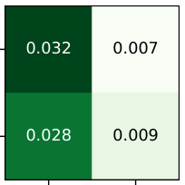
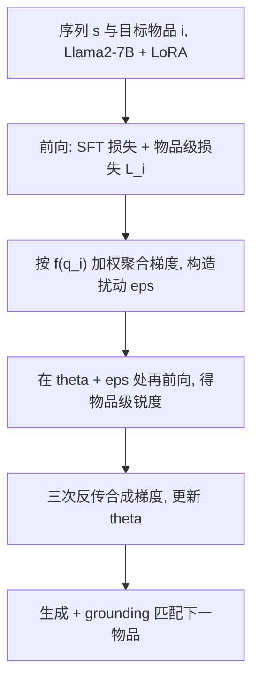
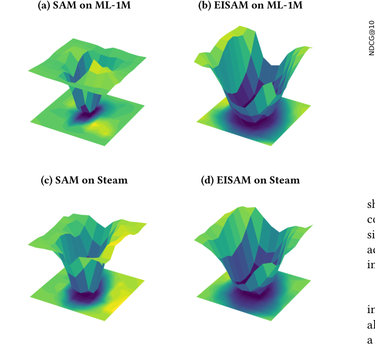

# Taming the Long Tail: Efficient Item-wise Sharpness-Aware Minimization for LLM-based Recommender Systems (驾驭长尾：面向 LLM 推荐系统的高效物品级锐度感知最小化)

- **会议/期刊**: WWW 2026
- **作者与机构**: Jiaming Zhang, Yuyuan Li, Xiaohua Feng, Li Zhang, Chaochao Chen (浙江大学)；Longfei Li, Jun Zhou (蚂蚁集团)
- **推荐链路定位**: 端到端生成式序列推荐（LLM 骨干 + LoRA 轻调 + grounding 解码）
- **研究方向**: 冷启动与长尾推荐 / LLM 推荐 (LLM4Rec)
- **论文原文**: [arXiv:2603.12752v1](https://arxiv.org/abs/2603.12752v1)
- **开源代码**: [xiye7lai/samlrs](https://github.com/xiye7lai/samlrs)

## TL;DR (1分钟核心速览)

LLM 推荐系统（LRS）的长尾问题此前从未被系统研究。本文先做实证拆分：**数据长尾**（推荐集偏斜）主导头、尾性能差距，**先验长尾**（预训练语料）只放大头部、对尾部几乎无害。据此提出 EISAM：把 SAM 的全局锐度正则拆成**按物品频率加权的物品级曲率惩罚**，用闭式扰动 + 三次反传实现，避免 GroupSAM 的组循环开销。在 ML-1M/Steam/ADM 三数据集、全库 grounding 排序协议下，整体 NDCG@10 平均 +3.53%，尾部 NDCG@10 平均 **+8.90%**（最高 +14.49%），每 epoch 训练时间仅增加 5.3%。

## Background & Motivation (背景与核心矛盾)

- **主流范式**: LRS 直接以 LLM 作序列推荐骨干，用 SFT/LoRA 对齐 next-item 生成，再通过 embedding 相似度 grounding 回物品空间。
- **前人局限**: ① 传统长尾方案（解耦网络、因果重加权、跨域迁移）依赖对模型结构、目标函数或交互采样的直接控制，与“冻结生成式骨干 + 轻量微调”范式不兼容；② 直接套用 SAM 只压全局锐度，头部样本淹没了尾部信号；GroupSAM 按组多次 SAM 求解，复杂度约为 **Group 倍**（实测 3.82–4.16×）。
- **核心洞察 (Key Insight)**: 先验长尾 $P$与数据长尾$D$均影响性能，但只有$D$决定头尾落差——$D$-Head 组 NDCG@10 为 0.032，$D$-Tail 仅 0.007；最优出现在$P$-Head∩$D$-Head，而最差并不在 Tail∩Tail，而在$P$-Head∩$D$-Tail，说明物品一旦落入数据长尾，无论先验如何都难以被召回。
- **本文切入点**: 既然瓶颈是数据长尾造成的**尾部损失曲面过锐**，就直接在目标函数里对每个物品单独施加频率感知的曲率正则。

<figure class="paper-figure" markdown="span">
  <figcaption>图1：不同数据/先验组上的性能。</figcaption>
</figure>

## Method (核心方法设计)

### 1. 整体框架 (Overall Architecture)

输入为长度 10 的物品序列与目标物品，Llama2-7B + LoRA 前向得到 token 级 SFT 损失，同时按目标物品把样本划入子集 $\mathcal{S}^{(i)}$计算物品级损失；随后按频率权重$f(q_i)$聚合物品级梯度构造最坏扰动$\hat{\boldsymbol{\epsilon}}$，在$\boldsymbol{\theta}+\hat{\boldsymbol{\epsilon}}$ 处再前向得到锐度惩罚并按三次反传合成总梯度更新参数；推理时 BIGRec 用生成结果与物品 embedding 做全库 grounding 匹配，TALLRec 用 beam search 生成多个候选。

### 2. 关键设计拆解 (Key Designs)

1. **物品级锐度正则（Item-wise Sharpness）**：痛点是把 max 放到全局损失上会让头部主导扰动方向。本文对每个物品定义 $\mathcal{S}^{(i)}=\{(s,i)\in\mathcal{S}\}$与$L^{(i)}_{\mathcal{S}}(\boldsymbol{\theta})$，构造
$L^{\text{SAM}}_{\mathcal{S}}(\boldsymbol{\theta})=\max_{\|\boldsymbol{\epsilon}\|\le\rho}\sum_{i\in\mathcal{I}}f(q_i)\big[L^{(i)}_{\mathcal{S}}(\boldsymbol{\theta}+\boldsymbol{\epsilon})-L^{(i)}_{\mathcal{S}}(\boldsymbol{\theta})\big]$其中$f(q_i)=(1-q_i)^{\gamma}$ 单调递减：尾部物品权重趋近 1、高频头部趋近 0，扰动便“只看尾部曲率”，物理直觉是给长尾样本留出更宽的极小值盆地。
2. **高效闭式扰动与梯度（3-pass 优化）**：物品级拆分若逐组求解将不可扩展。一阶泰勒展开后内层最大化有闭式解
$\hat{\boldsymbol{\epsilon}}(\boldsymbol{\theta})=\rho\,\frac{\sum_{i}f(q_i)\nabla_{\boldsymbol{\theta}}L^{(i)}_{\mathcal{S}}(\boldsymbol{\theta})}{\big\|\sum_{i}f(q_i)\nabla_{\boldsymbol{\theta}}L^{(i)}_{\mathcal{S}}(\boldsymbol{\theta})\big\|_2}$丢弃含 Hessian 的高阶项后，总梯度为$\nabla_{\boldsymbol{\theta}}J\approx\big[\nabla L_{\mathcal{S}}-\lambda\nabla L^{w}_{\mathcal{S}}\big]_{\boldsymbol{\theta}}+\lambda\nabla L^{w}_{\mathcal{S}}\big|_{\boldsymbol{\theta}+\hat{\boldsymbol{\epsilon}}}$，即每步 3 次反传，与物品数无关，彻底规避 GroupSAM 的组循环。
3. **训练目标与理论支撑**：总损失 $J(\boldsymbol{\theta})=L_{\mathcal{S}}(\boldsymbol{\theta})+\lambda L^{\text{SAM}}_{\mathcal{S}}(\boldsymbol{\theta})$，$L_{\mathcal{S}}$为 SFT 交叉熵；全库 grounding 无需负采样。定理 5.4 给出平衡分布下的泛化界，含曲率奖励项$-\frac{\lambda\rho^{2}}{2|\mathcal{I}|q_{\min}(\sqrt{d}+\sqrt{2\ln n})^{2}}\mathrm{tr}(H_{w}(\boldsymbol{\theta}))$，复杂度项按$O(1/n)$收敛，权重设计通过$B_w=\sum_{i}f(q_i)q_iB$ 缩小不平衡松弛。

## Experimental Setup & Evaluation Protocol (实验设置与评估协议)

- **数据集与预处理**: 统一采用 `5-core` 过滤（剔除交互 <5 的物品），最大序列长度 10，按时间戳构建序列：

| 数据集 | #Items | #Interactions | #Sequences | 稀疏度/密度 | 特征/场景说明 |
| :--- | :---: | :---: | :---: | :---: | :--- |
| ML-1M | 3,883 | 1,000,209 | 939,809 | 未报告 | 电影评分，稠密、序列极多 |
| Steam | 32,135 | 1,307,310 | 138,970 | 未报告 | 游戏平台评论与游玩记录 |
| ADM | 266,414 | 836,006 | 22,982 | 未报告 | 亚马逊数字音乐，物品量最大、最稀疏 |

- **数据划分与防穿越 (Splitting Strategy)**: 基于时间戳的 `比例划分` 8:1:1（训练/验证/测试），无 future-leakage；按帕累托原则将**前 20% 高频物品定为 Head、其余 80% 为 Tail**。
- **排名评测协议 (Ranking Protocol)**: 无偏 `Full-Ranking`——BIGRec 将生成结果与全物品 embedding 做相似度 grounding 排序，TALLRec 采用 beam search 生成多候选，不做负采样估计；报告 NDCG@10 与 HR@10。
- **对比基线与超参设置**: 基线含 RW（重加权）、SAM（全局锐度，移植至 LRS）、GroupSAM（组级锐度），分别叠加在两个骨干 BIGRec / TALLRec 上；骨干 LLaMA2-7B，LoRA $r=8,\alpha=16$，lr$5\times10^{-4}$，batch 64，epoch 3（ADM 为 2）。

## Key Experimental Results (实验关键数据)

### 1. 主实验对比 (Main Results)

| 骨干/方法 | ML-1M Overall NDCG@10 | ML-1M Tail NDCG@10 | Steam Overall | Steam Tail | ADM Overall | ADM Tail |
| :--- | :---: | :---: | :---: | :---: | :---: | :---: |
| BIGRec | 0.0286 | 0.0128 | 0.0840 | 0.0314 | 0.0205 | 0.0075 |
| + RW | 0.0282 | 0.0136 | 0.0872 | 0.0391 | 0.0187 | 0.0085 |
| + SAM | 0.0294 | 0.0135 | 0.0875 | 0.0388 | 0.0213 | 0.0081 |
| + GroupSAM | 0.0274 | 0.0149 | 0.0874 | 0.0395 | 0.0215 | 0.0092 |
| **+ EISAM (Ours)** | **0.0303** | **0.0160** | **0.0887** | **0.0411** | **0.0225** | **0.0102** |
| Improv. | +3.06% | +7.38% | +1.37% | +4.05% | +4.65% | +10.87% |

（Tail HR@10 上 EISAM 于 ML-1M/Steam/ADM 分别达 0.0203/0.0564/0.0168，相对最佳基线 +14.69%/+6.21%/+9.09%；TALLRec 骨干下 EISAM 亦将整体 NDCG@10 由 0.0197/0.0800/0.0196 提升至 0.0211/0.0832/0.0216，尾部最高 +14.49%。）

### 2. 消融/开销实验 (Ablation & Efficiency)

原文未给出标准 `w/o` 组件表，以“正则粒度变体 + 单 epoch 训练时间”作为等价分析（ML-1M / BIGRec）：

| 正则粒度 | Tail NDCG@10 | 每 epoch 时间 (相对 SAM) | Overall NDCG@10 |
| :--- | :---: | :---: | :---: |
| 无 (BIGRec) | 0.0128 | 1.00×（基准训练） | 0.0286 |
| GroupSAM（组级） | 0.0149 | 12,172s (3.82×) | 0.0274 |
| SAM（全局） | 0.0135 | 3,182s (1.00×) | 0.0294 |
| **EISAM（物品级）** | **0.0160** | **3,652s (1.14×)** | **0.0303** |

### 3. 关键实验发现 (Key Findings)

1. **粒度决定尾部收益**：全局 SAM 把整体 NDCG 从 0.0286 提到 0.0294，但尾部仅 +0.0007；组级 GroupSAM 尾部到 0.0149 却把整体拉低到 0.0274（组间无交互）；只有物品级 EISAM 同时拿到尾部 0.0160 与整体 0.0303，说明“细粒度 + 全局共享梯度”是必要组合。
2. **开销是关键取胜点**：EISAM 相对 SAM 仅 1.14×/1.01×/1.01×，而 GroupSAM 为 3.82–4.16×，细粒度正则的代价被闭式扰动压到几乎可忽略。
3. **曲面形状被真实改变**：尾部损失曲面可视化显示 SAM 仍存在尖锐极小值，EISAM 在三个数据集上均更平坦；超参上 $\lambda>1.0$或$\gamma>100$会因过度压制头部而性能回落，$\lambda\in[0.4,1.0]$ 稳健。

<figure class="paper-figure" markdown="span">
  <figcaption>图3：LRS 在尾部物品上的损失景观可视化。颜色越深表示损失值越低。</figcaption>
</figure>

## Highlights & Limitations (亮点、对比与审稿批判)

- **与代表作对比 (vs. Prior Work)**: 相较 BIGRec/TALLRec 只做 SFT 对齐，本文首次在 LRS 中显式建模长尾；相较 GraphSAM 类组级 SAM，本文把正则从“组”降到“物品”且去掉组循环；相较传统重加权（RW），本文正则的是**曲率**而非损失值，实验显示 RW 在 ADM 上甚至使整体下降（0.0205→0.0187）。
- **可迁移亮点**: ① 频率加权 + 闭式扰动的“按样本子集加权 SAM”可直接套到 CTR 多任务、冷启动物品微调；② 3 次反传近似可作为通用插件接入任何 LoRA 微调管线。
- **审稿级局限批判**: ① 理论界建立在“平衡测试分布 + 损失有界”的强假设上，与真实曝光分布仍有差距；② 未报告方差/显著性检验与多次随机种子，且缺少对 $\rho$ 的敏感度与显存占用分析；③ 仅验证 7B 级开源 LLM 与两个骨干，未涉及工业级大模型或在线 A/B。

## Rating (四维评分)

- **方法创新性 (Novelty)**: ⭐⭐⭐⭐ （把 SAM 的 max 有效“下放”到物品粒度并给出闭式解与泛化界，机制简洁且切中 LRS 长尾盲区）
- **评估协议与实验扎实度 (Protocol & Experiments)**: ⭐⭐⭐⭐ （三数据集 × 两骨干 × 头/尾/整体三层指标完整，采用全库 grounding 排序；但缺显著性检验与标准 w/o 消融）
- **写作与数学规范度 (Clarity & Rigor)**: ⭐⭐⭐⭐ （物品级锐度、三次反传梯度、界的三项分解推导清晰，算法伪码完整；部分符号与附录依赖较重）
- **工业落地与复现价值 (Industrial & Practical Value)**: ⭐⭐⭐⭐⭐ （代码开源，仅 +5.3% 平均训练开销、无推理额外成本，可直接嵌入现有 LoRA 微调流水线）

