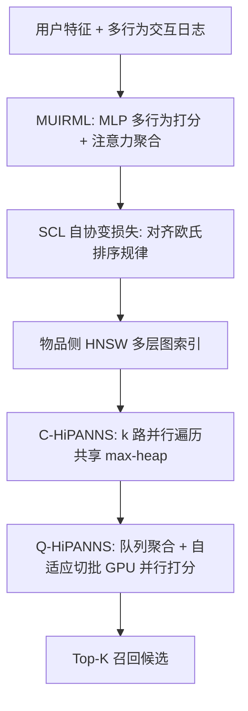
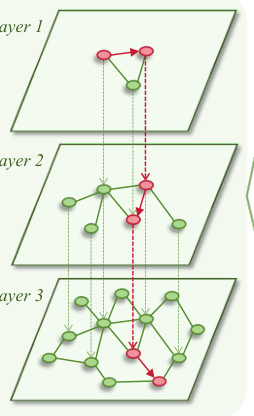
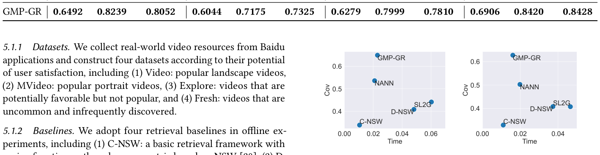

# GPU-accelerated Multi-relational Parallel Graph Retrieval for Web-scale Recommendations (面向网页级推荐的 GPU 加速多关系并行图检索)

- **会议/期刊**: WWW 2026（预印本 arXiv:2502.11490v1）
- **作者与机构**: Zhuoning Guo, Guangxing Chen, Qian Gao, Xiaochao Liao, Jianjia Zheng, Lu Shen, Hao Liu（HKUST(GZ) 与百度）
- **推荐链路定位**: 召回（十亿级候选→千级候选的图 ANNS 检索）
- **研究方向**: 协同过滤与双塔召回 / 工业级全链路架构
- **论文原文**: [https://arxiv.org/abs/2502.11490v1](https://arxiv.org/abs/2502.11490v1)
- **开源代码**: 暂未开源

## TL;DR (1分钟核心速览)

工业召回普遍采用「DNN 度量 + 图 ANNS」两段式，但多行为被割裂建模、DNN 度量不满足三角不等式导致图遍历走冗余边、GPU 高并发下频繁 kernel launch 拖垮吞吐。本文提出 GMP-GR：用多关系度量学习（MUIRML）统一多行为并以**自协变损失**把欧氏距离的排序规律迁移进 DNN 度量，再用**分层并行 HiPANNS**（候选内并行 + 查询间批聚合）拓宽搜索空间。在百度四个全库暴力排序（Full-Ranking）ground-truth 视频数据集上，Cov/Rec@10/Rec@100 较 NANN 相对提升 20.94%/22.66%/21.36%，检索速度达 3.2×10⁵ items/s，线上 T-P 提升 1.13%/1.19%。

## Background & Motivation (背景与核心矛盾)

- **主流范式**: 离线训练双塔式用户/物品嵌入与 DNN 相关性度量，在线以 HNSW 等图 ANNS 逐层贪心遍历，从十亿候选里取 Top-K（SL2G、NANN 为代表）。
- **前人局限一（建模割裂）**: 百度场景含点击、浏览等数十种行为，各行为独立训一套度量，既丢失行为间互益语义，又使系统更新成本随行为数指数膨胀。
- **前人局限二（度量不可导航）**: DNN 度量违背三角不等式，图遍历被迫探索冗余边，难以在有限步数内触达「远但高相关」的物品；同时贪心搜索深度/广度失衡，短步数即陷局部最优。
- **前人局限三（GPU launch-bound）**: 亿级 QPS 下不同用户搜索路径发散，产生海量不规则 (u,v) 打分小算子，频繁 kernel launch 的固定延迟主导运行时间。
- **核心洞察 (Key Insight)**: 无需让 DNN 度量去拟合欧氏距离的**数值**，只需让两者的**排序规律**（pairwise 协方差）对齐，即可在保留多行为精度的同时继承三角不等式的可导航性。
- **本文切入点**: 度量学习（准确性 + 可导航性）、并行图搜索（广度×深度）、系统优化（量化/编译/流量调度）三层协同。

## Method (核心方法设计)

### 1. 整体框架 (Overall Architecture)

离线阶段：用户/物品原始特征经投影器得到 $\mathbf{h}_u,\mathbf{h}_v$，拼入高斯扰动（serendipity）后送入 MLP 输出多行为交互向量$\hat{Z}_{u,v}$，再经注意力加权得相关性$\delta_{u,v}$；训练目标同时最小化行为预测误差与「DNN 度量–欧氏距离」排序协方差散度（SCL）。在线阶段：物品侧构 HNSW 多层图，HiPANNS 在每层执行$k$路不同种子的并行遍历（共享 max-heap 维护候选），并将各查询产生的 (u,v) 打分对投递到队列$\Psi$ 做自适应切分批处理后在 GPU 上并行求值；最后辅以流量分散、算子融合编译、INT16/FP16 量化与流式增量更新，支撑百亿级日请求。

<figure class="paper-figure" markdown="span">
  <figcaption>图2：GPU 加速的 Multi-relational Parallel Graph Retrieval 框架概览。</figcaption>
</figure>

### 2. 关键设计拆解 (Key Designs)

1. **MUIRML：多关系联合度量 + 探索扰动**：为破解多行为各训一度的成本爆炸，用一个 MLP 把 $Z_{u,v}$（多行为真值向量）一次性回归，并在用户侧注入$\tilde{h}\sim\mathcal{N}(0,1)$保证召回多样性：$\mathbf{h}^{(0)}_{u,v}=\mathrm{concat}(\mathbf{h}_u+\tilde{h},\mathbf{h}_v)$，最终$\delta_{u,v}=\mathbf{A}\cdot\hat{Z}_{u,v}$，注意力向量$\mathbf{A}$初始化为$1/|\mathbf{A}|$ 后按业务超参微调，实现「场景级」行为重要性可解释调节。
2. **自协变损失 SCL：把三角不等式“软移植”进 DNN**：直接回归欧氏距离会牺牲相关性精度，故只约束排序一致性——采样 $N_l$个 (u,v) 对，计算两组值的皮尔逊式协方差$\rho_{u,v}=\frac{\sum_k(\delta-\bar{\delta})(\delta'-\bar{\delta}')}{\sqrt{\mathrm{VAR}(\delta)\mathrm{VAR}(\delta')}}$，并在总损失中以$\frac{1}{\rho+1}$惩罚低相关。直觉：$\rho\to 1$ 时 DNN 度量排序与欧氏一致，图的短边导航即可逼近远距离高相关节点，消除冗余跳转。
3. **HiPANNS：C-HiPANNS 与 Q-HiPANNS 双层并行**：针对贪心搜索的深度/广度失衡，每层用 $k$个不同种子并行遍历、共享 max-heap$\Phi_u$取前$k$个作为下一层种子，搜索空间扩大$k$倍；针对 launch-bound，用队列$\Psi$先到先批，若当前批$B_i$大小$N_{B_i}$超过剩余槽$\epsilon$则切成$B_i^{[1,\epsilon]}$与$B_i^{[\epsilon+1,N_{B_i}]}$ 跨轮计算，使不规则的小算子被打包成满批 GPU kernel。
4. **训练目标、负采样与推理效率**：$\mathcal{L}=\sum_{i,j}\big(\|Z_{u_i,v_j}-\hat{Z}_{u_i,v_j}\|^2+\sum_{k}\frac{1}{\rho_{u_ik,v_jk}+1}\big)$，即多目标加权（行为监督 + 排序正则），**无需显式负采样**（全量交互值作回归目标）；推理侧 MLP 量化至 16 bit 后显存与算力减半，编译优化将独立算子合并提交。

## Experimental Setup & Evaluation Protocol (实验设置与评估协议)

- **数据集与预处理**（百度内部视频日志，按用户满意度潜力切分；论文未披露用户/物品规模与过滤规则）：

| 数据集 | #Users | #Items | #Interactions | 稀疏度/密度 | 特征/场景说明 |
| :--- | :---: | :---: | :---: | :---: | :--- |
| Video | 未披露 | 未披露 | 未披露 | 未披露 | 热门横屏视频 |
| MVideo | 未披露 | 未披露 | 未披露 | 未披露 | 热门竖屏视频 |
| Explore | 未披露 | 未披露 | 未披露 | 未披露 | 潜在偏好但非热门（探索池） |
| Fresh | 未披露 | 未披露 | 未披露 | 未披露 | 冷门/新出现内容（新鲜池） |

- **数据划分与防穿越 (Splitting Strategy)**: 论文未给出显式划分比例；训练用历史交互日志、评估以当前全库穷举打分为参照，属于工业「训练–检索」两段式的离线回放设定。
- **排名评测协议 (Ranking Protocol)**: **Full-Ranking（全库未交互排序）**——以暴力穷举打分排序结果为 ground truth，衡量 Cov（召回结果落入 GT Top-100 的比例）、Rec@10、Rec@100；效率以 items/s（每秒遍历节点数）计。
- **对比基线与超参设置**: C-NSW（余弦 + NSW）、D-NSW（单行为 DNN + NSW）、SL2G（DNN + HNSW）、NANN（对抗训练的工业 SOTA）；超参细节置于附录，未报告显著性检验。

## Key Experimental Results (实验关键数据)

### 1. 主实验对比 (Main Results)

| 方法 | Video Cov | Video Rec@10 | Video Rec@100 | MVideo Cov | Explore Cov | Fresh Cov |
| :--- | :---: | :---: | :---: | :---: | :---: | :---: |
| C-NSW | 0.3386 | 0.3829 | 0.4028 | 0.3185 | 0.3288 | 0.3493 |
| D-NSW | 0.4084 | 0.5527 | 0.6094 | 0.4283 | 0.4081 | 0.5083 |
| SL2G | 0.4413 | 0.5784 | 0.6121 | 0.4428 | 0.4076 | 0.5123 |
| NANN | 0.5368 | 0.6717 | 0.6635 | 0.5021 | 0.5029 | 0.6130 |
| **GMP-GR** | **0.6492** | **0.8239** | **0.8052** | **0.6044** | **0.6279** | **0.6906** |
| Improv. vs NANN | +20.94% | +22.66% | +21.36% | +20.37% | +24.86% | +12.66% |

检索速度（items/s，Video）：C-NSW 520,390 > **GMP-GR 321,352** > NANN 281,758 > D-NSW 163,093 > SL2G 134,947；GMP-GR 相对 SL2G 提速约 2.4×，且在所有 DNN 类方法中遍历节点数最多（搜索空间最宽）。

<figure class="paper-figure" markdown="span">
  <figcaption>图3：Video 和 Explore 数据集上检索性能与效率相关性的分析。靠近左上角（↖）的方法具有更好的检索性能，即 Cov（↑），且时间成本更低（←）。</figcaption>
</figure>

### 2. 消融实验 (Ablation Study)

| 变体 | 替换内容 | Cov | 检索速度 | 线上时长(T-P)贡献 |
| :--- | :--- | :---: | :---: | :---: |
| GMP-GR | — | 最优 | 3.2×10⁵ items/s | +1.13% / +1.19% |
| GMP-GR-P | MUIRML → 单行为监督 | 下降 | 下降（遍历步数增加） | −0.57% |
| GMP-GR-M | HiPANNS → 标准 HNSW | 下降（陷局部最优） | 大幅下降 | −0.23% |

（图 4 仅给出曲线：GMP-GR 在四个数据集上 Cov 与速度均优于两变体；精确数值未列表。）

### 3. 关键实验发现 (Key Findings)

1. **度量可导航性 > 度量绝对精度**：仅把 SCL 加入（GMP-GR-P→GMP-GR）同时抬升 Cov 与速度，说明排序规律对齐既减少收敛步数又提升召回质量，与「三角不等式保证最优寻路」的理论吻合。
2. **探索池与新鲜池收益同样显著**：Explore/Fresh 上 Cov 分别较 NANN 提升 24.86%/12.66%，表明多行为联合建模对稀疏长尾内容同样有效，而非只对热门内容有利。
3. **系统优化贡献可量化**：编译优化（算子融合 + 自适应 bucketing）带来 74%/75% 吞吐提升、模型量化带来 26%/25%，两者叠加使两个服务吞吐近似翻倍，说明在亿级 QPS 场景下「launch-bound 消除」的边际收益不低于模型侧改进。

## Highlights & Limitations (亮点、对比与审稿批判)

- **与代表作对比 (vs. Prior Work)**: SL2G 首次把 DNN 度量接入图 ANNS 但忽略三角不等式；NANN 通过对抗训练增强度量鲁棒性、以可控成本适配工业，但仍沿用单度量 + 串行图搜索；本文增量在于**排序规律正则**（SCL）与**并行化遍历/批调度**（HiPANNS），同时解决效果与吞吐两个瓶颈。
- **可迁移亮点**: (1) 「只在排序层面而非数值层面做对齐」的正则思路可直接迁移到任何需要 ANN 索引化的双塔召回度量；(2) 队列自适应切批（满批打包）是降低不规则 DNN 推理 launch 开销的通用工程手段。
- **审稿级局限批判**: (1) 实验完全基于百度内部日志，无公开数据集、无数据统计与划分细节、无显著性检验，外部可复现性弱；(2) 并行路数 $k$、批大小$B_U$、注意力初值等超参对延迟–精度 trade-off 敏感，论文未给出敏感度分析；(3) 与近期基于量化的语义 ID / 生成式检索路线缺乏横向对比。

## Rating (四维评分)

- **方法创新性 (Novelty)**: ⭐⭐⭐⭐ （SCL 用协方差对齐排序规律以“软继承”三角不等式，想法简洁且有理论直觉；HiPANNS 属工程性创新）
- **评估协议与实验扎实度 (Protocol & Experiments)**: ⭐⭐⭐ （Full-Ranking 暴力 GT 与线上 A/B 可信，但数据不可得、无统计检验、消融仅有曲线）
- **写作与数学规范度 (Clarity & Rigor)**: ⭐⭐⭐ （公式简洁易跟，但 SCL 的 $\mathrm{VAR}$ 定义与相关性推导书写不规范，部分符号与正文错配）
- **工业落地与复现价值 (Industrial & Practical Value)**: ⭐⭐⭐⭐⭐ （二十余业务上线、日请求百亿级、T-P +1.13% 的实打实收益，系统优化清单可直接复用）

