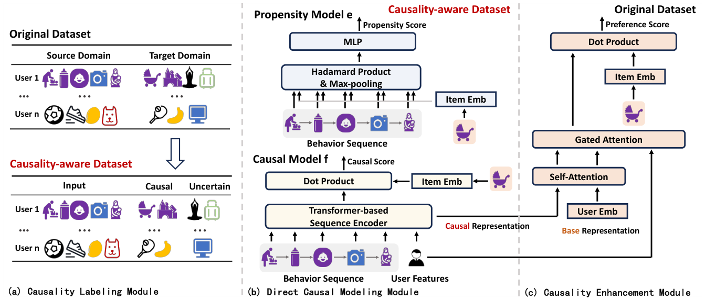
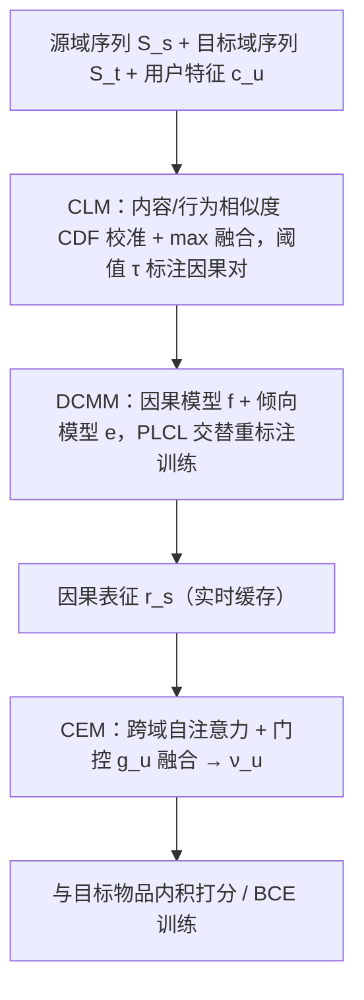

# Causality Enhancement for Cross-Domain Recommendation (跨域推荐的因果增强)

- **会议/期刊**: WWW 2026
- **作者与机构**: Zhibo Wu, Yunfan Wu, Lin Jiang, Ping Yang, Yao Hu（小红书 Xiaohongshu Co., Ltd）
- **推荐链路定位**: 精排（跨域表征融合插件，线上以实时缓存方式服务）
- **研究方向**: 跨域与多场景推荐 / 去偏与可信因果推荐
- **论文原文**: [https://arxiv.org/abs/2510.14641v1](https://arxiv.org/abs/2510.14641v1)
- **开源代码**: 暂未开源

## TL;DR (1分钟核心速览)

跨域推荐的两大痼疾是「源域任务不一致导致负迁移」与「源域行为与目标域偏好间因果稀疏，全量当特征用反而稀释信号」。本文把 CDR 重写为因果图 $L\to S, L\to T$，先用内容/行为双相似度启发式标注因果正样本集$\mathcal{D}^+$，再用带倾向分校正的 **Partial Label Causal Loss** 训练因果模型$f$，得到跨域因果表征经门控注意力注入目标模型。在 Douban/Amazon/小红书工业集上 Leave-One-Out 全库排序，HR@15 较最强基线 TrineCDR 提升 3.1%–9.5%，工业集 HR@150 提升 5.2%–10.0%，并已上线 15.8ms 无损延迟。

## Background & Motivation (背景与核心矛盾)

- **主流范式**: 一类是多任务学习（CoNet/MAN/DiCUR）共享参数或用户表征，建模 $L\to S$与$L\to T$；另一类把源域行为当额外特征（MiNet/TrineCDR），用注意力或图网络聚合，建模$(L,S)\to T$。
- **前人局限**: 其一，共享参数在两个域行为分布差异大时引发**负迁移**；其二，源域行为与目标域偏好之间的**因果稀疏**被忽略——用户目标域兴趣未必由源域行为引起，把全部源域序列喂进模型只会淹没真实因果信号。
- **核心洞察 (Key Insight)**: 若能把跨域迁移的中间变量 $I$ 显式学到，就不必让模型自己从共现中猜因果；难处是真实因果标签在工业场景不可得，只能拿到**启发式标注的部分标签**，因此需要一套对标注偏差理论无偏的学习目标。
- **本文切入点**: 数据侧用「相似-因果对齐」心理学假设构造因果感知数据集，模型侧用倾向分校正的部分标签损失泛化到标注之外的未见因果模式，最后以插件形式融合进目标域模型。

<figure class="paper-figure" markdown="span">
  <figcaption>图2：CE-CDR的整体架构。(a) CLM：构建因果感知的源域-目标域行为对；(b) DCMM：学习源域行为如何影响目标域偏好；(c) CEM：增强目标模型以进行全面的用户偏好建模。</figcaption>
</figure>

## Method (核心方法设计)

### 1. 整体框架 (Overall Architecture)

输入是用户 $u$的源域行为序列$S^u_s$、目标域序列$S^u_t$与用户画像特征$c_u$。CLM 先在内容/行为双空间量化「源域行为→目标域物品」的相似度，阈值筛出因果行为对构成$\mathcal{D}^+$及其补集$\mathcal{D}$；DCMM 以 SASRec 为骨干、并行一个倾向分模型$e$，在$\mathcal{D}$上交替优化修正标签$h$、因果模型$f$与$e$，产出因果表征$r^u_s$；CEM 将$r^u_s$与目标域基线表征$r^u_t$做两元素自注意力再用用户特征门控加权，得$\nu_u$与目标物品内积打分，BCE 训练。上线时$r^u_s$ 预计算入实时缓存。

### 2. 关键设计拆解 (Key Designs)

1. **CLM 相似度驱动因果标注（把心理学假设变成可算的标签）**：无标签可用 $\to$内容相似度由跨域共享类目分类任务学到的嵌入给出，行为相似度由图编码器在全局交互图上得到，两者量纲不可比，故先用经验 CDF 校准到同分布再取 max：$sim(i_s,i_t)=\max\{F_c(sim_c),F_b(sim_b)\}$，序列级取$\max_j$，得$\mathcal{D}^+=\{(u,S^u_s,i_t)\mid sim(S_s,i_t)>\tau, i_t\in S^u_t\}$。直觉是认知一致性/选择性暴露——看过露营笔记才去刷露营教程，高相似是因果的**充分非必要**代理。

2. **PLCL 部分标签因果损失（把「相似≠因果」写成可优化的重标注）**：直接拿 $\mathcal{D}^+$当真标签会把低相似但真实因果的对误标为负，且让$f$学到的是标注策略而非因果。作者引入倾向分$e(x)=p(x\in\mathcal{D}^+\mid x\in\mathcal{C})$，在$s\perp\!\!\!\perp y\mid x$下推出无偏修正标签$h(x)=\mathrm{sg}\big[s+(1-s)\frac{f(x)(1-e(x))}{1-f(x)e(x)}\big]$，代入加权 BCE 即得无偏估计；同时$e$用 max-pooling + MLP 只拟合「相似度筛选机制」（容量受限，否则无法区分低倾向与低因果），并以$h$为权重训练$L_e$。stop-gradient 保证$h$只作标签不回传，$f$与$e$ 互补解耦。

3. **CEM 门控融合与训练/推理开销**：把 $[r^u_s,r^u_t]$视为长度 2 的序列做自注意力得$p^u_s,p^u_t$，再用用户冷启动/活跃度等一致性特征算$g_u=\sigma(\mathrm{LeakyReLU}(c_uW_{g,1}+b_{g,1})W_{g,2}+b_{g,2})$，融合$\nu_u=g_u\odot p^u_s+(1-g_u)\odot p^u_t$，最终$L_{rec}$为对目标域全物品的 BCE（正样本用$h$修正、未交互物品置$h=0$）。负采样采用目标域未交互全集而非随机采样；推理侧$r^u_s$ 走冻结稠密参数 + 实时缓存，线上延迟与基线持平。

## Experimental Setup & Evaluation Protocol (实验设置与评估协议)

| 数据集 | #Users | #Items | #Interactions | 稀疏度/密度 | 特征/场景说明 |
| :--- | :---: | :---: | :---: | :---: | :--- |
| Douban (Book / Music) | 2,212 / 1,820（共享 1,736） | 95,872 / 79,878 | 227,251 / 179,847 | 密度约 $10^{-4}$ | 书评-音乐跨域，公开基准 |
| Amazon (Movies / CDs) | 123,960 / 112,395（共享 18,547） | 50,052 / 73,713 | 1,697,533 / 1,443,755 | 密度约 $10^{-4}$ | 评论跨类目，共享用户仅 15% |
| Industry (Note / Video) | 188,668,764 / 186,822,365（共享 167,766,638） | 65,732,897 / 35,344,556 | 20,479,556,858 / 9,467,087,108 | 极稀疏、超大规模 | 小红书笔记-视频双域真实日志 |

- **数据划分与防穿越**: `Leave-One-Out`，每个用户最新一次交互留作测试项，其余作训练；源域/目标域角色互换各跑一次，仅报目标域结果。
- **排名评测协议**: 无偏 `Full-Ranking`（目标域全库未交互物品排序，工业集候选约 3000 万），未使用采样排序；指标 HR@K 与 NDCG@K，$K=15$（Douban/Amazon）、$K=150$（Industry）。
- **对比基线与超参**: 多任务类 Base/CoNet/MAN/DiCUR，特征类 MiNet/TrineCDR，并额外报告各基线的 `+CE` 插件版；Adam 默认参数，$d=32$（Douban/Amazon）、$d=64$（Industry），$\tau=0.9$（Douban/Amazon）、$\tau=0.85$（Industry）。原文未报显著性检验$p$ 值，线上 A/B 声称 95% 置信。

## Key Experimental Results (实验关键数据)

### 1. 主实验对比 (Main Results)

| 方法 | Douban-Book HR@15 / NDCG@15 | Amazon-Movies HR@15 / NDCG@15 | Industry-Note HR@150 / NDCG@150 | Industry-Video HR@150 / NDCG@150 |
| :--- | :---: | :---: | :---: | :---: |
| Base Model | 0.3052 / 0.2303 | 0.4959 / 0.3084 | 0.1848 / 0.0633 | 0.2238 / 0.0659 |
| CoNet | 0.3961 / 0.3082 | 0.5437 / 0.3459 | 0.2265 / 0.0811 | 0.2807 / 0.0712 |
| MAN | 0.4359 / 0.3433 | 0.5879 / 0.3822 | 0.2348 / 0.0821 | 0.3045 / 0.0804 |
| DiCUR | 0.4475 / 0.3430 | 0.6337 / 0.4147 | 0.2446 / 0.0843 | 0.3310 / 0.0851 |
| MiNet | 0.4166 / 0.3209 | 0.5692 / 0.3666 | 0.2373 / 0.0866 | 0.3025 / 0.0846 |
| TrineCDR | 0.4586 / 0.3436 | 0.6508 / 0.4270 | 0.2484 / 0.0856 | 0.3466 / 0.0890 |
| **CE-CDR** | **0.5023 / 0.3711** | **0.6712 / 0.4498** | **0.2733 / 0.0933** | **0.3645 / 0.0992** |
| DiCUR+CE (插件) | 0.5136 / 0.3784 | **0.6810 / 0.4592** | **0.2837 / 0.0987** | **0.3780 / 0.1025** |
| **Improv.% (vs 最强基线)** | +9.53% / +8.00% | +3.13% / +5.34% | +10.02% / +9.00% | +5.16% / +11.46% |

### 2. 消融实验 (Ablation Study)

| 变体 | Douban-Book HR@15 / NDCG@15 | Industry-Note HR@150 / NDCG@150 | Industry-Video HR@150 / NDCG@150 |
| :--- | :---: | :---: | :---: |
| w/o CLM（目标域交互全视为因果正） | 0.4357 / 0.3249 | 0.2354 / 0.0831 | 0.3193 / 0.0857 |
| w/o Cas（$\mathcal{D}^+$ 当真实因果集，去 PLCL） | 0.4412 / 0.3321 | 0.2336 / 0.0822 | 0.3212 / 0.0849 |
| w/o Att（去跨域自注意力） | 0.4849 / 0.3654 | 0.2631 / 0.0902 | 0.3518 / 0.0958 |
| w/o Gate（门控换拼接） | 0.4702 / 0.3561 | 0.2536 / 0.0866 | 0.3382 / 0.0920 |
| w/-Cache（去实时缓存，仅性能对照） | 0.4991 / 0.3692 | 0.2722 / 0.0923 | 0.3634 / 0.0983 |
| CE-CDR 完整版 | **0.5023 / 0.3711** | **0.2733 / 0.0933** | **0.3645 / 0.0992** |

### 3. 关键实验发现 (Key Findings)

1. **提升并不来自「只选相似样本」，而来自重标注校正**：w/o CLM 与 w/o Cas 在 Industry-Video 上几乎同等崩塌（0.3193 / 0.3212 vs. 0.3645，约 −12%），说明把目标域交互全当正样本或把 $\mathcal{D}^+$ 当真标签都无法获益，真正的增益由 PLCL 的无偏修正提供；而 CLM+PLCL 组合的排序收益与数据构造质量共同决定。
2. **跨域重叠度决定收益上限**：Douban-Book（共享用户 78%）与 Industry-Note（共享 90%）的 HR 提升达 +9.5% / +10.0%，而 Amazon-Movies 共享用户仅 15%，提升收缩到 +3.1%，表明因果对数量受跨域共现约束，冷启动严重的跨域对需另加先验。
3. **插件与负迁移的边界清晰**：DiCUR+CE 在 Industry-Note 达 0.2837（较 DiCUR +16.0%），MAN+CE/TrineCDR+CE 分别提升 +2.7% / +2.1%；但 CoNet+CE（0.2660）反而低于原生 CE-CDR（0.2733），多任务共享参数与因果表征存在冲突；同时 w/o-Gate 跌幅（0.3382）大于 w/o-Att（0.3518），说明自适应门控比跨域交互本身更关键。线上两周 A/B：Video 场景 Click +0.33%、CTR +0.37%，Note 场景 CTR +0.43%、次日活跃 +0.07%，推理延迟维持 15.8ms。

## Highlights & Limitations (亮点、对比与审稿批判)

- **与代表作对比 (vs. Prior Work)**: 与 CoNet/DiCUR 的「共享/映射即迁移」相比，本文显式区分因果与非因果迁移并在损失层校正标注偏差；与 TrineCDR 的「全量源域行为当特征 + 对比学习」相比，本文证明不加区分的源域特征会稀释贡献，Citation-free 的相似度标注 + 倾向分重加权是更轻量的替代。
- **可迁移亮点**: (1) 「启发式标注集 + 容量受限倾向模型 + stop-gradient 重标注」这一范式可迁移到任意有偏代理标签场景（以停留时长标注兴趣、以相似内容归因点击）；(2) CDF 校准 + max 融合解决多源相似度尺度不可比的工程技巧，可直接用于多模态或多路召回融合。
- **审稿级局限批判**: (1) 核心假设「相似 ⇒ 因果」是强先验，探索型/兴趣漂移用户被系统性低估，且 $\tau$ 需逐数据集调（0.85–0.9 最优，0.65 以下噪声显著）；(2) 仅报 LOO + HR/NDCG 与全库排序，无采样排序对照与离线显著性检验，工业集上 3000 万候选的 NDCG 绝对值极低（≈0.09），绝对收益的可解释性有限。

## Rating (四维评分)

- **方法创新性 (Novelty)**: ⭐⭐⭐⭐ （首次在数据与模型两侧同时显式建模跨域因果，PLCL 的无偏性有命题与证明支撑，而非仅拼模块）
- **评估协议与实验扎实度 (Protocol & Experiments)**: ⭐⭐⭐⭐ （三个数据集含十亿级工业集、LOO 全库排序、六个基线并额外给插件版，消融完整；扣分在缺显著性检验与采样排序对照）
- **写作与数学规范度 (Clarity & Rigor)**: ⭐⭐⭐⭐ （因果图重述、两命题推导清晰，倾向模型容量约束的必要性有讨论；骨干与标注细节对复现仍略欠）
- **工业落地与复现价值 (Industrial & Practical Value)**: ⭐⭐⭐⭐⭐ （模型无关插件、冻结稠密参数 + 实时缓存使线上零延迟增量，已上线半年并有 A/B 数据，工程叙事完整）

