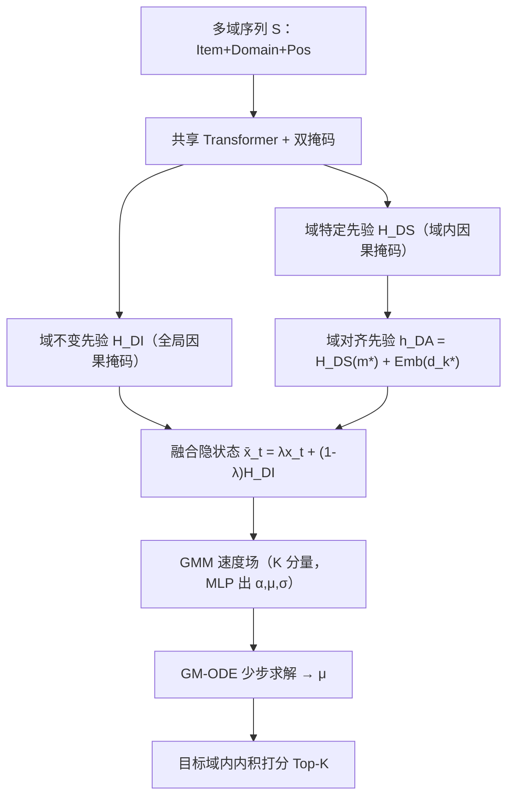
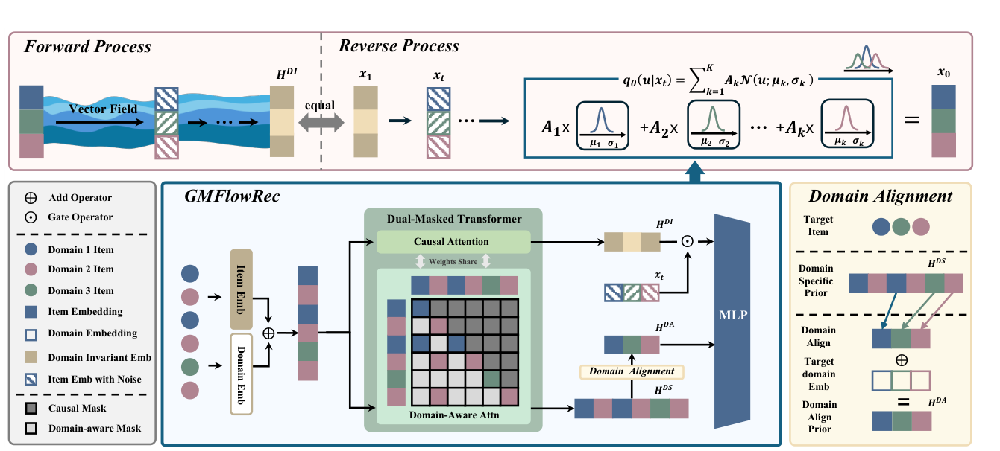

# Gaussian Mixture Flow Matching with Domain Alignment for Multi-Domain Sequential Recommendation (域对齐高斯混合流匹配的多域序列推荐)

- **会议/期刊**: WWW 2026
- **作者与机构**: Xiaoxin Ye, Chengkai Huang, Hongtao Huang, Lina Yao（UNSW / Macquarie University / CSIRO's Data61）
- **推荐链路定位**: 精排 / 端到端生成式序列推荐
- **研究方向**: 跨域与多场景推荐 / 生成式推荐
- **论文原文**: [https://arxiv.org/abs/2510.21021v1](https://arxiv.org/abs/2510.21021v1)
- **开源代码**: [https://github.com/rucliujn/JDsearch](https://github.com/rucliujn/JDsearch)（JD 数据集与流程脚本）

## TL;DR (1分钟核心速览)

从 CDSR（双域）扩到 MDSR（≥3 域）后，域转移路径数随域数平方增长，产生「转移冷启动」；同时域异构/域不均衡让多编码器方案不可扩展、单峰高斯扩散先验又无法表达多峰意图。本文提出 GMFlowRec：用**双掩码共享 Transformer** 一次前向解耦域不变与域特定意图，构造**域对齐先验** $h^{\mathrm{DA}}$，再以**高斯混合流匹配**（GMM 速度场替代 Transformer 去噪器）生成域感知轨迹。在 JD/Amazon 五域、Leave-One-Out + 1:999 采样排序协议下，40 个指标-域组合全部第一，NDCG@5 最高相对提升 44.37%，且训练每轮耗时低于多数基线。

## Background & Motivation (背景与核心矛盾)

- **主流范式**: 单域序列模型（SASRec）与 CDSR 模型（C2DSR、DREAM）依靠域间注意力/对比学习迁移知识；MDSR 侧 AutoCDSR、CGRec、SyNCRec 主要解决「负迁移」，普遍为每域配一个 Transformer。
- **前人局限**: ① 域数增长使转移空间 $O(D^2)$ 膨胀，多数跨域对样本极少（转移冷启动），AutoCDSR 仅把转移线索塞进注意力，无法路由稀疏转移知识；② 多编码器方案参数与域数线性/平方增长，且对稠密域过拟合、稀疏域欠拟合。
- **核心洞察 (Key Insight)**: 作者在 JD 上统计发现，序列内含 2 域时 NDCG@10 约 20%，5 域时骤降到 60% 以下的相对水平，域转移率与性能强负相关（图 1）；且现有扩散/流模型（DiffuRec、FMRec、DMCDR）统一采用**单峰高斯先验**，隐含「用户偏好单一连续模态」假设，与多域共存的域敏感兴趣相冲突。
- **本文切入点**: 把「域不变 + 域特定」双意图作为条件先验，用**多分量 GMM 速度场**建模多峰转移，并用单骨干换取 $O(1)$ 的域扩展性。

<figure class="paper-figure" markdown="span">
  ![图1：SASRec\[16\]在JD多域数据集上的性能。柱状图报告按用户序列中域的数量分组后各域的NDCG@10。折线图表示域转移率，说明随着域数量增加，跨域交互复杂度不断上升。](../../../../assets/papers/2510.21021v1/figure_1.png)<figcaption>图1：SASRec[16]在JD多域数据集上的性能。柱状图报告按用户序列中域的数量分组后各域的NDCG@10。折线图表示域转移率，说明随着域数量增加，跨域交互复杂度不断上升。</figcaption>
</figure>

## Method (核心方法设计)

### 1. 整体框架 (Overall Architecture)

输入为按时间戳聚合的多域序列 $S=[i_1,\dots,i_M]$，每项表征$x_m=\mathrm{Emb}(i_m)+D(d_m)+\mathrm{Pos}(m)$。同一个 Transformer 编码器在**两套互补注意力掩码**下各前向一次，得到域不变先验$H^{\mathrm{DI}}$与域特定先验$H^{\mathrm{DS}}$；后者与目标域嵌入相加得到域对齐先验$h^{\mathrm{DA}}_{d_k}$。训练时以目标物品嵌入为源点$x_0$、域不变用户态为终点$x_1$构造线性插值轨迹，用 MLP 输出$K$分量高斯的参数，将速度场建模为混合分布；推理时用一阶 GM-ODE 求解器少步解析出速度均值$\mu$，在目标域词表内做内积 Top-K。三支损失（推荐、先验、GMM）联合端到端优化。

<figure class="paper-figure" markdown="span">
  <figcaption>图2：GMFlowRec集成Dual-Masked Transformer，将多域用户序列编码为域不变先验和域特定先验。这通过两种互补注意力掩码实现：域不变掩码捕获跨域全局用户偏好，域特定掩码保留域内意图。Domain Alignment操作进一步将域特定先验细化为域对齐先验，用于指导由Gaussian Mixture Flow Matching建模的逆向生成过程。</figcaption>
</figure>

### 2. 关键设计拆解 (Key Designs)

1. **双掩码意图解耦（Dual-Masked Encoder）**：为在不增加编码器数量的前提下同时拿到全局偏好与域内偏好，对同一序列施加两种因果掩码：$M^{\mathrm{DI}}_{m,n}=\mathbb{I}[n\le m]$允许跨域全历史可见，$M^{\mathrm{DS}}_{m,n}=\mathbb{I}[d_m=d_n \wedge n\le m]$只保留同域前序。两路共享权重，参数量与域数$D$解耦，复杂度从多编码器的$O(D)$（CGRec/DSL 还叠加$O(D^2)$博弈或适配器）降为$O(1)$，这是可扩展到多域的关键。
2. **域对齐先验（Domain-Aligned Prior）**：域转移后 $H^{\mathrm{DS}}$时间上最新但语义可能错位（健康品→跑鞋）。取目标域内最近一次交互位置$m^*$，融合目标域嵌入作为生成起点：$h^{\mathrm{DA}}_{d_k}=H^{\mathrm{DS}}_{m^*}+\mathrm{Emb}(d_{k^*})$；若无域内历史则退化为$\mathrm{Emb}(d_{k^*})$，天然覆盖域冷启动。该先验经域内 softmax 做下一项预测监督$\ell^{\mathrm{Prior}}$，把生成过程锚定到目标域语义空间。
3. **高斯混合流匹配与训练目标**：融合隐状态 $\bar{x}_t=\lambda x_t+(1-\lambda)H^{\mathrm{DI}}_M$抑制早期嵌入坍缩；再由 MLP 输出混合参数$\{\alpha_k,\mu_k,\sigma_k\}_{k=1}^{K}=\mathrm{MLP}([\bar{x}_t\|h^{\mathrm{DA}}_{d_k}])$，速度分布$q_\theta(\mu|x_t,h^{\mathrm{DA}})=\sum_k A_k\mathcal{N}(\mu;\mu_k,\sigma_k^2 I)$，取均值$\mu=\sum_k A_k\mu_k$作为确定性速度供 ODE 求解。总损失$\mathcal{L}=\sum_{d_k\in\mathcal{D}}\big(\ell^{\mathrm{Rec}}_{d_k}+\alpha\ell^{\mathrm{Prior}}_{d_k}+\beta\ell^{\mathrm{GMM}}_{d_k}\big)$，其中$\ell^{\mathrm{GMM}}=-\log q_\theta(\mu|x_t,h^{\mathrm{DA}}_{d_k},t)$。**免负采样**（域内 softmax + 采样评测），推理仅需少步 GM-ODE，避免 Transformer 去噪器的迭代开销。

## Experimental Setup & Evaluation Protocol (实验设置与评估协议)

- **数据集与预处理**: 均含 5 个域；用户保留 ≥10 次交互、物品保留 ≥15 次交互，序列截断至 50。Amazon 采用公开 5-core 版本，JD 来自电商检索日志。

| 数据集 | 域构成 | 过滤规则 | 序列长度 | 说明 |
| :--- | :--- | :--- | :---: | :--- |
| JD | 5 域（D1–D5） | 用户 ≥10、物品 ≥15 | ≤50 | 高转移率、域不均衡显著，统计见原文 Table 3 |
| Amazon | Health / Clothing / Beauty / Grocery / Sports | 同上（5-core） | ≤50 | 域间语义差异大、稀疏度高 |

- **数据划分与防穿越**: `Leave-One-Out`——每用户最后一条测试、倒数第二条验证，严格按时间序，无未来信息泄漏。
- **排名评测协议**: `Sampled Ranking`，每个测试用例 = 1 正样本 + 同域随机 999 负样本，在 1000 项列表中排序，报告 H@5/H@10、N@5/N@10；转移率、域数、少样本与效率分析统一用跨域平均的 Group NDCG@10。
- **对比基线与超参**: 三类基线——单域（SASRec、DiffuRec、FMRec）、CDSR 改造（C2DSR$_m$、DREAM$_m$）、MDSR（Auto++、DSL、CGRec、SyNC）。嵌入维度$d=64$，Adam，学习率$1\times10^{-4}$，batch 256，100 epoch 早停；五次不同随机种子取均值±标准差，提升在$p<0.01$ 下显著。

## Key Experimental Results (实验关键数据)

### 1. 主实验对比 (Main Results)

NDCG@10（JD 取 D1/D2/D5，Amazon 取 Health/Sports；最优加粗）：

| 模型 | JD-D1 | JD-D2 | JD-D5 | AMZ-Health | AMZ-Sports |
| :--- | :---: | :---: | :---: | :---: | :---: |
| SASRec | 25.79 | 22.15 | 25.13 | 8.54 | 5.85 |
| DiffuRec | 27.74 | 21.85 | 25.31 | 12.70 | 10.15 |
| FMRec | 27.76 | 21.79 | 25.39 | 12.57 | 9.81 |
| DREAM$_m$ | 28.16 | 23.34 | 27.02 | 12.70 | 11.20 |
| C2DSR$_m$ | 29.96 | 22.71 | 29.90 | 13.63 | 11.19 |
| CGRec | 30.78 | 23.61 | 31.05 | 13.51 | 9.48 |
| SyNC | 25.21 | 17.79 | 25.59 | 13.60 | 10.12 |
| **GMFlowRec** | **34.39** | **32.87** | **36.69** | **14.53** | **12.51** |
| Improv.% | +11.73% | +39.24% | +18.16% | +6.60% | +11.73% |

JD-D2 的 N@5 提升达 **+44.37%**（21.35→30.82），为全文最大增益。

### 2. 消融实验 (Ablation Study)

五域平均 NDCG@10（$K=4$）：

| 变体 | JD 平均 | Amazon 平均 | 说明 |
| :--- | :---: | :---: | :--- |
| Flow（FMRec 式单峰流） | 25.67 | 11.91 | 无域先验、单峰高斯 |
| + GMFlow（GMM 速度场） | 26.42 | 12.27 | 仅多峰化，增益有限 |
| v1: + $H^{\mathrm{DA}}$（去$M^{\mathrm{DS}}$） | 32.01 | 12.51 | 域对齐先验贡献最大 |
| v2: + 双掩码（完整先验） | 32.46 | 13.15 | 域特定掩码补足局部意图 |
| **Our: + $\ell^{\mathrm{Prior}}$** | **34.51** | **14.07** | 先验监督进一步对齐 |

### 3. 关键实验发现 (Key Findings)

1. **增益主要来自先验对齐而非生成器本身**：仅换 GMM 速度场（Flow→GMFlow）JD 平均只涨 0.75，但接入 $H^{\mathrm{DA}}$后跳升至 32.01（+5.59）；图 4(a) 中移除$\ell^{\mathrm{Prior}}$的跌幅大于移除$\ell^{\mathrm{GMM}}$，说明「域感知条件」比「多峰建模」更稀缺。
2. **基线越弱的域，收益越大**：JD-D2 上最强基线 CGRec 仅 23.61，本文 32.87（+39.24%），而 Amazon-Health 已接近饱和（13.63→14.53，+6.60%），证明方法针对的是转移复杂度/稀疏性造成的失效而非简单拟合能力。
3. **转移与少样本场景鲁棒性突出**：目标域≠末位物品域（w/ transition）与域内交互 <5 的少样本设定下，SyNC/DSL 掉点明显（SyNC 在 JD 少样本下大幅退化），GMFlowRec 保持领先；$K$ 从 4 增大后性能趋稳，说明少量分量即可覆盖多峰意图，且单骨干使每轮训练时间低于多数高精度基线（图 7）。

## Highlights & Limitations (亮点、对比与审稿批判)

- **与代表作对比**: 相对 AutoCDSR/Auto++ 的单注意力路由，本文用双掩码在**一个**编码器内显式分离不变/特定意图，避免 $O(D)$ 多编码器；相对 DiffuRec/FMRec 的单峰高斯流，本文用 GMM 速度场表达多峰转移且以 MLP 取代 Transformer 去噪器；相对 SyNC 依赖单域/跨域双模型协同，本文对末位域漂移不敏感。
- **可迁移亮点**: ①「同一骨干 + 两种掩码」的意图解耦范式可平移到多场景/多任务推荐（替代 PLE 式多专家）；②用 GMM 解析速度场做少步 ODE 采样，是把扩散类推荐推理成本压下来的通用手段。
- **审稿级局限批判**: ① 评测为 1:999 采样排序，未报告 Full-Ranking 全库指标，负样本同域采样也可能高估绝对水平；② $\ell^{\mathrm{GMM}}$对混合**均值**$\mu$取 NLL 而非对真实速度做回归，与 CFM 的$\|v_\theta-(x_1-x_0)\|^2$目标缺乏严格一致性论证，理论动机偏启发式；③$\lambda$、$\alpha$、$\beta$的敏感度未系统报告，仅给出$K$ 的稳定性；④ 无线上 A/B，JD 数据来自自有检索日志，跨平台泛化性待验证。

## Rating (四维评分)

- **方法创新性 (Novelty)**: ⭐⭐⭐⭐ （首次把 GMM 流匹配与域感知先验结合到 MDSR，双掩码解耦思路干净，但各组件单独看均属已有范式组合）
- **评估协议与实验扎实度 (Protocol & Experiments)**: ⭐⭐⭐⭐ （两套大规模五域数据、9 个基线、五种子±标准差与 $p<0.01$ 显著性、转移/少样本/效率多维分析齐全，可惜仅采样排序）
- **写作与数学规范度 (Clarity & Rigor)**: ⭐⭐⭐ （结构清晰、符号统一，但 $\ell^{\mathrm{GMM}}$ 与流匹配目标的推导略跳跃，部分实验图与正文表编号不一致）
- **工业落地与复现价值 (Industrial & Practical Value)**: ⭐⭐⭐⭐ （单骨干 $O(1)$ 域扩展 + 少步 ODE 推理，代码与 JD 数据已开源，工程可落地性强）

