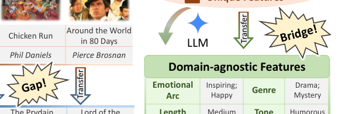
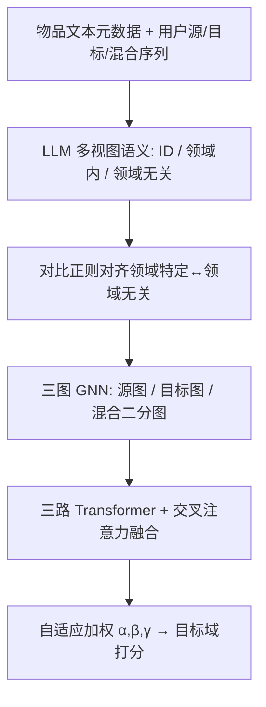
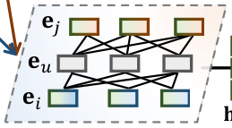

# SemaCDR: LLM-Powered Transferable Semantics for Cross-Domain Sequential Recommendation (LLM 驱动的可迁移语义跨域序列推荐)

- **会议/期刊**: WWW 2026 (The ACM Web Conference)
- **作者与机构**: Chunxu Zhang, Shanqiang Huang, Zijian Zhang, Linsong Yu, Ruiqi Wan, Bo Yang (吉林大学)；Jiahong Liu, Irwin King (香港中文大学)
- **推荐链路定位**: 召回（目标域 next-item 打分）
- **研究方向**: 跨域与多场景推荐 / 大语言模型推荐
- **论文原文**: [https://arxiv.org/abs/2604.09551v1](https://arxiv.org/abs/2604.09551v1)
- **开源代码**: [https://github.com/huangshanqiang/SemaCDR](https://github.com/huangshanqiang/SemaCDR)

## TL;DR (1分钟核心速览)

跨域序列推荐（CDSR）长期依赖领域特有特征（电影片名、图书品牌），源域知识难以在语义层迁移，形成"特征可对齐、语义不可迁移"的瓶颈。SemaCDR 用 LLM 以统一 prompt 体系为物品批量生成 **领域无关语义类别**（Genre、Target Audience 等），与 ID、领域内 LLM 描述构成三视图表征，用对比正则把领域特定视图锚定到领域无关语义的邻近结构上，再经三张图（源/目标/混合二分图）+ Transformer + 跨注意力融合与自适应加权输出目标域打分。评估采用 Amazon 三对双向域、每测试样本 100 负采样的 Sampled Ranking 协议，六个方向 HR@10/NDCG@10 全面最优，最大相对提升 +14.7% (CD→Movie HR@10) 与 +19.1% (Food→Kitchen NDCG@5)。

## Background & Motivation (背景与核心矛盾)

- **主流范式**: CDR 分为 mapping-based（学习源→目标表征映射，如 π-Net）、fusion-based（共享因子分解/图结构联合建模，如 C2DSR、MGCL、Tri-CDR）与最新的 LLM-based（LLM 当特征编码器或直接当推荐器）。
- **前人局限**: 其一，迁移对象是 **领域特有特征或 ID**，电影片名与书名之间不存在可比的语义坐标，跨域对齐只能在数值空间强行拉近，负迁移风险高；其二，单域序列模型（SASRec/CL4SRec）与图融合模型即便引入 item-item 图，也仍未显式区分"该保留的领域个性"与"该共享的跨域共性"。
- **核心洞察 (Key Insight)**: 真正可迁移的不是物品身份，而是 **高层语义属性**——"Emotional Arc / Tone / Length / Genre"这类 LLM 可稳定生成的抽象标签在电影与图书间天然共享，可作为源目标之间的"语义桥"。作者用 t-SNE 验证：加入领域无关语义后，源域与目标域物品表征重叠显著增加（图 3）。
- **本文切入点**: 不做源→目标的显式映射，而是把两个域投影进 **LLM 构造的统一语义空间**，让迁移发生在语义层而非特征层。

<figure class="paper-figure" markdown="span">
  <figcaption>图1：现有CDR方法与本文提出的SemaCDR在跨域知识迁移方面的对比。</figcaption>
</figure>

## Method (核心方法设计)

### 1. 整体框架 (Overall Architecture)

输入是用户的源域序列 $\mathcal{S}^S_u$、目标域序列$\mathcal{S}^T_u$与按时间戳归并的混合序列$\mathcal{S}^{mix}_u$，以及物品的原始文本元数据。多视图语义学习模块先用 LLM 生成领域内描述与领域无关语义类别，得到三种嵌入并做对比对齐；图协同学习模块在源 item 图、目标 item 图与跨域 user-item 二分图上传播，产出图增强物品/用户表征；跨域行为融合模块用三个 Transformer 分别编码三条序列，再用交叉注意力把源域信息注入目标序列；自适应融合预测模块对融合序列、混合域序列与用户表征做可学习加权，与目标物品 ID 嵌入做内积/MLP 打分，以 BPR + 对比正则联合训练。

<figure class="paper-figure" markdown="span">
  <figcaption>图2：SemaCDR用于跨域序列推荐的概览。多视图语义学习模块构建并对齐领域特定与领域无关的物品嵌入，这些嵌入输入跨域行为融合模块以编码序列用户交互。自适应融合预测模块随后将这些嵌入与混合领域表示和用户表示整合，以生成统一偏好预测，从而桥接跨域知识。</figcaption>
</figure>

### 2. 关键设计拆解 (Key Designs)

1. **LLM 领域无关语义码本与三视图拼接**：痛点是把"电影=某片名"这种身份信息当迁移载体，跨域不可比。本文用固定 prompt 模板让 LLM 为每个物品输出 $K$个高层类别下的若干子类，物品$m$的领域无关嵌入为子类嵌入的池化聚合$\mathbf{e}^{agn}_m=\bigoplus_{k=1}^{K}\bigoplus_{v\in\mathcal{V}_m(c_k)}\mathbf{e}(v)$；最终节点初始化为$\mathbf{e}_m=\mathbf{e}^{ID}_m\oplus\mathbf{e}^{inn}_m\oplus\mathbf{e}^{agn}_m$。直觉：ID 保个性、$inn$保领域内语义、$agn$ 提供跨域公共坐标系，三者正交互补，故消融中同时去掉两者跌幅最大。

2. **跨视图对比正则（把语义结构当"老师"）**：仅拼接并不能保证领域特定嵌入尊重跨域语义邻近关系。作者以领域无关视图为 anchor，对 $(\mathbf{e}^{ID},\mathbf{e}^{agn})$与$(\mathbf{e}^{inn},\mathbf{e}^{agn})$两组视图对在源、目标域内分别施加 InfoNCE 式损失$\mathcal{L}_c=-\sum_{i}\log\frac{\exp(\mathrm{sim}(\mathbf{e}^{q}_i,\mathbf{e}^{k}_i)/\tau)}{\sum_{i'}\exp(\mathrm{sim}(\mathbf{e}^{q}_i,\mathbf{e}^{k}_{i'})/\tau)}$。作用机理是约束 **物品间相对关系**（谁和谁更像）而非绝对坐标，使 ID 空间被语义空间"结构化"，从而目标域物品能落进源域语义邻域。

3. **跨域序列融合与自适应加权、训练目标**：三路 Transformer 编码后，用 $\mathbf{z}^{fuse}_u=\mathrm{CrossAttn}(Q=\mathbf{z}^T_u,K=\mathbf{z}^S_u,V=\mathbf{z}^S_u)$让目标序列按自身需求检索源域行为；最终$\mathbf{z}^{final}_u=\alpha\mathbf{z}^{fuse}_u+\beta\mathbf{z}^{mix}_u+\gamma\mathbf{h}^{mix}_u$，$\alpha,\beta,\gamma$可学习（替代平均池化），预测$\hat{y}_{u,i}=\phi(\mathbf{z}^{final}_u,\mathbf{e}^{ID}_i)$。总损失$\mathcal{L}=\mathcal{L}_{rec}+\lambda(\mathcal{L}^1_c+\mathcal{L}^2_c)$，$\mathcal{L}_{rec}$ 为标准 BPR，负样本为训练集内随机负采样；推理时只需前向序列编码 + 内积，LLM 仅在离线构图阶段调用一次，在线无额外大模型开销。

## Experimental Setup & Evaluation Protocol (实验设置与评估协议)

- **数据集与预处理**: Amazon Review 三个双向跨域场景，均按 CDR 常规做 5-core 类过滤，用户集跨域共享；详细统计见原文附录 B。

| 数据集(域对) | 领域组合 | 方向 | 稀疏/场景说明 |
| :--- | :---: | :---: | :--- |
| Kitchen–Food | Home_and_Kitchen ↔ Grocery_and_Gourmet_Food | 双向 | 高相关域，共享"厨房/食材"语义 |
| Movie–Book | Movies_and_TV ↔ Books | 双向 | 中等相关，共享叙事/题材语义 |
| CD–Movie | CDs_and_Vinyl ↔ Movies_and_TV | 双向 | 弱相关，检验负迁移鲁棒性 |

- **数据划分与防穿越 (Splitting Strategy)**: 沿用 C2DSR/Tri-CDR 设定的 `Leave-One-Out` 式序列切分（每用户最后一项作测试、倒数第二项作验证），源/目标域序列各自按时间戳保序，混合序列按跨域时间戳归并。
- **排名评测协议 (Ranking Protocol)**: `Sampled Ranking`——每个测试正样本随机采 100 个负样本参与排序，报告 HR@{5,10} 与 NDCG@{5,10}，五次独立运行取均值并给出标准差。
- **对比基线与超参设置**: 单域基线 SASRec、CL4SRec；跨域基线 π-Net、C2DSR、MGCL、CD-SASRec、Tri-CDR、TJAPL。统一隐层维度 $d=64$、batch 256、dropout 0.5、最大序列长度 100；最优超参$K=8$（语义类别数）、$\lambda=0.1$，语义相关模块学习率$3e^{-4}$、其余$1e^{-3}$；RTX 3090 单卡训练。

## Key Experimental Results (实验关键数据)

### 1. 主实验对比 (Main Results)

| 方法 | Kitchen→Food N@5 | HR@10 | Food→Kitchen N@5 | HR@10 | Book→Movie N@5 | HR@10 | Movie→Book N@5 | HR@10 | CD→Movie N@5 | HR@10 | Movie→CD N@5 | HR@10 |
| :--- | :---: | :---: | :---: | :---: | :---: | :---: | :---: | :---: | :---: | :---: | :---: | :---: |
| SASRec | 0.1754 | 0.3248 | 0.1099 | 0.2369 | 0.2246 | 0.4356 | 0.1989 | 0.3864 | 0.1631 | 0.3292 | 0.1795 | 0.3584 |
| CL4SRec | 0.1885 | 0.3879 | 0.1176 | 0.2741 | 0.2724 | 0.4909 | 0.2442 | 0.4912 | 0.1915 | 0.4224 | 0.2243 | 0.4721 |
| π-Net | 0.1653 | 0.3184 | 0.1649 | 0.3172 | 0.2171 | 0.3918 | 0.2154 | 0.3905 | 0.1434 | 0.2720 | 0.1443 | 0.2758 |
| C2DSR | 0.1739 | 0.3328 | 0.1381 | 0.2871 | 0.2468 | 0.4469 | 0.1748 | 0.3349 | 0.1977 | 0.3620 | 0.1808 | 0.3716 |
| MGCL | 0.2191 | 0.4335 | 0.1542 | 0.3389 | 0.2382 | 0.4551 | 0.2387 | 0.3996 | 0.2308 | 0.4703 | 0.2456 | 0.5074 |
| CD-SASRec | 0.2147 | 0.4298 | 0.1139 | 0.2547 | 0.3254 | 0.6004 | 0.3235 | 0.5998 | 0.2306 | 0.4726 | 0.2372 | 0.4651 |
| Tri-CDR | 0.1892 | 0.3926 | 0.1420 | 0.3315 | 0.3258 | 0.5998 | 0.2871 | 0.5488 | 0.2322 | 0.4750 | 0.2434 | 0.5084 |
| TJAPL | 0.2454 | 0.4464 | 0.1719 | 0.3616 | 0.3507 | 0.6090 | 0.3434 | 0.6019 | 0.2747 | 0.5020 | 0.2869 | 0.5287 |
| **SemaCDR** | **0.2736** | **0.4775** | **0.2047** | **0.3806** | **0.3548** | **0.6199** | **0.3607** | **0.6256** | **0.3256** | **0.5760** | **0.3185** | **0.5562** |
| Improv.% | +11.5 | +7.0 | +19.1 | +5.3 | +1.2 | +1.8 | +5.0 | +3.9 | +18.5 | +14.7 | +11.0 | +5.2 |

### 2. 消融实验 (Ablation Study)

| 变体 (Kitchen→Food) | N@5 | N@10 | HR@5 | HR@10 |
| :--- | :---: | :---: | :---: | :---: |
| w/o InnSem | 0.2608 | 0.2993 | 0.3459 | 0.4637 |
| w/o DomAgnSem | 0.2502 | 0.2896 | 0.3392 | 0.4591 |
| w/o Inn+DomAgnSem | 0.2370 | 0.2740 | 0.3258 | 0.4404 |
| SimpGraph（仅单域 item 图） | 0.2698 | 0.3014 | 0.3505 | 0.4721 |
| w/o CDBehav（去跨域序列融合） | 0.2671 | 0.3009 | 0.3469 | 0.4678 |
| AvgFusion（改为均值融合） | 0.2510 | 0.2867 | 0.3373 | 0.4479 |
| w/o ConReg（去对比正则） | 0.2633 | 0.2948 | 0.3510 | 0.4631 |
| **SemaCDR (Full)** | **0.2736** | **0.3105** | **0.3633** | **0.4775** |

### 3. 关键实验发现 (Key Findings)

1. **语义视图是性能主引擎，且两者互补而非冗余**：同时去掉领域内与领域无关语义后 N@5 从 0.2736 掉到 0.2370（-13.4%），单去 $DomAgnSem$已损失 8.6%，说明 LLM 语义不是锦上添花而是把 ID 空间"重排"的结构性信号；二者同时移除的跌幅大于任一单独移除，验证了$\mathbf{e}^{inn}$（个性内容）与$\mathbf{e}^{agn}$（跨域共性）承担不同职能。
2. **融合策略比融合动作本身更关键**：把可学习 $\alpha,\beta,\gamma$ 换成均值池化，N@5 掉到 0.2510（-8.3%），跌幅甚至超过完全移除跨域序列融合（0.2671，-2.4%）——说明源域信号"该以多大权重进来"比"是否进来"更决定上限，跨域负迁移主要由无权融合引入。
3. **弱相关域收益最大，强基线场景收益收敛**：CD→Movie（音乐 vs 电影，语义最远）HR@10 相对提升 +14.7%、N@5 +18.5%，Food→Kitchen N@5 +19.1%；而 Book→Movie 仅 +1.2%，因该场景 CD-SASRec/TJAPL 已达 0.3254/0.3507 高位，增益空间被压缩。兼容性实验进一步佐证增益可叠加：把多视图语义+对比正则插入 C2DSR，Food→Kitchen N@5 +12.8%、Movie→Book HR@10 +19.2%；插入 Tri-CDR 亦有 +1.4%~+4.6% 的稳定正收益。

## Highlights & Limitations (亮点、对比与审稿批判)

- **与代表作对比**: 相对 π-Net 这类映射式方法，本文不再学习域间变换函数，而是构造可共享的语义坐标，避免映射矩阵在弱相关域上的过拟合；相对 C2DSR/MGCL 这类对比式跨域图模型，本文的对比信号来自"领域特定↔领域无关"的视图内一致性而非跨序列互信息，迁移粒度从行为级下沉到物品语义级；相对把 LLM 当推荐器直接微调的路线，本文只把 LLM 当离线语义标注器，在线成本几乎为零。
- **可迁移亮点**: (i) 用固定 prompt 批量生成"领域无关属性码本"并做子类嵌入池化，这一套做法可直接插进任何跨域/多场景模型（论文已验证对 C2DSR、Tri-CDR 通用）；(ii) 以语义视图为 anchor、以 ID 视图为 query 的视图间 InfoNCE 约束，可作为通用正则项约束表征空间的邻域结构。
- **审稿级局限批判**: 其一，语义迁移的能力上界被 LLM 生成类别质量锁死，$K=8$ 与子类划分依赖手工 prompt，跨域对（尤其 CD–Movie 这类抽象属性稀缺品类）可能出现语义标签失配，论文未量化 LLM 标注噪声的影响；其二，评估仅用 100 负采样的 Sampled Ranking，未报告 Full-Ranking 结果，高曝光热门物品的假阳性未被充分暴露，且缺线上 A/B 与冷启动分桶实验，实际业务收益仍待验证。

## Rating (四维评分)

- **方法创新性 (Novelty)**: ⭐⭐⭐⭐ （把"跨域迁移"重构为"统一语义空间构造 + 视图间结构对齐"，思路清晰且区别于常规映射/融合范式，但各组件本身多为已有技术的组合式创新）
- **评估协议与实验扎实度 (Protocol & Experiments)**: ⭐⭐⭐⭐ （六个双向场景 + 8 个 SOTA 基线 + 五种子标准差 + 完整消融与兼容性实验很扎实，扣分在仅 Sampled 100 负采样、缺 Full-Ranking 与冷启动分桶）
- **写作与数学规范度 (Clarity & Rigor)**: ⭐⭐⭐⭐ （公式简洁、模块边界清晰，$\oplus$/$\bigoplus$ 聚合算子与图的边权定义明确；但聚合算子表述过泛，缺乏对 LLM 语义码本构建过程的复杂度分析）
- **工业落地与复现价值 (Industrial & Practical Value)**: ⭐⭐⭐⭐ （代码已开源，LLM 仅离线调用一次、在线为常规 GNN+Transformer 推理，易于接入现有召回链路；主要成本在语义码本的离线生成与三图维护）

