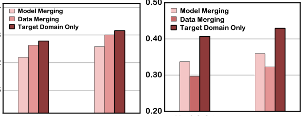
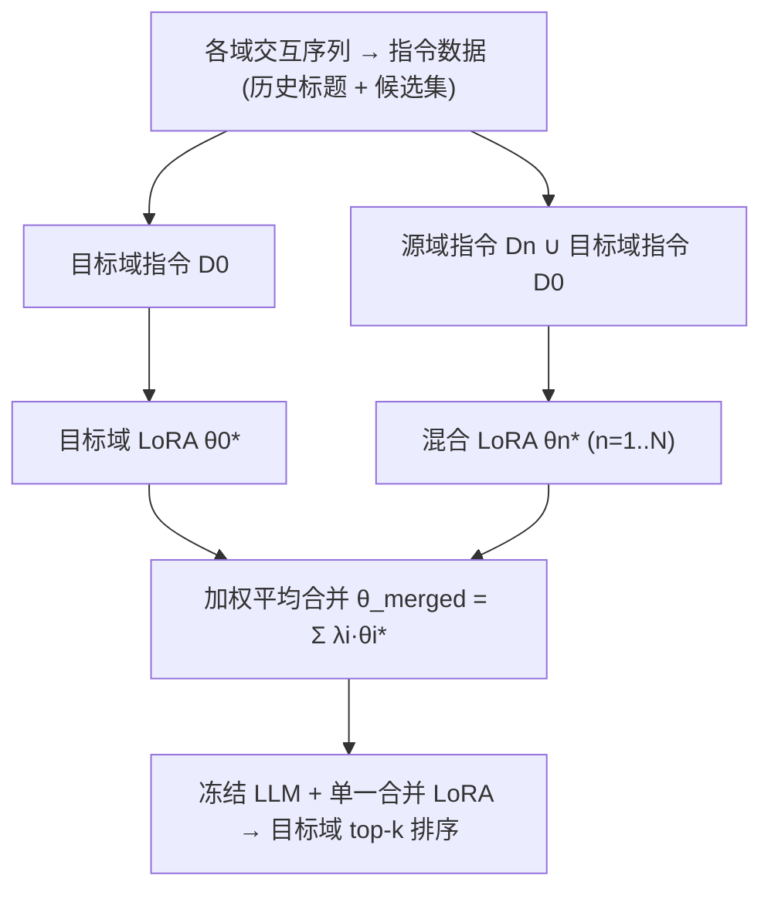
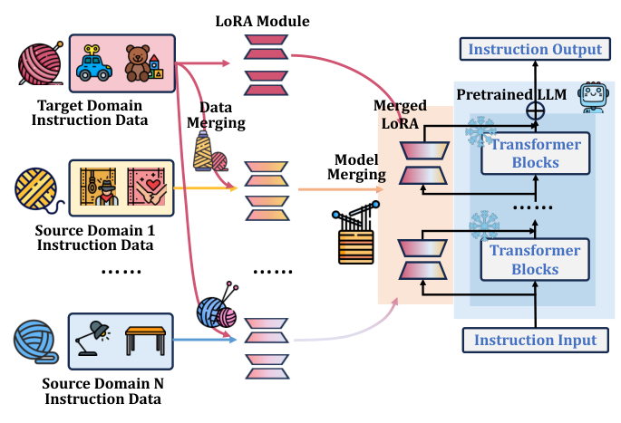

# WeaveRec: An LLM-Based Cross-Domain Sequential Recommendation Framework with Model Merging（WeaveRec：基于模型合并的 LLM 跨域序列推荐框架）

- **会议/期刊**: WWW 2026
- **作者与机构**: Min Hou, Xin Liu, Le Wu*, Chenyi He, Hao Liu（合肥工业大学）, Zhi Li（清华大学深圳国际研究生院）, Xin Li, Si Wei（科大讯飞）
- **推荐链路定位**: 端到端序列推荐（LLM 指令微调 + 参数级融合，无在线重训）
- **研究方向**: 跨域与多场景推荐 / 大语言模型推荐
- **论文原文**: [https://arxiv.org/abs/2510.26546v1](https://arxiv.org/abs/2510.26546v1)
- **开源代码**: [https://anonymous.4open.science/r/WeaveRec-829F](https://anonymous.4open.science/r/WeaveRec-829F)

## TL;DR (1分钟核心速览)

针对跨域序列推荐（CDSR）中「传统方法依赖重叠用户/物品」与「LLM 直接合并多域数据会因梯度冲突而不稳定」两大痛点，本文先用实证指出：**模型合并的性能退化，源自源域模型在目标域上极差**，会把融合结果拖向"谁都不像"的折中解。据此提出 WeaveRec：每个源域都用「源域+目标域」混合指令数据训练一个**混合 LoRA**，再与目标域 LoRA 做权重平均合并。在 Amazon 四域与跨平台 Toys/MovieLens-1M 上（5-core + Leave-One-Out，30 候选采样排序），NDCG@1 相对目标域单模型平均提升约 3%，跨平台最高提升 7.9%，且推理零额外延迟。

## Background & Motivation (背景与核心矛盾)

- **主流范式**: CDSR 分两支——ID 类方法（MCRPL 等）靠重叠用户/物品学映射函数；可迁移类方法（UniSRec/VQ-Rec/RecFormer）靠文本语义空间对齐。LLM 时代则流行"一模型通吃"：把多域数据拼成统一指令集训一个模型（LLM-Rec）。
- **前人局限**: ① 重叠用户/物品假设在真实场景几乎不成立；② 数据合并**不灵活**（增删一个域须全量重训）且存在**数据冲突**（源域交互与目标域偏好矛盾，梯度方向互相拉扯）。
- **核心洞察 (Key Insight)**: 作者在 Sports/Clothing 等配对实验中发现两类反直觉现象：(a) 直接数据合并常常**不如目标域单模型**（如 Beauty 目标域从 0.4071 掉到 0.2965）；(b) 现成的 WA / DARE / Ties-Merging / LoRA-LEGO / AdaMerging 全部无法超越目标域单模型，融合结果总落在"源域模型—目标域模型"连线的中间。损失景观显示目标域模型在山顶、源域模型在山脚，合并自然滑向山腰。
- **本文切入点**: 既然合并结果受制于最差成员，那就**先把源域模型改造成在目标域上也处于山顶的成员**——用混合数据训练，再合并。

<figure class="paper-figure" markdown="span">
  <figcaption>图2：数据合并与模型合并下性能退化的示意图。实验基于四个源域：Amazon Beauty、Sports、Clothing 和 Food，以及两个目标域：Clothing 和 Beauty。</figcaption>
</figure>

## Method (核心方法设计)

### 1. 整体框架 (Overall Architecture)

WeaveRec 分三阶段。**阶段一（数据编织）**：将所有域的交互序列按统一模板转为指令（历史物品标题 + 30 个候选标题 + 任务描述，输出为排序列表），全用 title 表示以保证跨域可迁移性。**阶段二（LoRA 编织训练）**：初始化 LoRA 后分成 $N+1$个分支——分支 0 仅在目标域指令$\mathcal{D}^I_0$上微调得$\theta_0^*$；分支$n$在$\mathcal{D}^I_0\cup\mathcal{D}^I_n$混合数据上微调得$\theta_n^*$。**阶段三（模型合并）**：将$N+1$个 LoRA 按权重$\lambda_i$ 平均为一个 LoRA 装回冻结的 Qwen2-7B，直接在目标域推理。整个流程只需训练多个小 LoRA，可并行/增量，且合并后参数规模等价于单个 LoRA。

<figure class="paper-figure" markdown="span">
  <figcaption>图5：我们提出的 WeaveRec 框架示意图。</figcaption>
</figure>

### 2. 关键设计拆解 (Key Designs)

1. **混合域"编织"训练（Weaving Training）**：痛点在于源域 LoRA 只见过源域分布，在目标域上近乎随机，作为合并成员会把融合解拖垮。本文把每个源域分支的训练目标改为 $\theta_n^{*}=\arg\min_{\theta_n}-\sum_{(\mathbf{x},\mathbf{y})\in\mathcal{D}^I_0\cup\mathcal{D}^I_n}\sum_{t}\log P_{\Theta+\theta_n}(y^t\,|\,\mathbf{y}^{<t},\mathbf{x})$，即**先让源域知识"染上"目标域分布**。直觉上，这等价于把源域模型沿目标域流形做了一次领域自适应，使$d_{\mathcal{H}}(D_M,D_T)$ 显著缩小；实测混合 LoRA 单独在目标域上（如 Sports 0.3698~0.3786）已与目标域 LoRA（0.3708）持平，正是"山顶成员"。

2. **权重平均合并 + 泛化误差上界收敛**：合并算子沿用最朴素的平均 $\boldsymbol{\theta}_{\text{merged}}=\sum_{i=0}^{N}\lambda_i\boldsymbol{\theta}_i^{*}$，其中$\sum_i\lambda_i=1$（$\lambda_i$可调或直接取$\frac{1}{N+1}$），逐层对低秩矩阵做$\mathbf{B}^l_{\text{merged}}=\sum_i\lambda_i\mathbf{B}^l_i$、$\mathbf{A}^l_{\text{merged}}=\sum_i\lambda_i\mathbf{A}^l_i$。理论支撑来自域适应界：$\epsilon_T(h_S)\le\epsilon_S(h_S)+d_{\mathcal{H}}(D_S,D_T)+\lambda^{*}$；由于混合分布$D_M\sim(1+Z)D_T+ZD_S,\ Z\sim\mathrm{Bernoulli}(\frac{\lambda}{1+\lambda})$与$D_T$天然重叠，任何能区分二者的判别函数必须同时拟合两域，故$d_{\mathcal{H}}(D_M,D_T)<d_{\mathcal{H}}(D_S,D_T)$，在收敛模型$\epsilon_S(h_S)\approx\epsilon_M(h_M)$前提下得$\text{Bound}(\epsilon_T(h_M))<\text{Bound}(\epsilon_T(h_S))$——从理论上解释了为何"必须换成员而不能换合并算法"。

3. **训练目标、负采样与推理效率**：各分支损失均为标准指令微调负对数似然（LoRA 只更新 $\mathbf{B}\mathbf{A}$，$\mathbf{h}=\mathbf{W}\mathbf{x}+\mathbf{B}\mathbf{A}\mathbf{x}$），无额外对比/正则项；训练数据采用 1 正 + 29 随机负的候选构造，**无难负采样**。推理端只保留一个合并 LoRA，显存与延迟与单域 LoRA 完全一致；新增源域仅需再训一个混合 LoRA 后重算平均，无需触碰已有分支——这是数据合并范式做不到的增量能力。

## Experimental Setup & Evaluation Protocol (实验设置与评估协议)

- **数据集与预处理**: 全部保留 **5-core**（用户与物品交互数 ≥ 5），跨平台场景额外引入 MovieLens-1M。正文未列出精确统计量（见原文附录 A.2），此处仅列配置：

| 数据集 | 场景类型 | 领域/平台 | 过滤与划分 | 说明 |
| :--- | :---: | :--- | :---: | :--- |
| Amazon Beauty / Sports / Clothing / Food | 跨域（4 目标域轮转） | 同平台电商 | 5-core + Leave-One-Out | 物品用 title 文本表示，四域互为源/目标 |
| Amazon Toys / MovieLens-1M | 跨平台（双向） | 电商 ↔ 电影 | 5-core + Leave-One-Out | 验证异构平台迁移能力 |

- **数据划分与防穿越**: 采用 `Leave-One-Out`——每用户最后一条交互为测试、倒数第二条为验证、其余训练，严格按时间序，无未来信息泄漏。
- **排名评测协议**: `Sampled Ranking`（采样排序），每用户候选集为 1 个真实正样本 + 29 个随机未交互负样本（1:29），指标为 NDCG@1/3/5 与 MRR@5；显著性用配对 t-test，$p<0.05$。
- **对比基线与超参设置**: 五组基线——① 单域序列（GRU4Rec/SASRec/BERT4Rec/FMLP-Rec）；② 传统 CDSR（MCRPL/VQ-Rec/UniSRec/RecFormer）；③ LLM 推荐（Qwen2-7B 零样本、TALLRec、LLM-Rec）；④ 模型合并（Weight Average、AdaMerging、LoRA-LEGO、Ties-Merging）；⑤ 自身消融（Target-domain Only、All Data Merging）。骨干统一为 Qwen2-7B-Instruct + LoRA。

## Key Experimental Results (实验关键数据)

### 1. 主实验对比 (Main Results)

跨域场景（NDCG@1 / NDCG@5，加粗为最优）：

| 方法 | →Sports | →Beauty | →Clothing | →Food |
| :--- | :---: | :---: | :---: | :---: |
| SASRec | 0.1890 / 0.3699 | 0.2166 / 0.3712 | 0.1963 / 0.3714 | 0.2366 / 0.3979 |
| FMLP-Rec | 0.2411 / 0.3879 | 0.2581 / 0.4003 | 0.1842 / 0.3084 | 0.2934 / 0.4197 |
| RecFormer | 0.2638 / 0.3816 | 0.2844 / 0.4160 | 0.2568 / 0.3792 | 0.3125 / 0.4376 |
| LLM-Rec | 0.3206 / 0.4107 | 0.3623 / 0.4478 | 0.3227 / 0.4076 | 0.3475 / 0.4522 |
| Weight Average | 0.3098 / 0.3510 | 0.3369 / 0.3766 | 0.3269 / 0.3689 | 0.3028 / 0.3460 |
| LoRA-LEGO | 0.3109 / 0.3502 | 0.3481 / 0.3867 | 0.3244 / 0.3655 | 0.3084 / 0.3493 |
| Target-domain Only | 0.3708 / 0.4057 | 0.4071 / 0.4438 | 0.3643 / 0.4049 | 0.4143 / 0.4492 |
| All Data Merging | 0.3677 / 0.4092 | 0.2965 / 0.3413 | 0.3545 / 0.3963 | 0.4146 / 0.4554 |
| **WeaveRec** | **0.3897 / 0.4253** | **0.4180 / 0.4543** | **0.3732 / 0.4130** | **0.4220 / 0.4572** |
| Improv. vs Target-only | +5.10% | +2.68% | +2.44% | +1.86% |

跨平台场景：Toys→MovieLens-1M 上 WeaveRec NDCG@1 = **0.4854**（Target-only 0.4500，+7.87%；LLM-Rec 0.4023）；MovieLens-1M→Toys 上 **0.4110**（Target-only 0.4080，LLM-Rec 0.3238，LoRA-LEGO 0.3704）。

### 2. 消融实验 (Ablation Study)

| 配置 | →Sports | →Beauty | →Clothing | 说明 |
| :--- | :---: | :---: | :---: | :--- |
| Target-domain LoRA | 0.3708 | 0.4071 | 0.3643 | 单目标域，无跨域 |
| Hybrid LoRA 1 单独 | 0.3698 | 0.4059 | 0.3673 | 单源混合分支 |
| Hybrid LoRA 2 单独 | 0.3786 | 0.4072 | 0.3573 | 单源混合分支 |
| Hybrid LoRA 3 单独 | 0.3709 | 0.4029 | 0.3567 | 单源混合分支 |
| **WeaveRec（合并）** | **0.3897** | **0.4180** | **0.3732** | 合并增益 +1.1~1.9 pt |
| 合并函数换 LoRA-LEGO | — | 0.3493 | — | 复杂合并反而崩 |
| 合并函数换 Ties-Merging | — | 0.3466 | — | 甚至低于单目标域 |
| 合并函数换 AdaMerging | — | 0.4115 | — | 次优，仍需调系数 |

### 3. 关键实验发现 (Key Findings)

1. **"成员质量"决定合并上限，而非合并算法**：在 WeaveRec 框架内把 WA 换成 LoRA-LEGO / Ties-Merging，Beauty 目标域 NDCG@1 从 0.4180 暴跌至 0.3493 / 0.3466（甚至低于目标域单模型的 0.4071），说明这些方法对参数扰动过于激进、抹掉了有价值的域内知识；这一反直觉结论直接否定了"改进合并算子"的技术路线。
2. **数据合并的不稳定性被彻底暴露**：All Data Merging 在 Food（0.4146）与 Sports（0.3677）尚可，但在 Beauty 上从 0.4071 崩至 0.2965（−27%），正是多域梯度方向冲突的实证；而 WeaveRec 在四个目标域全部为正增益，方差显著更小。
3. **源域数量收益呈目标域异质性**：以 Sports 为目标时 WeaveRec-0/1/2 差异微小（0.3708→0.3786），多加源域几乎无增益但也无退化；以 Beauty 为目标时性能随源域数单调上升，三源最佳（0.4180），说明最优源域数需按目标域特性选择；插值权重敏感性实验显示 $\alpha=0.5$（等权平均）与最优权重差距极小，故多源时可直接免调参。

## Highlights & Limitations (亮点、对比与审稿批判)

- **与代表作对比 (vs. Prior Work)**: 相较 LLM-Rec / M6-Rec 的"全量数据合并 + 统一微调"，WeaveRec 把"合并"从数据层搬到参数层，天然支持域增量且无冲突；相较 UniSRec / RecFormer 依赖文本语义空间对齐，它不要求任何重叠用户/物品；相较 TALLRec 等纯 LLM 微调，它显式引入了跨域知识注入通道。与传统模型合并（Ties / DARE / LoRA-LEGO）的本质区别在于：**本文修改的是"被合并的成员"，而非"合并的规则"**。
- **可迁移亮点**: ①「混合域训练 + 权重平均」是通用配方，可平移到多场景 CTR、跨域召回的双塔/LoRA 融合，且推理零成本；② 训练时让每个待合并分支都"见过目标任务少量数据"，可作为任何 multi-LoRA / MoE 融合前的标准预处理。
- **审稿级局限批判**: ① 评估仅为 **1:29 采样排序**（30 候选），与真实全库排序差距大，NDCG 绝对值偏乐观，缺乏 Full-Ranking 结果；② 数据集统计量、超参（LoRA rank、学习率、$\lambda$ 搜索空间）与训练成本均放在附录，正文可复现性信息不足；③ 每个源域需额外训练一个混合 LoRA，源域数线性增长训练开销（虽推理不变），且"目标域数据参与源域训练"在隐私敏感场景可能不可行；④ 理论界的推导依赖 H-divergence 与"收敛模型误差近似相等"的强假设，属于定性论证而非紧界。

## Rating (四维评分)

- **方法创新性 (Novelty)**: ⭐⭐⭐⭐ （把模型合并的失败归因从"合并算法"转向"成员质量"，视角新颖且有损失景观 + 泛化界双重支撑，但单点技术（混合训练+平均）本身较朴素）
- **评估协议与实验扎实度 (Protocol & Experiments)**: ⭐⭐⭐ （覆盖跨域/跨平台双场景与 5 组基线、含 t 检验，但仅采样排序、无全库评测，数据统计与超参置于附录削弱说服力）
- **写作与数学规范度 (Clarity & Rigor)**: ⭐⭐⭐⭐ （动机—实证—理论—实验的闭环清晰，泛化界推导链条完整，唯 H-divergence 部分的严格性略显宽松）
- **工业落地与复现价值 (Industrial & Practical Value)**: ⭐⭐⭐⭐⭐ （合并后零额外推理显存/延迟、支持源域热插拔增量，代码已匿名开源，对多业务线 LLM 推荐系统极具工程吸引力）

