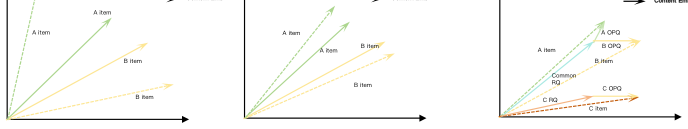
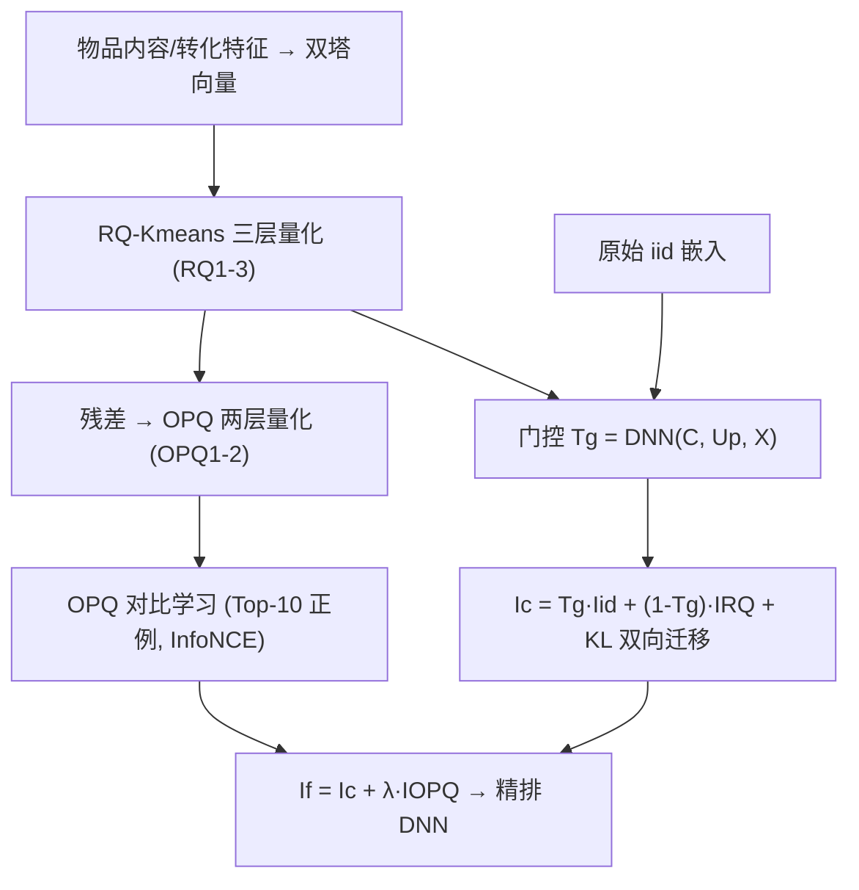
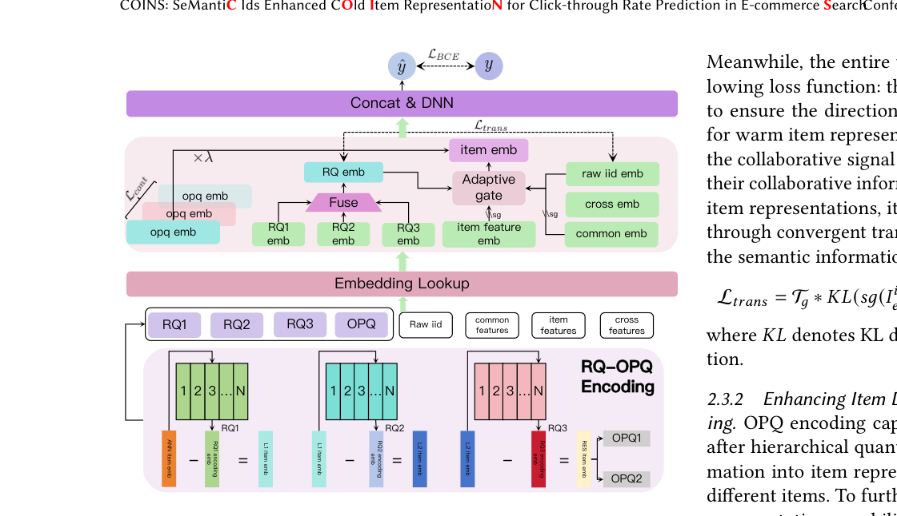

# COINS: Semantic Ids Enhanced Cold Item Representation for Click-through Rate Prediction in E-commerce Search (语义 ID 增强的电商搜索冷启动物品表征)

- **会议/期刊**: WWW 2026（Accepted）
- **作者与机构**: Qihang Zhao, Zhongbo Sun, Xiaoyang Zheng, Xian Guo, Siyuan Wang, Zihan Liang, Mingcan Peng, Ben Chen, Chenyi Lei（快手，中国科学技术大学）
- **推荐链路定位**: 精排（CTR 预估中的物品表征层）
- **研究方向**: CTR/CVR 预估与特征交叉 / 冷启动与长尾推荐
- **论文原文**: [https://arxiv.org/abs/2510.12604v4](https://arxiv.org/abs/2510.12604v4)
- **开源代码**: 暂未开源

## TL;DR (1分钟核心速览)

电商搜索中约 30% 月新增商品为冷启动物品，60% 以上首周点击数不足 5 次，ID 类协同特征几乎为空。本文复用 OneSearch 的 RQ-OPQ 语义 ID（sid），提出 **COINS**：用自适应门控在原始随机 iid 嵌入与 RQ 层级语义嵌入之间做双向知识迁移，再用 OPQ 残差码本做 Top-10 相似正例的对比学习注入物品判别性。在 91 天工业日志（5 亿测试样本，4 亿冷启）的日志级 AUC/GAUC 评估下，冷启动 AUC 相对 SOTA SaviorRec 提升 0.93pp（+1.10%），线上 9 天 A/B 订单量 +2.23%、冷启订单量 +9.64%。

## Background & Motivation (背景与核心矛盾)

- **主流范式**: 冷启动物品表征分两派——生成式（meta-learning / GAN / VAE 由热物品信号合成冷启嵌入）与知识对齐式（对比学习或蒸馏，把内容侧特征对齐到热物品协同表征空间）。
- **前人局限**: ① 生成式为每个冷启物品**独立生成**表征，忽略特征迁移过程中的时序漂移，易产生分布偏移；② 对齐式默认「内容与协同在嵌入空间一致」，强行对齐会把物品自身的细粒度判别信息抹平，且无法处理现实中二者**不对称**的情形（图 1(a)(b)）。
- **核心洞察 (Key Insight)**: 语义 ID 天然是**分级**的——RQ 前 3 层码本收敛到跨物品共享语义（适合承载协同信号迁移），OPQ 残差 2 层码本恰好编码物品间的差异（适合保留判别性）。因此「迁移」与「区分」应在不同编码层上分开做，而不是在同一空间强行对齐。
- **本文切入点**: 用门控权重区分热/冷物品的迁移方向，用对比学习单独强化 OPQ 残差层。

<figure class="paper-figure" markdown="span">
  <figcaption>图1：基于知识对齐的方法类型。</figcaption>
</figure>

## Method (核心方法设计)

### 1. 整体框架 (Overall Architecture)

物品首先被双塔（内容 + 转化信号）编码为初始向量，经 RQ-Kmeans 三层量化得 $RQ_1,RQ_2,RQ_3$，再对残差做两层 OPQ 量化得$OPQ_1,OPQ_2$，拼成 5 层 sid。COINS 将$RQ_{1..3}$经 `Fuse` 映射为$I_{RQ}^{emb}$，与原始随机哈希 iid 嵌入$I_{id}^{emb}$通过上下文/用户画像/物品特征驱动的门控$T_g$融合为$I_c^{emb}$；同时$I_{OPQ}^{emb}$经 InfoNCE 对比学习强化后以系数$\lambda$加性融入，得到最终$I_f^{emb}$ 替换精排中的 iid 嵌入，其余特征交叉与 DNN 结构不变，端到端以 BCE + 迁移 + 对比三项损失联合训练。

<figure class="paper-figure" markdown="span">
  <figcaption>图2：COINS 框架。</figcaption>
</figure>

### 2. 关键设计拆解 (Key Designs)

1. **自适应双向迁移门控 (Adaptive Transfer via RQ)**：痛点是对齐式方法单向地把内容硬拉到协同空间，热物品反而受损。COINS 让门控由请求上下文 $C$、用户画像$U_p$、物品特征$X$ 共同决定，实现样本级（而非物品级）的融合权重：
   $T_g=\mathrm{DNN}(C,U_p,X)$，$I_c^{emb}=T_g\odot I_{id}^{emb}+(1-T_g)\odot I_{RQ}^{emb}$；
   并用带 stop-gradient 的双向 KL 约束迁移方向：热物品（$T_g\to1$）保留 iid 协同分布、把协同注入 RQ，冷启物品（$T_g\to0$）反向把 RQ 中已迁移到的协同灌回 iid：
   $\mathcal{L}_{trans}=T_g\,\mathrm{KL}(\mathrm{sg}(I_{id}^{emb}),I_{RQ}^{emb})+(1-T_g)\,\mathrm{KL}(I_{id}^{emb},\mathrm{sg}(I_{RQ}^{emb}))$。
   直觉：门控把「谁向谁学」变成可学习的软路由，避免冷启物品被无差别对齐到热物品均值。
2. **OPQ 残差判别性对比学习**：RQ 只留共享码本，物品差异全在残差里。按 OPQ 码本向量相似度取 Top-10 作为候选正例池 $P$，在 batch 内筛出正例、其余及随机采样作负例$N$，用温度$\tau=0.1$ 的 InfoNCE：
   $\mathcal{L}_{cont}=-\log\frac{\sum_{i^+\in P}\exp(\mathrm{sim}(I_i,I_{i^+})/\tau)}{\sum_{i^+\in P}\exp(\mathrm{sim}(I_i,I_{i^+})/\tau)+\sum_{i^-\in N}\exp(\mathrm{sim}(I_i,I_{i^-})/\tau)}$，
   最终 $I_f^{emb}=I_c^{emb}+\lambda I_{OPQ}^{emb}$（$\lambda=0.5$）。相似码本→正例的构造使「近似但不同」的物品被推开，抑制冷启物品表征塌缩。
3. **训练目标与推理开销**：$\mathcal{L}_{total}=\mathcal{L}_{BCE}+\alpha_1\mathcal{L}_{trans}+\alpha_2\mathcal{L}_{cont}$，$\alpha_1=0.01,\alpha_2=0.05$。无额外人工负采样（负例来自 in-batch + 随机采样），sid 离线预量化、线上仅查表 + 一次门控 DNN 与加性融合，增量开销可忽略。

## Experimental Setup & Evaluation Protocol (实验设置与评估协议)

- **数据集与预处理**: 某电商平台 91 天真实用户日志。物品按近 7 天统计划分：**热物品** = 点击数 >3 或订单数 >0；**冷启物品** = 曝光 <200。

| 数据集 | #Users | #Items | #Interactions | 稀疏度/密度 | 特征/场景说明 |
| :--- | :---: | :---: | :---: | :---: | :--- |
| All（测试集） | 未披露 | 未披露 | 5.0 亿样本 | 长尾（20% 物品占 80% 流量） | 电商搜索 CTR 日志 |
| Warm 子集 | — | — | 1.0 亿样本 | 稠密 | 点击 >3 或订单 >0 |
| Cold 子集 | — | — | 4.0 亿样本 | 极稀疏 | 7 天曝光 <200 |

- **数据划分与防穿越 (Splitting Strategy)**: **全局时间戳切分**——前 90 天训练、最后 1 天测试，严格避免未来信息泄漏。
- **排名评测协议 (Ranking Protocol)**: 日志回放式**样本级 CTR 评估**（真实曝光样本上的 AUC / GAUC），非 Full-Ranking 全库排序，也无人工负采样；GAUC 用于衡量用户内排序、抵抗用户活跃度偏置。
- **对比基线与超参设置**: 基线为同为语义 ID / 冷启方向的 SPM_SID、DAS、SaviorRec；$\alpha_1=0.01$、$\alpha_2=0.05$、$\tau=0.1$、$\lambda=0.5$；OPQ 正例池 Top-10。

## Key Experimental Results (实验关键数据)

### 1. 主实验对比 (Main Results)

| 模型 | All AUC | All GAUC | Warm AUC | Warm GAUC | Cold AUC | Cold GAUC |
| :--- | :---: | :---: | :---: | :---: | :---: | :---: |
| SPM_SID | 0.8663 | 0.6322 | 0.8649 | 0.6319 | 0.8400 | 0.6203 |
| DAS | 0.8679 | 0.6352 | 0.8689 | 0.6357 | 0.8426 | 0.6237 |
| SaviorRec | 0.8687 | 0.6360 | 0.8695 | 0.6377 | 0.8435 | 0.6249 |
| **COINS** | **0.8725** | **0.6394** | **0.8741** | **0.6405** | **0.8528** | **0.6301** |
| Improv.（vs. 最优基线） | +0.38pp | +0.34pp | +0.46pp | +0.28pp | **+0.93pp** | **+0.52pp** |

### 2. 消融实验 (Ablation Study)

| 变体 | All AUC | All GAUC | Warm AUC | Cold AUC | Cold GAUC |
| :--- | :---: | :---: | :---: | :---: | :---: |
| only sid（sid 替换 iid） | 0.8650 | 0.6312 | 0.8642 | 0.8391 | 0.6192 |
| iid + sid（仅做特征拼接） | 0.8671 | 0.6331 | 0.8681 | 0.8401 | 0.6215 |
| iid + RQ（仅门控迁移） | 0.8702 | 0.6371 | 0.8725 | 0.8479 | 0.6277 |
| iid + OPQ（仅对比学习） | 0.8683 | 0.6345 | 0.8706 | 0.8455 | 0.6257 |
| **COINS（完整）** | **0.8725** | **0.6394** | **0.8741** | **0.8528** | **0.6301** |

### 3. 关键实验发现 (Key Findings)

1. **增益几乎全部来自冷启分段**：All 上仅 +0.38pp，而 Cold 上 +0.93pp（相对 +1.10%），GAUC 冷启 +0.52pp，说明方法确实在稀疏侧生效而非全局性涨点；Warm 也有 +0.46pp，证明协同/语义双流融合对热物品无害。
2. **直接替换 iid 是有害的**：`only sid` 在 Warm AUC（0.8642）反而低于原生 iid 基线（0.8649），作者归因为协同信号错位——这定量证明了「语义 ID 不能替代 iid，只能与之门控融合」这一核心论点。
3. **两个模块互补而非冗余**：单开 RQ 迁移使冷启 AUC 从 0.8401 升至 0.8479（+0.78pp），单开 OPQ 对比升至 0.8455（+0.54pp），合并后 0.8528 超出两者单独增益之和的一部分，说明「共享协同 + 判别残差」是正交信息；仅在拼接（iid+sid）只能拿到 +0.10pp。
4. **线上显著性**：9 天 A/B（7% 流量）全站买家 +1.720%、订单量 +2.230%，冷启场景买家 +3.512%、订单量 +9.639%，冷启成为主要受益域（注：摘要中给出的 +1.66% CTR / +1.57% buyers 与表 3 数值不一致，复现时需以表格为准）。

## Highlights & Limitations (亮点、对比与审稿批判)

- **与代表作对比 (vs. Prior Work)**: SPM_SID 只对 sid 子片段哈希做语义自适应，不涉及协同迁移；DAS 用对比学习同步优化量化与 iid 对齐，但仍假设内容-协同一致；SaviorRec 依赖多模态 + sid 联合训练，参数量与成本更高。COINS 的差异在于**把「共享迁移」与「判别保留」解耦到 RQ / OPQ 两层**，并用门控显式建模协同-内容不对称性。
- **可迁移亮点**: ①「stop-gradient 双向 KL + 可学习门控」是处理双源表征不对称的通用模板，可直接搬到跨域/多场景的双流融合；② 用码本相似度构造 Top-10 正例替代传统数据增广，在量化表征场景下零额外采样成本。
- **审稿级局限批判**: ① 评估仅在**单一平台日志的样本级 AUC/GAUC**上做，无 Full-Ranking 排序指标（如 Recall/NDCG@K）与公开数据集复现，泛化性存疑；② 超参 $\alpha_1,\alpha_2,\lambda,\tau$与 Top-10 正例数均未做敏感性分析，且门控网络依赖线上实时特征$C,U_p,X$，离线-线上一致性风险未被讨论；③ 摘要与表 3 的线上指标数值自相矛盾，写作严谨度扣分；④ 未与生成式冷启（meta-learning / GAN）基线做直接对比，缺少对「第一类局限」的实证反驳。

## Rating (四维评分)

- **方法创新性 (Novelty)**: ⭐⭐⭐⭐ （RQ/OPQ 分层解耦 + 门控双向迁移的视角新颖，但本质仍是「对齐 + 对比」的组合式改进，且 RQ-OPQ 编码沿用 OneSearch）
- **评估协议与实验扎实度 (Protocol & Experiments)**: ⭐⭐⭐⭐ （5 亿样本工业日志 + 时间切分 + 9 天线上 A/B 说服力强，但缺公开数据集、无 Full-Ranking 指标、无超参敏感性分析）
- **写作与数学规范度 (Clarity & Rigor)**: ⭐⭐⭐ （框架图与三个损失定义清晰，但摘要与表格指标不一致、符号 $I_{id}^{emb}$与$iid$ 混用、缺复杂度分析）
- **工业落地与复现价值 (Industrial & Practical Value)**: ⭐⭐⭐⭐ （sid 离线预量化、线上仅增一次门控 DNN 与加性融合，A/B 冷启订单 +9.64%，落地价值明确；可惜未开源）

