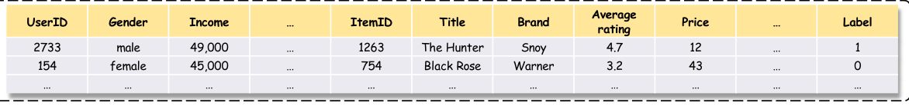
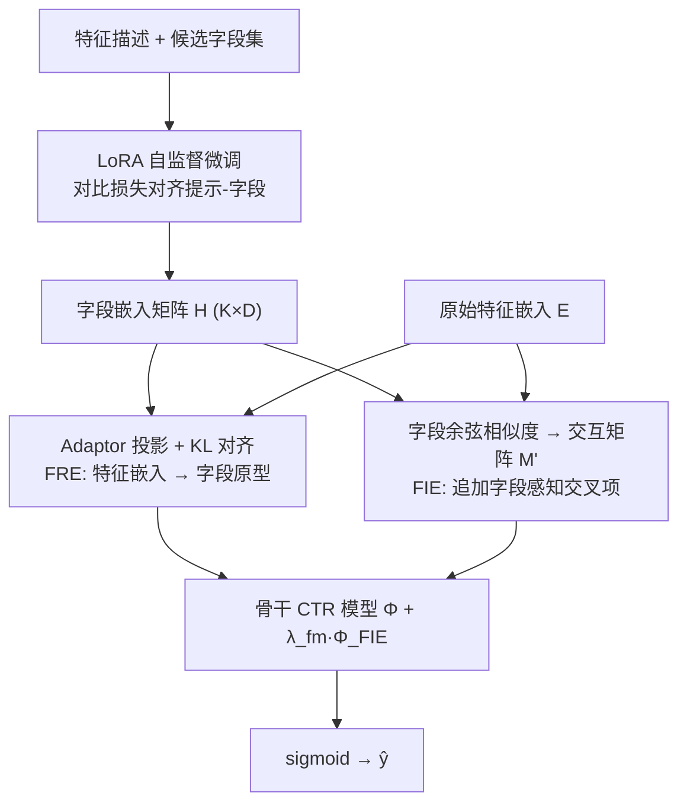

# Field Matters: A Lightweight LLM-enhanced Method for CTR Prediction (字段才是关键：一种轻量级 LLM 增强 CTR 预测方法)

- **会议/期刊**: WWW 2026
- **作者与机构**: Yu Cui, Jiawei Chen, Xiaohu Yang, Can Wang 等（浙江大学）；Feng Liu, Xingyu Lou, Changwang Zhang, Jun Wang（OPPO 研究院）；Yuegang Sun（Intelligence Indeed）
- **推荐链路定位**: 精排（CTR 预估）
- **研究方向**: CTR/CVR 预估与特征交叉 / 大语言模型推荐 (LLM4Rec)
- **论文原文**: [https://arxiv.org/abs/2505.14057v2](https://arxiv.org/abs/2505.14057v2)
- **开源代码**: [https://github.com/istarryn/LLaCTR](https://github.com/istarryn/LLaCTR)

## TL;DR (1分钟核心速览)

现有 LLM 增强 CTR 方法在 **实例级**（CTRL、LLM-CF）或 **用户/物品级**（KAR、EASE）调用 LLM，需为百万级样本/实体生成文本描述，训练开销平均达传统 CTR 模型的 290 倍以上。本文转而只对数量仅数十个的 **特征字段 (field)** 做增强：先用 LoRA 自监督微调让 LLM 学会"由特征猜字段"，蒸馏出字段语义向量，再用归一化 KL 损失对齐特征嵌入、用字段语义相似度构造交互重要性矩阵调制双线性交叉。集成到 FM/DeepFM/FwFM/FmFM/FinalMLP/WuKong 六个骨干、四个数据集上平均 AUC 相对提升 2.24%，在 89% 的指标格上超过 KAR、LLM-CF、CTRL、EASE、CELA、ClickPrompt，而训练时间降低 10–100 倍。

## Background & Motivation (背景与核心矛盾)

- **主流范式**: LLM 做 CTR 预测器（需在线推理，延迟不可接受）与 LLM 增强 CTR（LLM 离线产出语义嵌入，注入传统 ID 型 CTR 模型）。
- **前人局限**: ① 实例级/实体级提示需要 LLM 处理数百万条文本描述，再编码为嵌入，训练侧成本爆炸（图 1 显示 KAR/LLM-CF/CTRL/EASE 相对 WuKong 训练耗时上涨 31×–814×）；② 产出的是冗长、稠密且与 ID 嵌入空间不对齐的语义，传统轻量 CTR 模型难以有效吸收，甚至出现负迁移（表 2 中 LLM-CF、CTRL 在 Music/Movie 上 AUC 低于骨干）。
- **核心洞察 (Key Insight)**: 字段数（数十到数百）比实例数/实体数少数个数量级，且字段描述本身承载关键语义——"4.7 属于 *average rating*" 提示物品质量，"*user income* 与 *item price*" 的字段组合天然指示高价值交叉方向；当前工业模型却只把字段 ID 当作类别指示位。
- **本文切入点**: 把 LLM 的调用粒度从"每个样本/每个用户物品"下沉到"每个字段"，一次性蒸馏少量字段语义，作为原型与先验去指导表征学习和交叉建模。

<figure class="paper-figure" markdown="span">
  <figcaption>图2：当前LLM增强CTR范式与我们的字段级增强范式对比。</figcaption>
</figure>

## Method (核心方法设计)

### 1. 整体框架 (Overall Architecture)

LLaCTR 分两阶段离线+在线：离线阶段构造自监督样本（提示 = 任务指令 + 某特征描述 + 候选字段集合，答案 = 字段名），用 LoRA 微调 LLM，使编码器理解字段语义，随后仅对 K 个字段描述编码得到字段嵌入矩阵 $\mathbf{H}=\{\mathbf{h}_k\}_{k=1}^{K}$并冻结缓存；在线阶段 CTR 模型正常前向，同时经两条旁路使用$\mathbf{H}$：经 Adaptor 投影后以 KL 损失把特征嵌入拉向对应字段原型（FRE），以及以字段相似度生成$K\times K$ 交互重要性矩阵、追加一项字段感知的双线性交叉（FIE），与原骨干输出相加后经 sigmoid 输出点击概率。整个模块即插即用，不改动骨干结构。

### 2. 关键设计拆解 (Key Designs)

1. **自监督字段-特征微调 (SSFT)**：通用 LLM 缺乏推荐域字段知识，直接编码字段描述质量不高。做法是让 LLM 做"特征 $\to$ 字段"的判别式分类，采用对比损失而非生成损失（作者实测略优且与后续嵌入用途一致）：
$$\mathcal{L}_{CL}=-\log\frac{\exp(\cos(E(\mathcal{P}(f_{kj})),E(F_k))/\tau)}{\sum_{l}\exp(\cos(E(\mathcal{P}(f_{kj})),E(F_l))/\tau)}$$
其中 $\tau=0.02$，LoRA rank 为 8。直觉：迫使提示编码与正确字段编码在语义空间靠近，等价于把领域共现知识压缩进字段向量；每字段仅采样 1000 个特征即可收敛，成本与字段数而非样本量成正比。

2. **特征表示增强 (FRE)**：LLM 与 CTR 嵌入空间存在鸿沟，且两空间量纲不同。先线性 Adaptor 映射 $\mathbf{h}'_k=\text{Adaptor}(\mathbf{h}_k)$，再对两侧做 Softmax 后计算归一化 KL：
$$\mathcal{L}_{KL}=\sum_{k=1}^{K}\sum_{i=1}^{N}\mathbf{e}_{ik}\ln\frac{\mathbf{e}_{ik}}{\mathbf{h}'_{k}}$$
归一化消除模长影响、只对齐分布形态；字段嵌入充当"语义原型/聚类中心"，把同字段的稀疏特征嵌入拉向共同语义中心，缓解长尾特征欠训练。作者对比过对比损失对齐，KL 更优。

3. **特征交互增强 (FIE) 与训练目标**：传统字段感知模型（FwFM/FmFM）只用字段 ID 学权重矩阵，无语义。这里用字段嵌入余弦相似度得 $m^{F}_{ij}=\text{FieldInteraction}(\mathbf{h}_i,\mathbf{h}_j)$，经 Adaptor 得$\mathbf{M}'$，再追加一项：
$$\Phi_{new}(X_i)=\Phi(X_i)+\lambda_{fm}\sum_{k=1}^{K}\sum_{l=k+1}^{K}\varsigma\big(x_{ik}x_{il}^{\top}\langle \mathbf{e}_{ik},\mathbf{e}_{il}\rangle m'_{kl}\big)$$
不改骨干内部结构而做"加法式"增强，因此对显式（FM/FwFM/FmFM）与隐式（DeepFM/FinalMLP/WuKong）交叉模型都通用。总损失 $\mathcal{L}=\mathcal{L}_{BCE}+\lambda_{kl}\mathcal{L}_{KL}$，$\lambda_{kl},\lambda_{fm}\in\{0.01,\dots,1\}$调参；负采样沿用各骨干默认（BCE 全量曝光样本），推理时字段嵌入与$\mathbf{M}'$可预计算缓存，在线仅多一次$K\times K$ 加权求和，延迟近似不变。

## Experimental Setup & Evaluation Protocol (实验设置与评估协议)

- **数据集与预处理**: Amazon 三域按 5-core 过滤、评分 $\ge 4$ 二值化为正；MovieLens-1M 同样阈值 4 并剔除评分 3 的中性样本。

| 数据集 | #Users | #Items | #Interactions | 稀疏度/密度 | 特征/场景说明 |
| :--- | :---: | :---: | :---: | :---: | :--- |
| Gift Cards | 132,732 | 1,137 | 152,410 | 1.01×10⁻³ | 13 字段，电商礼品卡 |
| Video Games | 2,766,656 | 137,249 | 4,624,615 | 1.22×10⁻⁵ | 13 字段，极稀疏 |
| Digital Music | 100,952 | 70,511 | 130,434 | 1.83×10⁻⁵ | 13 字段，音乐下载 |
| MovieLens-1M | 6,040 | 3,706 | 1,000,209 | 4.47×10⁻² | 8 字段，电影评分 |

- **数据划分与防穿越 (Splitting Strategy)**: 按时间戳升序排列后 `8:1:1` 比例划分为训练/验证/测试，属全局时间切分，避免未来交互泄漏。
- **排名评测协议 (Ranking Protocol)**: 本文是点击率预估任务，非全库排序；采用 `LogLoss↓`、`AUC↑` 与相对 AUC 提升 `RelaImpr`，在完整曝光样本上计算（无负采样评估）。作者强调 CTR 场景下 0.1% AUC 差异即具实际意义。
- **对比基线与超参设置**: 骨干 6 个（FM、DeepFM、FwFM、FmFM、FinalMLP、WuKong）；LLM 增强基线 4 个（KAR RecSys'24、LLM-CF CIKM'24、CTRL TOIS'23、EASE CIKM'24），PLM 增强基线 2 个（CELA、ClickPrompt WWW'24，报告其最佳骨干结果）。嵌入维度 $d=32$、batch 4096、Adam、lr=1e-3，显著性以$p<0.05$ 标注 `*`。

## Key Experimental Results (实验关键数据)

### 1. 主实验对比 (Main Results)

以两个代表性骨干（DeepFM 隐式交叉、WuKong 最新 SOTA）为例，AUC↑ 与 RelaImpr：

| Backbone | Method | Gift Cards | Video Games | Digital Music | ML-1M | Avg RelaImpr |
| :--- | :--- | :---: | :---: | :---: | :---: | :---: |
| DeepFM | Base | 0.6713 | 0.6692 | 0.7582 | 0.8342 | — |
| DeepFM | KAR | 0.6778 | 0.6720 | 0.7587 | 0.8335 | 1.36% |
| DeepFM | LLM-CF | 0.6736 | 0.6730 | 0.7588 | 0.8353 | 1.05% |
| DeepFM | CTRL | 0.6744 | 0.6758 | 0.7576 | 0.8352 | 1.45% |
| DeepFM | EASE | 0.6739 | 0.6738 | 0.7604 | 0.8349 | 1.33% |
| DeepFM | **LLaCTR** | **0.6797** | **0.6744** | **0.7687** | **0.8354** | **3.11%** |
| WuKong | Base | 0.6728 | 0.6767 | 0.7514 | 0.8323 | — |
| WuKong | KAR | 0.6721 | 0.6758 | 0.7506 | 0.8316 | −0.35% |
| WuKong | LLM-CF | 0.6752 | 0.6788 | 0.7560 | 0.8293 | 0.36% |
| WuKong | CTRL | 0.6769 | 0.6800 | 0.7561 | 0.8367 | 1.02% |
| WuKong | EASE | 0.6758 | 0.6801 | 0.7556 | 0.8334 | 0.93% |
| WuKong | **LLaCTR** | **0.6802** | **0.6819** | **0.7564** | **0.8397** | **2.84%** |
| — | CELA (最佳骨干) | 0.6746 | 0.6775 | 0.7638 | 0.8373 | — |
| — | ClickPrompt (最佳骨干) | 0.6754 | 0.6799 | 0.7652 | 0.8379 | — |

六个骨干 × 四数据集的总体平均相对提升为 **2.24%**（分数据集平均 3.41%/3.65%/1.16%/0.74%），最佳单格为 DeepFM+FwFM 上的 5.73%、5.71%。

### 2. 消融实验 (Ablation Study)

AUC↑，移除 SSFT 微调（w/o FT）、KL 对齐（w/o $\lambda_{kl}$）、字段交叉项（w/o$\lambda_{fm}$）：

| 设置 | DeepFM-Gift | DeepFM-Games | DeepFM-Music | DeepFM-Movie | WuKong-Gift | WuKong-Games | WuKong-Music | WuKong-Movie |
| :--- | :---: | :---: | :---: | :---: | :---: | :---: | :---: | :---: |
| Base (骨干) | 0.6713 | 0.6692 | 0.7582 | 0.8342 | 0.6728 | 0.6767 | 0.7514 | 0.8323 |
| w/o FT | 0.6759 | 0.6732 | **0.7683** | 0.8352 | 0.6800 | 0.6777 | 0.7558 | 0.8322 |
| w/o $\lambda_{kl}$ (FRE) | 0.6764 | 0.6699 | 0.7582 | 0.8343 | 0.6730 | 0.6784 | 0.7524 | 0.8332 |
| w/o $\lambda_{fm}$ (FIE) | 0.6787 | 0.6741 | 0.7685 | 0.8351 | 0.6763 | 0.6783 | 0.7494 | 0.8347 |
| LLaCTR | **0.6797** | **0.6744** | **0.7687** | **0.8354** | **0.6802** | **0.6819** | **0.7564** | **0.8397** |

效率侧（图 5）：LLaCTR 在取得更高 AUC 的同时训练时间比 KAR/LLM-CF/CTRL/EASE 少 10–100 倍；随每字段采样数 100→500→1000，AUC 单调上升、耗时缓慢增长；即使完全不微调（w/o FT）也已超过多数 LLM 增强基线。

### 3. 关键实验发现 (Key Findings)

1. **字段级知识足以击败实例级知识**：仅用数十个字段向量，LLaCTR 在 89% 的指标格上超过使用实例/实体级提示的四个 LLM 增强基线，且 WuKong+LLaCTR 在 ML-1M 上达到 0.8397（较骨干 +2.21%、较 CTRL +0.82%），说明语义信息"密度"比"体量"更关键。
2. **两个增强通道互补且贡献不同**：去掉 KL 对齐（FRE）在 Gift Cards 上使 WuKong 从 0.6802 掉回 0.6730（几乎回到无增强水平），而去掉 FIE 则主要损伤 ML-1M（0.8397→0.8347），即 FRE 负责稀疏场景的嵌入质量、FIE 负责稠密场景的交叉先验。
3. **微调收益是"锦上添花"而非"必需"**：w/o FT 在 DeepFM-Music 上已达 0.7683（与全模型 0.7687 基本相同），但在 WuKong-Movie 上仅 0.8322（低于骨干 0.8323），说明 SSFT 的价值体现在语义敏感数据集上，资源受限时可安全降级为免微调版本。

## Highlights & Limitations (亮点、对比与审稿批判)

- **与代表作对比 (vs. Prior Work)**: KAR/LLM-CF 从用户-物品知识或 CoT 出发、EASE 训练语义 Adaptor 对齐物品嵌入、CTRL 以 LLM 编码实例并用对比学习对齐——三者均在"实例/实体"维度调用 LLM；本文把调用维度降到"字段"，参数与调用量与字段数（$<100$）而非样本量（百万级）挂钩，是本工作最本质的差异，也是效率优势的根源。
- **可迁移亮点**: ① "特征→所属字段"的自监督判别任务可作为任何表格/多域模型的低成本领域适配器；② 用嵌入余弦相似度生成交叉重要性矩阵并以加法项挂载，可无损迁移到任意交叉结构（DCN、EulerNet、Transformer 型精排），无需重训骨干。
- **审稿级局限批判**: ① 字段数极少（8–13）使语义先验容量上限受限，Music 上 DeepFM 提升仅 0.32%、FmFM 甚至为 −0.50%，说明并非稳定正向；② 主实验仅报告 AUC/LogLoss 与离线训练时间，缺少线上 QPS、显存占用与推理 P99 延迟，且"推理开销近似不变"仅在附录定性描述；③ 字段语义对齐假设同字段特征共享语义中心，对高基数 ID 类字段（UserID/ItemID）可能过强，作者未给出分字段类型的分桶分析。

## Rating (四维评分)

- **方法创新性 (Novelty)**: ⭐⭐⭐⭐ （"字段级增强"视角切中 LLM4Rec 的成本痛点，SSFT+FRE+FIE 三件套组合自洽，但单项技术多为已有算子的巧妙移植，缺乏理论刻画）
- **评估协议与实验扎实度 (Protocol & Experiments)**: ⭐⭐⭐⭐ （6 骨干 × 4 数据集 × 6 基线、时间戳切分与 $p<0.05$ 显著性俱全，但仅有离线 AUC、缺少分字段/分稀疏度切片与线上验证）
- **写作与数学规范度 (Clarity & Rigor)**: ⭐⭐⭐⭐ （框架图与公式链条清晰、维度与超参交代完整，但消融中 "Base/w/o FT" 命名易混淆，部分提升幅度与显著性星标标注不统一）
- **工业落地与复现价值 (Industrial & Practical Value)**: ⭐⭐⭐⭐⭐ （代码开源、离线一次蒸馏即可缓存字段向量、在线仅增 $K\times K$ 加权求和，10–100× 训练加速对工业级精排极具吸引力）

