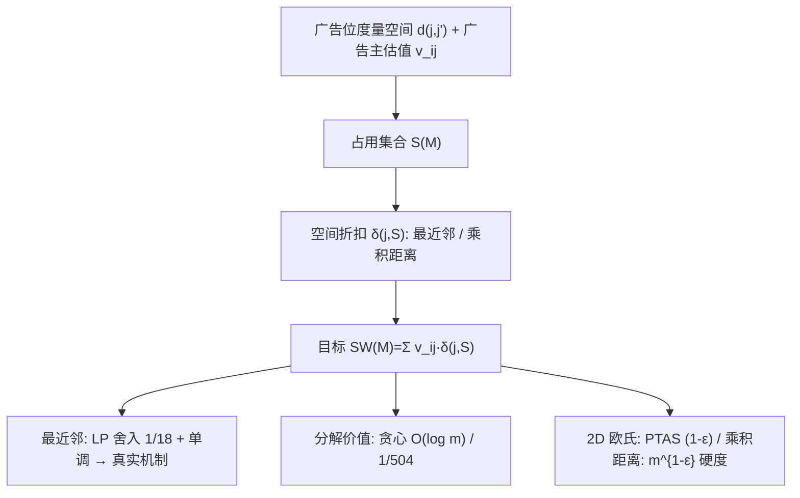

# Online Advertising with Spatial Interactions (在线广告中的空间外部性与广告位分配)

- **会议/期刊**: WWW 2026
- **作者与机构**: Gagan Aggarwal (Google Research), Yifan Wang (Georgia Tech), Mingfei Zhao (Google Research)
- **推荐链路定位**: 精排后端的广告位分配与定价（Slate Auction / 机制设计）
- **研究方向**: CTR/CVR 预估与特征交叉 / 广告分配机制设计
- **论文原文**: [arXiv:2602.12481v1](https://arxiv.org/abs/2602.12481v1)
- **开源代码**: 暂未开源

## TL;DR (1分钟核心速览)

页面上的多广告位共享有限用户注意力，邻近广告互相争夺点击，但现有广告位分配与拍卖把广告位视为相互独立或沿一维有序排列，忽略了二维页面布局中的**空间拥挤外部性**。本文把广告位嵌入度量空间，将广告主价值建模为 $\text{bid}\times\delta(j,S(M))$，提出两个可分析的具体模型（最近邻 / 乘积距离）：前者在一般度量下给出多项式时间 **1/18 近似**算法且分配规则单调、可经 Myerson 引理转化为真实机制，并在 2D 欧氏空间给出 PTAS；后者通过 Max-Independent-Set 归约证明任何多项式算法都无法达到$m^{1-\varepsilon}$ 以内的近似（除非 P=NP），从而给出统计算法/不可计算性的完整分界。

## Background & Motivation (背景与核心矛盾)

- **主流范式**: 平台把每个广告位当作独立标的拍卖，yield 为 bid×pCTR；外部性研究则以 GSP 位置拍卖、级联模型 (cascade)、品牌效应模型为代表，把位置效应用一维序列或共展示集合建模。
- **前人局限**: ① 位置效应被压缩成一维排序，页面二维布局中的**邻近距离**无法表达；② 已有的"外部性"只对 co-displayed set 建模，未把"哪个广告放在哪个方位"作为一等公民，于是拥挤（clutter）只能被当作附加惩罚项。
- **核心洞察 (Key Insight)**: 用户注意力受空间拥挤调制——干扰强度随距离衰减，且这一衰减可由任意**度量嵌入**编码（物理距离、语义相似性、意图重叠皆可）。因此广告位分配问题本质上是一个"带空间折扣的二分匹配"问题。
- **本文切入点**: 将广告位作为度量空间中的点、把匹配的目标改为 $SW(M)=\sum_{(i,j)\in M}v_{i,j}\cdot\delta(j,S(M))$，在两种典型$\delta$ 下分别研究分配算法复杂度与真实机制的可实现性。

## Method (核心方法设计)

### 1. 整体框架 (Overall Architecture)

模型给定 $m$个广告位、$n$个广告主（可补 0 值虚拟广告主使$n\ge m$），匹配$M\subseteq[n]\times[m]$决定哪些广告位被占用$S(M)=\{j\mid\exists i,(i,j)\in M\}$。核心算子是把"广告主对广告位的基准估值$v_{i,j}$"乘以一个仅依赖**已占位集合**的空间折扣函数$\delta(j,S(M))\in[0,1]$（对$S$ 单调非增），从而得到社会福利目标。本文在此框架下实例化两个极端模型（局部最近邻 vs 全局乘性衰减），分别在分配版（估值公开）与拍卖版（估值为私有信息、需真实报价）两个层面上分析近似比与硬度。

### 2. 关键设计拆解 (Key Designs)

1. **空间折扣双模型（Nearest-Neighbor / Product-Distance）**：前人只在集合级别表达外部性，无法区分"隔一格"与"隔三格"。本文定义 $\delta_{\min}(j,S)=1$（若$S=\{j\}$），否则取$\min_{j'\in S\setminus\{j\}}d(j,j')$；另一极端$\delta_{\text{mul}}(j,S)=\prod_{j'\in S\setminus\{j\}}d(j,j')$。前者刻画"主导干扰只来自最近竞争对手"的局部拥挤，后者刻画"每个新增占位都独立乘性衰减"的全局拥挤——两模型正好覆盖干扰强度的两个极端，且$\delta\in[0,1]$ 与单调性由 min/乘积算子天然保证。

2. **最近邻模型的 LP 松弛 + 随机舍入（1/18 近似且单调）**：把分配问题归约到"分组伪圆盘选择"——每个广告主对应一组伪圆盘（中心 $c$、半径$r$、权值$w$），每组至多选一个。核心 LP 为$\max\sum_i w_ix_i$，约束为"任意点$c$被至多一个圆盘覆盖"（强约束 I）与"每组至多一个圆盘"。先以$x_i^*/3$概率加入$T$，再以概率$\frac{1}{3}\prod_{i'\ne i}\big(1-\mathbb{I}[\,i'\in T_k\ \lor\ d(c_i,c_{i'})<r_{i'}\,]\cdot x^*_{i'}/3\big)$保留，可证$\Pr[i\in \tilde{T}]=x_i^*/9$，即$\mathbb{E}[Val(\tilde{T})]\ge\frac{1}{9}LP^*$；再经"强约束 I → 弱约束 II"转换损失$1/2$，总得$1/18$。该分配规则对报价单调，故 Myerson 引理可直接给出真实机制。

3. **分解估值下的简单贪心（$\tilde{O}(n+m)$且真实）**：LP 路线需要多次求解，难以在线部署。当$v_{i,j}=w_i\cdot u_j$且$u_j$公开时，只需预选广告位子集$\tilde{S}$：随机取$r\in\{2^0,2^{-1},\dots,2^{-\lceil\log_2 m^2\rceil}\}$，按$u_j$降序贪心加入与$\tilde{S}$中所有点距离$\ge r$的广告位；广告主报价到来后按$w_i$降序与$u_j\cdot\min_{j'\in\tilde{S}\setminus\{j\}}d(j,j')$降序配对。该分配可写成单调对称范数$f(Z;W^{\downarrow})=\sum_j z^{\downarrow}_j w^{\downarrow}_j$，因而仍单调、仍真实，得到$O(\log m)$近似；若$w_i$服从已知分布$D_i$，用期望分位数$\gamma^{(k)}$预选广告位后可达常数$1/504$ 近似。

4. **复杂度分界与推理开销**：2D 欧氏、$v_{i,j}=u_j$时，归约到按直径分层的加权圆盘选择，在网格树结构上做动态规划，得$(1-\varepsilon)$-近似 PTAS，复杂度$O(\mathrm{poly}(n,\varepsilon^{-1})\cdot m^{O(\varepsilon^{-2})})$。乘积距离模型则通过 Max-Independent-Set → MSED（最大化$\sum_{u\in U}0.5^{\deg_U(u)}$）→ 乘积距离二次归约，证明不存在$m^{1-\varepsilon}$近似，且单广告位平凡解已是$m$-近似，故该分界几乎紧。

## Experimental Setup & Evaluation Protocol (实验设置与评估协议)

- **数据集与预处理**: 本文为**纯理论/机制设计论文，不含公开数据集实验**。评估对象为可证明的近似比与真实性。
- **数据划分与防穿越**: 不适用（无训练/测试切分）。
- **排名评测协议**: 社会福利 $SW(M)$与最优解$SW(M^*)$ 的比值（在全匹配空间上取精确最优），而非采样排序。
- **对比基线与超参设置**: 对比基准为 [BGMS16] 的最优多样性选择（全部 $v_{i,j}=1$，得$2e$-近似且已知 2-近似下界）、级联/位置拍卖（$[KM08,AFMP08]$）、品牌效应模型（HM14），以及乘积距离下的平凡单广告位$m$-近似解。

## Key Experimental Results (实验关键数据)

### 1. 主实验对比 (Main Results)

理论结果汇总（近似比越低越好，对比其最优已知或对应基准）：

| 模型 | 设定 | 本文结果 | 基准 / 下界 | 真实性 |
| :--- | :--- | :---: | :---: | :---: |
| 最近邻 | 一般度量 | **1/18** 多项式时间近似 | [BGMS16] $2e$-approx（$v\equiv1$），2-approx 下界 | ✓ 单调→Myerson |
| 最近邻 | 分解 $w_i\cdot u_j$| **$O(\log m)$**，$\tilde O(n+m)$ | LP-based 1/18（多次求解） | ✓ |
| 最近邻 | 分解 + $w_i\sim D_i$| **1/504** 常数近似 |$O(\log m)$（对抗性$w_i$） | ✓ |
| 最近邻 | 2D 欧氏、$v_{i,j}=u_j$| **$(1-\varepsilon)$PTAS**，$m^{O(1/\varepsilon^2)}$ | 一般度量下 2-approx 下界不适用 | 分配版 |
| 乘积距离 | 一般度量 | **$m^{1-\varepsilon}$不可近似**（除 P=NP） | 单广告位$m$-approx 为平凡上界 | — |

### 2. 消融实验 (Ablation Study)

由于无数据实验，此处以"机制组件贡献"拆解：

| 组件移除 / 替换 | 近似比 | 说明 |
| :--- | :---: | :--- |
| 完整 LP 舍入（$x_i/3$+$1/3$保留） | **1/18** | 期望$\Pr[i\in\tilde T]=x_i^*/9$ |
| 去掉舍入中的 $1/3$系数 |$\ge 1/6$ 但约束 II 可能被违反 | 随机舍入概率需保证可行 |
| 跳过"强约束 I → 弱约束 II"转换 | $1/9$不可回映到匹配 | 匹配可行性只保证$1/2$ |
| 贪心版退化为直接按 $u_j$排序 | 无保证 | 需$u_j\cdot\min d$ 才能嵌入范数 |
| 分布信息引入 $\gamma^{(k)}$| **1/504** |$28\times18$ 的分离常数 |

### 3. 关键实验发现 (Key Findings)

1. **1/18 的三个乘数可精确归因**：$1/3$（初始化采样）×$1/3$（保留概率）×$1/2$（约束转换）严格对应 LP 舍入的三步，说明近似比损失完全来自"分组约束"与"圆心覆盖"的交互，而非采样噪声；这也解释了为何 [BGMS16] 在$v\equiv1$上只能达$2e$——他们的舍入未针对真实机制优化单调性。
2. **可分解估值是落地关键**：当 $v_{i,j}=w_i u_j$时，$\tilde{O}(n+m)$的排序贪心即可把近似比从 1/18 的常数级提升到$O(\log m)$量级（同等保证），且在$w_i$ 分布已知时进一步压缩至 1/504；这说明"算法复杂度"的终极瓶颈不在近似常数，而在是否需要实时求解 LP。
3. **两个模型的计算分界由几何密度决定**：最近邻模型下 2D 欧氏空间比一般度量**严格更容易**（PTAS vs 2-approx 下界），因为伪圆盘局部密度被平面几何界住；乘积距离模型则因每个邻居独立贡献，等价于 MSED 的指数整合，直接继承 MIS 的 $|V|^{1-\varepsilon}$ 硬度，说明"干扰聚合方式"（min vs product）决定了问题是否可解。

## Highlights & Limitations (亮点、对比与审稿批判)

- **与代表作对比 (vs. Prior Work)**: 相比 [GM08]（audience choice）与 [KM08, AFMP08]（cascade / Markovian scan）沿**一维序列**刻画注意力衰减，本文首次把广告位的**方向与距离**提升为一等原语，因此能表达"同页但异角"广告的差异化干扰；相比 HM14 的品牌效应只给非对称定性结论，本文给出可证明的近似比与最优不可近似性。
- **可迁移亮点**: ① 度量嵌入可编码物理距离、语义相似、意图重叠，直接可复用到短视频智能布局 / 信息流"卡片位置"分配；② "同时对偶范数 + 单调对称范数"证明技巧，可用于任何"私有可分解估值 + 组合结构"的匹配近似分析。
- **审稿级局限批判**: ① 1/18 近似需多次解 LP 取对偶价，在线广告毫秒级出价窗口下不可行；简单贪心版要求 $v_{i,j}=w_i u_j$的强结构假设，真实广告主价值不可分解。② 全文无任何真实点击日志或仿真验证，$\delta_{\min}/\delta_{\text{mul}}$是"数学上整洁但经验上未被校准"的假设；且$\delta$ 只依赖占位集合而与广告身份无关，这在品牌广告或竞品排他场景下可能失效。

## Rating (四维评分)

- **方法创新性 (Novelty)**: ⭐⭐⭐⭐⭐ （首次把页面二维空间邻近性作为广告分配机制的一等原语，并给出紧密的近似/硬度两侧分界）
- **评估协议与实验扎实度 (Protocol & Experiments)**: ⭐⭐⭐ （定理链完整、近似比可追溯，但纯理论无数据验证，缺少真实 CTR 日志对空间衰减的经验校准）
- **写作与数学规范度 (Clarity & Rigor)**: ⭐⭐⭐⭐⭐ （LP 舍入、PTAS 动态规划、二次归约推导严格，符号简洁无冗余）
- **工业落地与复现价值 (Industrial & Practical Value)**: ⭐⭐⭐ （框架与贪心版可迁移到实时分配，但 1/18 与多次 LP 求解不适用于在线出价，需进一步工程近似）

