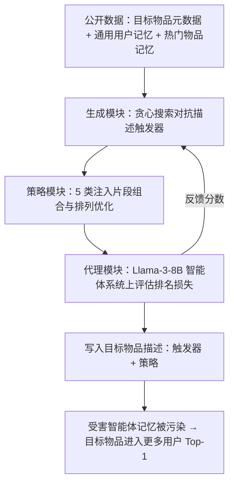

# DrunkAgent: Stealthy Memory Corruption in LLM-Powered Recommender Agents（灌醉智能体：LLM 推荐智能体的隐蔽记忆污染）

- **会议/期刊**: WWW 2026
- **作者与机构**: Shiyi Yang, Zhibo Hu, Xinshu Li, Chen Wang, Tong Yu, Xiwei Xu, Liming Zhu, Lina Yao（UNSW / Data61-CSIRO / Macquarie University / Adobe Research）
- **推荐链路定位**: 端到端生成式（攻击面为智能体记忆更新链路，效果体现在最终推荐列表）
- **研究方向**: 去偏公平、可信隐私与工业架构 / 对话与智能体推荐
- **论文原文**: [https://arxiv.org/abs/2503.23804v3](https://arxiv.org/abs/2503.23804v3)
- **开源代码**: [Meta-Llama-3-8B-Instruct](https://huggingface.co/meta-llama/Meta-Llama-3-8B-Instruct)（仅给出代理模型基座，攻击代码暂未开源）

## TL;DR (1分钟核心速览)

LLM 智能体推荐系统把「记忆」当作个性化引擎，但记忆同时是可被外部文本污染的写入面。本文首次系统研究该攻击面，提出黑盒框架 DrunkAgent：先用贪心搜索在代理系统上优化一段语义自然（低困惑度）的目标物品描述触发器，再用五类提示注入策略「灌醉」目标物品智能体、阻断其记忆更新，使触发器被长期钉在记忆中。在 Amazon 三数据集、AgentCF/AgentRAG/AgentSEQ 三类受害系统上，目标物品 HR@1 从 0.05 级别提升至 0.13–0.49（相对最优基线最多 +206%），而全库推荐性能分布几乎不变。

## Background & Motivation (背景与核心矛盾)

- **主流范式**: LLM 推荐已从「把交互历史填进 prompt」演进到带 memory / planning / tool-use 的自主智能体（AgentCF、AgentRAG、AgentSEQ），记忆模块支持智能体持续从环境交互中自我演化。
- **前人局限**: 其一，传统 shilling/投毒攻击假设静态 embedding 与伪造用户画像，与文本驱动的智能体系统存在语义鸿沟；其二，LLM 文本攻击（CheatAgent、ChatGPTAttack）只扰动**静态 prompt 或物品标题**，而智能体的动态记忆更新会稀释静态扰动，且标题简短导致扰动易被察觉。
- **核心洞察 (Key Insight)**: 记忆是**持续性状态**而非一次性输入——攻击一旦写入，会在检索与序列建模下被反复召回、沿时间依赖扩散，形成长期偏好漂移；因此"小规模但持久"的污染远优于"一次性大扰动"。
- **本文切入点**: 不攻击模型参数，只攻击**物品描述这一商家可维护的公开字段**，在代理系统上离线优化触发器和注入策略，实现黑盒可迁移 + 语义隐蔽的目标物品推广。

## Method (核心方法设计)

### 1. 整体框架 (Overall Architecture)

输入仅为公开数据（物品标题/描述、热门物品列表、通用用户画像）。生成模块以「让目标物品排第一」为目标，对候选描述做贪心进化搜索；策略模块生成一段提示注入片段，使目标物品智能体在与环境协作更新记忆时「喝醉」——即无法正常完成记忆更新，从而让恶意描述驻留。两者在代理模块（Llama-3-8B-Instruct 驱动的 user/item/recommendation 三类智能体）上联合优化，最终把 $\tilde{m}_t^* \oplus \tilde{q}^*$ 一次性写入受害平台的目标物品描述 API；在线阶段零额外查询。

### 2. 关键设计拆解 (Key Designs)

1. **推荐语境构造与代理近似（解决黑盒下"候选池不可见"）**：受害者记忆不可读、候选集未知，本文用公开可得的两类先验近似：通用用户记忆 $\tilde{m}_u$保证触发器面向大众而非小众群体，热门物品特征序列$C_p=f_{\Psi}^{LLM}(X_p \oplus M_p)$作为"必须击败"的候选并置于目标物品之前（利用 LLM 的位置偏好）。构造出攻击提示$\tilde{X}_t = \tilde{P} \oplus \tilde{m}_u \oplus C_p \oplus m_t$，其中$m_t$ 为物品元数据；这样优化目标与真实推荐语境对齐，是迁移性的第一来源。
2. **贪心文本进化搜索（把离散文本优化变成可打分的序贯决策）**：以"目标物品排第一"的输出串 $\tilde{R}_t$的自回归负对数似然作分数$s_i^{(k-1)} = -\mathcal{L}(\tilde{m}_{ti}^{(k-1)})$，其中$\mathcal{L} = -\log P\!\left(f_\Phi^{Agent}(\tilde{R}_t \mid \tilde{X}_t \oplus \tilde{m}_{ti}^{(k-1)})\right)$。每轮保留 top-$n$候选 → 按$\mathrm{softmax}(s_i)$采样其余候选并做**切片交叉**（在标点处切分、两两交换文本片段）→ 用 LLM 做语言润色并限长。分数即"排名损失"，交叉提供组合多样性以避免局部最优，润色则把困惑度压到人类文本水平，兼顾有效性与隐蔽性。最终$\tilde{m}_t^* = \arg\max_{\tilde{m}_{ti}^{E}}(\{s_i^{E}\})$。
3. **"灌醉"策略与训练/推理开销**：策略模块组合五类片段——伪造任务完成 $\tilde{q}_f$、上下文切换$\tilde{q}_c$、分隔符增强$\tilde{q}_g$（`###`）、恶意任务注入$\tilde{q}_n$、转义符$\tilde{q}_s$（`\n` 与重复 `!`），即$\tilde{q} = \tilde{q}_f \oplus \tilde{q}_c \oplus \tilde{q}_g \oplus \tilde{q}_n \oplus \tilde{q}_s$；其排列通过最大化恶意动作发生率优化：$\tilde{q}^* = \arg\max_{\tilde{q}} \mathbb{E}_{\tilde{q}\sim\pi_{\tilde{q}}}\!\left[\mathbb{I}\!\left(f_\Phi^{Agent}(\tilde{X}_s \oplus \tilde{q} \oplus \tilde{m}_t^*) = \tilde{a}_t\right)\right]$，$\tilde{a}_t$表示目标智能体"无法感知/学习/自演化"。总损失可视为双层目标：外层离散指示函数（策略），内层 NLL（触发器）。超参$E=20$、候选池 10、保留 5；全部优化离线在代理上完成（约数百次 8B 前向 + GPT-4-turbo 润色），在线成本仅一次描述写入。

## Experimental Setup & Evaluation Protocol (实验设置与评估协议)

- **数据集与预处理**: 三个文本密集型 Amazon 评论子类（原文未报告精确规模，仅注明目标物品从各数据集 item pool 随机采样；Yelp 作为跨域泛化附录）：

| 数据集 | 领域 | #Users/#Items | 说明 |
| :--- | :---: | :---: | :--- |
| CDs & Vinyl | 音乐 | 原文未报告 | 标题+描述文本丰富，长描述利于隐藏扰动 |
| Office Products | 办公 | 原文未报告 | 品类跨度大，物品描述较短 |
| Musical Instruments | 乐器 | 原文未报告 | 长尾明显，基线在此普遍失效 |

- **数据划分与防穿越 (Splitting Strategy)**: 攻击目标为**测试期推理阶段**的物品描述字段，不注入伪造用户、不重训模型，因此不存在传统投毒的训练/测试穿越问题；受害系统沿用 AgentCF/AgentRAG/AgentSEQ 的默认实现与默认划分。
- **排名评测协议 (Ranking Protocol)**: 属**候选集内 Listwise 排序**（智能体在 prompt 内对 10 个候选物品排序），而非全库 Full-Ranking；指标为 HR@K 与 NDCG@K（$K=1,2,3$），命中即视为进入列表。隐蔽性用 GPT-Neo 困惑度（PPL，越低越自然）与"攻击前后整体 HR@3 变化分布"双通道度量。
- **对比基线与超参设置**: 6 个黑盒文本攻击基线，覆盖字符级（DeepwordBug、PuncAttack）、词级（TextFooler、BertAttack）、句级（TrivialInsertion、ChatGPTAttack），全部在同一代理上优化并仅扰动目标物品描述以保证公平；Benign 为未攻击参照。代理基座为 Meta-Llama-3-8B-Instruct，生成/润色用 gpt-4-turbo，受害 LLM temperature=0，随机种子 2024。

## Key Experimental Results (实验关键数据)

### 1. 主实验对比 (Main Results)

CDs & Vinyl 上的攻击迁移性（victim 与 proxy 架构/基座/提示模板均不同）：

| 攻击方法 | AgentCF H@1 | AgentCF H@3 | AgentCF N@3 | AgentRAG H@1 | AgentSEQ H@1 | AgentSEQ H@3 |
| :--- | :---: | :---: | :---: | :---: | :---: | :---: |
| Benign | 0.0505 | 0.1616 | 0.1140 | 0.0505 | 0.0404 | 0.1515 |
| DeepwordBug | 0.0808 | 0.3232 | 0.2166 | 0.0202 | 0.1111 | 0.3232 |
| PuncAttack | 0.0505 | 0.2323 | 0.1520 | 0.0404 | 0.1212 | 0.3030 |
| TextFooler | 0.0707 | 0.2626 | 0.1799 | 0.0606 | **0.1616** | 0.2121 |
| BertAttack | 0.0303 | 0.2020 | 0.1267 | 0.0404 | 0.0707 | 0.1919 |
| TrivialInsertion | 0.0202 | 0.1818 | 0.1129 | 0.0000 | 0.0202 | 0.2727 |
| ChatGPTAttack | 0.0606 | 0.2626 | 0.1735 | 0.0606 | 0.0808 | 0.2929 |
| **DrunkAgent** | **0.4040** | **0.4343** | **0.4205** | **0.3131** | **0.4949** | **0.5152** |
| **Improv.%** (vs 最优基线) | **+400.0%** | **+34.4%** | **+94.2%** | **+417.7%** | **+206.3%** | **+75.9%** |

跨数据集 × 跨受害系统的 HR@1 汇总（Improv. 相对最优基线）：

| 受害系统 | CDs & Vinyl | Office Products | Musical Instruments |
| :--- | :---: | :---: | :---: |
| AgentCF | 0.4040 (+400.0%) | 0.2449 (+300.2%) | 0.2268 (+634.0%) |
| AgentRAG | 0.3131 (+416.7%) | 0.1837 (+125.1%) | 0.1340 (+550.5%) |
| AgentSEQ | 0.4949 (+206.3%) | 0.1429 (+16.7%) | 0.1443 (+180.2%) |

### 2. 消融实验 (Ablation Study)

原文形式化消融置于附录，正文可用的**组件必要性代理（proxy）诊断**以"仅改描述、无策略模块"的 6 个基线为对照组（Musical Instruments / AgentCF，各基线均跌破 Benign）：

| 配置 | H@1 | 相对 Benign | 结论 |
| :--- | :---: | :---: | :--- |
| Benign（未攻击） | 0.0412 | — | 参照 |
| 纯描述扰动基线区间（6 种） | 0.0000–0.0309 | −25% ~ −100% | 无策略模块时记忆更新会**抹掉**扰动 |
| **DrunkAgent（触发器+策略）** | **0.2268** | **+450.4%** | 策略模块是把触发器"钉"进记忆的必要条件 |

其余分析维度：跨目标物品通用性（图 3，随机换目标物品后目标物品 HR@1 仍普遍 >0.10，多数受害设置下达 0.21–0.45）；隐蔽性（图 4，全受害系统攻击前后 HR@3 差值集中在 0.00–0.02）；不可感知性（图 5，DrunkAgent 困惑度约 42–50，明显低于 DeepwordBug 的 154–637 与 PuncAttack 的约 299）；防御鲁棒性（图 6，GPT-o1 释义防御后仍有效，Office Products 上甚至略有增强）。

### 3. 关键实验发现 (Key Findings)

1. **"只改文本"不够，"改文本 + 阻断记忆更新"才够**：AgentCF-CD 上最强文本基线 ChatGPTAttack 仅 0.0606（接近 Benign 0.0505），而引入策略模块后跃升到 0.4040（约 7 倍）——说明动态记忆更新本身即是一道天然防线，攻击必须同时压制更新链路。
2. **检索增强是最强防御面**：同为 CD 数据集，AgentSEQ 被推到 0.4949（且 H@3 仅 0.5152，几乎锁死 Top-1），AgentCF 0.4040，而 AgentRAG 仅 0.3131——RAG 反复召回并稀释注入记忆，是三类架构中唯一显著降低攻击成功率的机制。
3. **隐蔽性来自"低扰动强度 + 低困惑度"双低**：攻击后整体 HR@3 分布几乎不动（差值 0.00–0.02），困惑度约 42–50 逼近自然文本；这也解释了大量基线在 Musical Instruments 上反而低于 Benign——粗糙扰动会被智能体当作噪声在记忆优化中清除，而语义自然的触发器会被保留并放大。
4. **跨域强度差异明显**：CDs & Vinyl 效果最强（长描述、语境丰富、易藏扰动），Office Products 最弱（AgentSEQ 仅 +16.7%）——可迁移性受目标物品描述长度与品类语义密度制约。

## Highlights & Limitations (亮点、对比与审稿批判)

- **与代表作对比 (vs. Prior Work)**: 相较传统 shilling/投毒（伪造用户-评分矩阵、假设静态 embedding），本文不注入任何假用户、零假设 embedding，成本仅一次描述更新；相较 ChatGPTAttack（只改写标题、无代理优化、无策略模块），本文（i）在代理系统上做排名损失驱动的显式优化，（ii）作用对象是动态记忆而非静态 prompt，（iii）以长描述为扰动载体，隐蔽性显著更高；相较 CheatAgent（需篡改受害系统的 prompt 模板、且为无目标降效攻击），本文严格限制在商家可写的物品描述字段，威胁模型更贴近真实平台滥用。
- **可迁移亮点**: ①"用热门物品 + 通用用户画像近似不可见候选池"的思路，可直接迁移到冷启动/跨域场景下的候选集重建与离线评估；②以自回归 NLL 给离散文本打分、再配合切片交叉 + LLM 润色的进化搜索，可作为通用的**离散提示/文本属性优化器**，用于物品文案生成、可解释推荐理由等任务。
- **审稿级局限批判**: ①评估协议偏窄——受害系统在 prompt 内只对 10 个候选做 listwise 排序，并非全库 Full-Ranking，攻击收益在真实千级候选池下可能被高估；且 HR@1 与 NDCG@1 数值完全相等，指标冗余。②目标单一且成本不低——仅做单目标物品推广、未讨论多目标联合优化与预算约束，且每次攻击需 20 轮 × 10 候选的 8B 前向加 GPT-4-turbo 润色，工程上需评估成本-收益；防御侧也仅测试了释义（paraphrase）一种，缺少记忆一致性校验、困惑度门控、描述去重等针对性防御。

## Rating (四维评分)

- **方法创新性 (Novelty)**: ⭐⭐⭐⭐ （首次把"智能体记忆更新"确立为推荐系统攻击面，双层离散优化（触发器 + 注入策略）设计清晰，但单点技术多为既有文本攻击组件的新组合）
- **评估协议与实验扎实度 (Protocol & Experiments)**: ⭐⭐⭐ （三数据集 × 三受害范式 × 六类扰动强度基线较全面，但候选集仅 10 个的 listwise 协议偏离真实全库排序，形式化消融被推到附录）
- **写作与数学规范度 (Clarity & Rigor)**: ⭐⭐⭐⭐ （威胁模型、能力边界与算法流程交代清楚，公式统一；但部分符号（$m_v$vs$\tilde{m}_t$、$\tilde{X}_t$与$\tilde{X}_s$）在正文中易混淆，缺少复杂度分析）
- **工业落地与复现价值 (Industrial & Practical Value)**: ⭐⭐⭐⭐ （威胁模型贴合商家可维护描述 API 的真实滥用路径，对平台方的记忆防护设计有直接警示价值；但攻击代码未开源，代理依赖 8B 模型 + 商用 LLM，复现成本偏高）

