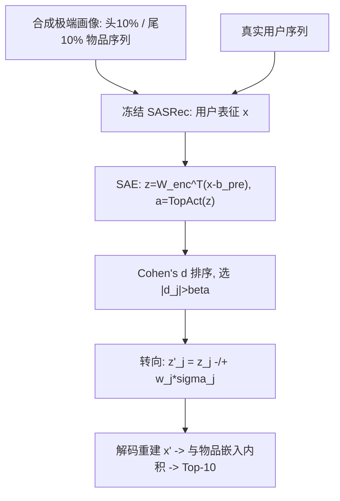

# From Insight to Intervention: Interpretable Neuron Steering for Controlling Popularity Bias in Recommender Systems (从洞察到干预：可解释神经元转向控制推荐流行度偏差)

- **会议/期刊**: WWW 2026 (arXiv 2601.15122v2)
- **作者与机构**: Parviz Ahmadov, Masoud Mansoury (Delft University of Technology)
- **推荐链路定位**: 重排 / 后处理（作用在已训练模型的用户表征上，无需重训）
- **研究方向**: 去偏公平与可信推荐 / 序列推荐
- **论文原文**: [https://arxiv.org/abs/2601.15122v2](https://arxiv.org/abs/2601.15122v2)
- **开源代码**: [https://github.com/parepic/PopSteer2.0](https://github.com/parepic/PopSteer2.0)

## TL;DR (1分钟核心速览)

现有流行度去偏方法（重加权打分、改架构、重排）本质是黑盒：能"降偏"却说不清哪一内部组件制造了偏差。本文提出 PopSteer，把稀疏自编码器 (SAE) 挂在 SASRec 的用户表征输出端，用合成头/尾极端画像的激活差异（Cohen's $d$）定位"流行度神经元"，再对这些神经元的激活做方差归一化的定向增/减，回写用户向量后重算打分。在 ML-1M / BeerAdvocate / Yelp 的 Leave-One-Out 协议下，Item Coverage 与 Gini 显著优于 P-MMF、PCT、IPR、FA\*IR、DUOR，且在 ML-1M 上 Gini 从 0.74+ 降至 0.67 量级，仅在 Yelp 上反向提升 nDCG@10 约 2.5%。

## Background & Motivation (背景与核心矛盾)

- **主流范式**: 流行度偏差缓解分三路——训练期重加权/正则、反事实与对抗训练、以及后处理重排（FA\*IR、P-MMF、PCT、IPR、DUOR），普遍把模型当黑盒只调"输出"。
- **前人局限**: (i) 重排类方法在长尾扶持与精度之间常出现"陡崖式"掉点，只换来微小公平增益；(ii) 训练期方法需改损失、需重训，且无法回答"哪一层/哪个单元编码了流行度"，难以诊断系统性偏差来源。
- **核心洞察 (Key Insight)**: SAE 的过完备 + TopK 稀疏性会迫使每个放电单元"单义化"（monosemantic），从而可像 LLM 那样做神经元级归因；作者还实证 SAE 隐层激活近似高斯（各数据集 78.65%–92.53% 神经元 $|\text{skew}|<0.5$，92.37%–97.59%$|\text{excess kurtosis}|<1$），使 Cohen's$d$ 这类效应量可用于神经元排序。
- **本文切入点**: 用"合成极端画像 → 神经元效应量排序 → 定向激活缩放"的闭环，把去偏从"改输出"变成"改内部表征中可解释的一维概念"。

## Method (核心方法设计)

### 1. 整体框架 (Overall Architecture)

两轮流程共享同一套预训练 SASRec 与 SAE。**第一轮（解释）**：构造只含头部物品的 $\mathcal{I}_{Pop}$与只含尾部物品的$\mathcal{I}_{Unpop}$的合成序列画像（默认$n'=409{,}600$个合成用户、序列长$M=50$），送入冻结的 SAE，统计每个隐神经元的激活均值/方差，算 Cohen's$d$得到"偏热门/偏冷门"排序。**第二轮（干预）**：对真实用户的交互序列取同一 SAE 前向，按$d_j$阈值$\beta$选出偏置神经元，把隐激活$z_j$ 做正负向偏移后经 TopAct 与解码器重建，得到"被转向的用户嵌入"，再与原生物品嵌入内积打分输出 Top-10。整个过程只多一次 SAE 前向+解码，不触碰推荐模型参数与损失。

### 2. 关键设计拆解 (Key Designs)

1. **单义化 SAE 探针（把黑盒用户向量拆成可读概念）**：痛点是稠密自编码器单元重叠、不可归因；本文用 TopK 稀疏（隐维 $N=s\cdot d$，$s\in\{32,\dots,128\}$，保留$K\in\{36,\dots,56\}$个激活）配合死神经元复活项，使每个单元专精单一概念。重建式为$\hat{x}=W_{dec}a+b_{pre}$，其中$a=\mathrm{TopAct}(z)$、$z=W_{enc}^{\top}(x-b_{pre})$，训练目标为$\min \|x-\hat{x}\|_2^2+\gamma\mathcal{L}_{aux}$。直觉：过完备池 + 硬稀疏 = 强解耦，转向某一维时对其它语义的干扰被结构性压低。
2. **Cohen's $d$神经元偏置打分（用效应量而非激活绝对值选靶）**：痛点是"哪个神经元真的编码流行度"缺乏量化标准；作者用两类合成画像的激活分布差异做标准化效应量，$d_j=\frac{\mu_{j,Pop}-\mu_{j,Unpop}}{\sqrt{(\sigma^2_{j,Pop}+\sigma^2_{j,Unpop})/2}}$，$d_j>0$表示与热门对齐、$d_j<0$与冷门对齐。因激活近似高斯，$d$具备可比的尺度不变性，跨数据集设同一$\beta$ 才成立。
3. **方差归一化定向转向（避免 zero-out 式硬破坏）**：痛点是对抗式干预常把激活置零/截断，会扭曲分布并伤精度；本文改为按神经元自身标准差缩放、按 $|d_j|$相对强度加权：$z'_j=z_j-w_j\sigma_j$若$d_j>\beta$，$z'_j=z_j+w_j\sigma_j$若$d_j<-\beta$，其中$w_j=\alpha_{Pop}\frac{|d_j|}{\max_i|d_i|}$（对$d_j<-\beta$用$\alpha_{Unpop}$）。直觉：偏移量与"该神经元正常波动幅度"同量级，属于有界扰动，故精度损失平滑而非断崖。
4. **训练目标、负采样与推理开销**：SAE 侧只有重建损失 + 辅助项，推荐模型侧**完全沿用** SASRec 原训练目标与负采样策略（不改损失、不引入新负例）；推理时每用户多一次 SAE 编解码（图 8 显示开销随 SAE 隐维线性增长，但为常数级附加），且 $\alpha_{Pop}/\alpha_{Unpop}$ 可在线上按业务需求在线调节精度-公平权衡。

## Experimental Setup & Evaluation Protocol (实验设置与评估协议)

- **数据集与预处理**: ML-1M / BeerAdvocate 采 `5-core` 过滤，Yelp 因极稀疏采 `20-core`：

| 数据集 | #Users | #Items | #Interactions | 稀疏度/密度 | 特征/场景说明 |
| :--- | :---: | :---: | :---: | :---: | :--- |
| ML-1M | 6,040 | 3,417 | 999,611 | 4.8% | 电影评分，含时间戳 |
| BeerAdvocate | 10,464 | 13,907 | 1,395,865 | 1% | 啤酒评论，长尾极重 |
| Yelp | 20,799 | 16,253 | 983,530 | 0.29% | 餐饮点评，20-core |

- **数据划分与防穿越**: 标准 `Leave-One-Out`（最近一次交互为测试、次近为验证、其余训练），末位物品列表长度 10；序列建模天然按时间戳排序，无未来信息泄漏。
- **排名评测协议**: 主指标 nDCG@10（另在附录分 Head/Tail 分别统计）；公平性用 **Item Coverage**（出现在推荐列表中 ≥5 次的物品占比）与 **Gini Index**（曝光分布不均匀度，越低越公平）。⚠️ 原文未明示是 `Full-Ranking` 还是 `Sampled Ranking`（沿用 SASRec 惯例多为 100 负例采样），属复现口径盲点。
- **对比基线与超参设置**: P-MMF（min-regularize，$\lambda\in[0.01,1]$）、PCT、IPR（$\tilde{s}_{u,i}=s_{u,i}/(1+\alpha\rho_i)$）、FA\*IR（$p,\alpha$网格）、DUOR（列表长$t\in\{50,\dots,1000\}$）与 Random；基线的长列表均取 250 以保证同口径。PopSteer 网格搜索$\alpha_{Pop},\alpha_{Unpop}\in\{1.0,\dots,5.0\}$、$\beta\in\{0,0.5,1,1.5,2\}$；骨干 SASRec 学习率 1e-3、早停 patience=10；公平性差异以$p<0.01$ 的 Wasserstein 距离检验。

## Key Experimental Results (实验关键数据)

### 1. 主实验对比 (Main Results)

原文主结果仅以 Pareto 曲线（Fig. 2，nDCG vs. Item Coverage / Gini）呈现，未给数值表；下表汇总可提取的数值锚点与曲线上的相对位置（`—` 表示仅曲线给出，无数值）：

| 方法 | ML-1M nDCG@10 | ML-1M IC↑ | ML-1M Gini↓ | BeerAdv. IC↑ | BeerAdv. Gini↓ | Yelp IC↑ | Yelp Gini↓ |
| :--- | :---: | :---: | :---: | :---: | :---: | :---: | :---: |
| SASRec (骨干) | 0.1204 | — (最低) | — (最高) | — | — | 0.0202 | — |
| Random | — | — | — | — | — | — | — |
| PCT | — | — | — | — | — | — | — |
| P-MMF | — | — | — | — | — | — | — |
| IPR | — | — | — | — | — | — | — |
| FA\*IR | — | — | — | — | — | — | — |
| DUOR | — | — | — | — | — | — | — |
| **PopSteer (β=1)** | **0.1202 (≈无损)** | **0.5651** | **0.6698** | **0.2939** | **0.7910** | **0.3589** | **0.8143** |

关键定位：ML-1M / BeerAdvocate 上 PopSteer 在**同等 nDCG** 下取得显著更高的 Coverage 与更低的 Gini，全面优于所有基线；Yelp 上 IPR 与 DUOR 能取得更极端的公平值，但代价是更大的 nDCG 跌幅——在"可接受精度损失"的现实工作区间 PopSteer 仍占优；此外 PopSteer 在 Yelp 上把 SASRec 的 nDCG 反向提升约 **2.5%**（精度+公平双赢）。SAE 保真度方面（表3）：重建嵌入余弦相似度 0.998 / 0.984 / 0.989，nDCG 0.1204→0.1202、0.0334→0.0333、0.0202→0.0197。

### 2. 消融实验 (Ablation Study)

| 数据集 | β | PopSteer IC↑ | Noise IC | RandomSelect IC | PopSteer Gini↓ | Noise Gini | RS Gini |
| :--- | :---: | :---: | :---: | :---: | :---: | :---: | :---: |
| ML-1M | 0.5 | **0.5707** | 0.4732 | 0.4750 | **0.6645** | 0.7464 | 0.7429 |
| ML-1M | 1.0 | **0.5651** | 0.4741 | 0.4791 | **0.6698** | 0.7438 | 0.7442 |
| BeerAdv. | 0.5 | **0.2998** | 0.2268 | 0.2430 | **0.7846** | 0.8502 | 0.8409 |
| BeerAdv. | 1.0 | **0.2939** | 0.2131 | 0.2407 | **0.7910** | 0.8675 | 0.8440 |
| Yelp | 1.0 | **0.3589** | 0.3369 | 0.3398 | **0.8143** | 0.8268 | 0.8268 |

（`Noise`：选对神经元但注入高斯噪声；`RandomSelect`：保留转向幅度/方向但随机选神经元；两者均按 nDCG 跌幅 ≤10% 调参，公平口径可比。）

### 3. 关键实验发现 (Key Findings)

1. **"选对"与"改对"缺一不可**：去掉任一环节公平性立刻退化——ML-1M 上 β=1 时 PopSteer 的 Gini 0.6698 相比 Noise 0.7438 与 RandomSelect 0.7442 降低约 7.4 个点，说明增益并非来自"给表征加扰动"这一副效应，而是来自 $d_j$ 引导的定向编辑。
2. **偏置方向被因果验证**：图 4 显示仅按 $d_j>1$ 逐个关掉少数 popularity 神经元，Gini 单调下降；反之关掉 unpopularity 神经元使 Gini 恶化（ML-1M 起始就有陡降，暗示少数"主导神经元"承载主要偏置），与 SAE 单义化假设一致。
3. **表征空间确实被推向长尾**：UMAP + Wasserstein 距离（表 4）显示转向后用户分布远离合成热门簇（ML-1M 1.53→5.92）、靠近合成冷门簇（7.25→3.42），$p<0.01$；同时真实用户原本更贴近热门簇，量化坐实了"数据侧偏置已内化进表征"。
4. **超参非对称**：$\alpha_{Pop}$增大时 nDCG 更早、更陡下降（模型依赖头部特征提供相关性），而$\alpha_{Unpop}$ 放大长尾神经元相对安全——这为线上调参给出"先抬冷门、慎压热门"的操作性建议。

## Highlights & Limitations (亮点、对比与审稿批判)

- **与代表作对比**: 相较 IPR/DUOR（打分层面乘性惩罚或按用户流行度倾向动态校准），PopSteer 在**表征层面**做加性、方差归一化的定向编辑，故权衡曲线平滑可预测；相较 FA\*IR/P-MMF（强制前缀配额或 max-min 公平约束，本质是列表约束满足），它无需重排求解器且不锁定单一公平定义；相较训练期正则/对抗方法，它 post-hoc、免重训、可跨骨干（附录还验证了 LightGCN）。
- **可迁移亮点**: (i) "合成极端画像 → 效应量排序 → 有界激活编辑"这一诊断-干预范式可直接搬到性别/年龄/地域等其它属性偏置，只需替换合成数据构造器；(ii) 用 $\sigma_j$ 做缩放因子替代 zero-out，是把可解释性干预落到工程安全的实用技巧。
- **审稿级局限批判**: (i) **评估口径不透明**——主结果只有 Pareto 曲线无表格，负例采样规模与是否全库排序未交代，Item Coverage 的"≥5 次"阈值也会抬高绝对值，跨论文比较困难；(ii) **干预与合成数据强耦合**：合成画像只用 top/bottom 10% 极端物品、长度固定 $M=50$，对"中度流行"物品与兴趣混合型用户是否同样单义，缺少敏感性证据；且每用户多一次 SAE 编解码，隐维$s\cdot d$ 增大时延迟线性增长，大规模在线部署成本尚未量化（仅在附录/图 8）。

## Rating (四维评分)

- **方法创新性 (Novelty)**: ⭐⭐⭐⭐ （首次将 SAE 神经元级可解释性用于推荐流行度偏差的"诊断+干预"闭环，Cohen's $d$ 选靶 + 方差归一化转向组合新颖，但各组件分别借鉴自 LLM 可解释性工作）
- **评估协议与实验扎实度 (Protocol & Experiments)**: ⭐⭐⭐ （三域数据集 + 5 个强基线 + 双公平指标 + 消融与 Wasserstein 显著性检验较完整，但主结果无数值表、排序协议未明示、缺线上或大规模延迟实测）
- **写作与数学规范度 (Clarity & Rigor)**: ⭐⭐⭐⭐ （SAE 与转向公式定义干净、TopAct 术语特意区分推荐 top-k；高斯性假设还给了偏度/峰度实证；但符号 $\beta$与阈值语义、$\mathcal{L}_{aux}$ 细节需回引原文）
- **工业落地与复现价值 (Industrial & Practical Value)**: ⭐⭐⭐⭐ （post-hoc 免重训、单超参即可调公平-精度权衡、代码已开源，工程接入成本低；代价是额外 SAE 前向与需维护一份归因流水线）

