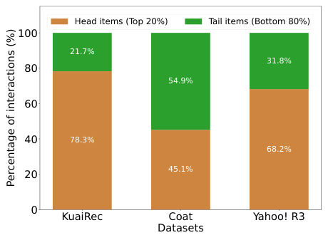
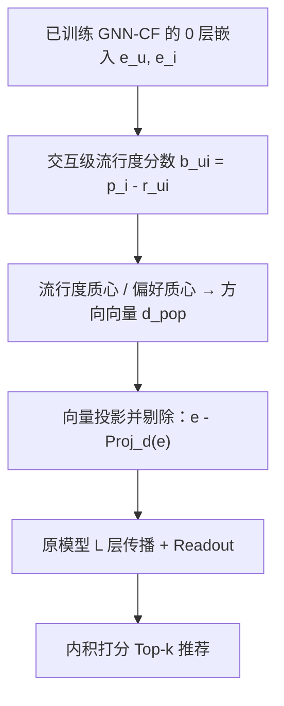

# Post-hoc Popularity Bias Correction in GNN-based Collaborative Filtering (GNN 协同过滤的即插即用流行度偏差校正)

- **会议/期刊**: WWW 2026 (The ACM Web Conference)
- **作者与机构**: Md Aminul Islam, Elena Zheleva (University of Illinois Chicago)；Ren Wang (Illinois Institute of Technology)
- **推荐链路定位**: 召回（GNN 协同过滤的嵌入后处理）
- **研究方向**: 去偏公平、可信隐私与工业架构 / 图神经网络推荐
- **论文原文**: [https://arxiv.org/abs/2510.12959v2](https://arxiv.org/abs/2510.12959v2)
- **开源代码**: [https://github.com/edgeslab/Posthoc_Popularity_Debiasing](https://github.com/edgeslab/Posthoc_Popularity_Debiasing)

## TL;DR (1分钟核心速览)

GNN 协同过滤在多跳邻域聚合中会把长尾交互数据的流行度偏差不断放大，而现有 IPW、正则化、因果、聚合加权等方法**都必须重训骨干**，聚合加权法还因训练早期表征不稳而产生噪声权重。本文提出 PPD：在**已训练好的嵌入**上，用「全局偏好 $p_i$减去个性化偏好$r_{ui}$」估计出**交互级**流行度分数，据此构造每个节点的流行度方向向量，再通过一次向量投影把该方向上的分量从嵌入中减掉，随后正常传播与打分。在 KuaiRec / Coat / Yahoo! R3 三个带**无偏测试集**的数据集上，Recall@20 相对最强基线提升 +186.4% / +4.8% / +2.9%，同时推理耗时降低 2.32×–28.64×。

## Background & Motivation (背景与核心矛盾)

- **主流范式**: 以 LightGCN 为代表的消息传递 CF 通过邻居聚合学习高阶协同信号，是召回侧的事实标准；去偏工作主要分 IPW 重加权、正则化约束、因果图/反事实、以及聚合阶段加权（APDA、NAVIP）四类。
- **前人局限**: ① 损失改造类方法无法抵消**聚合过程本身传播的偏差**——高度数物品在每层传播中快速把信息扩散到大量用户，用户表征被头部物品"拉走"，多层堆叠后进一步强化；② 聚合加权法在**每个 epoch** 都施加权重，训练早期表征尚未稳定，流行度估计噪声大，反而扭曲学习；③ 全部需要重训，对已上线模型不可用。
- **核心洞察 (Key Insight)**: 偏差已经"固化"在训练好的嵌入里，因此**只要把嵌入中的流行度分量剔掉就够**，无需再碰训练过程；而且流行度并非总是有害，必须扣掉"真实偏好"那一部分（$b_{ui}=p_i-r_{ui}$），否则会把用户真正喜欢的头部物品一并误杀。
- **本文切入点**: 用一次后处理投影替换整个重训闭环，并把流行度估计从"节点度数/聚类"升级为"交互级 + 全局与个性化双因素"。

<figure class="paper-figure" markdown="span">
  <figcaption>图1：KuaiRec、Coat 和 Yahoo! R3 数据集中头部（前20%）与尾部（后80%）项目的交互分布。大多数交互集中在头部项目上，凸显了这些数据集中的数据不平衡。</figcaption>
</figure>

## Method (核心方法设计)

### 1. 整体框架 (Overall Architecture)

PPD 分三步闭环：(i) 取一个已训好的 GNN-CF 模型（LightGCN/SGL 等）的 0 层嵌入；(ii) 对每条已观测交互 $(u,i)$计算全局偏好$p_i$与个性化偏好$r_{ui}$，得到流行度分数$b_{ui}$，再加权聚合出每个用户的"流行度质心"与"偏好质心"，两者之差即得流行度方向；(iii) 把 0 层嵌入投影到该方向上并减去投影分量，得到去偏嵌入，再走原模型的$L$层传播与 mean-pooling readout，用内积打分输出 Top-$k$。关键在于**只在$l=0$ 层去偏一次**，让无偏信号自然流向所有高阶层。

### 2. 关键设计拆解 (Key Designs)

1. **交互级流行度分数（增量：把"频次/度数"换成"全局偏好 − 个性化偏好"）**：频次式流行度无法区分"用户真心喜欢的头部物品"与"被裹挟点击的头部物品"。作者定义 $p_i=\frac{1}{|\mathcal{U}|}\sum_{u}sim(\boldsymbol{e}_u,\boldsymbol{e}_i)$（嵌入空间中的泛化吸引力）与$r_{ui}=\frac{1}{|N_u|}\sum_{j\in N_u}sim(\boldsymbol{e}_i,\boldsymbol{e}_j)-\beta p_ip_j$（物品与该用户历史的一致性，并减去$\beta p_ip_j$抑制"流行-流行误相似"），最终$b_{ui}=p_i-r_{ui}$。相减的物理直觉：$p_i$中属于真实兴趣的部分被$r_{ui}$ 抵扣掉，只剩"纯被流行推动"的残差。

2. **质心—方向—投影去偏（增量：一次投影替代逐 epoch 加权）**：以 $b_{ui}$与$1-b_{ui}$为权重分别聚合邻居，得$\bar{\boldsymbol{e}}_{pop}$与$\bar{\boldsymbol{e}}_{pref}$，方向向量定义为$\boldsymbol{d}_{pop}=\bar{\boldsymbol{e}}_{pop}-\phi\cdot\bar{\boldsymbol{e}}_{pref}$（$\phi\in[0,1]$ 调节偏好质心的可信度，数据越偏斜取越小）。去偏算子为

$$\tilde{\boldsymbol{e}}_u=\boldsymbol{e}_u-\frac{\langle\boldsymbol{e}_u,\boldsymbol{d}_{pop}\rangle}{\|\boldsymbol{d}_{pop}\|^2}\,\boldsymbol{d}_{pop}$$

   即只删掉"沿着流行度方向"的那一维分量，与流行度正交的偏好子空间**完全保留**，因此不会像重排序那样粗暴打压头部物品，避免了 head-tail 此消彼长。

3. **训练目标、负采样与推理效率**：PPD **不改任何损失**，骨干仍用 BPR：$\mathcal{L}_{BPR}=\sum_{(u,i)\in N_u,j\notin N_u}-\ln\sigma(\hat y_{ui}-\hat y_{uj})+\gamma\|\Theta\|_2^2$，负采样沿用均匀负采样；PPD 只在训练结束后做一次前向统计 + 一次投影，**不需要加载训练集、不需要 GPU 训练**，GPU 显存约为最强基线的一半，实测加速 2.32×/28.64×/3.44×。

## Experimental Setup & Evaluation Protocol (实验设置与评估协议)

- **数据集与预处理**: 特意选取**自带无偏测试集**的三个数据集（避免从训练交互中采样测试集导致的流行度穿越）：

| 数据集 | #Users | #Items | #Interactions | 稀疏度 | 无偏测试构造 |
| :--- | :---: | :---: | :---: | :---: | :--- |
| KuaiRec | 7,176 | 10,728 | 1,153,106 | 0.01498 | 全曝光稠密子阵（1,411 用户 × 3,327 物品），观看时长 > 2× 视频时长记正 |
| Coat | 290 | 300 | 5,490 | 0.06303 | 每用户随机展示 16 件并评分（训练为自选 24 件） |
| Yahoo! R3 | 14,382 | 1,000 | 129,748 | 0.00902 | 5,400 用户随机听 10 首歌，评分 ≥3 记正 |

- **数据划分与防穿越 (Splitting Strategy)**: 采用"自选训练集 + 随机曝光测试集"的**无偏划分**（KuaiRec 为全曝光划分），从机制上切断训练分布与评测分布的同源流行度。
- **排名评测协议 (Ranking Protocol)**: Coat / Yahoo! R3 使用 **Full-Ranking 全库排序**（排除训练正反馈）；KuaiRec 因测试集为稠密子阵，仅在 3,327 个全曝光物品内排序（非全库）。指标 Recall@20 / NDCG@20 / HR@20。
- **对比基线与超参设置**: 8 个基线覆盖全部去偏流派——LightGCN（无去偏骨干）、DAP（后处理）、APDA / NAVIP（聚合加权）、MACR / PPAC（因果）、IPSCN（IPW）、SAM-REG（正则化）；统一以 LightGCN 为骨干，另在 SGL 上验证泛化性。

## Key Experimental Results (实验关键数据)

### 1. 主实验对比 (Main Results)

| 类型 | 方法 | KuaiRec R@20 | KuaiRec N@20 | Coat R@20 | Coat N@20 | Yahoo R@20 | Yahoo N@20 | 耗时(min, KuaiRec) |
| :--- | :--- | :---: | :---: | :---: | :---: | :---: | :---: | :---: |
| 无去偏 | LightGCN | 0.0055 | 0.0043 | 0.1572 | 0.0773 | 0.1403 | 0.0640 | 115.42 |
| 后处理 | DAP | 0.0289 | 0.0284 | 0.1607 | 0.0777 | 0.1416 | 0.0647 | 260.13 |
| 聚合加权 | APDA | 0.0097 | 0.0077 | 0.1435 | 0.0727 | 0.1392 | 0.0627 | 832.52 |
| 聚合加权 | NAVIP | 0.0006 | 0.0039 | 0.1413 | 0.0730 | 0.1439 | 0.0648 | 121.34 |
| 因果 | MACR | 0.0104 | 0.0107 | 0.1002 | 0.0451 | 0.0089 | 0.0033 | 119.23 |
| IPW | IPSCN | 0.0010 | 0.0060 | 0.2296 | 0.1933 | 0.1309 | 0.0589 | 118.32 |
| 正则化 | SAM-REG | 0.0018 | 0.0133 | 0.2206 | 0.1892 | 0.1226 | 0.0551 | 132.12 |
| 因果 | PPAC | 0.0345 | 0.0483 | 0.1444 | 0.0716 | 0.1462 | 0.0657 | 260.21 |
| **后处理** | **PPD** | **0.0988** | **0.2899** | **0.2407** | **0.1957** | **0.1505** | **0.0695** | **112.31** |
| — | **Improv.%** | +186.4% | +500.2% | +4.8% | +1.2% | +2.9% | +5.8% | **2.32×** |

### 2. 消融与分组实验 (Ablation & Head/Tail Split)

| 设置 / 变体 | KuaiRec(头20%/尾80% R@20) | Coat(头/尾 R@20) | Yahoo(头/尾 R@20) | 结论 |
| :--- | :---: | :---: | :---: | :--- |
| PPD 完整版 | 0.1167 / 0.0010 | 0.3770 / 0.1550 | 0.3222 / 0.0352 | 头尾同时最优 |
| 最强去偏基线 | 0.0407 (PPAC) / 0.0003 (IPSCN) | 0.3672 (IPSCN) / 0.1531 (SAM-REG) | 0.3008 (NAVIP) / 0.0337 (DAP) | 尾部普遍崩坏 |
| w/o 个性化偏好 (PPD w/o-PP) | 三数据集全面下降（附录表 5） | 同左 | 同左 | $r_{ui}$ 是剥离残差的关键 |
| $\phi$（偏好质心系数） | 高偏斜下$\phi\approx0.5$最佳 | 偏斜较小时取更大$\phi$更优 | 同 Coat | 最优$\phi$ 依数据偏斜度而定 |
| $\beta$（流行度惩罚） | 0.2（0.3 时回落） | 0.1 | 0.3 |$\beta=0$ 明显次优，惩罚项必要 |

### 3. 关键实验发现 (Key Findings)

1. **越偏斜，收益越大**：KuaiRec 头部交互占 78.3%，PPD 相对最强基线 Recall@20 +186.4%、NDCG@20 +500.2%；而在偏差较温和的 Coat 上仍稳取 +4.8%，说明该方法不是"靠极端分布刷分"。
2. **头尾不存在此消彼长**：KuaiRec 头部 R@20 +186.7%、尾部 +233.3%；Coat 头部 +2.7%、尾部 +1.24%；Yahoo 头部 +7.1%、尾部 +2.33%（仅尾 NDCG 微降 1.5%）。这直接源于"只减投影分量、保留正交偏好子空间"的算子设计，与 APDA 等加权法以牺牲头部换尾部形成对照。
3. **去偏反而拓宽了深度收益**：LightGCN 在 KuaiRec 上 2 层即达峰值、3–4 层因偏差放大与过平滑而退化；PPD 在该数据集上随层数增加**持续受益**，说明 0 层一次去偏阻断了高层传播的偏差累积路径。

## Highlights & Limitations (亮点、对比与审稿批判)

- **与代表作对比 (vs. Prior Work)**: 相比 APDA / NAVIP 的"每 epoch 加权"，PPD 把加权换成"训练后一次投影"，既躲开早期表征不稳，也免除重训；相比同为后处理的 DAP，PPD 用**交互级** $b_{ui}$ 取代"节点度数 + 相似节点聚类"，能区分"真喜欢的头部"与"被裹挟的头部"，故 KuaiRec 上 Recall 是 DAP 的 3.4 倍。
- **可迁移亮点**: ①"方向向量 + 正交投影"这一算子可平移到曝光偏差、位置偏差等任意可定义方向的去偏场景；②在 0 层去偏、后续层正常传播的"单点介入"策略，可作为任何多层 GNN 的低成本正则化插件。
- **审稿级局限批判**: ①无偏数据集仅 3 个且 Coat 仅 290 用户，Yahoo 极度稀疏（0.009），统计功效有限，缺少大规模工业 A/B；②超参 $\phi$、$\beta$ 依数据集偏斜度手调，论文未给出可自动定标的准则，冷启动场景下偏好质心噪声可能放大；③方法假设"流行度方向线性可分离"，对多模态/内容特征混合的嵌入是否仍成立未验证。

## Rating (四维评分)

- **方法创新性 (Novelty)**: ⭐⭐⭐⭐ （把"流行度=全局−个性化残差"与正交投影结合，机制简洁且有清晰物理直觉，但线性可分离假设偏强）
- **评估协议与实验扎实度 (Protocol & Experiments)**: ⭐⭐⭐⭐⭐ （罕见地坚持使用三个自带无偏测试集的数据，全库排序 + 头尾分组 + 骨干替换 + 耗时显存对比，协议非常干净）
- **写作与数学规范度 (Clarity & Rigor)**: ⭐⭐⭐⭐ （公式推导与投影算子表述清晰，但关键超参分析与 SGL 泛化实验被推入附录，主文略欠完整）
- **工业落地与复现价值 (Industrial & Practical Value)**: ⭐⭐⭐⭐⭐ （免重训、半显存、2.32×–28.64× 加速，代码已开源，可直接挂到线上已部署 GNN 召回模型上）

