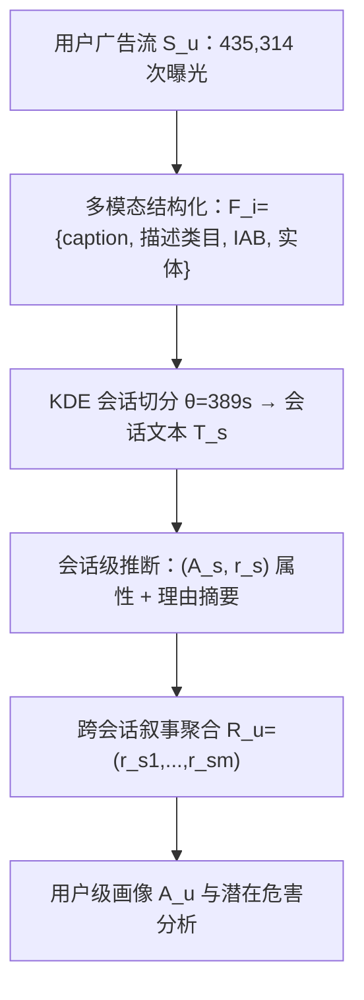

# When Ads Become Profiles: Uncovering the Invisible Risk of Web Advertising at Scale with LLMs (当广告成为画像：用 LLM 大规模揭示网络广告的隐形风险)

- **会议/期刊**: WWW 2026 (The ACM Web Conference 2026)
- **作者与机构**: Baiyu Chen, Benjamin Tag, Flora Salim (UNSW)；Hao Xue (HKUST-GZ)；Daniel Angus (QUT)
- **推荐链路定位**: 广告投放审计 / 被动曝光侧画像推断（非召回-排序链路）
- **研究方向**: 去偏公平、可信隐私与工业架构 / LLM4Rec
- **论文原文**: [https://arxiv.org/abs/2509.18874v3](https://arxiv.org/abs/2509.18874v3)
- **开源代码**: [https://github.com/Breezelled/when-ads-become-profiles](https://github.com/Breezelled/when-ads-become-profiles)
- **归档说明**: 本文属广告生态的隐私威胁建模与社会风险量化（不做 CTR/特征交叉），故主分类归入 `debias_fairness_industrial`，交叉 `llm_rec`。

## TL;DR (1分钟核心速览)

Meta 2022 年关停"详细定向"敏感类目后，算法优化仍让**广告曝光与私密属性强相关**；以往利用该信号需海量标注训练专用分类器，门槛极高。本文提出零样本三阶段流水线：多模态广告结构化（caption / IAB 类目 / 实体）$\to$会话级属性推断与自然语言理由$\to$ 跨会话叙事聚合的用户级画像。在 891 名澳大利亚 Facebook 用户、63,864 会话、435,314 次曝光的纵向日志上，用户级 Gender 达 76.38%、Party 41.60%（census 先验 19.85%）、Age MAE 0.85，且比人类便宜 223 倍、快 52 倍。

## Background & Motivation (背景与核心矛盾)

- **主流范式**: 平台用不透明的定向优化算法按推断画像投放广告；监管通过"移除显式敏感定向选项"来保护隐私。
- **前人局限**: ① 显式定向限制并未消除算法优化引入的人口学偏斜，广告曝光仍是私密属性的高保真代理；② 广告审计文献只做到"检测歧视"，而利用该信号需大规模标注 + 有监督训练分类器，成本与可审计性构成天然屏障。
- **核心洞察 (Key Insight)**: 零样本多模态 LLM 的普及把这一屏障抹平——LLM 能直接读懂广告创意的语义（视觉 + 文案），使**被动曝光（passive exposure）**这一被忽视的数字足迹成为与主动发帖等价的泄露通道；且攻击者可藏身于"广告拦截器/优惠券插件"这类合法读取页面内容的良性扩展中，天然绕过平台侧审计。
- **本文切入点**: 把"仅凭广告流逆推用户属性"形式化为可量化的对抗性推断任务，用现成 LLM 做零样本自然语言 profiling，并与 census 先验、人类标注者三方对标。

## Method (核心方法设计)

### 1. 整体框架 (Overall Architecture)

威胁模型给出三条操作性假设：攻击者无标注数据、无平台内部权限（只看客户端渲染的可见广告）、无真值属性，仅通过公共 API 调用现成多模态 LLM。流水线把连续广告流压缩为可负担的文本表征：先用 Gemini 2.0 Flash 把每条广告转成结构化语义特征，按 KDE 学出的时间阈值切成会话，会话内做零样本属性推断并输出"理由摘要"，最后把跨会话摘要拼成时序叙事做用户级合成判断——**用自然语言摘要替代原始图像序列，同时解决 token 上限与图文对齐歧义两个工程瓶颈**。

### 2. 关键设计拆解 (Key Designs)

1. **多模态广告语义结构化（把创意变成可推理符号）**：痛点是原始图像序列既超 token 预算又易产生图文错配。做法是对每条广告 $d_i=(V_i,T_i)$以抽取提示做零样本映射$F_i=\mathcal{M}(V_i,T_i\mid P_{\text{extract}})=\{c_i,D_i,L_i,E_i\}$，即 caption、自由描述类目、45 类 IAB 零样本多标签、关键实体。直觉：把高维视觉信号压成"广告主想传达什么"的语义骨架，剔除与用户属性无关的像素噪声。

2. **分层"会话 $\to$用户"自然语言聚合（长序列的可扩展压缩器）**：痛点是用整个两年广告流做一次推断在上下文与成本上不可行。做法是会话级$(\hat{A}_s,r_s)=\mathcal{M}(T_s\mid P^{\text{session}}_{\text{profile}})$只输出属性与一段理由摘要；用户级再用$\hat{A}_u=\mathcal{M}(R_u\mid P^{\text{user}}_{\text{profile}})$，其中$R_u=(r_{s_1},\dots,r_{s_m})$是摘要的时序拼接。直觉：摘要$r_s$ 充当有损但语义保真的"证据载体"，使累积证据与兴趣漂移可被检测，而成本随会话数线性（而非随曝光数）增长。

3. **训练目标、负采样与推理效率**：全流程**零训练、零负采样、零参数更新**，仅靠提示工程；评估用 ordinal 属性的分箱距离 $\mathrm{MAE}=\frac{1}{N}\sum_{n}|\hat{k}_n-k_n|$ 刻画"方向正确性"。边际成本比人类低 223 倍、延迟低 52 倍，故攻击可大规模并行。

## Experimental Setup & Evaluation Protocol (实验设置与评估协议)

- **数据集与预处理**（Australian Ad Observatory 公民科学项目，与威胁模型的浏览器插件视角同构）：

| 数据集 | #Users | #Sessions | #Impressions | 稀疏/规模说明 |
| :--- | :---: | :---: | :---: | :--- |
| 原始 Facebook 广告日志 (2021–2023) | 2,000+ | — | 700,000+ | 含广告创意图/文、元数据、脱敏用户链接 |
| 过滤后实验集 | 891 | 63,864 | 435,314 | 仅 Facebook 来源；会话长度限 3–50 条；用户至少 3 个会话 |

- **数据划分与防穿越 (Splitting Strategy)**: **非随机划分**，而是按时间连续性做会话切分——对 log 间隔做核密度估计得全局阈值 $\theta=389$s，相邻广告间隔超阈值即判为新会话；真值来自用户入组时的人口学问卷，与广告内容完全独立，无标签穿越风险。
- **排名评测协议 (Ranking Protocol)**: 本文不做检索排序，而是**零样本分类评测**：Accuracy + Macro-F1（应对类别不平衡），Age/Income 额外报 MAE 与 NMAE（跨不同分箱粒度可比）。对照组包括 Random Guessing、**Random Control（会话内广告顺序打乱）**、census 派生的 Prior-Mode / Prior-Sampling（1,000 次采样均值±标准差）、6 名人类标注者（100 个分层抽样会话）。
- **对比基线与超参设置**: LLM 侧覆盖 GPT-4o、Gemini 2.0 Flash / 2.5 Flash / 2.5 Pro、GPT-5 Mini、GPT-5；为与 census 基线公平对比，增设注入澳大利亚文化上下文的 Gemini†。全流程零微调，超参见附录 B；未报告显著性检验，人类基线给出 $\pm$ 标准差。

## Key Experimental Results (实验关键数据)

### 1. 主实验对比 (Main Results)

**用户级画像重建（891 用户，Acc / MAE，Gemini† 提供澳大利亚文化上下文）**

| 属性 (指标) | Random | Prior-Mode | Prior-Sampling | Random Control | Gemini 2.0 Flash | Gemini† | Improv.% (vs 最强非 LLM) |
| :--- | :---: | :---: | :---: | :---: | :---: | :---: | :---: |
| Gender (Acc) | 50.00 | 36.47 | 49.89 | 70.39 | 74.88 | **76.38** | +8.5% |
| Age (Acc) | 14.29 | 20.84 | 14.85 | 38.00 | **41.18** | 40.84 | +8.4% |
| Age (MAE↓) | 2.29 | 2.04 | 2.11 | 0.90 | **0.85** | 0.95 | −5.6% |
| Income (Acc) | 8.33 | 9.25 | 8.32 | **10.27** | 9.11 | 8.99 | −11.3% |
| Income (MAE↓) | 3.97 | 3.07 | 4.06 | **2.73** | **2.73** | 2.77 | ±0.0% |
| Education (F1) | 25.00 | 11.94 | 24.20 | 33.60 | 34.13 | **34.37** | +2.3% |
| Employment (F1) | 20.00 | 24.13 | 32.77 | 33.59 | 34.66 | **35.63** | +6.1% |
| Party (Acc) | 20.00 | 3.14 | 19.85 | 39.92 | 39.91 | **41.60** | +4.2% |

**会话级 vs 人类（前 3 行为全量 63,864 会话；† 标记行为 100 个人工评测会话子集）**

| 方法 | Gender Acc | Age MAE↓ | Education Acc | Employment Acc | Party Acc |
| :--- | :---: | :---: | :---: | :---: | :---: |
| Random Guessing | 50.00 | 2.29 | 25.00 | 20.00 | 20.00 |
| Random Control | 58.80 | **1.63** | **42.76** | 48.29 | 34.63 |
| Gemini 2.0 Flash | **59.13** | 1.64 | 42.70 | **48.38** | **35.13** |
| Human† | 73.67±5.13 | 1.58 | 33.67 | 37.83 | 25.00 |
| GPT-4o† | 60.00 | 1.26 | 46.00 | 49.00 | 26.00 |
| GPT-5† | **76.00** | 1.23 | 46.00 | 51.00 | 25.00 |
| Gemini 2.5 Pro† | 75.00 | **1.15** | **51.00** | **53.00** | **31.00** |

### 2. 消融实验 (Ablation Study)

原文未设模块级消融，此处按其变体对照整理（用户级口径）：

| 配置 | Gender Acc | Age Acc | Age MAE↓ | Education F1 | Employment F1 | Party Acc |
| :--- | :---: | :---: | :---: | :---: | :---: | :---: |
| Full (Gemini†) | **76.38** | 40.84 | 0.95 | **34.37** | **35.63** | **41.60** |
| w/o 文化上下文提示 | 74.88 | **41.18** | **0.85** | 34.13 | 34.66 | 39.91 |
| w/o 跨会话聚合（仅会话级） | 59.13 | 20.41 | 1.64 | 18.04 | 19.92 | 35.13 |
| w/o 时序顺序（打乱） | 70.39 | 38.00 | 0.90 | 33.60 | 33.59 | 39.92 |

### 3. 关键实验发现 (Key Findings)

1. **短窗口即可画像，长期追踪非必需**：仅用单个会话，Education 达 42.70%（随机 25.00%，+70.8%）、Employment 48.38%（+141.9%）、Party 35.13%（+75.7%）；Age NMAE 0.27 优于随机 0.38，说明误差是"邻近分箱的近似命中"而非噪声。
2. **跨会话聚合是最大增益源，且增益随属性社会性递增**：相对最强 census 先验 Prior-Sampling，用户级 Gender +53.1%、Party Acc +109.6%、Education F1 +42.0%、Age MAE −58.3%；而 Income 反而劣于 Random Control（9.11 vs 10.27），揭示收入是最难被广告语义编码的属性。
3. **时序顺序只对身份类属性有用**：打乱会话顺序使 Gender 从 74.88 掉到 70.39（−6.0%）、Age Acc −1.5%，但对 Education/Employment 仅 −1.4%/−1.3%，证明社会经济属性靠**累积语义集合**而非排列顺序泄露；同时 LLM 在 Gender 上已与人类持平（GPT-5 76.00 vs Human 73.67），在 Education/Employment 上大幅超越人类（51.00 vs 33.67、53.00 vs 37.83）。

## Highlights & Limitations (亮点、对比与审稿批判)

- **与代表作对比 (vs. Prior Work)**: 相较 Facebook Likes / 搜索日志 / Reddit 帖子等**主动数字足迹**研究，本文首次证明**被动消费的算法内容**是等价泄露通道；相较广告审计文献（只做歧视检测与群体统计），本文把同一相关性升级为**个体级对抗性利用**；相较需标注训练的专用分类器，本文零样本即可复现，攻击门槛从"数据科学团队"降到"会调 API 的个人"。
- **可迁移亮点**: ① "会话摘要 $\to$跨会话叙事"的分层自然语言聚合，是把超长多模态行为日志塞进 LLM 上下文并保持线性的通用压缩范式，可直接迁移至长序列推荐画像；② 用 KDE + log 间隔自动学会话阈值$\theta$，比固定 30 分钟规则更贴合真实浏览节奏，值得序列/会话推荐借鉴。
- **审稿级局限批判**: ① 样本为澳大利亚、桌面端、自选择的 891 人，6 个属性且每格样本小，无显著性检验与置信区间（人类基线 $\pm5.13$ 已相当宽），结论外推性存疑；② 为避免 token 爆炸把视觉 captioning 与推理拆开，作者自承端到端多模态可能低估风险，但反过来也使"究竟是 LLM 解码了个性信号还是仅拟合了国别先验 + IAB 分布"缺乏干净的因果分离；③ 全文无防御侧评估——未给出加噪、创意扰动或差分隐私下的精度-成本权衡曲线，因而对治理的指导仍停留在倡议层面。

## Rating (四维评分)

- **方法创新性 (Novelty)**: ⭐⭐⭐⭐ （把"被动广告曝光"确立为独立泄露面并把零样本多模态 LLM 用作对抗推断引擎，问题定义本身即是主要贡献；但流水线组件均为现成模型的工程编排）
- **评估协议与实验扎实度 (Protocol & Experiments)**: ⭐⭐⭐ （census 先验 + 人类 + 打乱顺序三重对照设计考究，数据规模真实；但单平台、小样本、无显著性检验与置信区间，且无模块级消融）
- **写作与数学规范度 (Clarity & Rigor)**: ⭐⭐⭐⭐ （威胁模型假设、任务形式化与指标选择（MAE 刻画方向正确性）交代清楚，NMAE 归一化考虑周到；数学深度有限，属实证研究范式）
- **工业落地与复现价值 (Industrial & Practical Value)**: ⭐⭐⭐⭐ （代码开源、零训练可复现、成本低 223 倍，对平台风控与广告审核团队具有直接的攻防演练价值；但缺乏防御方案的定量验证，落地需补齐对抗鲁棒性实验）

