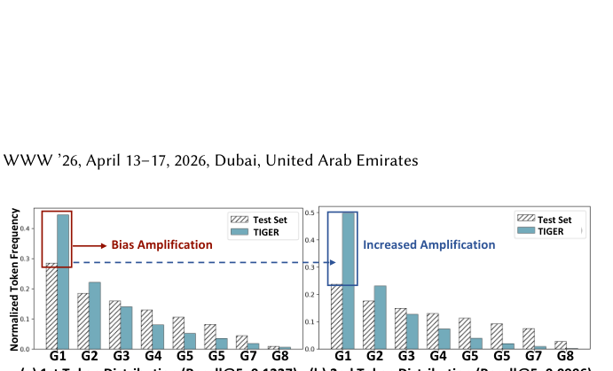
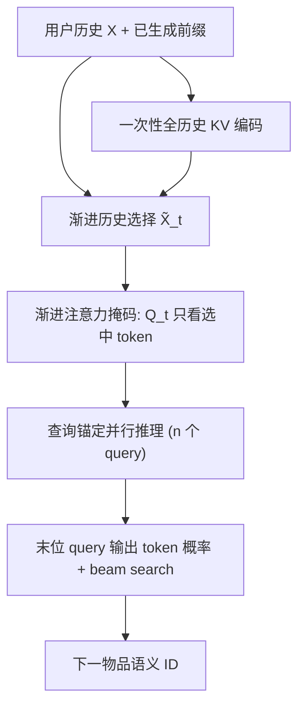
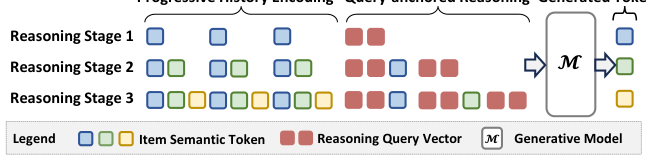

# Bringing Reasoning to Generative Recommendation Through the Lens of Cascaded Ranking (从级联排序视角为生成式推荐引入推理)

- **会议/期刊**: WWW 2026 (Accepted)
- **作者与机构**: Xinyu Lin, Tat-Seng Chua (NUS)；Pengyuan Liu, Wenjie Wang, Yicheng Hu, Fuli Feng (USTC)；Chen Xu (RUC)；Qifan Wang (Meta AI)
- **推荐链路定位**: 召回 / 端到端生成式检索（语义 ID 逐 token 生成）
- **研究方向**: 生成式推荐与离散语义 ID / 去偏公平与可信推荐
- **论文原文**: [https://arxiv.org/abs/2602.03692v2](https://arxiv.org/abs/2602.03692v2)
- **开源代码**: [https://github.com/Linxyhaha/CARE](https://github.com/Linxyhaha/CARE)

## TL;DR (1分钟核心速览)

本文指出语义 ID 生成式推荐存在 **token 级偏差放大**：越靠后的细粒度 token，其流行度偏差越被放大（最热门 token 组平均被放大 246%，第 4 个 token 达 325%），根源是「所有生成步共用同一份历史 KV 编码」+「固定单次前向计算」。作者提出 CARE：用**渐进历史编码 + 渐进注意力掩码**注入异质信息，用**查询锚定并行推理**在单次前向内完成多步深推理，并以推理多样性损失去同质化。在 4 个数据集、3 个生成式骨干上，按时间 8:1:1 划分、Top-K 全库打分协议下，Recall@5 相对提升约 4%~15%，同时 DivR@5 提升 30%~55%、过度推荐率 ORR@5 由 22.8% 降至 15.2%。

## Background & Motivation (背景与核心矛盾)

- **主流范式**: 以 RQ-VAE/层次聚类把物品编码为「粗→细」语义 ID $(c_1,\dots,c_l)$，单模型自回归生成下一物品的 token 序列，实现端到端、高 FLOPs 利用率的推荐。
- **前人局限**: ①不同生成步共享同一份编码历史 $\boldsymbol{h}=KV(X)$，信息同质，无法区分细粒度偏好；②每步只做一次固定计算量的前向，缺乏类似多阶段管道后期重模型的算力倾斜，导致后段 token 判别力不足。
- **核心洞察 (Key Insight)**: 作者把 GR 的逐 token 生成重新解读为「隐式级联排序」——第 1 个 token 相当于召回、第 2 个相当于粗排，候选集按前缀共享逐步收窄；因此传统多阶段「越往后期特征交互越深」的成功经验，正对应 GR 缺失的两件事：异质信息与递增算力。
- **本文切入点**: 既然偏差随生成步累积，就让「信息粒度」和「推理算力」也随生成步一起递增，且不引入自回归推理的额外时延。

<figure class="paper-figure" markdown="span">
  <figcaption>图1：(1) 热门token组上的偏差放大；以及(2) 从初始到后续token生成步骤（即第1到第2个token）偏差放大加剧的示意图。G1-G8表示按流行度排序的token组。</figcaption>
</figure>

## Method (核心方法设计)

### 1. 整体框架 (Overall Architecture)

输入用户历史 $X$与待生成语义 ID 前缀；历史**只编码一次**得全量 KV，随后每个生成步$t$只让一组可学习查询向量$Q_t$与「按粒度选中的历史子集$\tilde X_t$」交互（渐进注意力掩码控制可见范围），最后一步 query 的输出经线性层给出下一个 token 的概率分布；训练用生成似然损失 + 推理多样性损失联合优化，推理时仍是单次前向 + beam search，无额外自回归步。

<figure class="paper-figure" markdown="span">
  <figcaption>图4：CARE示意图，包括渐进式历史编码与查询锚定推理。</figcaption>
</figure>

### 2. 关键设计拆解 (Key Designs)

1. **查询锚定推理 (Query-Anchored Reasoning)**：痛点——LLM 式「先推理再回答」需多次前向，实时推荐不可承受。做法：在第 $t$步拼接$n$个可学习查询$Q_t=(\boldsymbol{q}_1,\dots,\boldsymbol{q}_n)$，一次前向即可完成$n$ 步并行深推理，取末位查询输出概率
   $\boldsymbol{p}=\mathcal{M}(\boldsymbol{h},Q_1,c_1,\dots,Q_{t-1},c_{t-1},Q_t),\quad c_t=\arg\max_c \boldsymbol{p}[c]$。
   直觉：自注意力使末位 query 聚合前 $n-1$ 个 query 的推理痕迹，等价于「并行思维链」，把算力集中到与历史的多轮交互而非序列解码上。

2. **渐进历史编码 + 渐进注意力掩码 (Progressive History Encoding & Mask)**：痛点——同质历史导致粗/细粒度偏好无法区分。做法：利用语义 ID 的层次性，第 $t$步只暴露每个历史物品的前$t$个 token，即$\boldsymbol{h}_t=KV(\tilde X_t)$，早期只看粗粒度（"运动"），后期补足细粒度（"篮球鞋"）。若按因果掩码逐阶段重编码，复杂度为$O(l^3M^2d)$；改为一次编码 + 掩码选择性可见，降为$O(l^2M^2d)$，避免重复计算 KV。

3. **训练目标、负采样与推理效率**：损失 $\mathcal{L}=\mathcal{L}_{gen}+\alpha\mathcal{L}_{div}$，其中$\mathcal{L}_{gen}$为逐 token 对数似然（Teacher Forcing），$\mathcal{L}_{div}=\frac{1}{N^2-N}\sum_{i}\sum_{j\neq i}\mathcal{S}_{ij}$惩罚同一阶段内 query 间余弦相似度，防止多个 query 退化为同一语义锚点（$\alpha=0.7$ 最佳）。全库 softmax、无负采样；实测训练时间仅 +4.9%、推理 +1.5%，训练显存 +6.37%、推理显存 +0.34%。

## Experimental Setup & Evaluation Protocol (实验设置与评估协议)

- **数据集与预处理**: 3 个 Amazon 类别 + MicroLens 微视频；均按用户交互时间排序后 8:1:1 切分，物品由 RQ-VAE 生成 $l=4$ 的语义 ID。

| 数据集 | #Train Int. | #Valid Int. | #Test Int. | #Items | 场景说明 |
| :--- | :---: | :---: | :---: | :---: | :--- |
| Games | 201,612 | 25,201 | 25,202 | 11,036 | 电商游戏品类，含标题/类目元数据 |
| Sports | 181,476 | 22,684 | 22,685 | 16,002 | 电商运动品类 |
| Toys | 112,754 | 14,094 | 14,095 | 11,251 | 电商玩具品类 |
| MicroLens | 60,100 | 9,035 | 9,120 | 5,326 | 微视频，含视频标题 |

- **数据划分与防穿越 (Splitting Strategy)**: 全局时间序 8:1:1 比例划分（train/valid/test），严格避免未来交互穿越。
- **排名评测协议 (Ranking Protocol)**: 采用无偏 **Full-Ranking**（对全物品集打分排序），报告 Recall@{5,10,20}、NDCG@{5,10,20}；另用 DivR@K（唯一推荐物品占比）与 ORR@K（Top-5 物品占全部推荐的比例，越低越好）刻画多样性。
- **对比基线与超参设置**: 传统序列 SASRec / GRU4Rec / CASER；自回归 GR：TIGER、LETTER；并行 GR：RPG、HSTU、SETRec；推理与去偏：ReaRec*（迁移至 GR）、SPRec。骨干统一 Qwen2.5-0.5B，学习率搜索 $\{1e^{-3},5e^{-4},3e^{-4},1e^{-5}\}$，batch 512，最多 200 epoch，8×A100。

## Key Experimental Results (实验关键数据)

### 1. 主实验对比 (Main Results)

| 数据集 | 方法 | R@5 | R@10 | R@20 | N@5 | N@10 | N@20 |
| :--- | :--- | :---: | :---: | :---: | :---: | :---: | :---: |
| Games | SASRec | 0.0316 | 0.0487 | 0.0721 | 0.0221 | 0.0276 | 0.0335 |
| Games | CASER | 0.0261 | 0.0427 | 0.0672 | 0.0176 | 0.0229 | 0.0291 |
| Games | SPRec | 0.0170 | 0.0244 | 0.0358 | 0.0121 | 0.0145 | 0.0174 |
| Games | TIGER | 0.0298 | 0.0503 | 0.0824 | 0.0207 | 0.0273 | 0.0353 |
| Games | **TIGER+CARE** | **0.0338** | **0.0544** | **0.0874** | **0.0232** | **0.0299** | **0.0382** |
| Games | LETTER | 0.0287 | 0.0503 | 0.0840 | 0.0182 | 0.0250 | 0.0335 |
| Games | **LETTER+CARE** | **0.0323** | **0.0532** | **0.0897** | **0.0213** | **0.0279** | **0.0371** |
| Toys | TIGER | 0.0419 | 0.0610 | 0.0904 | 0.0285 | 0.0346 | 0.0420 |
| Toys | **TIGER+CARE** | **0.0469** | **0.0677** | **0.0947** | **0.0337** | **0.0404** | **0.0472** |
| Toys | LETTER | 0.0429 | 0.0673 | 0.1059 | 0.0300 | 0.0378 | 0.0475 |
| Toys | **LETTER+CARE** | **0.0494** | **0.0759** | **0.1117** | **0.0340** | **0.0425** | **0.0515** |

相对提升幅度：Games 上 TIGER R@5 +13.4%、N@5 +12.1%；Toys 上 LETTER R@5 +15.2%、N@5 +13.3%；MicroLens 上 TIGER R@5 +8.5%、N@5 提升幅度最大（0.0086→0.0132）。并行骨干 SETRec 上增益较小（Games R@5 0.0480→0.0500）。

**多样性（Games）**：TIGER 的 DivR@5 0.0183→**0.0260**、ORR@5 0.2278→**0.1516**；LETTER 的 DivR@5 0.0202→**0.0312**、ORR@5 0.2341→**0.1388**。

### 2. 消融实验 (Ablation Study)

| 变体（Games） | R@5 趋势 | 结论 |
| :--- | :---: | :--- |
| CARE 全量 (TIGER) | 0.0338 (基线) | 完整模型最优 |
| w/o Reasoning（去查询锚定推理） | ↓ 最大 | 深交互是增益主来源 |
| w/o PA（渐进掩码换回因果掩码） | ↓ 中等 | 异质信息粒度对齐有效 |
| w/o $\mathcal{L}_{Div}$ | ↓ 较小 | query 去同质化起正则有助 |

**推理步数缩放（TIGER, Games, 各生成步 query 数）**：`1-1-4-4` 最佳（R@5 0.0357、N@5 0.0248），优于 `2-2-1-1`（0.0334）与 `2-4-1-1`（0.0299）；均衡配置 `4-4-1-1` 仅 0.0320。

### 3. 关键实验发现 (Key Findings)

1. **偏差放大在细粒度 token 上更致命，也最易被修复**：TIGER 前 4 个 token 的最热组放大倍数依次为 160%/200%/300%/325%，而 CARE 使第 3、4 个 token 的 Recall@5 分别提升 **918.9%** 与 **1186.6%**，第 1 个 token 反而微降 3.0%——说明粗粒度 token 受时序兴趣漂移主导，靠推理难以获益，而细粒度 token 才是算力倾斜的回报区。
2. **算力应「后置」而「前置」**：`1-1-4-4` 将 query 集中在后两阶段 (R@5 0.0357) 明显优于 `2-4-1-1` (0.0299)，与「越晚越需要细粒度理解」的级联排序动机自洽；前期多推理甚至带来负收益。
3. **异质信息依赖语义 ID 的层次性**：在严格粗→细的 TIGER/LETTER 上提升显著（Toys LETTER R@5 +15.2%），而在 token 无序的并行骨干 SETRec 上增益收窄（Games +4.2%），部分数据集 NDCG 甚至轻微下降——退化原因是 SETRec 的语义 token 与 CF token 线性融合共享权重，额外推理难以拉开 token 语义区分度。

## Highlights & Limitations (亮点、对比与审稿批判)

- **与代表作对比 (vs. Prior Work)**: 相较 TIGER/LETTER 仅增加少量参数即插即用，不改变语义 ID 与解码范式；相较 ReaRec*（自回归式「先推理再推荐」，需多轮前向）CARE 用并行 query 把推理开销压到常数级；相较 SPRec（依赖物品标题做 SFT+DPO 去偏，在 Amazon 长文本噪声下 R@5 仅 0.0170）CARE 在语义 token 空间直接去偏，无需外部对齐数据。
- **可迁移亮点**: ①「渐进注意力掩码」可迁移到任何需要多阶段重编码的层次序列任务（如多级类目、多字段生成），把 $O(l^3)$ 重编码降为一次编码 + 掩码复用；②query 间余弦多样性惩罚是一种零额外推理成本的「并行思维链去冗余」正则，适用于任意多 query/多专家头结构。
- **审稿级局限批判**: ①缺少线上 A/B 与长期留存/生态多样性指标，DivR/ORR 仅为离线静态代理，「缓解回音室」的因果结论尚弱；②增益对语义 ID 的层次性高度敏感（SETRec 上 NDCG 反向），且 $n$与$\alpha$需逐阶段手调（`1-1-4-4`、$\alpha=0.7$），大规模部署的自动算力分配尚未解决；③推理时间虽仅 +1.5%，但 TIGER 因 Trie 回溯导致推理显著慢于 LETTER（639s vs 523s），实际系统收益依赖 tokenizer 质量。

## Rating (四维评分)

- **方法创新性 (Novelty)**: ⭐⭐⭐⭐ （把 GR 逐 token 生成重解读为级联排序，并据此同时给出「偏差放大」诊断与「渐进信息 + 并行推理」两把解药，视角新颖且几乎零推理开销）
- **评估协议与实验扎实度 (Protocol & Experiments)**: ⭐⭐⭐⭐ （4 数据集 × 3 骨干 × Full-Ranking + 准确性/多样性/效率/缩放四维评测，token 级分布与逐 token Recall 分析扎实；缺线上验证与显著性检验）
- **写作与数学规范度 (Clarity & Rigor)**: ⭐⭐⭐⭐ （动机—诊断—方法链条清晰，渐进掩码给出 $O(l^3M^2d)\to O(l^2M^2d)$ 复杂度对比；渐进选择策略与掩码实现细节略偏工程化）
- **工业落地与复现价值 (Industrial & Practical Value)**: ⭐⭐⭐⭐ （代码与 MicroLens 数据开源，训练/推理时间增幅 <5%，可插拔到现有 GR 骨干；实际收益受语义 ID 层次性与 tokenizer 质量约束）

