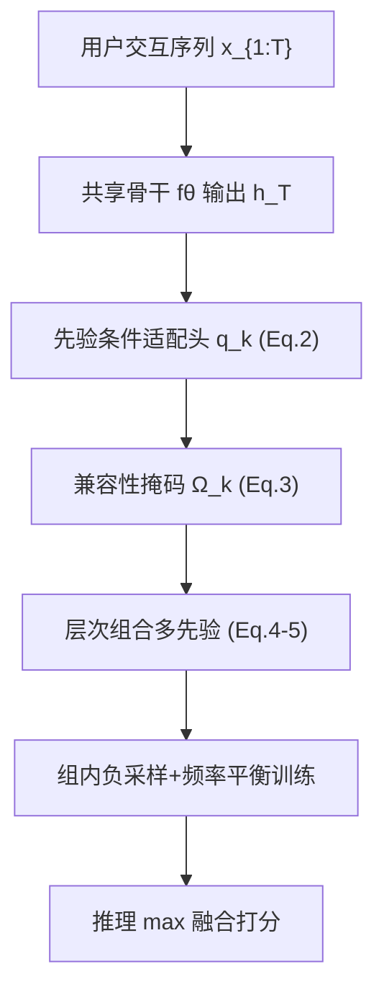

# Don't Waste It: Guiding Generative Recommenders with Structured Human Priors via Multi-Head Decoding（别浪费它：用结构化人类先验经多解码头引导生成式推荐）

- **会议/期刊**: WWW 2026
- **作者与机构**: Yunkai Zhang, Qiang Zhang, Feng (Ryan) Lin, Ruizhong Qiu 等；Meta AI、BAIR (UC Berkeley)、UC Santa Cruz
- **推荐链路定位**: 端到端生成式召回（下一物品预测）
- **研究方向**: 生成式推荐与离散语义ID / 序列与会话推荐
- **论文原文**: [arXiv:2511.10492v3](https://arxiv.org/abs/2511.10492v3)
- **开源代码**: [GitHub](https://github.com/zhykoties/Multi-Head-Recommendation-with-Human-Priors)

## TL;DR (1分钟核心速览)

针对生成式推荐把用户历史压缩为单一 $h_T$、且工业后处理规则与端到端训练解耦的问题，本文提出 backbone-agnostic 的先验条件多解码头：用零初始化残差 adapter 生成$q_k$，以兼容性 mask 限制各头物品子集，并用层次组合建模多先验；训练采用组内负采样、频率平衡与时间折扣，推理按候选所属头 max 融合。在 Pixel8M/MerRec/EB-NeRD 上，HSTU+组合先验的 R@10 较 backbone 提升约 38%/2.1%/13.9%，并提升多样性、新兴趣探索与少数用户个性化。

## Background & Motivation (背景与核心矛盾)

- **主流范式**: HSTU/HLLM 等生成式推荐将序列编码为单一用户状态，用 next-token 或对比学习做下一物品预测；多兴趣/解耦方法多依赖无监督聚类或 VAE。
- **前人局限**: 后处理规则与核心表征学习解耦，模型仍是黑箱；单一向量瓶颈难以承载多面意图，无监督兴趣不可识别、难控制，且多兴趣网络常需架构改动。
- **核心洞察 (Key Insight)**: 工业积累的物品类目、事件类型、长短期、图社区等先验，可作为弱监督沿可解释轴分解用户意图，而非训练后再“打补丁”。
- **本文切入点**: 不改 backbone，用轻量 prior-conditioned adapter heads + 兼容性掩码 + 层次组合，把先验直接注入端到端训练。

## Method (核心方法设计)

### 1. 整体框架 (Overall Architecture)

输入用户交互序列 $x_{1:T}$，共享序列编码器$f_\theta$输出$h_T$；每个先验组$k$经残差 adapter 投影为查询$q_k$，并用兼容物品集$\Omega_k$做打分掩码。多先验通过层次 adapter 递归组合，叶子头对应具体先验路径；训练时每个头只在其兼容正样本$Y_k$上计算损失，并采用组内负采样、频率平衡和时间折扣。推理时，候选物品$i$由所有兼容头$H(i)$ 打分并取最大值融合，同一深度 adapter 可并行执行。

### 2. 关键设计拆解 (Key Designs)

1. **先验条件查询头与兼容性掩码**：痛点是将所有意图压进单一 $h_T$。本文用零初始化残差 adapter$q_k=h_T+\mathrm{SiLU}(\mathbf{W}^{(k)}h_T)$，训练初期各头等价于 backbone，随后按先验信号分化；打分改为$s_k(i|h_T)=q_k^\top e_i$若$i\in\Omega_k$，否则$-\infty$。直觉是每个头只竞争本先验子空间，强制可识别解耦并降低头间干扰。

2. **层次组合多先验**：独立头忽略先验交互，笛卡尔积头又受稀有组合稀疏困扰。本文递归构造 $z^{(d)}_{g_1,\dots,g_d}=z^{(d-1)}_{g_1,\dots,g_{d-1}}+A^{(d)}_{g_1,\dots,g_d}(z^{(d-1)}_{g_1,\dots,g_{d-1}})$，其中$A^{(d)}(\cdot)=\mathrm{SiLU}(\mathbf{W}^{(d)}_{g_1,\dots,g_d}\cdot)+e_{g_{d-1}}$，叶子为最终查询。共享上层路径与组嵌入形成类似贝叶斯收缩的正则，缓解稀有组合过拟合；层次兼容集为各层$\Omega$ 的交集。

3. **训练目标、负采样与推理效率**：总损失 $\mathcal{L}=\sum_{t=1}^{\tau}\gamma^{t-1}\sum_{k\in\mathcal{K}}w_k\mathcal{L}_{k,t}$，其中$\mathcal{L}_{k,t}=-\mathbb{I}_{y_{T+t}\in Y_k}\log\frac{\exp(s_k(y_{T+t}))}{\sum_{j\in\tilde{\Omega}_k}\exp(s_k(j))}$，$w_k=|Y_k|/\sum_j|Y_j|$。负采样限制在$\tilde{\Omega}_k\subseteq\Omega_k$，即 in-group negative sampling，迫使头区分同组难负例；推理$S(i)=\max_{k\in H(i)}s_k(i)$。新增参数$O(Kd^2)$，HSTU 下单头仅约 0.14% 总参数，同层头可并行。

## Experimental Setup & Evaluation Protocol (实验设置与评估协议)

- **数据集与预处理**: 三个真实域，过滤后统计如下：

| 数据集 | #Users | #Items | #Interactions | 稀疏度/密度 | 特征/场景说明 |
| :--- | :---: | :---: | :---: | :---: | :--- |
| Pixel8M | 561,737 | 398,261 | 57M | 密度约 0.025% | 视频多模态；8 个语义类目先验 |
| MerRec | 119,754 | 1,255,665 | 521M | 密度约 0.347% | 电商长序列；6 种事件先验 |
| EB-NeRD | 44,968 | 25,216 | 30M | 密度约 2.645% | 新闻文本；Leiden 图社区先验 |

Pixel8M 对 HSTU 保留 $\ge 50$次交互用户，对 HLLM 保留$\ge 20$；MerRec 取$>2000$次交互用户；EB-NeRD 取$>512$ 次交互用户。

- **数据划分与防穿越 (Splitting Strategy)**: 采用序列预测式切分：固定历史窗口预测未来 $\tau$项；Pixel8M HSTU 用$T=50,\tau=8$，HLLM 用$T=10,\tau=4$；EB-NeRD HSTU 用$T=50,\tau=8$，HLLM 用$T=24,\tau=4$。正文未细化全局时间戳切分与防穿越细节，需按 forecast horizon 评估理解。
- **排名评测协议 (Ranking Protocol)**: 指标为 Recall@K、NDCG@K。HSTU 采用 next-token 全物品 softmax，可视为全库/全兼容集排序；HLLM 采用对比学习，softmax 在兼容物品与采样负例上计算，属采样排序。两者 context 长度不同，主表不可直接跨 backbone 比较。
- **对比基线与超参设置**: 基线含 ComiRec、REMI、DualVAE，以及 HSTU/HLLM backbone；HSTU 默认 size 3，$d=512$，并测 12.4M–658.9M 参数规模。ComiRec/REMI 搜索兴趣数$\{1,2,4,8,16,32\}$；DualVAE 搜索 aspect 数等。原文未见显著性检验报告。

## Key Experimental Results (实验关键数据)

### 1. 主实验对比 (Main Results)

下表统一以 HSTU 设置为主，列出单先验、时序先验与组合先验；Pixel8M 单先验为 Item，MerRec 为 Event，EB-NeRD 为 Graph。粗体为各数据集最优。

| 模型/变体 | Pixel8M R@10 | Pixel8M N@10 | MerRec R@10 | MerRec N@10 | EB-NeRD R@10 | EB-NeRD N@10 |
| :--- | :---: | :---: | :---: | :---: | :---: | :---: |
| HSTU (无先验) | 1.45 | 1.53 | 49.30 | 32.61 | 32.54 | 32.30 |
| + 单先验 | 1.75 | 1.83 | **50.33** | **35.99** | 34.48 | 33.84 |
| + 时序先验 | 1.90 | 1.96 | — | — | 36.28 | 34.99 |
| + 组合先验 | **2.00** | **2.09** | — | — | **37.05** | **36.24** |
| ComiRec | 1.70 | 1.77 | 49.49 | 33.01 | 35.71 | 34.75 |
| REMI | 1.81 | 1.92 | 49.27 | 33.15 | 34.79 | 34.88 |
| DualVAE | 1.49 | 1.60 | 48.20 | 31.03 | 31.24 | 30.61 |

相对 HSTU，`+组合` 在 Pixel8M 的 R@10/N@10 提升约 **+37.9%/+36.6%**；MerRec `+Event` 提升约 **+2.1%/+10.4%**；EB-NeRD `+组合` 提升约 **+13.9%/+12.2%**。HLLM 上单先验与组合先验同样稳定增益，但受 context 不同限制未并入同表。

### 2. 消融实验 (Ablation Study)

| 骨干/设置 | R@10 | N@10 | H@10 |
| :--- | :---: | :---: | :---: |
| HSTU Full ($\gamma=0.99$) | 2.000 | 2.099 | 2.3728 |
| w/o in-group 负采样 | 1.642 | 1.700 | 2.6395 |
| w/o 频率平衡 | 1.928 | 2.005 | 2.4234 |
| $\gamma=0.7$ | **2.065** | **2.155** | 2.3773 |
| Random 分头* | 1.586 | 1.648 | 2.308 |
| HLLM Multiplicative | 1.441 | 1.496 | 2.223 |
| HLLM Hierarchical | 1.499 | 1.559 | 2.208 |

\*Random 分头为 Pixel8M 的 LT/ST1 设置；HLLM 两行为层次组合对比。

### 3. 关键实验发现 (Key Findings)

1. **组内负采样是解耦头生效的关键**：移除后 R@10 从 2.000 降至 1.642（约 -17.9%），N@10 从 2.099 降至 1.700；同时熵升到 2.6395，说明模型变“散”但判别力下降，同组难负例比跨组负例更能逼出可识别表征。
2. **收益来自先验结构而非“更多头”**：Random 分头 R@10=1.586，甚至低于同设置 LT/ST1 的 1.655；HLLM 上层次组合 R@10=1.499，优于乘法组合 1.441（+4.0%），且共享上层路径缓解稀有先验组合的数据稀疏。
3. **时间折扣与探索目标可兼顾**：$\gamma=0.7$取得最佳 R@10=2.065、N@10=2.155，较$\gamma=0.99$ 提升约 3.3%/2.7%，而 H@10 几乎不变（2.3773 vs 2.3728）。新兴趣子集上，LT/ST1+Item 的 N@10 相对 boost 达 +15.76%，远高于仅 LT/ST1 的 +3.58%，表明专用头能扶持少数/新类目。

## Highlights & Limitations (亮点、对比与审稿批判)

- **与代表作对比 (vs. Prior Work)**: ComiRec/REMI 采用无监督“cluster-then-encode”多兴趣，本文是“encode-then-project”并用显式先验弱监督；DualVAE 依赖 VAE 解耦且深层骨干下不稳定，本文解耦轴可识别、可控；相较 HSTU/HLLM 的后处理规则，本文将先验直接纳入端到端损失。
- **可迁移亮点**: in-group negative sampling 可迁移到多兴趣/多任务召回，用同组难负例替代全局负采样；零初始化残差 adapter + max fusion 可在不改 backbone 的前提下注入类目、事件、地域等业务先验。
- **审稿级局限批判**: 先验仍需人工定义且对质量敏感，头数随先验笛卡尔积增长（EB-NeRD 可达 8×11=88 头），全库检索需维护各 $\Omega_k$ 索引；实验均为离线，切分/防穿越与显著性检验报告不足，且 HSTU/HLLM 的 context 不同导致跨 backbone 比较受限。

## Rating (四维评分)

- **方法创新性 (Novelty)**: ⭐⭐⭐⭐ （把 LLM 多解码头思想迁移为“先验条件 adapter”，以兼容 mask 实现可识别解耦，简单但有效。）
- **评估协议与实验扎实度 (Protocol & Experiments)**: ⭐⭐⭐ （三域大数据与多 backbone 较充分，但切分细节、显著性检验和跨 backbone 可比性仍不足。）
- **写作与数学规范度 (Clarity & Rigor)**: ⭐⭐⭐⭐ （核心公式与层次组合定义清晰，复杂度分析到位；附录对数据切分与先验构造仍可更透明。）
- **工业落地与复现价值 (Industrial & Practical Value)**: ⭐⭐⭐⭐ （backbone-agnostic、单头约 0.14% 参数且有开源代码，适合注入工业先验；但多先验索引与人工先验治理有工程成本。）

