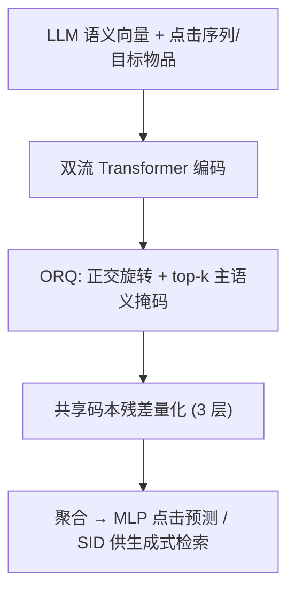
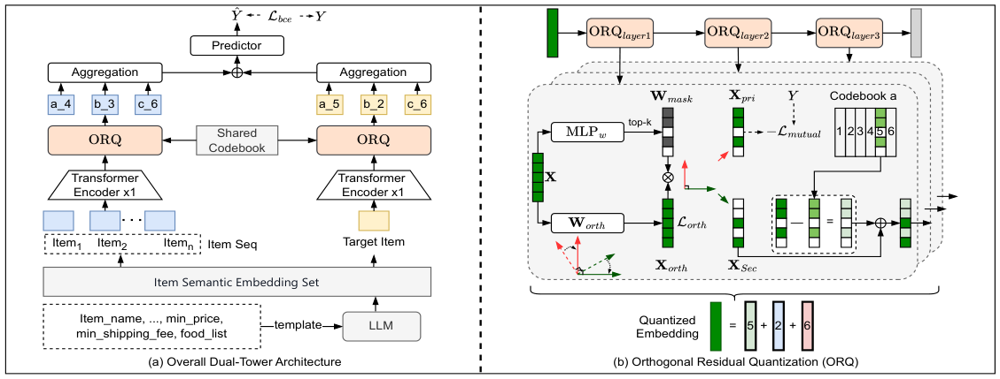

# DOS: Dual-Flow Orthogonal Semantic IDs for Recommendation in Meituan (美团双流正交语义 ID 推荐)

- **会议/期刊**: WWW 2026 (Short Paper)
- **作者与机构**: Junwei Yin, Senjie Kou, Changhao Li, Shuli Wang 等（美团）
- **推荐链路定位**: 召回 / 端到端生成式检索
- **研究方向**: 生成式推荐与离散语义 ID / 大语言模型推荐
- **论文原文**: [https://arxiv.org/abs/2602.04460v1](https://arxiv.org/abs/2602.04460v1)
- **开源代码**: 暂未开源

## TL;DR (1分钟核心速览)

生成式推荐依赖 Semantic ID（SID）压缩语义空间，但现有 SID 多以"重构"为唯一目标、任务无关地学习，导致**码本空间与生成空间错位**；同时常规量化对 LLM 语义的保真度不足。DOS 提出用户—物品**双流共享码本**架构把协同信号注入量化过程，并用**正交残差量化（ORQ）**旋转语义空间、按任务相关性逐层剥离主/次语义。在美团生产数据上，下游 AUC 0.8763（较 DAS +2.6%）、HSTU 框架下 Hit@10 0.0676（较 DAS +32.3%），一周线上 A/B 带来 **+1.15% 收入**。

## Background & Motivation (背景与核心矛盾)

- **主流范式**: 用 RQ-VAE / RQ-KMeans 等残差量化器把 LLM 物品向量压成多级离散 token，再交给 HSTU/TIGER 类自回归模型做下一物品生成。
- **前人局限 1（Codebook-Generation Gap）**: 量化阶段只做重构、任务无关，用户点击上下文完全不参与码本学习，量化出的空间与下游生成任务空间存在系统性偏移。
- **前人局限 2（Semantic Loss in Quantization）**: 既有量化器是为"聚类物品"设计的，沿最大方差方向切分维度，未必保留对 LLM 语义理解最关键的维度，离散化时语义失真被进一步放大。
- **核心洞察 (Key Insight)**: 用户序列与目标物品的表示**同源**（都由物品 embedding 派生），因此可用同一码本把"用户兴趣"与"目标物品"投到同一语义空间，量化过程本身就能承担对齐职责。
- **本文切入点**: 把"量化"从重构任务改造成**任务感知的表征选择任务**——双流输入 + 正交旋转 + 逐层主/次语义分离。

## Method (核心方法设计)

### 1. 整体框架 (Overall Architecture)

先用结构化 Prompt 让 LLM（Qwen3-0.6B-embedding）生成物品语义向量（店名、二级/三级品类、起送价、配送费、特色菜品等字段拼接），得到 $\mathcal{E}_{semantic}\in\mathbb{R}^{N\times d}$。随后进入**双流**：用户流编码$S$长点击序列，物品流编码目标物品，两路各用一层 Transformer Encoder 得到$X_{user},X_{item}$；两路共享同一套正交残差量化器与码本，输出三级离散码并聚合为最终 embedding，拼接后经 MLP 预测点击，以 BCE 训练。量化器的训练信号既包含重构损失，也包含下游 BCE 与正交/互信息正则，因此码本天然朝"有利于生成任务"的方向收敛。

<figure class="paper-figure" markdown="span">
  <figcaption>图1：DOS 概览。左侧 (a) 展示了用于处理用户的点击序列和目标物品的整体双流架构。右侧 (b) 说明了 ORQ 模块，该模块利用 X𝑜𝑟𝑡ℎ 和 W𝑚𝑎𝑠𝑘，通过联合优化 L𝑂𝑟𝑡ℎ 和 L𝑀𝑢𝑡𝑢𝑎𝑙 来解耦主语义特征（X𝑝𝑟𝑖）和次语义特征（X𝑠𝑒𝑐），从而支持任务相关语义的渐进选择。</figcaption>
</figure>

### 2. 关键设计拆解 (Key Designs)

1. **双流共享码本对齐 (DFI)**：痛点是量化独立于任务；做法是让用户流与物品流经各自编码器后**共用同一码本**量化，使用户兴趣向量与目标物品向量被投影到同一语义空间，相似性可直接比较。区别于 DAS 通过额外协同模块"间接"对齐，这里把目标物品直接放进量化输入，对齐发生在编码—量化内部而非事后。

2. **正交残差量化 (ORQ)**：先用正交矩阵把输入旋到"最省信息"的朝向，并以正交约束保证该变换不塌缩：
$$\mathcal{L}_{Orth}=\left\lVert W_{orth}W_{orth}^{\top}-I\right\rVert^{2},\quad X_{orth}=W_{orth}X$$
再用两层 MLP + Sigmoid 打分，取 top-$k$维作为**主语义**$X_{pri}=W_{mask}X_{orth}$，其余为**次语义**$X_{sec}=(1-W_{mask})X_{orth}$；由于掩码在正交基上做，$X_{pri}\cdot X_{sec}=0$，主/次语义严格解耦、信息不重不漏。为让主语义"任务相关"，对$X_{pri}$与标签$Y$ 施加互信息约束（最小化即最大化 MI）：
$$\mathcal{L}_{Mutual}=-\sum_{X_{pri},Y}P(X_{pri},Y)\log\frac{P(X_{pri},Y)}{P(X_{pri})P(Y)}$$
直觉上，正交旋转使维度可加性成立（能量守恒），从而使"按维度挑选"等价于"按语义子空间挑选"，避免传统量化在任意基上剪枝造成的信息破坏。

3. **残差传递、损失与推理**：主语义量化到最近码字 $C_i$后，残差$X_{resi}=X_{pri}-C_i$与次语义拼接送入下一层$X_{next}=X_{sec}\oplus X_{resi}$，三层（每层码本 1024）逐级剥离由粗到细的任务相关语义。总目标为
$$\mathcal{L}=\mathcal{L}_{BCE}+\alpha(\mathcal{L}_{Orth}+\mathcal{L}_{Mutual})+\mathcal{L}_{Recon}+\mathcal{L}_{VQ}$$
其中 $\mathcal{L}_{VQ}$为标准 commitment 形式（$\beta$为码本更新权重），实验取$\alpha=0.1,\beta=0.25$。**无需负采样器**：量化阶段每个序列取第 51 个物品为正样本、随机采样为负样本；推理阶段仅需一次前向 + 三级码本查表，开销远低于大词表 item-ID softmax，且 SID 可直接接入 HSTU 做自回归生成。

## Experimental Setup & Evaluation Protocol (实验设置与评估协议)

- **数据集与预处理**: 全部来自美团生产数据（作者明确放弃不兼容的公开数据集）。

| 数据集 | #Users | #Items | #Interactions | 稀疏度/密度 | 特征/场景说明 |
| :--- | :---: | :---: | :---: | :---: | :--- |
| 量化数据集 | 未披露 | 24,000,000 | 未披露（序列长 50） | — | 近一年行为日志，覆盖全业务物品；8:1:1 划分 |
| 离线训练集 | 未披露 | 同上 | 180,000,000 | — | 60 天日志，前 57 天训练、后 3 天验证 |

- **数据划分与防穿越 (Splitting Strategy)**: 量化数据集按 **8:1:1 比例划分**；下游训练集采用**全局时间戳切分**（最近 3 天做验证），避免未来信息泄漏。
- **排名评测协议 (Ranking Protocol)**: 量化任务用 **AUC / F1**（正样本 = 序列后第 51 个物品，负样本随机采样，属**采样排序**设定）；生成任务在 HSTU 框架内用 **Hit@10**，报告中未显式声明是否为全库排序，这是复现时需留意的一处模糊点。
- **对比基线与超参设置**: 基线为 RQ-KMeans、RQ-VAE、DAS（生成侧再加 HSTU 作为承载框架）；语义维度 $d=1024$、码本层数$L=3$、每层码本 1024、batch 1024、early stopping patience=5；显著性检验未报告。

## Key Experimental Results (实验关键数据)

### 1. 主实验对比 (Main Results)

| Model | AUC | Improv. | F1-Score | Improv. |
| :--- | :---: | :---: | :---: | :---: |
| RQ-KMeans | 0.8363 | +4.78% | 0.7641 | +5.44% |
| RQ-VAE | 0.8526 | +2.78% | 0.7739 | +4.11% |
| DAS | 0.8539 | +2.62% | 0.7869 | +2.39% |
| **DOS** | **0.8763** | — | **0.8057** | — |

| 生成侧 (HSTU + SID) | All | Busi_A | Busi_B | Busi_C | Busi_D |
| :--- | :---: | :---: | :---: | :---: | :---: |
| HSTU-RQ-KMeans | 0.0410 | 0.0252 | 0.0554 | 0.0398 | 0.0421 |
| HSTU-DAS | 0.0511 | 0.0325 | 0.0672 | 0.0502 | 0.0541 |
| **HSTU-DOS** | **0.0676** | **0.0457** | **0.0797** | **0.0730** | **0.0718** |
| Improv. vs DAS | +32.3% | +40.6% | +18.6% | +45.4% | +32.7% |

### 2. 消融实验 (Ablation Study)

| 变体 | AUC | F1-Score | 说明 |
| :--- | :---: | :---: | :--- |
| -w MLP-Encoder | 0.8462 | 0.7645 | Transformer 换两层 MLP，无法建模序列—物品关系 |
| -w/o Share | 0.8671 | 0.7950 | 用户/物品码本不共享，语义空间错位 |
| -w Decoder | 0.8626 | 0.7862 | 加重构解码器，与"选任务相关语义"目标冲突 |
| **DOS** | **0.8763** | **0.8057** | — |

### 3. 关键实验发现 (Key Findings)

1. **共享码本是最大功臣**：去掉共享后 AUC 从 0.8763 掉到 0.8671（-1.05%），F1 掉 1.07pt，说明"用户兴趣与目标物品同空间可比"这一约束比编码器容量更关键；而换成 MLP 编码器损失更大（AUC -3.44%），证明序列级上下文建模不可替代。
2. **重构目标是有害的**：加回解码器反而使 AUC 降至 0.8626、F1 降至 0.7862，定量印证作者"重构 ≠ 任务相关"的论断，也解释了 DOS 故意不做 decode 的设计取舍。
3. **增益在生成式场景被放大**：量化指标仅 +2~3%，但 Hit@10 相对 DAS 提升 32.3%、相对 RQ-KMeans 提升 64.9%，且在四个业务线上一致为正（Busi_C 达 +45.4%），说明 SID 质量对自回归解码的误差累积高度敏感；线上 30% 流量一周 A/B 直接换来 +1.15% 收入，验证了离线指标的商业可转化性。

## Highlights & Limitations (亮点、对比与审稿批判)

- **与代表作对比 (vs. Prior Work)**: RQ-VAE / RQ-KMeans 是**任务无关的重构式量化**，量化完再谈对齐；DAS 引入协同模块做**事后间接对齐**，语义空间仍可能偏移；DOS 把目标物品直接纳入量化输入，用共享码本做**编码—量化内生对齐**，并用正交分解保证剪枝不损信息，是三者中唯一"量化与任务联合优化"的方案。
- **可迁移亮点**: (1) 在正交基上做 top-$k$ 维度掩码，把"特征选择"变成严格无损的子空间选择，可迁移到任何需要可解释维度剪枝的 embedding 压缩场景；(2) 用互信息替代重构作为码本的辅助目标，可复用到多模态 tokenizer 与 RQ 系列量化器。
- **审稿级局限批判**: (1) 全部实验基于单一平台（美团外卖/本地生活）私有数据，且量化数据集仅 2.4K 万物品、3 个基线，缺少公开基准与显著性检验，"泛化性"证据薄弱；(2) 论文仅 4 页，Hit@10 的候选集规模、是否全库排序、生成解码延迟与码本更新的在线成本均未交代，工业复现的信息完备度不足。

## Rating (四维评分)

- **方法创新性 (Novelty)**: ⭐⭐⭐⭐ （正交分解 + 互信息约束把量化改造成任务相关子空间选择，思路干净；但双流共享码本与残差量化本身并非全新范式）
- **评估协议与实验扎实度 (Protocol & Experiments)**: ⭐⭐⭐ （有真实生产数据与线上 A/B 难得，但仅 3 个基线、单一平台、无公开数据集、无显著性检验，Hit@10 协议描述不完整）
- **写作与数学规范度 (Clarity & Rigor)**: ⭐⭐⭐⭐ （公式紧凑、损失项与超参交代清楚；但部分符号如掩码与 top-$k$ 集合定义略跳步，互信息项写成负号形式易引起误读）
- **工业落地与复现价值 (Industrial & Practical Value)**: ⭐⭐⭐⭐ （已服务亿级用户、线上收入 +1.15% 的说服力强，且 SID 可无缝接入现有 HSTU 链路；扣分在于未开源且依赖内部日志）

