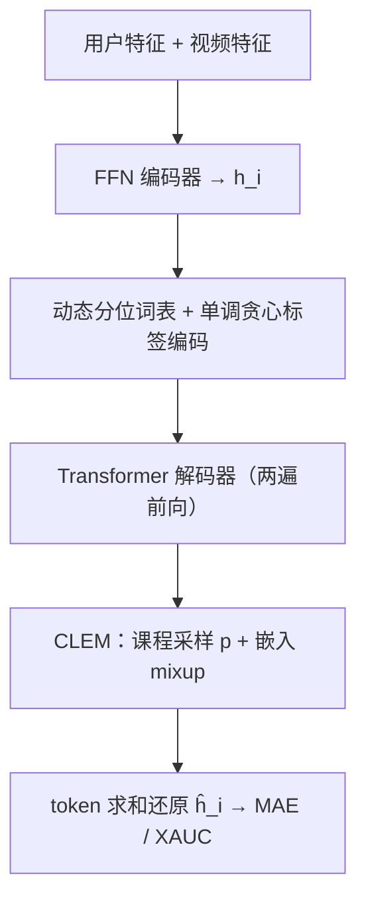

# Generative Regression Based Watch Time Prediction for Short-Video Recommendation (面向短视频推荐的生成式回归观看时长预测)

- **会议/期刊**: WWW 2026（arXiv:2412.20211v3，2024-12-28）
- **作者与机构**: Hongxu Ma, Shuigeng Zhou（复旦大学）；Kai Tian, Tao Zhang, Xuefeng Zhang, Chunjie Chen, Han Li（快手）；Han Zhou（上海财经大学）；Jihong Guan（同济大学）
- **推荐链路定位**: 精排（排序分融合前的时长/价值预估）
- **研究方向**: 生成式推荐与离散语义ID / CTR 预估与特征交叉（值回归）
- **论文原文**: [论文原文链接](https://arxiv.org/abs/2412.20211v3)
- **开源代码**: 暂未开源

## TL;DR (1分钟核心速览)

短视频观看时长呈宽值域、强长尾分布，直接回归有偏、分桶序回归（CREAD/TPM）又受固定离散化与区间独立预测拖累。本文提出 **Generative Regression (GR)**：用动态分位词表 + 单调贪心编码把时长无损映射为 token 序列，再由 Transformer 解码器自回归逐段生成、求和还原；并以 **CLEM**（课程学习 + 嵌入 mixup）缓解 teacher-forcing 的曝光偏差。KuaiRec 上 MAE 3.196（比 CREAD 降 3.36%）、XAUC 0.614，快手线上视频消费时长 +0.129%（p=0.01）。

## Background & Motivation (背景与核心矛盾)

- **主流范式**: 两条路线——(i) 值回归/去偏（VR、WLR、D2Q、CWM）直接拟合绝对秒数或用反事实、时长感知的高斯混合去偏；(ii) 序回归（CREAD、TPM）把连续值切成若干时间桶，用一串二分类器输出桶概率再乘桶跨度求和。
- **前人局限**: 其一，序回归各桶预测**相互独立**，桶间条件依赖只体现在标签定义里，缺乏逐步纠错通道；其二，**固定桶划分**使性能强绑定于分桶策略，且长尾导致尾桶跨度极大，尾桶即使概率极小也会放大短时样本误差（短视频场景 80% 样本 GT≤10s，误差被系统性放大）。
- **核心洞察 (Key Insight)**: 观看时长可分解为"若干时间槽之和"，序列每一步的输出天然作为下一步输入——这正是语言模型的条件生成结构；同时作者验证了 token 嵌入空间中"共享前缀的值聚簇、数值相近的嵌入邻近"，即词表具备**语义可加性**。
- **本文切入点**: 把回归改写成"逐段生成 + 求和还原"的序列生成任务，用数据驱动词表替代人工分桶，用课程学习消除训练/推理输入错配。

## Method (核心方法设计)

### 1. 整体框架 (Overall Architecture)

输入为用户侧（ID、静态画像、历史行为）与视频侧（标签、时长、类目）特征拼接 $\boldsymbol{x}_i=[\boldsymbol{u}_i;\boldsymbol{v}_i]$，经 FFN 编码器压成定长隐向量$\boldsymbol{h}_i\in\mathbb{R}^{1\times D}$（作者刻意用 FFN，因为 WTP 不依赖历史交互顺序，且便于替换任意骨干）。解码器为简化 Transformer（Masked MHA + 交叉 MHA + FFN），以 `<SOS>` 起始，逐步输出代表时间槽的 token，遇 `<EOS>` 终止，最终$\hat{y}_i=\sum_{t} g(\hat{s}_i^t)$还原为秒数。训练用两遍前向：第一遍 vanilla 取预测，第二遍按动态概率$p$ 混合真值与预测 token 作输入，并施加嵌入 mixup；推理只走第一遍，逐步贪心/采样解码至 `<EOS>`。

### 2. 关键设计拆解 (Key Designs)

1. **结构离散化：动态分位词表 + 单调贪心编码**：人工/二倍词表要么失衡要么近半 token 闲置。算法从高分位 $q_{start}$起、按衰减率$\alpha$递降至$q_{end}$，每轮取当前残差分布的$q$-分位值$o_i$作为一个 token，并从所有标签中减去它，直至相对重构误差$\max_j \hat{y}_j/y_j \le \epsilon$：

$$y_i=\sum_{t=1}^{T_i} g(s_i^t)+\epsilon,\quad |\epsilon|\le 0.001\,y_i,\quad g(s_i^1)\ge g(s_i^2)\ge\cdots\ge g(s_i^{T_i})$$

   编码端按"从大到小贪心减"保证序列最短且单调非增（贴合观看注意力衰减），高频短时长样本自然落在短序列上，尾桶跨度不再污染短时预测。

2. **自回归条件生成替代独立分桶**：序回归各桶概率独立输出，本文改为链式分解，每步条件于已生成前缀：

$$P_\theta(\boldsymbol{s}_i\mid \boldsymbol{h}_i)=\prod_{t=1}^{T_i}P_\theta(s_i^t\mid \boldsymbol{h}_i,\boldsymbol{s}_i^{<t})$$

   由于每步只能取词表中的一个时间槽，输出和天然受"已生成部分"约束，等价于把序回归隐式假设的"桶概率沿路径递减"结构显式建模，从而具备逐步误差修正能力。

3. **CLEM：课程学习 + 嵌入 mixup**：teacher forcing 的输入分布与推理不一致。采样率按非线性衰减 $p=p_0\cdot\frac{\omega}{\omega+e^{\tau/\omega}}$（$\tau$为迭代步）从近 1 平滑降至 0；同时以当前预测 token 为中心、窗口$n_w$ 内按解码 logit 重加权融合邻域嵌入作为下一步输入：

$$\boldsymbol{z}_i^t=\sum_{j=0}^{n_w}\sigma_j\,\boldsymbol{E}[\delta_{\hat{s}_i^t}+j-b,:],\quad \sigma_j=\frac{\exp(-\rho_j)}{\sum_{k}\exp(\rho_{\delta_{\hat{s}_i^t}+k-b})}$$

   邻域 token 数值相近（图 3(b) 显示相邻索引概率最相似），加权融合既降低单 token 误判风险，又重构了输出→输入的梯度通路，且不增加推理成本。

4. **训练目标与开销**：$\mathcal{L}=\mathcal{L}_{ce}+\lambda\mathcal{L}_{huber}$，前者为词表全 softmax 的 token 级交叉熵（序号回归任务，无负采样概念），后者以$\delta$ 为阈值在二次/线性间切换以抗长尾离群点。序列长度由编码决定（短时长通常 2–4 个 token），推理为多步解码；论文报告线上平均 QPS 反而下降 10.2%（词表规模远小于 LLM、解码器参数精简）。

## Experimental Setup & Evaluation Protocol (实验设置与评估协议)

- **数据集与预处理**: 沿用 CREAD/TPM 的公开集切分；工业集 Indust 取自快手真实日志。

| 数据集 | #Users | #Items | #Interactions | 稀疏度/密度 | 特征/场景说明 |
| :--- | :---: | :---: | :---: | :---: | :--- |
| KuaiRec | 7,176 | ~11k 视频 | ~12.5M | 极稠密（构造型全曝光日志） | 同时报 watch time 与 watch ratio 两套标签 |
| CIKM16 | 原文正文未列（详见附录） | — | — | — | 时长预测竞赛数据，回归标签 |
| Indust | 快手 4 亿 DAU 抽样 | 十亿级曝光 | 4 天训练日志 | 超高稀疏 | 工业短视频真实曝光流 |

- **数据划分与防穿越 (Splitting Strategy)**: Indust 采用**全局时间戳切分**（前 4 天训练、次日测试）；KuaiRec / CIKM16 沿用 CREAD/TPM 的划分协议，**非 Leave-One-Out**。
- **排名评测协议 (Ranking Protocol)**: 非全库排序任务。主指标为逐样本点估计 **MAE**，辅以 **XAUC**——从测试集**均匀采样样本对**、统计预测序与真实序一致的比例，属点对级排序一致性而非 Full-Ranking；KuaiRec 额外报 watch ratio（可与时长相乘折算时长）。
- **对比基线与超参设置**: 6 个基线覆盖两大流派——VR、WLR（时长偏差加权）、D2Q（时长感知高斯混合）、CWM（反事实时长）、TPM（层次标签序回归）、CREAD（误差自适应动态分桶）；5 次重复取均值，线上 A/B 用 p 值（p=0.01）判显著性。

## Key Experimental Results (实验关键数据)

### 1. 主实验对比 (Main Results)

| 方法 | KuaiRec MAE↓ | KuaiRec XAUC↑ | KuaiRec(ratio) MAE↓ | KuaiRec(ratio) XAUC↑ | CIKM16 MAE↓ | CIKM16 XAUC↑ | Indust MAE↓ | Indust XAUC↑ |
| :--- | :---: | :---: | :---: | :---: | :---: | :---: | :---: | :---: |
| VR | 7.634 | 0.534 | 0.385 | 0.691 | 1.039 | 0.641 | 46.343 | 0.588 |
| WLR | 6.047 | 0.545 | 0.375 | 0.698 | 0.998 | 0.672 | — | — |
| D2Q | 5.426 | 0.565 | 0.371 | 0.712 | 0.899 | 0.661 | — | — |
| CWM | 3.452 | 0.580 | 0.368 | 0.725 | 0.891 | 0.662 | — | — |
| TPM | 3.456 | 0.571 | 0.361 | 0.734 | 0.850 | 0.676 | 41.486 | 0.593 |
| CREAD | 3.307 | 0.594 | 0.369 | 0.738 | 0.865 | 0.678 | 39.979 | 0.597 |
| **GR (ours)** | **3.196** | **0.614** | **0.333** | **0.753** | **0.815** | **0.691** | **38.528** | **0.604** |
| Improv. (vs. 次优) | MAE ↓3.36% | XAUC ↑14.98%(累计) | MAE ↓7.76% | XAUC ↑8.97% | MAE ↓4.12% | XAUC ↑7.80% | MAE ↓3.63% | XAUC ↑1.00% |

线上 A/B（快手，6% 流量、>2500 万用户、6 天）：App 使用时长 **+0.112%**（p=0.01）、人均 App 使用 **+0.087%**、视频消费总时长 **+0.129%**，同时服务 QPS 降低 10.2%。

### 2. 消融实验 (Ablation Study)

| 变体 | KuaiRec MAE↓ | KuaiRec XAUC↑ | CIKM16 MAE↓ | CIKM16 XAUC↑ |
| :--- | :---: | :---: | :---: | :---: |
| (a) GR 完整 | **3.196** | **0.614** | **0.815** | **0.691** |
| (b) w/o CLEM | 3.416 | 0.584 | 0.858 | 0.674 |
| (c) EM with TF (p=1) | 3.241 | 0.604 | 0.844 | 0.684 |
| (d) CL w/o EM | 3.359 | 0.588 | 0.849 | 0.679 |
| (e) 线性衰减 | 3.205 | 0.613 | 0.818 | 0.690 |
| (f) 指数衰减 | 3.211 | 0.613 | 0.819 | 0.690 |
| (g) 固定 p=0.5 | 3.208 | 0.612 | 0.820 | 0.690 |
| (h) 纯自由生成 p=0 | 3.283 | 0.593 | 0.846 | 0.681 |

### 3. 关键实验发现 (Key Findings)

1. **增益主要来自"短时长密集区"**：KuaiRec 约 80% 样本 GT≤10s，按 2 秒分段后 GR 在 0–10s 各段全面优于 CREAD/TPM，仅在 >10s 段略逊 TPM；预测分布均值与 GT 均值几乎重合、方差最大（CREAD 呈尖峰收缩、TPM 因根节点概率>0.5 系统性高估），说明生成式范式能输出 0s 附近的预测（首步即 `<EOS>`），这正是尾桶跨度放大误差的反面。
2. **词表设计是独立增益项**：动态分位词表相对人工词表在 KuaiRec/CIKM16 上 MAE 从 3.281/0.825 降到 3.196/0.815，token 频率分布明显更均衡；二倍词表有近一半 token 几乎不被使用，人工词表则高度倾斜——即"离散化结构本身"而非仅模型容量带来收益。
3. **CLEM 中 mixup 的贡献大于调度**：去掉全部 CLEM，KuaiRec MAE 升 6.9%、XAUC 降 4.9%；只保留 CL 不加 EM 仍损失 5.1% MAE，而只用 EM（p=1）仅损失 1.4%，说明嵌入 mixup 是主要正则来源、课程调度是必要配套。同一框架迁移到 LTV 预测，Criteo-SSC 上 MAE 相对 SOTA（OptDist）再降 **17.66%**、Spearman ρ +20.79%。

## Highlights & Limitations (亮点、对比与审稿批判)

- **与代表作对比 (vs. Prior Work)**: 相比 CREAD 的误差自适应动态分桶，GR 不再需要"桶 + 概率×跨度"的刚性反解，用 token 序列求和实现近似无损还原；相比 TPM 的层次标签树，GR 的每一步条件于已生成前缀，显式利用步间依赖做误差修正；相比 VR/WLR/D2Q 等去偏回归，GR 从表示与损失结构层面缓解长尾失衡，而非仅校正时长偏差。
- **可迁移亮点**: (i) "动态分位残差分解 + 单调贪心编码"是一套与模型无关的连续值离散化工具，可直接用于 LTV、停留时长、GMV 等长尾回归标签；(ii) 小词表场景下的 embedding mixup + 两遍前向课程学习，是低成本缓解 exposure bias 的通用配方。
- **审稿级局限批判**: (i) 自回归多步解码在超长时长（>10s 高频区）反而弱于 TPM，且论文未给出序列长度分布与端到端推理延迟分解，只给 QPS 一个结论性数字；(ii) 词表由全量标签的离线分位数构造，分布漂移或跨业务迁移时需重算，且 $q_{start}$、$\alpha$、$\omega$ 等敏感超参缺乏敏感性曲线；(iii) 工业集基线不完整（WLR/D2Q/CWM 未报数），主表也仅以附录"参数对齐实验"口头保证增益非来自模型容量。

## Rating (四维评分)

- **方法创新性 (Novelty)**: ⭐⭐⭐⭐ （把序回归的隐式单调假设显式化为自回归链式分解，非简单套用 LLM 词表，离散化"近乎无损 + 最短序列"有明确设计原则）
- **评估协议与实验扎实度 (Protocol & Experiments)**: ⭐⭐⭐⭐ （两个公开集 + 工业集 + 6 天线上 A/B 与 p 值，消融三档拆解到位；扣分在于 XAUC 为采样对级而非全库排序、工业集基线缺失）
- **写作与数学规范度 (Clarity & Rigor)**: ⭐⭐⭐⭐ （符号与编解码一致性、损失定义清晰，算法伪码完整；理论最优离散化明确留白，部分推导置于附录）
- **工业落地与复现价值 (Industrial & Practical Value)**: ⭐⭐⭐⭐ （已上线快手并带来 0.1% 量级业务增益、QPS 反降 10.2%，词表方法可复用；但未开源、词表需按业务重训，复现成本中等）

