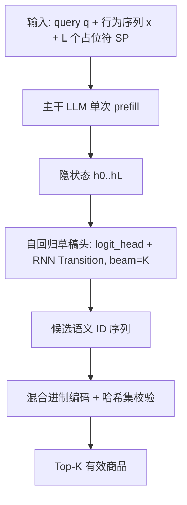
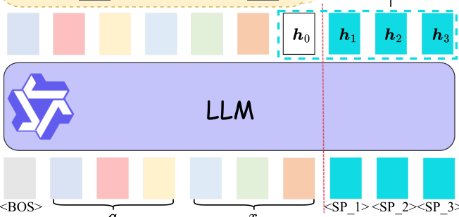

# NEZHA: A Zero-sacrifice and Hyperspeed Decoding Architecture for Generative Recommendations (零损失超高速生成式推荐解码架构)

- **会议/期刊**: WWW 2026（Dubai, UAE）
- **作者与机构**: Yejing Wang, Ziwei Liu, Maolin Wang, Wenlin Zhang, Xiangyu Zhao（香港城市大学）；Shengyu Zhou, Jinyu Lu, Langming Liu, Feng Li, Wenbo Su, Pengjie Wang, Jian Xu（阿里巴巴）
- **推荐链路定位**: 召回（候选生成）/ 端到端生成式
- **研究方向**: 生成式推荐与离散语义 ID / 大语言模型推荐 (LLM4Rec)
- **论文原文**: [arXiv:2511.18793v2](https://arxiv.org/abs/2511.18793v2)
- **开源代码**: [WWW2026_NEZHA](https://github.com/Applied-Machine-Learning-Lab/WWW2026_NEZHA)

## TL;DR (1分钟核心速览)

生成式推荐（GR）的落地瓶颈不在精度而在**延迟**：Beam Search 逐 token 反复 prefill，淘宝搜索广告首页仅给 30ms，而线上 GR 需 >1000ms。NEZHA 提出「自草稿 + 无模型校验」：在主干 LLM 上挂自回归草稿头，用 $L$个占位符 token 一次前向预计算全部 hide state 并自回归展开语义 ID；再用混合进制编码 + 哈希集在常数时间剔除幻觉 ID。在 Yelp/Beauty/Games 三数据集、Llama-1B 与 Qwen3-0.8B 双骨干上，精度与 Beam Search 持平甚至更优，延迟降至约$1/10$（74.21ms → 7.00ms），线上算法层加速 2.6×、总延迟压到 30ms 内，10% 流量 A/B 带来 1.2% 收入提升。

## Background & Motivation (背景与核心矛盾)

- **主流范式**: GR 走「item 语义 ID 量化（RQ-VAE，$L=3$ 个 token）→ LLM 序列训练 → Beam Search 推理」三段式，解码阶段被反复调用于扩展每条 beam。
- **前人局限**: ① 延迟结构失衡——剖析显示解码占总推理时间 60% 以上（0.6B 模型 decode 2.95 vs prefill 1.0），KV-Cache/FlashAttention 对 3–4 token 级短序列几乎无效；② 现有推测解码（SD）需**外部草稿模型**（额外训练与推理开销）与**模型内验证**（至少一次大模型前向），加速上限被锁死。
- **核心洞察 (Key Insight)**: 语义 ID 是**严格有序、极度稀疏**的组合码（线上有效 ID 占比约 0.1%），既不需要语言学语法校验，也不允许并行多头打乱顺序——因此「校验」可退化为哈希查表，「草稿」可由主干自身完成。
- **本文切入点**: 把草稿头内嵌进主干实现 self-drafting，把验证换成 model-free 的哈希集交集，从而同时砍掉两个延迟来源。

## Method (核心方法设计)

### 1. 整体框架 (Overall Architecture)

输入为 query $q$与用户行为序列$x$，末尾拼接$L$个占位符 `<SP_1>…<SP_L>` 取代真值语义 ID。一次 prefill 即产出$L+1$个末层隐状态$\boldsymbol{h}_0,\dots,\boldsymbol{h}_L$（$\boldsymbol{h}_0$为上下文，$\boldsymbol{h}_l$为第$l$个位置占位）。训练时草稿头以 teacher forcing 逐位置预测真值 token；推理时草稿头做 beam search，$L$步后得到$K\times K$候选，末步统一算索引并与有效 ID 哈希集求交、保留累积概率最高的$K$ 个。全程只调用主干一次前向，主干不再参与解码。

<figure class="paper-figure" markdown="span">
  <figcaption>图1：𝐿= 3、𝐾= 3 时 NEZHA 框架的示意图。图中区分训练路径（绿色虚线）、推理路径（红色虚线）和共享计算（黑色实线）。</figcaption>
</figure>

### 2. 关键设计拆解 (Key Designs)

1. **占位符 prompt + 自回归草稿头（Nimble Drafting）**：并行多 token 预测（MTP/Medusa）共享同一末层隐状态，破坏语义 ID 的顺序依赖，导致精度崩塌；NEZHA 改为「位置感知 + 状态递推」：$\boldsymbol{s}_1=\boldsymbol{h}_0$，$\boldsymbol{p}_l=\text{logit\_head}_l(\boldsymbol{h}_l,\boldsymbol{s}_l)$，$\boldsymbol{s}_{l+1}=\text{Transition}_l(\boldsymbol{s}_l,\boldsymbol{e}_l)$。占位符既注入位置先验，又让$L$步解码共享一次 prefill；Transition 用轻量 RNN 把已选 token 的嵌入回灌进状态，重建$[t_1,t_2]\to t_3$的强前缀约束。整套草稿头只是$[1024,512]$ 的线性层 + RNN，参数量可忽略。

2. **无模型校验（Efficient Verification）**：模型校验要一次大模型前向，是线上延迟的主要残项。利用语义 ID 空间稀疏性，先把候选码做混合进制双射到整数：$V_i=\mathcal{P}(v_i)=\sum_{l=1}^{L}\left(t_{i,l}\times\prod_{j=1}^{l-1}T_j\right)$，再把所有有效 ID 存入哈希集$\mathcal{V}$，末步直接求交：$\hat{Y}_L=\hat{Y}_L[\mathcal{V}\cap\mathcal{V}_L]$。常数时间查表即可过滤 >99.9% 的幻觉（无效）ID；线上把草稿有效率从 43% 提到 93%。

3. **训练目标与推理开销**：损失仅在语义 ID 三位上计算交叉熵 $\mathcal{L}=-\sum_{y\in\mathcal{D}}\sum_{l=1}^{L}\log p_{y_l}$，主干与草稿头联合端到端训练，无需额外草稿模型、无需负采样（beam 内竞争即可）；推理时复杂度从$O(K(L-1))$次大模型前向降为$O(1)$次 prefill +$L$ 次轻量头调用 + 一次哈希查表，实测算法层总加速 2.6×（含系统排队优化后 >30×）。

## Experimental Setup & Evaluation Protocol (实验设置与评估协议)

- **数据集与预处理**:

| 数据集 | #Users | #Items | #Interactions | 平均序列长度 | 特征/场景说明 |
| :--- | :---: | :---: | :---: | :---: | :--- |
| Yelp | 15,719 | 11,383 | 192,214 | 12.22 | 本地生活 POI 评论 |
| Beauty | 52,204 | 57,288 | 394,908 | 7.56 | Amazon 美妆，含文本属性 |
| Games | 64,071 | 33,614 | 568,314 | 8.87 | Amazon 游戏 |

- **数据划分与防穿越**: `Leave-One-Out`——每用户最后一条交互作 test、倒数第二条作 valid、其余训练，无时间戳切分。
- **排名评测协议**: 生成式 Top-K 排序（推理 beam size $K=10$，报告 HR@5/10 与 NDCG@5/10），**非全库 Full-Ranking**；同时报告平均生成延迟 LT(ms)（prefill + decode）。
- **对比基线与超参**: 基线为 Vanilla Beam Search 与 MTP（Medusa/AtSpeed 因延迟与复杂度未纳入）；骨干 Llama-1B 与 Qwen3-0.8B；RQ-VAE 量化 $L=3$、每层码本$T_l=512$、hidden$d=1024$；3 个随机种子（42/43/44）取均值，单侧 t 检验$p<0.05$ 标 `*`。

## Key Experimental Results (实验关键数据)

### 1. 主实验对比 (Main Results)

| Backbone | Method | Beauty H@5/H@10/N@10 | Games H@5/H@10/N@10 | Yelp H@5/H@10/N@10 | LT (ms, B/G/Y) |
| :--- | :--- | :---: | :---: | :---: | :---: |
| Llama-1B | Beam Search | **0.0392**/**0.0568**/**0.0311** | 0.0305/0.0406/0.0256 | 0.0176/0.0262/0.0138 | 74.21/78.95/75.99 |
| Llama-1B | MTP | 0.0378/0.0555/0.0297 | 0.0291/0.0400/0.0248 | 0.0140/0.0240/0.0114 | 6.74/7.33/7.18 |
| Llama-1B | **NEZHA** | 0.0390/0.0562/0.0304 | **0.0313**/**0.0410**/**0.0259** | **0.0194\***/**0.0332\***/**0.0168\*** (**+26.7%**) | 7.00/7.52/7.41 |
| Qwen3-0.8B | Beam Search | 0.0446/0.0643/0.0370 | 0.0226/0.0305/0.0179 | 0.0235/**0.0377**/**0.0192** | 47.70/50.06/48.31 |
| Qwen3-0.8B | MTP | 0.0422/0.0617/0.0352 | 0.0204/0.0283/0.0170 | 0.0229/0.0346/0.0177 | 4.18/4.61/4.24 |
| Qwen3-0.8B | **NEZHA** | **0.0451**/**0.0649**/**0.0377** | **0.0239\***/**0.0314**/**0.0193\*** | 0.0235/0.0363/0.0185 | 4.41/4.80/4.46 |

（延迟分解：3B Vanilla 总 9.41；0.6B Vanilla 总 4.86；NEZHA 0.6B 总 1.86，其中 decode 2.95→0.78，系统开销 0.91→0.08。）

### 2. 消融实验 (Ablation Study)

| 变体（Yelp / Llama） | H@5 | H@10 | N@5 | N@10 | LT |
| :--- | :---: | :---: | :---: | :---: | :---: |
| NEZHA 完整 | 0.0194 | **0.0332** | 0.0125 | **0.0168** | 7.41 |
| NEZHA-1（去上下文状态 $\boldsymbol{s}_l$ 与 Transition） | 0.0044 | 0.0083 | 0.0024 | 0.0037 | 7.03 |
| NEZHA-2（去占位符 $\boldsymbol{h}_l$） | 0.0188 | 0.0309 | 0.0120 | 0.0159 | 7.41 |
| NEZHA-3（RNN Transition → 加法） | 0.0173 | 0.0322 | 0.0110 | 0.0158 | 7.18 |
| NEZHA-4（关闭哈希校验） | 0.0194 | 0.0328 | 0.0124 | 0.0167 | 7.16 |

### 3. 关键实验发现 (Key Findings)

1. **顺序状态是命门、占位符是增益**：去掉状态递推（NEZHA-1）H@10 从 0.0332 崩到 0.0083（−75%），说明朴素并行多头在语义 ID 上根本不可用；去掉占位符（NEZHA-2）仅掉 7%，即占位符负责位置先验而非上下文建模，两者互补但不平等。
2. **校验几乎免费但收益刚性**：NEZHA-4 只省 0.25ms，却牺牲 N@5（0.0125→0.0124）与 H@10（0.0332→0.0328）；在生产数据上收益被放大（有效 ID 率 43%→93%，离线指标 +12pp），因线上码本规模更大、无效组合更多。
3. **效率与精度同时零牺牲**：Llama 骨干下 NEZHA 对 Beam Search 实现 10.6× 加速（74.21→7.00ms），Yelp 上 H@10 反而相对提升 26.7%（0.0262→0.0332\*）；而 MTP 虽快 11×，精度却全面劣于基线（Beauty H@10 0.0568→0.0555），验证「并行草稿破坏顺序依赖」的论断。

## Highlights & Limitations (亮点、对比与审稿批判)

- **与代表作对比 (vs. Prior Work)**: 相较 Medusa/AtSpeed（外挂草稿模型 + 树注意力/大模型校验），NEZHA 把草稿头内嵌主干，省掉独立模型的训练与运维；相较 SpecGR/RPG 侧重 tokenizer 或长 ID 并行重构，本文完全不动量化与训练范式，只改**服务层解码**，因而可与任意 GR 训练方案叠加。
- **可迁移亮点**: ① 「占位符 + 状态递推」的位置感知自草稿头可迁移到任意多 token 结构化输出（如多域语义 ID、多行为序列生成）；② 「有效 ID 集合 → 混合进制整数 → 哈希查表」这一无模型校验思路，可直接用于任何码本封闭的生成式召回做幻觉过滤。
- **审稿级局限批判**: ① 基线仅 Beam Search 与 MTP，Medusa/AtSpeed 被以「延迟过高」为由略去，缺少与主流 SD 的公平同环境对比；② 实验固定 $L=3$、$T_l=512$，未给出$L$/$K$ 增大时的延迟与接受率曲线，也未讨论哈希集规模随物品数膨胀的内存与更新代价（工业场景需分钟级热更新）；③ 校验只判「ID 合法」，不判「语义合理」，对合法但无关的误召回无矫正能力。

## Rating (四维评分)

- **方法创新性 (Novelty)**: ⭐⭐⭐⭐ （self-drafting + model-free verification 的组合在 GR 场景属首次，且以「语义 ID 稀疏性」为理论支点，思路干净）
- **评估协议与实验扎实度 (Protocol & Experiments)**: ⭐⭐⭐ （三数据集双骨干三seed+t检验合规，但基线偏少、采用 Leave-One-Out 生成式 Top-K 而非 Full-Ranking，跨工作可比性受限）
- **写作与数学规范度 (Clarity & Rigor)**: ⭐⭐⭐⭐ （延迟分解与算法伪码清晰，混合进制双射与校验交集定义严谨；状态更新式略简，Transition 结构细节不足）
- **工业落地与复现价值 (Industrial & Practical Value)**: ⭐⭐⭐⭐⭐ （淘宝搜索广告全量上线、延迟 1000ms→<30ms、A/B +1.2% 收入，代码开源，工程价值极高）

