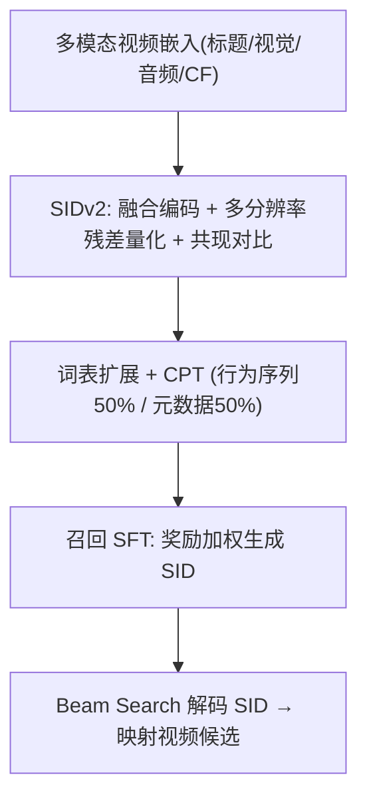
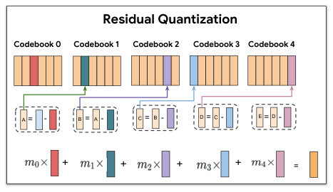

# PLUM: Adapting Pre-trained Language Models for Industrial-scale Generative Recommendations (面向工业级生成式推荐的原生大模型适配框架)

- **会议/期刊**: WWW 2026 (Proceedings of the ACM Web Conference 2026)
- **作者与机构**: Ruining He, Lukasz Heldt, Lichan Hong, Raghunandan Keshavan, Xinyang Yi 等 — Google DeepMind / YouTube
- **推荐链路定位**: 召回（候选生成，端到端生成式检索）
- **研究方向**: 生成式推荐与离散语义 ID / 大语言模型推荐
- **论文原文**: [https://arxiv.org/abs/2510.07784v1](https://arxiv.org/abs/2510.07784v1)
- **开源代码**: 暂未开源

## TL;DR (1分钟核心速览)

工业召回长期困在"巨型 ID Embedding 表"范式：参数量堆在输入层而非网络层，样本效率低、无法复用语义知识。PLUM 把 YouTube 十亿级视频库的召回改写为 LLM 自回归生成 Semantic ID 的三段式流程——SIDv2 分词、域内持续预训练 (CPT)、生成式召回 SFT，并在十亿级全库排序协议下取得有效词表 2.60×–13.24×、线上 Panel CTR +4.96% 的增益，训练 FLOPs 反降至基线 0.55× 以下。

## Background & Motivation (背景与核心矛盾)

- **主流范式**: 工业召回仍由 Large Embedding Model (LEM) 主导，绝大多数参数驻留在 $O(10^7)$ 词表的 ID Embedding 表中，用巨型输入表记忆用户-物品共现。
- **前人局限**: 其一，网络层极浅（LEM 中神经网络仅占总参数 0.4%），深度与算力无法有效转化为泛化；其二，通用 LLM 未经域内行为语料预训练，直接零样本用于推荐存在稳定的性能落差，SID 与文本模态无法对齐。
- **核心洞察 (Key Insight)**: 若把物品压缩为语义化离散码（SID），推荐就从"查表"变成"说物品的语言"，于是可以把模型复杂度从输入 Embedding 迁移到稠密网络，复用 LLM 的序列建模与语言先验，并顺势摆脱内积检索的天花板。
- **本文切入点**: 用 SIDv2 构造高质量、行为对齐、层级自洽的码本，先 CPT 把 SID 纳入词表并与文本接地，再做奖励加权的生成式召回 SFT。

## Method (核心方法设计)

### 1. 整体框架 (Overall Architecture)

离线先用多模态编码器 + 残差量化器为每个视频生成定长 SID 元组；随后扩展 LLM 词表加入 SID token，在"用户行为序列 + 视频元数据语料"各占 50% 的混合语料上做 1M step（约 260B token）的 next-token 预训练，使 SID 与文本 token 共享语义空间；再以奖励加权自回归损失做召回 SFT，输入 prompt 由历史 SID、数值特征的 custom token 与文本特征交错拼接；线上以 beam search 解码多条 SID 序列，直接映射回视频作为候选集，不再维护独立向量索引。

<figure class="paper-figure" markdown="span">
  <figcaption>图1：我们的 Semantic ID 模型示意图。该模型接收两个多模态视频嵌入，对其进行编码，并使用残差量化器将结果压缩为量化 ID。该 ID 通过对比损失训练，以重建原始输入并对共现视频进行语义聚类。</figcaption>
</figure>

### 2. 关键设计拆解 (Key Designs)

1. **SIDv2：让码本既语义又行为对齐**：TIGER 式 RQ-VAE 只吃单模态、且均匀码本导致 SID 空间稀疏、唯一性差。PLUM 先对 $M$路嵌入分别过编码器得$z_m$，拼接投影为$z$（对模态数量无假设）；码本容量按层级衰减$|\mathcal{C}_l| = 2048/2^{l-1}$，高层用高分辨率保证可分、低层编码低熵残差；再加 progressive masking$m_l = \mathbb{I}[l < r]$（$r$随机），量化向量$\hat{z}=\sum_{l=1}^{L} m_l e_l^{*}$，迫使前缀码独立可用（便于 beam search 早停与容错）。直觉上，前缀 token 承载粗粒度主题、后位 token 只做细节纠偏，与其自回归生成顺序天然一致。
2. **共现对比正则（把 CF 信号软注入量化器）**：直接把行为 CF 向量拼进量化器会因流行度漂移而需要频繁重训。PLUM 改为在 batch 内以共看对为正样本，用 InfoNCE 塑造嵌入空间：$\mathcal{L}_{con}=-\sum_{i=1}^{2N_b}\dfrac{\exp(\mathrm{sim}(p_i,p_i^{+}))}{\sum_{j=1}^{2N_b}\exp(\mathrm{sim}(p_i,p_j))}$，总损失$\mathcal{L}=\mathcal{L}_{recon}+\mathcal{L}_{rq}+\mathcal{L}_{con}$。这样行为信号只塑形、不进码本，量化器保持稳定，同时让"用户眼中相似"压过"内容上相似"。
3. **召回 SFT 与推理**：SFT 目标为 $\mathcal{L}_{SFT}=-\sum_{t=1}^{L} r(\text{user},v_{click})\log P(\text{sid}_t \mid \text{Context},\text{History},\text{sid}_{<t})$，其中$r$ 是手工打分的点击奖励；实现上按奖励采样样本、损失内等权（奖励加权采样替代加权损失，兼顾训练稳定性与成本）。无需负采样——全库由自回归解码隐式"排序"；线上 beam search 生成候选，SFT 后无效 SID（幻觉）率 < 5%，SID→视频冲突率低。

## Experimental Setup & Evaluation Protocol (实验设置与评估协议)

- **数据集与预处理**: 全部为 YouTube 内部生产数据，未公开统计量；物品侧覆盖十亿级视频库，训练用连续 7 天（2025 年 7 月）打乱样本，评测用第 8 天。

| 数据集/场景 | 库规模 | 划分方式 | 说明 |
| :--- | :---: | :---: | :--- |
| YouTube LFV (长视频) | 十亿级视频 | 7 天训练 / 次日 (Day 8) 留出 | 线上 + 离线双评 |
| YouTube Shorts (短视频) | 十亿级视频 | 同上 | 线上 + 离线双评 |
| 对比基线 LEM | 同库 | 同协议 | Transformer + $O(10^7)$ 词表 Embedding，NN 仅占 0.4% 参数 |

- **数据划分与防穿越 (Splitting Strategy)**: 全局时间戳切分——过去 7 天训练、次日评测，严格避免未来交互泄漏；SID 量化器与下游模型分阶段训练，量化器训练不使用测试日数据。
- **排名评测协议 (Ranking Protocol)**: 无偏 **Full-Ranking**——在十亿级全库上计算 Video Recall@10（beam 取 top-10 SID，冲突时随机采样映射视频）；同时报告有效词表规模（覆盖 95% 曝光所需唯一视频数）与线上 A/B（相对 LEM+，同配额加量对照）。
- **对比基线与超参设置**: 基线仅 LEM（离线）与 LEM+（线上最优生产召回加同等配额），采用 PLUM 900M MoE（Gemini-1.5 系）对比；缩放研究覆盖 MoE-110M/370M/900M/3B，学习率 $1\times10^{-4}\to2\times10^{-5}$，batch 按 HBM 饱和设置，Iso-FLOPS 下对比；未报告显著性检验，线上指标为百分比相对变动。

## Key Experimental Results (实验关键数据)

### 1. 主实验对比 (Main Results)

| 指标 | 场景 | PLUM 900M MoE | LEM (离线) | 相对变化 |
| :--- | :---: | :---: | :---: | :---: |
| Effective Vocab Size | LFV | — | — | **2.60×** |
| Effective Vocab Size | Shorts | — | — | **13.24×** |
| CTR | LFV | — | — | **1.42×** |
| CTR | Shorts | — | — | **1.33×** |
| WF/View | LFV | — | — | **1.32×** |
| WT/View | Shorts | — | — | **1.13×** |
| WT/View | LFV | — | — | 0.72× |
| (线上 A/B vs LEM+) Panel CTR | Shorts | — | — | **+4.96%** |
| (线上 A/B vs LEM+) Views | LFV | — | — | **+0.80%** |
| (线上 A/B vs LEM+) Engaged Users | Shorts | — | — | **+0.28%** |

（原文以比值/百分比增量形式报告绝对值保密；PLUM 训练 FLOPs < 0.55× LEM，日样本量约 250M vs 数十亿。）

### 2. 消融实验 (Ablation Study)

| 配置 | SID Uniqueness | VID Recall@10 |
| :--- | :---: | :---: |
| SIDv1 (RQ-VAE 基线) | 94.0% | 12.3% |
| **SIDv2 (完整)** | **96.7%** | **14.4%** |
| w/o Multi-Resolution Codebook | 94.8% | 13.2% |
| w/o Multi-Embedding Fusion | 96.9% | 12.8% |
| w/o Co-occurrence Contrastive | 91.8% | 12.6% |

| 训练阶段组合 | 预训练 LLM 初始化 | CPT | Recall@10 (Day 8) |
| :--- | :---: | :---: | :---: |
| R1 | ✗ | ✗ | 0.19 |
| R2 | ✓ | ✗ | 0.23 |
| CR1 | ✗ | ✓ | 0.27 |
| **CR2 (PLUM)** | ✓ | ✓ | **0.28** |

### 3. 关键实验发现 (Key Findings)

1. **CPT 是增益主引擎，通用语言先验只是次优替代**：R1→CR1 提升 0.19→0.27（+42%），而仅换 LLM 初始化（R1→R2）只到 0.23；CR1 与 CR2 仅差 0.01，说明域内行为语料的价值远大于"从更大文本模型出发"，且 CPT 模型收敛显著更快（图 3），使多下游任务共享同一 CPT checkpoint 变得经济。
2. **共现对比是唯一"双赢"组件**：去掉 $\mathcal{L}_{con}$ 后 uniqueness 掉至 91.8%（甚至低于 v1 的 94.0%）、Recall 12.6%，说明纯内容量化会破坏码本唯一性；而去掉多分辨率码本仅损失 Recall 1.2 点、去掉多模态融合损失 1.6 点，二者主要贡献在可分性而非唯一性。
3. **短视频收益远大于长视频**：线上 Shorts Panel CTR +4.96% vs LFV +0.76%，有效词表 13.24× vs 2.60×；但 LFV 的 WT/View 仅 0.72×，说明生成式召回更擅长在长尾/高频冷启内容上扩张候选多样性，却在长视频"深度观看"上仍需精排与时长目标补充。

## Highlights & Limitations (亮点、对比与审稿批判)

- **与代表作对比 (vs. Prior Work)**: 相较 TIGER/RQ-VAE 系（从零训练、单模态码本），PLUM 的差异在于"不从头训"——用 CPT 把 SID 作为新模态接地到预训练 LLM；相较 OneRec（encoder-decoder + RL 奖励模型）与混合生成式检索（SID + 稠密向量双输出），PLUM 坚持纯 SID 生成、以奖励加权采样的 SFT 替代 RL，工程链路更短；相较 MMQ 为每模态生成独立 token，PLUM 直接拼接多模态嵌入，支持任意模态数。
- **可迁移亮点**: (1) 用"对比正则软注入 CF 信号"替代"把 CF 向量拼进量化器"，可避免因流行度漂移而周期性重训量化器；(2) progressive masking 训练使前缀码自洽，直接服务于 beam search 的早停与非法码过滤，是把"训练目标与解码方式对齐"的通用技巧。
- **审稿级局限批判**: 其一，全部实验基于不可复现的内部数据与线上流量，缺少公开基准对照，且线上增益（+0.06%–+4.96%）未给置信区间与显著性检验，难以判断是否越过噪声；其二，缩放研究自承 MoE-3B 未跑赢 900M，仅处理 0.57 个 epoch、batch 受 HBM 限制，因此"持续 scaling 有效"的结论只到 900M 激活参数为止；此外 SID 冲突时随机映射视频会让 Recall 略偏乐观，beam search 与随机解码的多样性-准确率权衡也未量化。

## Rating (四维评分)

- **方法创新性 (Novelty)**: ⭐⭐⭐⭐ （SIDv2 的多分辨率码本 + 渐进掩码 + 共现对比三点均指向"生成式检索对齐"，组合新颖，但单点多为对 RQ-VAE/TIGER 的工程改良而非理论突破）
- **评估协议与实验扎实度 (Protocol & Experiments)**: ⭐⭐⭐ （十亿级全库 Full-Ranking + 真实线上 A/B 极难得，但无公开数据、无显著性检验、基线仅 LEM 一条，缩放结论受算力截断）
- **写作与数学规范度 (Clarity & Rigor)**: ⭐⭐⭐⭐ （三阶段流程与 CPT 数据 schema 交代清晰、消融 2×2 设计干净；量化损失与掩码公式略简，码本容量衰减缺推导）
- **工业落地与复现价值 (Industrial & Practical Value)**: ⭐⭐⭐⭐⭐ （已在 YouTube 多端上线服务十亿用户，训练 FLOPs 低于 LEM、样本效率高一个量级，为"去 Embedding 表"的召回架构提供了可执行蓝图；可惜未开源）

