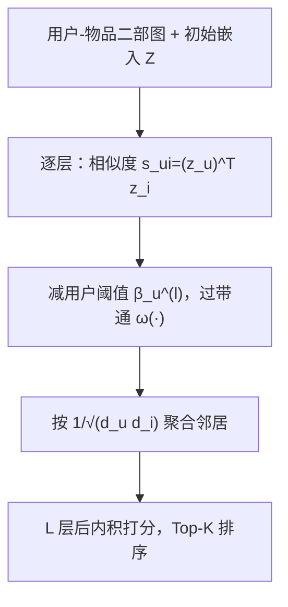
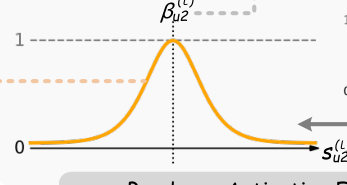

# TopKGAT: A Top-K Objective-Driven Architecture for Recommendation

---
title: "[Paper Note] TopKGAT: A Top-K Objective-Driven Architecture for Recommendation"
description: "[WWW 2026][图神经网络与知识图谱推荐] 从Precision@K可微近似推导图注意力架构，以带通激活聚焦Top-K边界，四数据集全库排序平均提升NDCG 3.53%。"
tags:
  - WWW 2026
  - 图神经网络与知识图谱推荐
  - 精排/排序
  - Top-K优化
  - 图注意力网络
date: 2026-11-21
venue: WWW
year: 2026
paper_url: "https://arxiv.org/abs/2601.18432v1"
code_url: "https://github.com/StupidThree/TopKGAT"
categories:
  - graph_rec

# TopKGAT: A Top-K Objective-Driven Architecture for Recommendation (面向Top-K目标的推荐架构)

- **会议/期刊**: WWW 2026
- **作者与机构**: Sirui Chen, Jiawei Chen, Canghong Jin, Sheng Zhou, Jingbang Chen, Wujie Sun, Can Wang；浙江大学、杭州城市大学、CUHK-Shenzhen & SLAI 等
- **推荐链路定位**: 精排/排序（Top-K 排序）
- **研究方向**: 图神经网络与知识图谱推荐
- **论文原文**: [https://arxiv.org/abs/2601.18432v1](https://arxiv.org/abs/2601.18432v1)
- **开源代码**: [https://github.com/StupidThree/TopKGAT](https://github.com/StupidThree/TopKGAT)

## TL;DR (1分钟核心速览)

针对现有推荐架构的归纳偏置与Top-K指标错位，TopKGAT将Precision@K经分位数阈值与sigmoid平滑变为可微目标，并令每层前向等价于其梯度上升，得到“带通激活+用户阈值”的图注意力。四个基准在5-core、7:1:2划分、全库排序下，NDCG@20平均相对提升3.53%，Recall@20提升2.84%。

## Background & Motivation (背景与核心矛盾)

- **主流范式**: 图推荐以LightGCN邻域平滑、GAT/Transformer注意力为主；Rankformer尝试把BPR成对排序性质嵌入架构。
- **前人局限**: 平滑目标与BPR优化全物品/成对关系，并非Top-K头部指标；GAT/Transformer的单调激活偏向高分邻居，忽视Top-K边界，全局注意力还引入噪声与近似误差。
- **核心洞察 (Key Insight)**: Top-K指标只取决于排序边界附近的样本，Precision@K的梯度天然产生“钟形”权重，可把该梯度上升展开为网络层。
- **本文切入点**: 用可微Precision@K的梯度直接设计单层图注意力，使架构本身对齐Top-K目标。

## Method (核心方法设计)

### 1. 整体框架 (Overall Architecture)

TopKGAT把用户-物品交互图作为输入，每层先计算边两端嵌入内积，减去该用户在该层的可学习阈值$\beta_u^{(l)}$，再经带通函数$\omega(\cdot)$得到注意力权重，按度归一化聚合邻居；堆叠$L$层后以最终嵌入内积做Top-K排序。关键不是外挂排序损失，而是令单层前向计算等价于可微Precision@K的梯度上升步，因此归纳偏置从训练开始就偏向头部排序。

<figure class="paper-figure" markdown="span">
  <figcaption>图1：TopKGAT 示意图。</figcaption>
</figure>
图1：TopKGAT 以带通注意力聚焦Top-K边界的整体流程。

### 2. 关键设计拆解 (Key Designs)

1. **可微Top-K目标（Differentiable Top-K Metric）**：痛点是指标含离散Top-K截断与Heaviside指示函数，不可导。作者用分位数阈值$\beta_u^{K}=\inf\{s_{ui}:i\in\mathcal{R}_u^K\}$把“是否进入Top-K”转成$s_{ui}\ge\beta_u^K$，再用sigmoid平滑：$\widehat{\mathrm{Pre@K}}(u)=\frac{1}{K}\sum_{i\in\mathcal{T}_u}\sigma(s_{ui}-\beta_u^K)$。这样Top-K目标可反向传播，$\beta_u^K$也刻画了每个用户的决策边界。

2. **梯度上升展开为图注意力（Gradient-as-Architecture）**：优化目标为$J_{\mathrm{Pre@K}}=\sum_{u\in\mathcal{U}}\sum_{i\in\mathcal{N}_u}\frac{\sigma(s_{ui}-\beta_u)}{\sqrt{d_ud_i}}-\lambda\|\mathbf{Z}\|_2^2$，令$\mathbf{Z}^{(l+1)}=\mathbf{Z}^{(l)}+\tau\frac{\partial J_{\mathrm{Pre@K}}}{\partial\mathbf{Z}^{(l)}}$，取$\lambda=\tau=1$得$\mathbf{z}_u^{(l+1)}=\sum_{i\in\mathcal{N}_u}\frac{\omega((\mathbf{z}_u^{(l)})^\top\mathbf{z}_i^{(l)}-\beta_u^{(l)})}{\sqrt{d_ud_i}}\mathbf{z}_i^{(l)}$，物品侧对称。其中$\omega(x)=4\sigma'(x)=\frac{4}{(1+e^{-x})(1+e^{x})}$为钟形带通函数：相似度接近阈值$\beta_u^{(l)}$的边权重最大，远离边界的“已确定正/负样本”被降权。LightGCN是$\omega=1,\beta=0$的特例，NGAT4Rec是$\omega=\mathrm{ReLU},\beta=0$的特例；TopKGAT把注意力集中到真正影响Top-K的边界物品。

3. **训练目标、负采样与推理效率**：模型前向已内嵌$J_{\mathrm{Pre@K}}$，外层训练按图推荐常见实现采用BPR pairwise损失$\mathcal{L}_{\mathrm{BPR}}$，每个正样本配1个均匀负例（正文未展开最终损失与负采样，复现应以官方代码为准）。推理仅做$L$层稀疏邻接聚合再全库内积排序，复杂度约$\mathcal{O}(L|E|d+nm)$，比Rankformer全局注意力更省显存；代价是额外$L\times n$个用户阈值参数。

## Experimental Setup & Evaluation Protocol (实验设置与评估协议)

- **数据集与预处理**: 四个真实数据集均做`5-core`过滤，统计如下：

| 数据集 | #Users | #Items | #Interactions | 密度 | 场景说明 |
| :--- | :---: | :---: | :---: | :---: | :--- |
| Ali-Display | 17,730 | 10,036 | 173,111 | 0.097% | 淘宝展示广告点击 |
| Epinions | 17,893 | 17,659 | 301,378 | 0.095% | 消费者评论社交 |
| Food | 14,382 | 31,288 | 456,925 | 0.102% | 食谱评分 |
| Gowalla | 55,833 | 118,744 | 1,753,362 | 0.026% | LBSN签到 |

- **数据划分与防穿越**: 随机按`7:1:2`划分训练/验证/测试；非全局时间戳切分，存在未来交互穿越风险，也未单独构造冷启动划分。
- **排名评测协议**: 报告`NDCG@20`与`Recall@20`，按LightGCN系通用协议做全库未交互物品排序；原文未显式报告采样负例比例。
- **对比基线与超参设置**: 覆盖MF、LightGCN、LightGCN++、ReducedGCN、GAT、NGAT4Rec、MGFormer、Rankformer；嵌入维度$d$正文未报告，各基线按官方代码调参，提升显著性标注为$p<0.05$。

## Key Experimental Results (实验关键数据)

### 1. 主实验对比 (Main Results)

表1：主实验（N=NDCG@20，R=Recall@20；加粗为最优，Improv.%为原文报告）。

| 方法 | Ali N | Ali R | Epi N | Epi R | Food N | Food R | Gow N | Gow R |
| :--- | ---: | ---: | ---: | ---: | ---: | ---: | ---: | ---: |
| MF | 0.0606 | 0.1114 | 0.0518 | 0.0853 | 0.0186 | 0.0317 | 0.0935 | 0.1334 |
| LightGCN | 0.0640 | 0.1201 | 0.0530 | 0.0881 | 0.0301 | 0.0499 | 0.1129 | 0.1594 |
| LightGCN++ | 0.0571 | 0.1058 | 0.0566 | 0.0915 | 0.0299 | 0.0479 | 0.1175 | 0.1642 |
| ReducedGCN | 0.0654 | 0.1216 | 0.0550 | 0.0922 | 0.0303 | 0.0490 | 0.1136 | 0.1600 |
| GAT | 0.0472 | 0.0881 | 0.0427 | 0.0727 | 0.0236 | 0.0390 | 0.0846 | 0.1246 |
| NGAT4Rec | 0.0631 | 0.1188 | 0.0540 | 0.0888 | 0.0290 | 0.0480 | 0.1078 | 0.1524 |
| MGFormer | 0.0649 | 0.1083 | 0.0542 | 0.0854 | 0.0260 | 0.0394 | 0.0973 | 0.1306 |
| Rankformer | 0.0652 | 0.1208 | 0.0554 | 0.0895 | 0.0247 | 0.0424 | 0.1093 | 0.1589 |
| **TopKGAT** | **0.0689** | **0.1266** | **0.0592** | **0.0962** | **0.0312** | **0.0508** | **0.1189** | **0.1660** |
| Improv.% | 5.33 | 4.10 | 4.51 | 4.32 | 3.09 | 1.80 | 1.19 | 1.13 |

### 2. 消融实验 (Ablation Study)

表2：消融实验（N/R；`w/o ω&β`为替换为vanilla GAT对应模块，`w/o β`令$\beta=0$，`w/o ω`用softmax替代带通）。

| 变体 | Ali N/R | Epi N/R | Food N/R | Gow N/R |
| :--- | ---: | ---: | ---: | ---: |
| w/o ω&β | 0.0512/0.0998 | 0.0313/0.0561 | 0.0105/0.0186 | 0.0648/0.1047 |
| w/o ω（保留β） | 0.0493/0.1010 | 0.0291/0.0532 | 0.0163/0.0273 | 0.0593/0.0942 |
| w/o β（保留ω） | 0.0664/0.1243 | 0.0531/0.0882 | 0.0304/0.0494 | 0.1181/0.1648 |
| **TopKGAT** | **0.0689/0.1266** | **0.0592/0.0962** | **0.0312/0.0508** | **0.1189/0.1660** |

### 3. 关键实验发现 (Key Findings)

1. 相对最强基线，TopKGAT在Ali/Epinions的NDCG@20提升5.33%/4.51%，但Gowalla仅1.19%，说明稀疏大图上边界可分辨信号更弱，收益更依赖邻域质量。
2. 移除带通$\omega$后，Ali NDCG@20由0.0689跌至0.0512（-25.7%），Epinions由0.0592跌至0.0313（-47.1%）；而只保留$\beta$在Ali反降至0.0493，证明阈值必须与带通激活耦合，单独阈值无益。
3. 通用GAT在Ali NDCG@20仅0.0472，低于MF的0.0606；MGFormer/Rankformer在Food也仅0.0260/0.0247，低于LightGCN的0.0301；TopKGAT达0.0312，说明全局/单调注意力不如Top-K边界聚焦。

## Highlights & Limitations (亮点、对比与审稿批判)

- **与代表作对比 (vs. Prior Work)**: 相较LightGCN的均匀平滑，TopKGAT用带通权重聚焦边界；相较NGAT4Rec的ReLU单调注意力，它抑制已确定高分/低分邻居；相较Rankformer的BPR/全排序与全局注意力近似，它直接对齐Top-K且保持局部稀疏聚合。
- **可迁移亮点**: “可学习用户阈值+带通激活”可作为排序头/边权模块迁移到其他图推荐；用可微Top-K替代指标直接指导架构设计，也适用于列表级目标。
- **审稿级局限批判**: 一是随机7:1:2划分而非时间切分，且无冷启动/长尾分桶，线上泛化证据不足；二是阈值参数随$L\times n$增长，缺少显存/时延与β超参敏感性分析，且只报告NDCG/Recall@20，未验证推导所用的Precision@K。

## Rating (四维评分)

- **方法创新性 (Novelty)**: ⭐⭐⭐⭐ （从Precision@K梯度推导出带通图注意力，机制新颖且有清晰数学依据）
- **评估协议与实验扎实度 (Protocol & Experiments)**: ⭐⭐⭐ （四数据集+8基线且显著性$p<0.05$，但随机划分、缺效率与冷启动评估）
- **写作与数学规范度 (Clarity & Rigor)**: ⭐⭐⭐⭐ （推导简洁、与LightGCN/NGAT4Rec关系讲清，但最终损失与负采样细节缺失）
- **工业落地与复现价值 (Industrial & Practical Value)**: ⭐⭐⭐⭐ （局部稀疏聚合易工程化且已开源，但β参数开销与线上A/B仍需验证）

