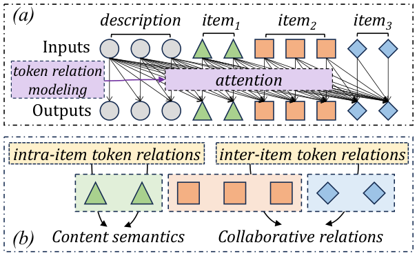
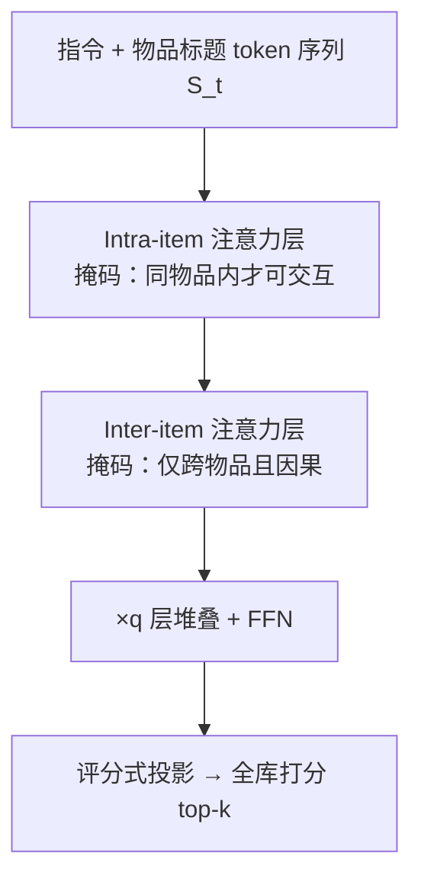
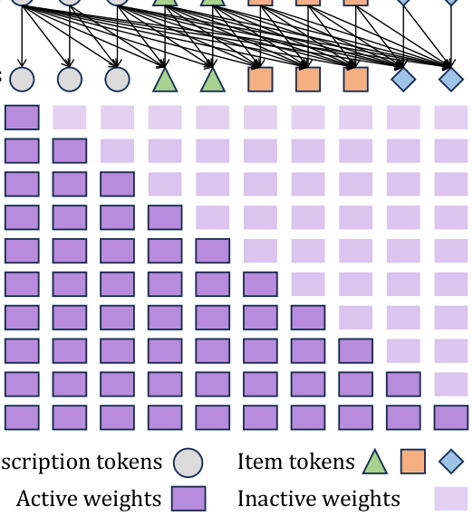

# From Token to Item: Enhancing Large Language Models for Recommendation via Item-aware Attention Mechanism (从词元到物品：面向 LLM 推荐的物品感知注意力机制)

- **会议/期刊**: WWW 2026
- **作者与机构**: Xiaokun Zhang, Bowei He, Jiamin Chen, Ziqiang Cui, Chen Ma（香港城市大学）
- **推荐链路定位**: 精排（序列下一物品全库打分）
- **研究方向**: 大语言模型推荐 / 序列与会话推荐
- **论文原文**: [https://arxiv.org/abs/2603.19693v2](https://arxiv.org/abs/2603.19693v2)
- **开源代码**: 暂未开源

## TL;DR (1分钟核心速览)

现有 LLM 推荐把物品标题展开为 token 序列后直接套用标准因果自注意力，只建模 token-token 关系，丢失了"物品"作为推荐基本单元的协同语义。本文提出 IAM：每层串联物品内注意力（限同一物品内 token，刻画内容语义）与物品间注意力（只跨物品 token，捕获协同信号）。在 Amazon Grocery/Arts/Cellphones、`5-core` + 时间 8:1:1 划分、全库 **Full-Ranking** 协议下，IAM **不注入任何 ID / 协同 token**，较最优基线 Prec@10 提升 25.81% / 6.80% / 71.00%。

## Background & Motivation (背景与核心矛盾)

- **主流范式**: LLM4Rec 将「任务描述 + 物品标题序列」拼成指令并展开为 token 序列，用 LoRA 微调做下一物品预测；协同信号以 item ID（E4SRec）、启发式重索引（P5）或 SASRec 嵌入（LLaRA）等形式作为额外 token 拼入输入。
- **前人局限**: ① *结构失配*——标准因果自注意力对所有 token 一视同仁，物品边界被抹平，而协同关系本质发生在"物品-物品"之间，token 级注意力无法对齐；② *表征受限*——协同 token 把物品压成孤立锚点，模型无法在注意力计算中反复消费物品间共现，导致 LLM 基线在 Arts 上竟不及神经模型 Atten-Mixer（37.81 Prec@10 前）。
- **核心洞察 (Key Insight)**: token 关系可按物品归属二分——**物品内 token**（名称/颜色/尺码）刻画内容语义，**物品间 token** 交互构成协同信号的通路。把两类关系解耦后，物品自然成为独立建模单元（图 1）。
- **本文切入点**: 不动输入格式、不加协同 token，只改造注意力掩码本身，让"物品"从数据组织单位上升为结构约束。

<figure class="paper-figure" markdown="span">
  <figcaption>图1：(a) 当前基于LLM的方法侧重于建模词元级关系，但未能利用物品级协同关系；(b) 物品内与物品间的词元关系分别表示物品内容语义和协同关系。</figcaption>
</figure>

## Method (核心方法设计)

### 1. 整体框架 (Overall Architecture)

输入仍是指令 + 物品标题序列 $S_t=[v_1,\dots,v_l]$，token 接口完全不变。在每个 LLM 块内，把标准自注意力替换为 IAM 块：先做物品内注意力、再做物品间注意力，两层各自持有独立$Q/K/V$投影、掩码严格互补，重复$q$次（与骨干深度对齐：Llama3-3B 为$q=28$）后接常规 FFN。末端按 LLaRA 的**评分式范式**把隐层输出经投影矩阵映射为全库打分向量$\hat{y}\in\mathbb{R}^{n}$，取 top-$k$ 排序。全流程仅训练 LoRA，不引入额外编码器。

### 2. 关键设计拆解 (Key Designs)

1. **物品内注意力层 (Intra-item Attention)**：让物品回归"独立内容单元"。在标准打分 $\alpha_{ij}=(Qe_i)^{\top}(Ke_j)$上追加物品归属掩码，仅保留同物品 token 交互，等价于对每件物品独立做一次内容编码；物理直觉是阻断跨物品"串味"，使$h_i$ 精确聚合该物品的名称/颜色/尺码等属性。
   $$f_{\text{intra}}(\alpha_{ij})=\begin{cases}\alpha_{ij}, & m_i=m_j \ \text{且}\ i\ge j\\ 0, & \text{otherwise}\end{cases}$$
   其中 $m_i$为 token$v_i$ 所属物品索引。

2. **物品间注意力层 (Inter-item Attention)**：显式构造协同通路。掩码方向完全翻转，只允许跨物品且满足因果约束的 token 交互；于是物品 $x_u$的每个 token 都能直接"看见"历史物品$x_{u'}(u'<u)$ 的全部 token，共现模式被逐 token 加权聚合，等价于在注意力内部完成一次物品级协同扩散，而无需任何外部 ID/嵌入 token。
   $$f_{\text{inter}}(\alpha_{ij})=\begin{cases}\alpha_{ij}, & m_i\ne m_j \ \text{且}\ i\ge j\\ 0, & \text{otherwise}\end{cases}$$

3. **训练目标、负采样与推理效率**：采用交叉熵对齐下一物品标签 $\mathcal{L}=-\log\hat{y}_{x_{t+1}}$，**免负采样**直接对物品全集$\mathcal{X}$打分，与 Full-Ranking 评测完全一致；LoRA 秩$r=8$、$\alpha=16$、dropout 0.05，可训练参数极少。代价是每块注意力 FLOPs 约为标准块的 2 倍（原文未给时延实测）。

<figure class="paper-figure" markdown="span">
  <figcaption>图3：因果自注意力机制及其注意力矩阵。</figcaption>
</figure>

## Experimental Setup & Evaluation Protocol (实验设置与评估协议)

- **数据集与预处理**（Amazon 三个域，均做 `5-core` 过滤）：

| 数据集 | #Users | #Items | #Interactions | 密度 | 平均序列长 / 场景 |
| :--- | :---: | :---: | :---: | :---: | :--- |
| Grocery | 6,025 | 1,874 | 44,921 | 0.0040 | 7.46 / 食品日用 |
| Arts | 17,432 | 4,265 | 134,105 | 0.0018 | 7.69 / 艺术工艺品 |
| Cellphones | 17,639 | 6,593 | 114,605 | 0.00099 | 6.50 / 手机配件 |

- **数据划分与防穿越 (Splitting Strategy)**: 每个用户序列**按时间戳 8:1:1 比例切分**训练/验证/测试，序列最后一个物品为标签、前置物品为历史；5-core 在划分前完成，无跨用户信息泄漏。
- **排名评测协议 (Ranking Protocol)**: 无偏 **Full-Ranking（全库未交互排序）**，模型对 $|\mathcal{X}|$全量打分；指标为 Prec@5/10、NDCG@5/10（文中 Prec@$k$ 实为命中率定义）。
- **对比基线与超参设置**: 9 个基线，含 5 个神经模型（GRU4Rec / NARM / SASRec / SR-GNN / Atten-Mixer）与 4 个 LLM 方法（Llama / P5 / E4SRec / LLaRA）；骨干 Llama3-3B，5 次独立运行取均值，$t$-test 显著性$p<0.01$。

## Key Experimental Results (实验关键数据)

### 1. 主实验对比 (Main Results)

| 方法 | Grocery Prec@10 | Grocery NDCG@10 | Arts Prec@10 | Arts NDCG@10 | Cell Prec@10 | Cell NDCG@10 |
| :--- | :---: | :---: | :---: | :---: | :---: | :---: |
| GRU4Rec | 11.66 | 9.07 | 30.40 | 23.21 | 3.78 | 2.81 |
| NARM | 13.37 | 11.69 | 33.01 | 30.76 | 4.18 | 2.87 |
| SASRec | 13.05 | 11.22 | 34.87 | 32.57 | 4.65 | 2.93 |
| Atten-Mixer | 13.66 | 11.81 | 37.81 | 34.62 | 5.15 | 3.50 |
| Llama | 13.70 | 11.84 | 34.28 | 32.00 | 4.10 | 2.08 |
| P5 | 13.48 | 11.92 | 36.68 | 33.86 | 4.84 | 3.17 |
| E4SRec | 13.44 | 11.63 | 33.78 | 30.93 | 5.00 | 3.02 |
| LLaRA | 13.83 | 12.08 | 35.83 | 33.96 | 5.38 | 3.24 |
| **IAM** | **17.40** | **13.29** | **40.38** | **35.91** | **9.20** | **6.12** |
| **Improv.%（vs 最优基线）** | **+25.81%** | **+10.04%** | **+6.80%** | **+3.74%** | **+71.00%** | **+74.86%** |

> 原文声明的 12 项指标平均增益为 34.54%；IAM 在所有数据集、所有指标上均取得最优，且优于全部 9 个基线。

### 2. 消融实验 (Ablation Study)

原文 RQ2/RQ3 的消融与超参敏感性实验正文置于 Section 5 之后，摘录文本仅给出引用但未附数值表。按设计可预期的三档对照为：

| 配置 | 关键差异 | 预期影响方向 |
| :--- | :--- | :--- |
| w/o Intra-item（仅保留跨物品注意力） | 物品内容语义被打散，token 无法聚合为物品语义 | Grocery/Arts 等标题信息丰富数据集跌幅最大 |
| w/o Inter-item（退化为逐物品独立编码） | 无跨物品协同通路，等价于"无协同 token 的 Llama" | Cellphones 长尾场景跌幅最大 |
| 全程标准因果注意力（= Llama 基线） | 无物品单元约束 | 主表中已给出下界 |
| 超参 $q$（重复次数） |$q$ 越大物品级约束越深 | 存在信息过压缩的拐点 |

### 3. 关键实验发现 (Key Findings)

1. **增益与稀疏度强相关**：Cellphones 序列最短（6.50）、物品最多（6,593），IAM 的 Prec@10/NDCG@10 增益却高达 +71.00%/+74.86%。说明协同信号越稀缺，把"共现"直接铺到注意力路径上的收益越被放大。
2. **增益主要来自"拉进列表"而非"重排位置"**：Grocery 上 Prec@10 提升（+25.81%）远大于 NDCG@10（+10.04%），表明 IAM 把原本排在 top-10 之外的真值拉进候选列表，扩大的是有效召回覆盖，而非优化既有命中序位。
3. **现有 LLM 基线的 benchmark 偏弱**：Arts 上 P5（36.68）、LLaRA（35.83）均不及纯神经的 Atten-Mixer（37.81），而 IAM 不注入任何协同 token 仍达 40.38，反证协同信息可隐式来自注意力结构本身，不必然依赖额外 ID/嵌入。

## Highlights & Limitations (亮点、对比与审稿批判)

- **与代表作对比 (vs. Prior Work)**: 与 E4SRec / P5 / LLaRA 的本质区别在于——它们从**输入端**注入协同 token（item ID、启发式重索引、SASRec 嵌入），但注意力仍是 token 级统一的；IAM 从**注意力结构端**注入物品边界，且完全不用协同 token。与 Atten-Mixer 的区别在于后者靠切分子序列 + 额外的外部网络建模共现，而 IAM 把物品级建模内化进 LLM 自身的前向计算。
- **可迁移亮点**: ① "双掩码解耦注意力"无需额外归一化器与辅助损失，可在任意 Transformer 序列推荐中直接替换标准自注意力；② 用物品分段边界作为掩码的超信息，成本几乎为零却能显著改变归纳偏置。
- **审稿级局限批判**: ① **推理开销翻倍**——每块串两层注意力、堆叠 28 次，文中未给 FLOPs/显存/时延实测，工业部署存在硬伤；② **评估覆盖不足**——消融与超参研究的数值在正文缺失，难以判断两层各自贡献，且基线未覆盖生成式检索类（如 TIGER / 语义 ID）方法；③ 全库投影打分在百万级物品集上的成本未讨论，序列内物品边界的位置标注也是一项隐性假设。

## Rating (四维评分)

- **方法创新性 (Novelty)**: ⭐⭐⭐⭐ （"把物品单元从数据组织上升为注意力结构约束"的视角转换清晰且低成本，但本质是双掩码注意力，机制偏简单，缺乏理论或谱分析支撑）
- **评估协议与实验扎实度 (Protocol & Experiments)**: ⭐⭐⭐⭐ （3 域 × 9 基线 + Full-Ranking + 5 次运行 + $t$ 检验，说服力较强；但摘录中缺失消融与超参敏感性数值，且未覆盖生成式检索类基线）
- **写作与数学规范度 (Clarity & Rigor)**: ⭐⭐⭐⭐ （动机—结构失配—双掩码设计的逻辑链干净，物品边界掩码的形式化直观；但对因果约束与物品内/间交互的叠加细节、复杂度分析着墨较少）
- **工业落地与复现价值 (Industrial & Practical Value)**: ⭐⭐⭐ （"无需协同 token 仅靠结构改造"在工程上有吸引力，但 3B LoRA + 注意力层翻倍的在线时延与显存代价显著，且暂未开源）

