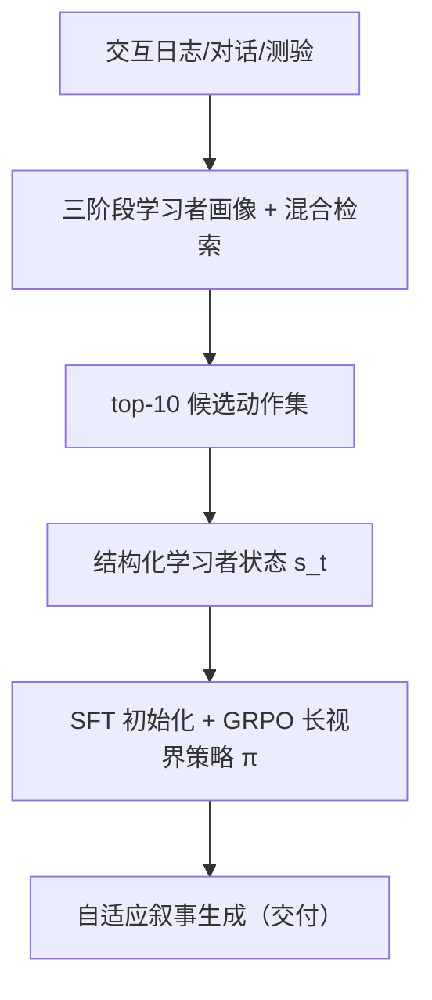
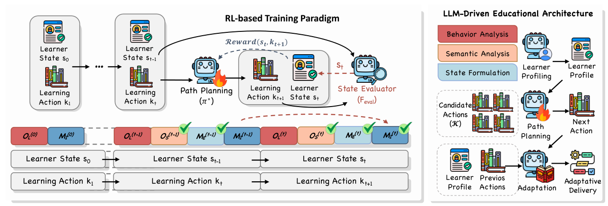
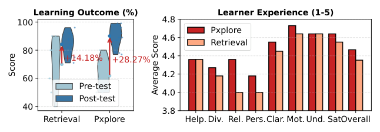

# Personalized Learning Path Planning through Goal-Driven Learner State Modeling (目标驱动学习者状态建模的个性化学习路径规划)

- **会议/期刊**: WWW 2026
- **作者与机构**: Joy Jia Yin Lim, Ye He, Jifan Yu 等；清华大学计算机系、教育研究院、统计与数据科学系
- **推荐链路定位**: 重排（候选学习动作集上的下一步动作选择）
- **研究方向**: 大语言模型推荐 / 强化学习与动态探索推荐
- **论文原文**: [https://arxiv.org/abs/2510.13215v2](https://arxiv.org/abs/2510.13215v2)
- **开源代码**: [https://github.com/Pxplore/pxplore-algo](https://github.com/Pxplore/pxplore-algo)

## TL;DR (1分钟核心速览)

个性化学习路径规划（PLPP）的核心痛点是现有 LLM 方案**缺乏目标对齐的长视界规划**，且短期单步决策短视、无法追踪动态演进的学习者状态。本文 Pxplore 提出四维结构化学习者状态模型（长/短期目标 + 内隐/外显动机）与**把抽象教学目标转化为可计算标量奖励**的自动化奖励函数，先用 SFT 初始化再用 GRPO 强化学习精调策略。在候选动作集（top-10）上，Pxplore-Qwen3 平均对齐率 **65.47%**（相对 GPT-4o 52.52% 提升 24.7%），并优于带推理引导的 GPT-4o（58.48%）；真实 22 人用户研究中学习增益从 61.81% 提升至 90.09%（+28.28%）。

## Background & Motivation (背景与核心矛盾)

- **主流范式**: 早期 PLPP 依赖协同过滤与知识图谱匹配预定义资源，近期转向 LLM 做可扩展学习者建模与内容自适应生成。
- **前人局限**: ①传统方法受限于预定义资源与静态画像，路径碎片化且不灵活；②LLM 方案多为**单步贪心/短视决策**，缺少捕捉长期学习进展的机制，且会把抽象的"好奇心/深度理解"等目标丢掉、输出无结构、有幻觉。
- **核心洞察 (Key Insight)**: 学习是**目标驱动的多步过程**，其收益来自累计教育影响，必须把抽象教学目标转成可优化的计算信号才能做长视界 RL 优化。
- **本文切入点**: 提出结构化、LLM 可填充的 Learner State 表示（状态可演进），并把"状态从未对齐→对齐"的转移定义为标量奖励，用 GRPO 优化长程策略。

## Method (核心方法设计)

### 1. 整体框架 (Overall Architecture)

Pxplore 把 PLPP 建模为马尔可夫决策过程：状态 $s_t$是结构化学习者状态，动作$k \in \mathcal{K}$为原子学习单元（概念解释/例题/练习），目标是最大化带折扣的累计教育奖励$\pi^* = \arg\max_\pi \mathbb{E}_\pi[\sum_t \gamma^{t-1}\mathcal{R}(s_t, k_{t+1})]$。训练侧先构建 300 条会话（14,584 轮交互）的专家数据集做 SFT 行为克隆，再用 GRPO 在群组内做方差缩减的长期价值优化。部署侧分两阶段：规划前用三阶段画像 + 混合检索（BM25 + 稠密向量）构建 top-10 候选；规划后由交付模型生成"叙事桥"把离散动作衔接为连贯学习流。

<figure class="paper-figure" markdown="span">
  <figcaption>图2：Pxplore框架概览，包括：(1) 基于强化学习的训练范式，用于目标对齐的学习路径规划；(2) LLM驱动的教育架构，用于自适应画像、规划与交付。</figcaption>
</figure>

### 2. 关键设计拆解 (Key Designs)

1. **四维结构化学习者状态建模**: 针对现有画像静态/无结构的痛点，将状态定义为 $s_t=(O_L^{(t)}, O_S^{(t)}, M_I^{(t)}, M_E^{(t)})$，每个组件$c=\{\text{description},\text{metric},\text{evidence},\text{confidence},\text{status}\}$，status 取 `[NOT_ALIGNED]`/`[ALIGNED]`。状态转移由评估器 LLM 完成：$s_{t+1}=F_{eval}(s_t, I_t)$，既更新已有组件状态，也追加交互中浮现的新组件——这让抽象目标变成可追踪、可演进的对象，是后续奖励计算的基础。

2. **自动化抽象奖励函数**: 教育奖励难以量化是核心卡点。作者定义指示函数 $\phi$与置信度$\text{conf}$，只奖励**新对齐**的组件：
$$\mathcal{R}(s_t,k_{t+1})=\sum_{c\in C(s_{t+1})} w_c\cdot\text{conf}(s_{t+1},c)\cdot[\phi(s_{t+1},c)-\phi(s_t,c)]$$
差分项 $\phi(s_{t+1},c)-\phi(s_t,c)$ 保证只有状态真正推进时才给正奖励，避免重复计分，直接将策略推向目标达成方向。

3. **SFT + GRPO 两阶段训练与推理**: 先用行为克隆 $\mathcal{L}_{SFT}=-\mathbb{E}_{(s,k^*)\sim\mathcal{D}}[\log\pi_\theta(k^*|s)]$获得局部最优的策略初始化；再用群组相对优势$\hat{A}_t^{grp}=\frac{A_t-\mu_g}{\sigma_g+\epsilon}$（$A_t=R_t+\gamma V(s_{t+1})-V(s_t)$）做 GRPO，缓解异构奖励分布下的高方差。推理时策略对候选$k^*_{t+1}=\arg\max_{k\in\mathcal{K}_c}\mathbb{E}_{\pi_\theta}[\mathcal{R}(s_t,k)+\gamma V(s_{t+1})]$排序，无需额外负采样；候选集构建用$\text{score}(k)=\alpha\,\text{BM25}(p_t,k)+(1-\alpha)\,\text{sim}_{dense}(p_t,k)$，过滤已学动作。

## Experimental Setup & Evaluation Protocol (实验设置与评估协议)

- **数据集与预处理**: 来自真实在线学习平台的 300 条会话，含 250 训练 / 50 测试，标注四维组件（$O_L$326、$O_S$401、$M_I$338、$M_E$ 350）。

| 数据集 | #Sessions | #Interactions | #O_L | #O_S | #M_I | #M_E | 场景 |
| :--- | :---: | :---: | :---: | :---: | :---: | :---: | :--- |
| Train | 250 | 11,328 | 273 | 325 | 275 | 288 | 真实平台会话 |
| Test | 50 | 3,256 | 53 | 76 | 63 | 62 | 同分布留出 |
| Total | 300 | 14,584 | 326 | 401 | 338 | 350 | — |

- **数据划分与防穿越**: 按**会话级留出**划分（250/50），测试集与训练集无重叠；SFT 阶段用三专家标注"最优下一动作" $k^*$ 作为监督信号。
- **排名评测协议**: 采用**采样候选集内的 Full 排序**（每个状态检索 top-10 候选），主指标为动作与专家"best"选择的**对齐率 (Alignment Rate)** 与**奖励值 $\mathcal{R}(\cdot)$**；规划模块另用 `Precision@1` 与 `NDCG@k (k=1,3,5,7,10)` 做列表质量排序评估。
- **对比基线与超参**: 3 组基线——①zero-shot 提示 LLM（GPT-4o、4o-mini、Qwen3-8B、Llama3.1-8B-Instruct）；②推理引导 LLM（额外注入预定义 Learner State）；③SFT 变体。温度、$\gamma$、$w_c$等见附录，显著性由双人标注一致性（Pearson$r>0.8$）与三类 LLM-judge 佐证。

## Key Experimental Results (实验关键数据)

### 1. 主实验对比 (Main Results)

| 模型 | $O_L$|$O_S$|$M_I$|$M_E$| Avg 对齐率 | Total$\mathcal{R}$ |
| :--- | :---: | :---: | :---: | :---: | :---: | :---: |
| GPT-4o | 53.45 | 40.23 | 69.23 | 51.47 | 52.52 | 145.8 |
| 4o-mini | 37.93 | 23.46 | 49.23 | 35.29 | 35.66 | 97.0 |
| Qwen3 | 37.70 | 31.82 | 49.28 | 41.89 | 39.73 | 116.0 |
| Llama3.1 | 36.21 | 32.56 | 56.72 | 49.25 | 43.17 | 120.0 |
| GPT-4o$_{Infer}$ | 61.29 | 40.91 | 74.63 | 62.50 | 58.48 | 169.0 |
| Qwen3$_{Infer}$ | 56.67 | 36.47 | 63.24 | 57.97 | 52.48 | 148.0 |
| Qwen3$_{SFT}$ | 65.00 | 55.81 | 71.01 | 60.87 | 62.68 | 178.0 |
| **Pxplore$_{Qwen3}$** | **66.10** | **58.33** | 76.12 | 63.24 | **65.47** | **182.0** |
| Pxplore$_{Llama3.1}$ | 63.33 | 47.67 | **80.30** | **67.14** | 63.48 | 179.0 |
| **Improv.% vs GPT-4o** | +23.7 | +45.0 | +9.9 | +22.9 | **+24.7** | +24.8 |

### 2. 消融实验 (Ablation Study)

| 设置 | Avg 对齐率 | Total $\mathcal{R}$ | 说明 |
| :--- | :---: | :---: | :--- |
| 4o-mini 提示 | 35.66 | 97.0 | 无结构化状态 |
| 4o-mini$_{Infer}$ | 52.33 | 146.0 | +注入 Learner State |
| Qwen3$_{SFT}$ | 62.68 | 178.0 | 仅 SFT，无 GRPO |
| Pxplore$_{Qwen3}$ | **65.47** | **182.0** | SFT + GRPO 完整 |

### 3. 关键实验发现 (Key Findings)

1. **状态注入带来最大跳变**：4o-mini 从 35.66% → 52.33%（+16.7pt），远大于 SFT 带来的 62.68%→65.47% 的边际提升，证明**结构化状态表征是收益主来源**，GRPO 是进一步精调。
2. **小模型可越级超越大模型**：Pxplore-Qwen3-8B（65.47%）> GPT-4o$_{Infer}$（58.48%）约 7pt，且总奖励 182 vs 169，说明**目标对齐的 RL 训练比更大参数量更有效**。
3. **交付模块的收益集中在情感维度**：真实用户研究中 Pxplore 在 Motivation（4.73）与 Satisfaction（4.64）显著领先，学习增益 +28.28% vs 基线 +14.18%；交付侧 Motivation +17.2%、Personalization +14.9%，但 Conciseness 仅 +3.1%，反映**以情感与个性化换取轻微冗余**的设计权衡。

<figure class="paper-figure" markdown="span">
  <figcaption>图7：Pxplore与基于检索的基线在学习成果和学习者体验方面的比较。</figcaption>
</figure>

## Highlights & Limitations (亮点、对比与审稿批判)

- **与代表作对比**: 相较传统 CF/KG 方法（预定义资源、静态画像）与纯提示 LLM（短视、易幻觉），Pxplore 首次把"抽象教学目标→可计算奖励"打通；相较 RL4Edu 的模拟器范式，本文用 SFT+GRPO 在真实平台数据上做策略优化并完成部署闭环。
- **可迁移亮点**: ①"状态对齐差分"奖励 $\phi(s_{t+1},c)-\phi(s_t,c)$ 可迁移到任何**稀疏稀疏进展型**任务（如课程学习、技能树、旅行路线）；②画像三阶段（行为→语义→合成）与 BM25+稠密混合检索是低成本高鲁棒性的候选构建范式。
- **审稿级局限批判**: ①**评估规模偏小**——仅 50 测试会话、22 用户、单平台，跨学科泛化性未验证；②奖励函数依赖 LLM 评估器 $F_{eval}$与人工设定的$w_c$，**评估器噪声与权重敏感度**未做系统消融；③策略推理需对每个候选调用 LLM 打分（top-10 × 每步），在线延迟与成本未量化。

## Rating (四维评分)

- **方法创新性 (Novelty)**: ⭐⭐⭐⭐ （四维结构化状态+差分式抽象奖励把教育目标转为可优化信号，思路新颖且可直接用于长视界推荐）
- **评估协议与实验扎实度 (Protocol & Experiments)**: ⭐⭐⭐ （含主实验/模块/真实用户三层评估，但测试会话仅 50、用户仅 22，跨域泛化与显著性检验偏弱）
- **写作与数学规范度 (Clarity & Rigor)**: ⭐⭐⭐⭐ （MDP 形式化、奖励与 GRPO 公式清晰，状态组件定义完整，符号一致性良好）
- **工业落地与复现价值 (Industrial & Practical Value)**: ⭐⭐⭐⭐ （已在真实平台部署、代码数据集开源，混合检索与两段式架构易于迁移，但推理成本需进一步优化）

