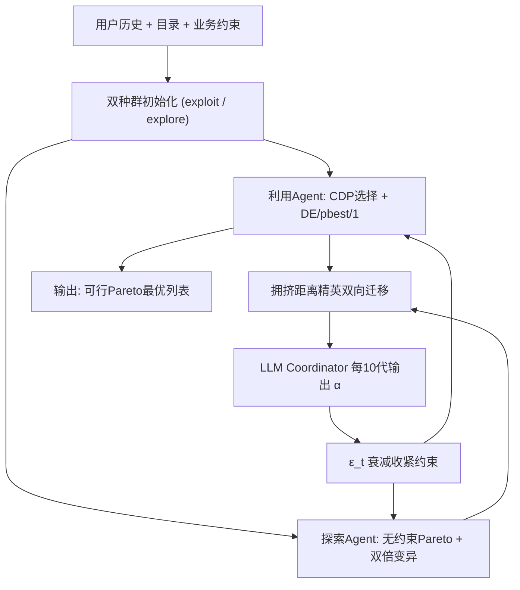
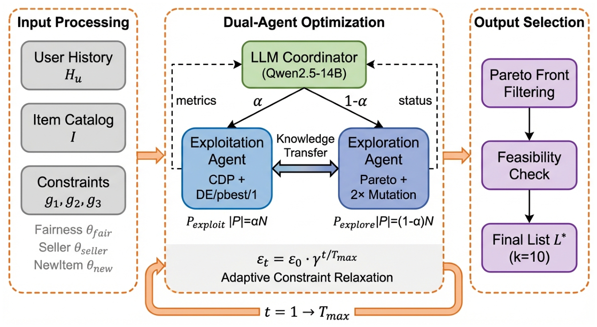
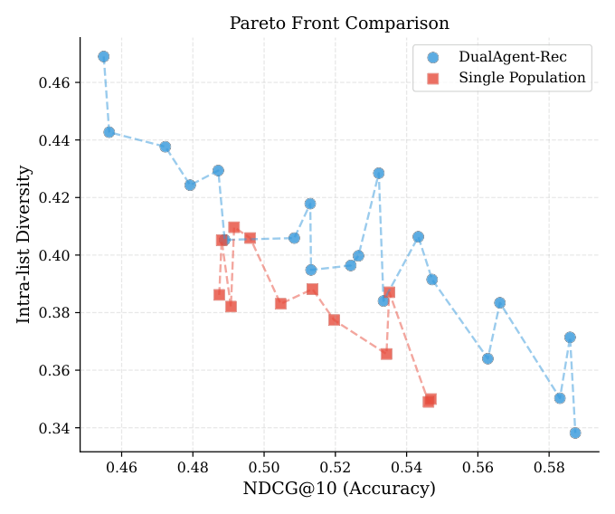

# LLMs as Orchestrators: Constraint-Compliant Multi-Agent Optimization for Recommendation Systems (大模型作为编排者：面向推荐系统的约束合规多智能体优化)

- **会议/期刊**: WWW Companion 2026 (8 页短文)
- **作者与机构**: Guilin Zhang, Kai Zhao, Jeffrey Friedman, Xu Chu (Workday, Pleasanton, CA)
- **推荐链路定位**: 重排 / 列表级优化（输出定长 $k=10$ 列表）
- **研究方向**: 多任务学习与列表级重排 / 大语言模型推荐 (LLM4Rec)
- **论文原文**: [https://arxiv.org/abs/2601.19121v3](https://arxiv.org/abs/2601.19121v3)
- **开源代码**: [https://github.com/GuilinDev/Dual-Agents-Recommendation](https://github.com/GuilinDev/Dual-Agents-Recommendation)

## TL;DR (1分钟核心速览)

工业推荐常需在"每一次"曝光中都满足公平性、卖家覆盖、新品配额等**硬约束**，而现有多目标推荐把约束写成软惩罚、LLM 智能体又只做打分与对话，导致线上频繁违规。本文把列表生成建模为约束多目标优化，用**双种群差分演化 + LLM 调度器 + 自适应 ε-松弛**求解：利用 Agent 走约束支配 (CDP) 保可行，探索 Agent 走无约束 Pareto 找多样性，LLM 每 10 代输出资源配比 $\alpha$。在 Amazon Reviews 2023 三个类目上实现 **100% 可行性**，Pareto 超体积 (HV) 相比单种群基线最高提升 4–6%。

## Background & Motivation (背景与核心矛盾)

- **主流范式**: 多目标推荐（MultiTRON、Deep Pareto RL 等）以加权标量化或 Pareto 前沿逼近来刻画精度-多样性权衡；LLM4Rec（CARTS、ARAG、GRACE 等）则聚焦物品打分、对话交互与理由生成。
- **前人局限**: (i) 公平/覆盖/新品曝光几乎都被写成软惩罚或后置过滤，**没有可行性保证**，部署中违约率居高不下；(ii) EVO 类约束优化（约束支配、ε-约束法）虽在基准函数上成熟，但直接搬到推荐里常因过度强化可行性而提前收敛到狭窄可行盆地，解质量崩坏。
- **核心洞察**: 约束推荐是一个"可行域可能极窄"的问题，**单一搜索过程无法同时承担"守住可行域"与"跳出可行域找更优前沿"两个矛盾目标**——需要结构化分工，而非更好的单一算子。
- **本文切入点**: 把探索/利用拆成两个独立种群，用 LLM 做高层"资源调度器"而非物品打分器，再用逐步收紧的 ε-松弛把早期不可行解"回收"为最终严格可行解。

## Method (核心方法设计)

### 1. 整体框架 (Overall Architecture)

输入为用户历史 $H_u$、物品目录$\mathcal{I}$与三类业务约束阈值；每个候选列表$L\subseteq\mathcal{I}$被表示为演化空间中的一个个体，由三个目标$f(L)=[f_1,f_2,f_3]$（相关性、列表内多样性、新颖性）与三个硬约束$g_j(L)\le 0$（类目 Gini$\le\theta_{fair}$、去重卖家数$\ge\theta_{seller}k$、30 天内新品数$\ge\theta_{new}k$）共同评价。每一代两个种群并行演化并交换精英解；每$T=10$代调用一次本地 Qwen2.5-14B，读取 HV、改进率、可行率与平均违反量，输出配比$\alpha$决定$|P_{exploit}|=\lfloor\alpha N\rfloor$。最终只从利用种群的**严格可行**个体中取最优解作为推荐列表。

<figure class="paper-figure" markdown="span">
  <figcaption>图1：DualAgent-Rec 框架架构，包含三阶段流水线。输入处理：编码用户历史、物品目录和业务约束（公平性、卖家覆盖、新品曝光）。双智能体优化：LLM Coordinator 在 Exploitation Agent（基于 CDP 的选择）与 Exploration Agent（变异率加倍）之间动态分配资源（𝛼）。双向知识迁移交换精英解。自适应 𝜖-松弛逐步收紧约束。输出选择：过滤 Pareto 最优可行解以生成最终推荐。</figcaption>
</figure>

### 2. 关键设计拆解 (Key Designs)

1. **双种群异质选择（利用 vs. 探索）**：痛点在于统一搜索要么被约束压死、要么被不可行解污染前沿。利用 Agent 用**约束支配原则** (CDP) 做字典序选择（可行 > 不可行，不可行中违反小者优先，可行内用 Pareto 支配），并用 `DE/pbest/1` 把子代偏向历史最优个体，加速可行域内精修；探索 Agent 则**完全忽略 $g_j$**、变异率加倍，专门在窄可行域外围采集遗传材料。直觉：可行域窄时，严格约束从第 0 代就执行必然早熟，必须留一个"无纪律"种群做多样性蓄水池。
2. **拥挤距离驱动的双向知识迁移**：两 Agent 若各演化则互不受益。每代取并集后按拥挤距离截断精英集 $L_{transfer}=\mathrm{TopK}(P_{exploit}\cup P_{explore},\ \text{crowding})$，高拥挤距离对应 Pareto 前沿稀疏区，因此交换的是"补空白"的解而非冗余解——这一步同时抑制了两个子种群的同质化。
3. **自校准 ε-松弛与 LLM 调度**：约束从第 0 代就硬执行会压缩搜索空间，故令 $\epsilon_t=\epsilon_0\cdot\gamma^{\,t/T_{max}}$，其中$\epsilon_0$取初始种群违反量的 **80 分位数**（保证约 20% 早期解被视作"可行"），$\gamma=0.8$平滑衰减至严格可行；LLM 侧则学习出与人工规则同向但自适应的策略：早期$\alpha\approx0.60$，中期 0.72，后期 0.80，一旦可行率跌破 80% 自动回落到 0.55（表 5）。总目标是演化搜索而非梯度损失，整体复杂度约为单种群的$2\times O(NM)$，50 代 /$N=100$ 平均 35s。

## Experimental Setup & Evaluation Protocol (实验设置与评估协议)

- **数据集与预处理**: Amazon Reviews 2023 三个类目（小/中/大目录），每个类目**采样 100 名交互数 ≥ 10 的用户**，并使用类目层级、卖家 ID、时间戳三元元数据构造约束：

| 数据集 | #Users | #Items | #Reviews | 稀疏度/密度 | 特征/场景说明 |
| :--- | :---: | :---: | :---: | :---: | :--- |
| All_Beauty | 134 | 286 | 30K | 极高稀疏 | 小目录、偏好集中 |
| Electronics | 1,205 | 2,847 | 580K | 高稀疏 | 大目录、规格异构 |
| Clothing_Shoes_Jewelry | 2,118 | 4,521 | 1.2M | 中稀疏 | 最大类目、季节性强 |
| 采样评测集 | 300 (3×100) | 7,654 | – | – | 每用户 ≥10 交互 |

- **数据划分与防穿越**: 未明确给出 Leave-One-Out / 全局时间戳切分的正式描述，仅提及 NDCG@10 使用 held-out 交互计算；**约束判定（如"30 天内新品"）依赖物品时间戳，但未说明是否对齐训练/测试时间边界**，存在穿越风险。
- **排名评测协议**: 未声明是 Full-Ranking 还是 Sampled Ranking（未给正负采样比）；NDCG@10 实为对最终输出的 10 条列表直接计算，**属于列表质量指标而非全库排序指标**；可行性率 = 满足全部三个约束的列表占比（生产级硬指标）。
- **对比基线与超参**: 对照全部为**自身消融变体**（w/o LLM 固定 $\alpha=0.7$、Single Population 合并 200 个体、w/o Constraints），未与 MultiTRON / Deep Pareto RL / 公平性约束推荐等外部 SOTA 对比。$N=100$、$T_{max}=50$、$k=10$、$T=10$、$\gamma=0.8$，约束阈值$\theta_{fair}=0.6,\theta_{seller}=0.2,\theta_{new}=0.1$，3 次独立重复取均值，未做显著性检验。

## Key Experimental Results (实验关键数据)

### 1. 主实验对比 (Main Results)

| 方法 | HV↑ | NDCG@10↑ | Diversity↑ | Feasibility↑ |
| :--- | :---: | :---: | :---: | :---: |
| w/o Constraints（纯 Pareto） | **0.160** | 0.562 | **0.343** | 72% |
| Single Population | 0.152 | 0.549 | 0.238 | 100% |
| w/o LLM（固定 $\alpha$=0.7） | 0.155 | 0.577 | 0.251 | 100% |
| **DualAgent-Rec** | 0.156 | **0.581** | 0.247 | **100%** |
| Improv. vs Single Pop. | +2.6% | +5.8% | +3.8% | 持平 |

跨类目（表 3）：All_Beauty 0.168/**0.612**/0.285，Electronics 0.152/0.568/0.234（vs Single Pop. 0.144，**+5.6%**），Clothing 0.148/0.563/0.222；目录越大增益越明显。

### 2. 消融实验 (Ablation Study)

| 参数 | 设置 | HV | NDCG@10 | Div. | 时间 |
| :--- | :--- | :---: | :---: | :---: | :---: |
| 种群规模 | 50 / 100 / 200 | 0.160 / 0.156 / 0.154 | 0.573 / **0.581** / 0.540 | 0.271 / 0.247 / **0.342** | 5.2s / 17.5s / 66.4s |
| 变异率 | 0.05 / 0.1 / 0.2 | 0.155 / 0.156 / 0.156 | 0.548 / **0.581** / 0.556 | 0.307 / 0.247 / 0.307 | ≈19s |
| 约束强度 | 严 $\theta$=0.7 / 常规 0.6 / 松 0.5 | 0.086 / 0.157 / **0.160** | **0.600** / 0.549 / 0.515 | 0.200 / 0.311 / **0.343** | 16–23s |
| 迭代代数 | 20 / 50 / 100 | 0.157 / 0.156 / 0.156 | 0.532 / **0.581** / 0.577 | **0.360** / 0.247 / 0.253 | 13s / 34s / 71s |

### 3. 关键实验发现 (Key Findings)

1. **可行性保障来自 ε-松弛而非 LLM**：所有带约束方法均达 100% 可行，而关闭约束后 HV 最高 (0.160)、多样性最高 (0.343)，但可行率仅 **72%**——说明"最优 HV"与"可部署"在硬约束场景下确实互斥，本文的 ε 机制把这两者用可控代价（HV 仅损失 2.5%）分开。
2. **LLM 调度的量化收益其实很薄**：0.155→0.156（约 +0.6% HV），远小于双种群结构本身带来的 +2.6%；真实价值在于可解释性（表 5 给出"HV 停滞→降 α 至 0.60 逃离局部最优"的自然语言理由）与免手工调参，而非精度。
3. **约束强度是唯一的一阶敏感因子**：$\theta$ 从 0.5 收紧到 0.7 使 HV 从 0.160 骤降至 0.086（−46%），而 NDCG 反升至 0.600，变异率在 0.05–0.2 内 HV 几乎不变（0.155–0.156），说明该框架真正需要人工决策的只有业务阈值本身。

<figure class="paper-figure" markdown="span">
  <figcaption>图4：DualAgent-Rec 与 Single Population 基线在准确率-多样性权衡空间中的 Pareto 前沿比较。双智能体框架实现更好的分布广度与覆盖，尤其在高多样性区域，Exploration Agent 能发现统一搜索遗漏的解。</figcaption>
</figure>

## Highlights & Limitations (亮点、对比与审稿批判)

- **与代表作对比**: MultiTRON / Deep Pareto RL 用 Pareto 逼近处理权衡，把约束当附加目标，前沿被不可行解污染；CARTS / ARAG / GRACE 把 LLM 用在物品语义与对话层，优化过程仍是静态规则。本文的本质差异是**把 LLM 从"内容理解器"上移为"优化过程控制器"**，属角色创新而非模型创新。
- **可迁移亮点**: (i) "双种群 + 拥挤距离精英交换"可直接套到任何带硬配额约束的列表重排（如广告位配比、内容生态扶持）；(ii) 用初始种群违反量 80 分位数自校准 $\epsilon_0$ 的做法，是一个几乎零成本、可复用的约束松弛初始化技巧。
- **审稿级局限批判**: (i) **实验协议偏弱**——无任何外部 SOTA 基线、无显著性检验、无 Full-Ranking 声明，且仅 300 名采样用户，"4–6% HV 提升"实际来自 All_Beauty(+4.3%) 与 Electronics(+5.6%) 的分项，整体仅 +2.6%，存在选择性汇报；(ii) **工程可用性存疑**——35s 优化 vs 单种群 18s（+94% 开销）换来 +2.6% HV，且 LLM 单次调用 2–3s，距在线重排的百毫秒级要求差两个数量级；50 代后收益消失（20 代即 0.157），说明演化搜索在此规模上已接近饱和，扩展到百万级目录需先做候选剪枝。

## Rating (四维评分)

- **方法创新性 (Novelty)**: ⭐⭐⭐ （把 LLM 定位为优化编排器而非打分器有新意，但双种群演化 + CDP + ε-松弛均为 CMOEA 领域成熟组件，属组合式创新）
- **评估协议与实验扎实度 (Protocol & Experiments)**: ⭐⭐ （全部基线为自身消融、无外部 SOTA、无显著性检验、仅 300 采样用户，且主结论的提升幅度与原文宣称存在口径差异）
- **写作与数学规范度 (Clarity & Rigor)**: ⭐⭐⭐ （三目标三约束与算法伪代码交代清晰、超参消融完整，但缺少数据划分与排序协议的正式定义，复杂度分析仅停留在经验计时）
- **工业落地与复现价值 (Industrial & Practical Value)**: ⭐⭐½ （代码开源、硬约束 100% 可达是真实痛点解法，但数十秒级求解与 2–3s LLM 延迟限制其只能用于离线/准实时批处理场景）

